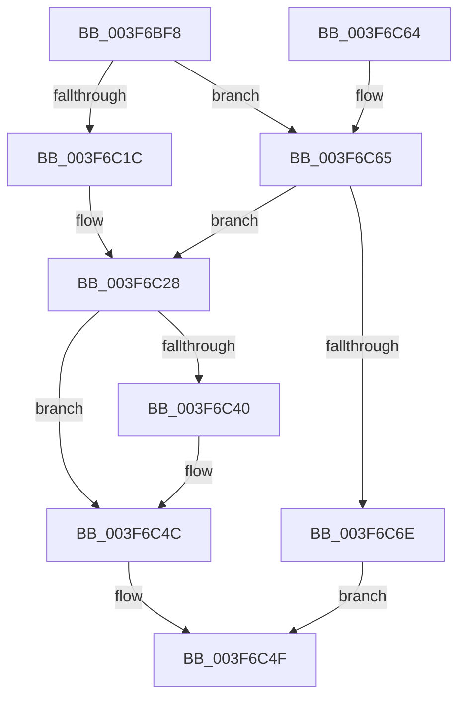

# HalpAcpiGetTable

- RVA: `0x003F6BF8`–`0x003F6C72` (길이 `122` bytes)
- VA: `0x00000001403F6BF8`
- 실행 섹션: `.text`
- PDB 이름 있음: `예`; PDB Function 태그: `아니요`
- unwind 정보 RVA: `0x00069BF8`
- 디코드: `36`개 명령, `122/122` bytes 표시
- 미해석 바이트: `0` (있으면 어셈블리에 `.byte`로 보존)

> 이 문서는 커널 이미지의 기계어와 PDB 기호를 분석해 생성했습니다. 4번과 5번은 함수 원형과 자료형을 바이너리 사용 방식에서 추정한 C 해석이며 원본 소스 복구 결과는 아닙니다.

## 1. Dependencies

- 직접 호출 지점: **4**; 고유 호출 대상: **4**
- 직접 호출자로 확인된 함수: **23**
- RIP 상대 이미지 참조: **1**

### Outgoing calls
- `0x003F6C23` → [ExAcquireFastMutex](../20/ExAcquireFastMutex_function_0020E5A0.md) (function, `0x0020E5A0`)
- `0x003F6C33` → [HalpAcpiGetTableWork](HalpAcpiGetTableWork_function_003F6CDC.md) (function, `0x003F6CDC`)
- `0x003F6C47` → [ExReleaseFastMutex](../25/ExReleaseFastMutex_function_002519C0.md) (function, `0x002519C0`)
- `0x003F6C65` → [HalpAcpiTableCacheInit](../../init/C7/HalpAcpiTableCacheInit_function_00C77650.md) (function, `0x00C77650`)

### Direct callers
- [HalAcpiGetTableEx](HalAcpiGetTableEx_function_003F6BE0.md) at `0x003F6BE4`
- [HalAcpiGetTable](../53/HalAcpiGetTable_function_0053EA00.md) at `0x0053EA0A`
- [HalMatchAcpiCreatorRevision](../53/HalMatchAcpiCreatorRevision_function_0053EA20.md) at `0x0053EA66`
- [HalMatchAcpiFADTBootArch](../53/HalMatchAcpiFADTBootArch_function_0053EAA0.md) at `0x0053EAC9`
- [HalMatchAcpiOemRevision](../53/HalMatchAcpiOemRevision_function_0053EB00.md) at `0x0053EB46`
- [HalMatchAcpiOemTableId](../53/HalMatchAcpiOemTableId_function_0053EB80.md) at `0x0053EBC5`
- [HalMatchAcpiRevision](../53/HalMatchAcpiRevision_function_0053EC60.md) at `0x0053ECA6`
- [HalpExtGetAcpiTable](../54/HalpExtGetAcpiTable_function_0054E5A0.md) at `0x0054E5AB`
- [HalpInterruptParseAcpiTables](../55/HalpInterruptParseAcpiTables_function_00557DD4.md) at `0x00557DED`
- [HalSocGetAcpiTable](../56/HalSocGetAcpiTable_function_00561580.md) at `0x0056159C`
- [HalpPowerInitFwPerformanceTableMappings](../../init/C1/HalpPowerInitFwPerformanceTableMappings_function_00C1EC34.md) at `0x00C1EC64`
- [HalpGetHotPlugMemoryInfo](../../init/C1/HalpGetHotPlugMemoryInfo_function_00C1EDF0.md) at `0x00C1EE08`
- [HalpGetHotPlugMemoryInfo](../../init/C1/HalpGetHotPlugMemoryInfo_function_00C1EDF0.md) at `0x00C1EE1E`
- [HalpExtInitExtensions](../../init/C1/HalpExtInitExtensions_function_00C1F7FC.md) at `0x00C1F89E`
- [HalpInitializeConfigurationFromMadt](../../init/C2/HalpInitializeConfigurationFromMadt_function_00C21D54.md) at `0x00C21D82`
- [HalpNumaInitializeHmaConfiguration](../../init/C2/HalpNumaInitializeHmaConfiguration_function_00C22054.md) at `0x00C2206A`
- [HalpNumaInitializeStaticConfiguration](../../init/C2/HalpNumaInitializeStaticConfiguration_function_00C220D8.md) at `0x00C22117`
- [HalpNumaInitializeStaticConfiguration](../../init/C2/HalpNumaInitializeStaticConfiguration_function_00C220D8.md) at `0x00C22131`
- [HalpNumaInitializeStaticConfiguration](../../init/C2/HalpNumaInitializeStaticConfiguration_function_00C220D8.md) at `0x00C2214B`
- [HalpNumaInitializeStaticConfiguration](../../init/C2/HalpNumaInitializeStaticConfiguration_function_00C220D8.md) at `0x00C225F4`
- [HalpPciInitializeMmConfigAccess](../../init/C2/HalpPciInitializeMmConfigAccess_function_00C23800.md) at `0x00C2381C`
- [HalpSetupAcpiPhase0](../../init/C2/HalpSetupAcpiPhase0_function_00C23EDC.md) at `0x00C23F16`
- [HalpSetupAcpiPhase0](../../init/C2/HalpSetupAcpiPhase0_function_00C23EDC.md) at `0x00C2401F`
- [HalpSetupAcpiPhase0](../../init/C2/HalpSetupAcpiPhase0_function_00C23EDC.md) at `0x00C2406D`
- [HalpSetupAcpiPhase0](../../init/C2/HalpSetupAcpiPhase0_function_00C23EDC.md) at `0x00C2415F`
- [HalpAcpiDetectMachineSpecificActions](../../init/C2/HalpAcpiDetectMachineSpecificActions_function_00C257FC.md) at `0x00C25835`
- [HalpIommuHsaDiscover](../../init/C2/HalpIommuHsaDiscover_function_00C25BE8.md) at `0x00C25C3C`
- [KsepMatchInitAcpiOemInfo](../../init/C3/KsepMatchInitAcpiOemInfo_function_00C3BB60.md) at `0x00C3BBDB`
- [CmpGetAcpiBiosVersion](../../init/C5/CmpGetAcpiBiosVersion_function_00C59BF4.md) at `0x00C59C0F`
- [CmpGetAcpiBiosVersion](../../init/C5/CmpGetAcpiBiosVersion_function_00C59BF4.md) at `0x00C59C27`
- [CmpInitializeMachineDependentConfiguration](../../init/C5/CmpInitializeMachineDependentConfiguration_function_00C5A02C.md) at `0x00C5A474`

### Static image references
- `0x003F6C1C` → RVA `0x00FC3F40` (`.data`; read)

## 2. Other-region calls and transfers

- 다른 실행 섹션으로 향하는 call: **1**
  - `0x003F6C65` → [HalpAcpiTableCacheInit](../../init/C7/HalpAcpiTableCacheInit_function_00C77650.md) (`.text` → `INIT`)
- 별도 외부 분기/꼬리 이동을 확인하지 못했습니다.

## 3. Assembly (complete function range)

```asm
003F6BF8  48 89 5C 24 08                  mov qword ptr [rsp + 8], rbx
003F6BFD  48 89 6C 24 10                  mov qword ptr [rsp + 0x10], rbp
003F6C02  48 89 74 24 18                  mov qword ptr [rsp + 0x18], rsi
003F6C07  57                              push rdi
003F6C08  48 83 EC 20                     sub rsp, 0x20
003F6C0C  49 8B F9                        mov rdi, r9
003F6C0F  49 8B F0                        mov rsi, r8
003F6C12  8B EA                           mov ebp, edx
003F6C14  48 8B D9                        mov rbx, rcx
003F6C17  48 85 C9                        test rcx, rcx
003F6C1A  75 49                           jne 0x1403f6c65
003F6C1C  48 8D 0D 1D D3 BC 00            lea rcx, [rip + 0xbcd31d]
003F6C23  E8 78 79 E1 FF                  call 0x14020e5a0
003F6C28  4C 8B CF                        mov r9, rdi
003F6C2B  4C 8B C6                        mov r8, rsi
003F6C2E  8B D5                           mov edx, ebp
003F6C30  48 8B CB                        mov rcx, rbx
003F6C33  E8 A4 00 00 00                  call 0x1403f6cdc
003F6C38  48 8B F8                        mov rdi, rax
003F6C3B  48 85 DB                        test rbx, rbx
003F6C3E  75 0C                           jne 0x1403f6c4c
003F6C40  48 8D 0D F9 D2 BC 00            lea rcx, [rip + 0xbcd2f9]
003F6C47  E8 74 AD E5 FF                  call 0x1402519c0
003F6C4C  48 8B C7                        mov rax, rdi
003F6C4F  48 8B 5C 24 30                  mov rbx, qword ptr [rsp + 0x30]
003F6C54  48 8B 6C 24 38                  mov rbp, qword ptr [rsp + 0x38]
003F6C59  48 8B 74 24 40                  mov rsi, qword ptr [rsp + 0x40]
003F6C5E  48 83 C4 20                     add rsp, 0x20
003F6C62  5F                              pop rdi
003F6C63  C3                              ret
003F6C64  CC                              int3
003F6C65  E8 E6 09 88 00                  call 0x140c77650
003F6C6A  85 C0                           test eax, eax
003F6C6C  79 BA                           jns 0x1403f6c28
003F6C6E  33 C0                           xor eax, eax
003F6C70  EB DD                           jmp 0x1403f6c4f
```

## 4. C-style interpretation (structured pseudocode)

```c
__int64 __fastcall HalpAcpiGetTable(__int64 a1, int a2, __int64 a3, __int64 a4)
{
    __int64 result;
    __int64 v_rsp;
    unsigned __int64 v_stack_p10;
    unsigned __int64 v_stack_p18;
    unsigned __int64 v_stack_p8;

    v_stack_p8 = v_rbx;
    v_stack_p10 = v_rbp;
    v_stack_p18 = v_rsi;
    v_rsp = (v_rsp) - (32);
    if (a1 != 0) goto loc_003F6C65;
    result = ExAcquireFastMutex(v_rip + 12374813, a2, a3, a4);
loc_003F6C28:
    result = HalpAcpiGetTableWork(a1, (unsigned int)((unsigned int)((unsigned int)(a2))), a3, a4);
    if (a1 == 0) {
        a1 = v_rip + 12374777;
        result = ExReleaseFastMutex(a1, (unsigned int)((unsigned int)((unsigned int)(a2))), a3, a4);
    }
loc_003F6C4F:
    v_rsp = (v_rsp) + (32);
    return result;
loc_003F6C65:
    result = HalpAcpiTableCacheInit(a1, (unsigned int)((unsigned int)((unsigned int)(a2))), a3, a4);
    if (!sign_flag) goto loc_003F6C28;
    result = 0;
    goto loc_003F6C4F;
}
```

## 5. (Beta) C Style

```c
int64_t HalpAcpiGetTable(int64_t Arg1, int32_t Arg2, int64_t Arg3, int64_t Arg4)
{
    int64_t result;
    int64_t local_rsp;
    uint64_t v_stack_p10;
    uint64_t v_stack_p18;
    uint64_t v_stack_p8;

    v_stack_p8 = local_rbx;
    v_stack_p10 = local_rbp;
    v_stack_p18 = local_rsi;
    local_rsp = (local_rsp) - (32);
    if (Arg1 != 0) goto loc_003F6C65;
    result = ExAcquireFastMutex(v_rip + 12374813, Arg2, Arg3, Arg4);
loc_003F6C28:
    result = HalpAcpiGetTableWork(Arg1, (uint32_t)((uint32_t)((uint32_t)(Arg2))), Arg3, Arg4);
    if (Arg1 == 0) {
        Arg1 = v_rip + 12374777;
        result = ExReleaseFastMutex(Arg1, (uint32_t)((uint32_t)((uint32_t)(Arg2))), Arg3, Arg4);
    }
loc_003F6C4F:
    local_rsp = (local_rsp) + (32);
    return result;
loc_003F6C65:
    result = HalpAcpiTableCacheInit(Arg1, (uint32_t)((uint32_t)((uint32_t)(Arg2))), Arg3, Arg4);
    if (!sign_flag) goto loc_003F6C28;
    result = 0;
    goto loc_003F6C4F;
}
```

## 6. Execution-region graph

[열기: 2D/3D 그래프와 함수 탐색 컨트롤 패널](../../../control-panel.html?section=text&rva=0x003F6BF8&view=graph)

- 2D 그래프는 위에서 아래로 흐르고, 3D 그래프는 빈 공간을 드래그해 회전합니다. Shift+드래그는 이동, 휠은 확대·축소, 함수 노드 선택은 대상 보고서 이동입니다.

### Static fallback


