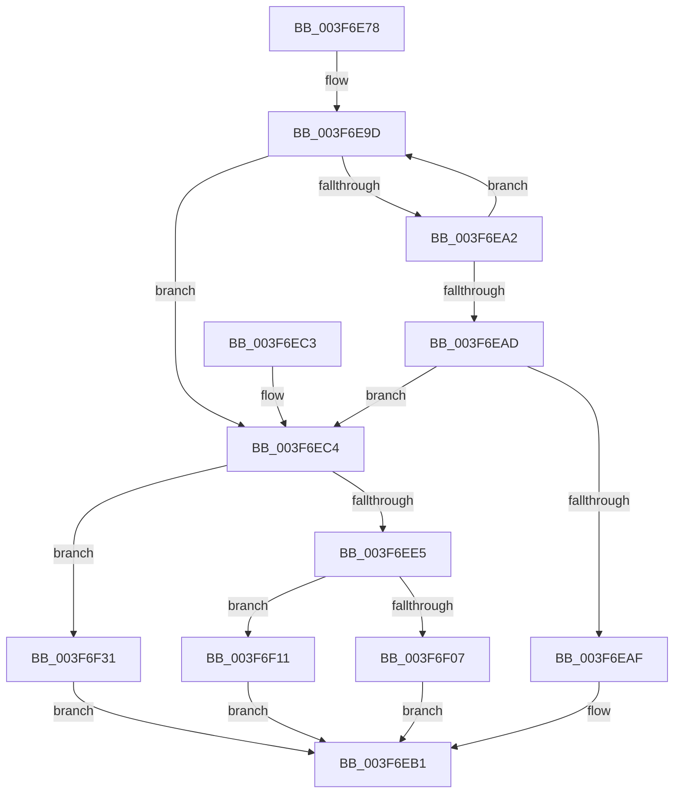

# HalpAcpiIsCachedTableCompromised

- RVA: `0x003F6E78`–`0x003F6F38` (길이 `192` bytes)
- VA: `0x00000001403F6E78`
- 실행 섹션: `.text`
- PDB 이름 있음: `예`; PDB Function 태그: `아니요`
- unwind 정보 RVA: `0x000981A0`
- 디코드: `56`개 명령, `192/192` bytes 표시
- 미해석 바이트: `0` (있으면 어셈블리에 `.byte`로 보존)

> 이 문서는 커널 이미지의 기계어와 PDB 기호를 분석해 생성했습니다. 4번과 5번은 함수 원형과 자료형을 바이너리 사용 방식에서 추정한 C 해석이며 원본 소스 복구 결과는 아닙니다.

## 1. Dependencies

- 직접 호출 지점: **4**; 고유 호출 대상: **4**
- 직접 호출자로 확인된 함수: **1**
- RIP 상대 이미지 참조: **1**

### Outgoing calls
- `0x003F6ED8` → [HalpAcpiGetTableFromBios](HalpAcpiGetTableFromBios_function_003F7404.md) (function, `0x003F7404`)
- `0x003F6EF1` → [memcmp](../6C/memcmp_function_006C6B10.md) (function, `0x006C6B10`)
- `0x003F6F0A` → [MiUnmapContiguousMemory](MiUnmapContiguousMemory_function_003F7908.md) (function, `0x003F7908`)
- `0x003F6F2A` → [HalpUnmapVirtualAddress](HalpUnmapVirtualAddress_function_003F8C30.md) (function, `0x003F8C30`)

### Direct callers
- [HalpAcpiGetTableWork](HalpAcpiGetTableWork_function_003F6CDC.md) at `0x003F6D31`

### Static image references
- `0x003F6E8D` → RVA `0x00013080` (`.rdata`; read)

## 2. Other-region calls and transfers

- 다른 실행 섹션으로 향하는 call: **0**
- 별도 외부 분기/꼬리 이동을 확인하지 못했습니다.

## 3. Assembly (complete function range)

```asm
003F6E78  48 8B C4                        mov rax, rsp
003F6E7B  48 89 58 08                     mov qword ptr [rax + 8], rbx
003F6E7F  48 89 70 10                     mov qword ptr [rax + 0x10], rsi
003F6E83  57                              push rdi
003F6E84  48 83 EC 40                     sub rsp, 0x40
003F6E88  48 83 60 F0 00                  and qword ptr [rax - 0x10], 0
003F6E8D  4C 8D 15 EC C1 C1 FF            lea r10, [rip - 0x3e3e14]
003F6E94  83 60 E8 00                     and dword ptr [rax - 0x18], 0
003F6E98  48 8B F1                        mov rsi, rcx
003F6E9B  33 C0                           xor eax, eax
003F6E9D  41 3B 12                        cmp edx, dword ptr [r10]
003F6EA0  74 22                           je 0x1403f6ec4
003F6EA2  FF C0                           inc eax
003F6EA4  49 83 C2 04                     add r10, 4
003F6EA8  83 F8 01                        cmp eax, 1
003F6EAB  72 F0                           jb 0x1403f6e9d
003F6EAD  75 15                           jne 0x1403f6ec4
003F6EAF  32 DB                           xor bl, bl
003F6EB1  48 8B 74 24 58                  mov rsi, qword ptr [rsp + 0x58]
003F6EB6  8A C3                           mov al, bl
003F6EB8  48 8B 5C 24 50                  mov rbx, qword ptr [rsp + 0x50]
003F6EBD  48 83 C4 40                     add rsp, 0x40
003F6EC1  5F                              pop rdi
003F6EC2  C3                              ret
003F6EC3  CC                              int3
003F6EC4  48 8D 44 24 38                  lea rax, [rsp + 0x38]
003F6EC9  48 89 44 24 28                  mov qword ptr [rsp + 0x28], rax
003F6ECE  48 8D 44 24 30                  lea rax, [rsp + 0x30]
003F6ED3  48 89 44 24 20                  mov qword ptr [rsp + 0x20], rax
003F6ED8  E8 27 05 00 00                  call 0x1403f7404
003F6EDD  48 8B F8                        mov rdi, rax
003F6EE0  48 85 C0                        test rax, rax
003F6EE3  74 4C                           je 0x1403f6f31
003F6EE5  44 8B 40 04                     mov r8d, dword ptr [rax + 4]
003F6EE9  48 8B C8                        mov rcx, rax
003F6EEC  48 8B 54 24 70                  mov rdx, qword ptr [rsp + 0x70]
003F6EF1  E8 1A FC 2C 00                  call 0x1406c6b10
003F6EF6  8B 54 24 30                     mov edx, dword ptr [rsp + 0x30]
003F6EFA  85 C0                           test eax, eax
003F6EFC  48 8B CF                        mov rcx, rdi
003F6EFF  0F 95 C3                        setne bl
003F6F02  48 85 F6                        test rsi, rsi
003F6F05  75 0A                           jne 0x1403f6f11
003F6F07  41 B0 01                        mov r8b, 1
003F6F0A  E8 F9 09 00 00                  call 0x1403f7908
003F6F0F  EB A0                           jmp 0x1403f6eb1
003F6F11  48 8B C7                        mov rax, rdi
003F6F14  48 81 C2 FF 0F 00 00            add rdx, 0xfff
003F6F1B  25 FF 0F 00 00                  and eax, 0xfff
003F6F20  45 33 C0                        xor r8d, r8d
003F6F23  48 03 D0                        add rdx, rax
003F6F26  48 C1 EA 0C                     shr rdx, 0xc
003F6F2A  E8 01 1D 00 00                  call 0x1403f8c30
003F6F2F  EB 80                           jmp 0x1403f6eb1
003F6F31  B3 01                           mov bl, 1
003F6F33  E9 79 FF FF FF                  jmp 0x1403f6eb1
```

## 4. C-style interpretation (structured pseudocode)

```c
__int64 __fastcall HalpAcpiIsCachedTableCompromised(__int64 a1, int a2, __int64 a3, __int64 a4, __int64 a5)
{
    __int64 result;
    __int64 v_r10;
    __int64 v_rbx;
    __int64 v_rsp;
    unsigned __int64 v_stack_p10;
    unsigned __int64 v_stack_p20;
    unsigned __int64 v_stack_p28;
    unsigned __int64 v_stack_p30;
    unsigned __int64 v_stack_p38;
    unsigned __int64 v_stack_p8;

    *(unsigned __int64 *)(v_rsp + 8) = v_rbx;
    *(unsigned __int64 *)(v_rsp + 16) = v_rsi;
    v_rsp = (v_rsp) - (64);
    result = 0;
loc_003F6E9D:
    if (a2 == (*(unsigned int *)(v_rip - 4079124))) goto loc_003F6EC4;
    result = (unsigned int)((result) + 1);
    v_r10 = (v_rip - 4079124) + (4);
    if (((unsigned int)(result)) < 1) goto loc_003F6E9D;
    if (((unsigned int)(result)) != 1) goto loc_003F6EC4;
    v_rbx = 0;
loc_003F6EB1:
    v_rsp = (v_rsp) + (64);
    return 0;
loc_003F6EC4:
    v_stack_p28 = v_stack_p38;
    v_stack_p20 = v_stack_p30;
    result = HalpAcpiGetTableFromBios(a1, a2, a3, a4);
    if (result == 0) goto loc_003F6F31;
    result = memcmp(result, a5, (unsigned int)(*(unsigned int *)(result + 4)), a4);
    v_rbx = ((unsigned int)(result) != 0) ? 1 : 0;
    if (v_stack_p10 != 0) goto loc_003F6F11;
    result = MiUnmapContiguousMemory(result, (unsigned int)(v_stack_p30), 1, a4);
    goto loc_003F6EB1;
loc_003F6F11:
    a2 = ((unsigned int)(v_stack_p30)) + (0xFFFULL);
    result = (unsigned int)((result) & (0xFFFULL));
    a3 = 0;
    a2 = (a2) + (result);
    a2 = (a2) >> (12);
    result = HalpUnmapVirtualAddress(result, a2, a3, a4);
    goto loc_003F6EB1;
loc_003F6F31:
    goto loc_003F6EB1;
}
```

## 5. (Beta) C Style

```c
int64_t HalpAcpiIsCachedTableCompromised(int64_t Arg1, int32_t Arg2, int64_t Arg3, int64_t Arg4, int64_t Arg5)
{
    int64_t result;
    int64_t local_r10;
    int64_t local_rbx;
    int64_t local_rsp;
    uint64_t v_stack_p10;
    uint64_t v_stack_p20;
    uint64_t v_stack_p28;
    uint64_t v_stack_p30;
    uint64_t v_stack_p38;
    uint64_t v_stack_p8;

    *(uint64_t *)(local_rsp + 0x8) = local_rbx;
    *(uint64_t *)(local_rsp + 0x10) = local_rsi;
    local_rsp = (local_rsp) - (64);
    result = 0;
loc_003F6E9D:
    if (Arg2 == (*(uint32_t *)(v_rip - 0x3E3E14))) goto loc_003F6EC4;
    result = (uint32_t)((result) + 1);
    local_r10 = (v_rip - 4079124) + (4);
    if (((uint32_t)(result)) < 1) goto loc_003F6E9D;
    if (((uint32_t)(result)) != 1) goto loc_003F6EC4;
    local_rbx = 0;
loc_003F6EB1:
    local_rsp = (local_rsp) + (64);
    return 0;
loc_003F6EC4:
    v_stack_p28 = v_stack_p38;
    v_stack_p20 = v_stack_p30;
    result = HalpAcpiGetTableFromBios(Arg1, Arg2, Arg3, Arg4);
    if (result == 0) goto loc_003F6F31;
    result = memcmp(result, Arg5, (uint32_t)(*(uint32_t *)(result + 0x4)), Arg4);
    local_rbx = ((uint32_t)(result) != 0) ? 1 : 0;
    if (v_stack_p10 != 0) goto loc_003F6F11;
    result = MiUnmapContiguousMemory(result, (uint32_t)(v_stack_p30), 1, Arg4);
    goto loc_003F6EB1;
loc_003F6F11:
    Arg2 = ((uint32_t)(v_stack_p30)) + (0xFFFULL);
    result = (uint32_t)((result) & (0xFFFULL));
    Arg3 = 0;
    Arg2 = (Arg2) + (result);
    Arg2 = (Arg2) >> (12);
    result = HalpUnmapVirtualAddress(result, Arg2, Arg3, Arg4);
    goto loc_003F6EB1;
loc_003F6F31:
    goto loc_003F6EB1;
}
```

## 6. Execution-region graph

[열기: 2D/3D 그래프와 함수 탐색 컨트롤 패널](../../../control-panel.html?section=text&rva=0x003F6E78&view=graph)

- 2D 그래프는 위에서 아래로 흐르고, 3D 그래프는 빈 공간을 드래그해 회전합니다. Shift+드래그는 이동, 휠은 확대·축소, 함수 노드 선택은 대상 보고서 이동입니다.

### Static fallback


