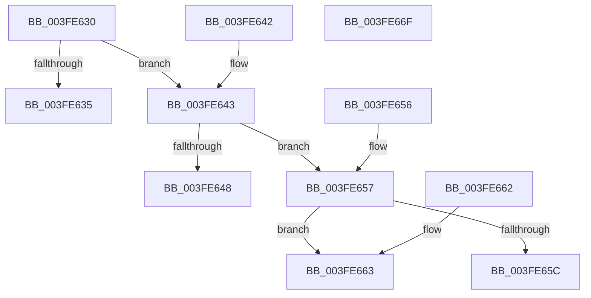

# HalpAcpiPmRegisterWritePort

- RVA: `0x003FE630`–`0x003FE670` (길이 `64` bytes)
- VA: `0x00000001403FE630`
- 실행 섹션: `.text`
- PDB 이름 있음: `예`; PDB Function 태그: `아니요`
- unwind 정보 RVA: `0x000DB714`
- 디코드: `33`개 명령, `64/64` bytes 표시
- 미해석 바이트: `0` (있으면 어셈블리에 `.byte`로 보존)

> 이 문서는 커널 이미지의 기계어와 PDB 기호를 분석해 생성했습니다. 4번과 5번은 함수 원형과 자료형을 바이너리 사용 방식에서 추정한 C 해석이며 원본 소스 복구 결과는 아닙니다.

## 1. Dependencies

- 직접 호출 지점: **0**; 고유 호출 대상: **0**
- 직접 호출자로 확인된 함수: **0**
- RIP 상대 이미지 참조: **0**

### Outgoing calls
- 직접 디코드된 call 명령이 없습니다.

### Direct callers
- 이 함수 시작 RVA로 연결되는 직접 call은 확인되지 않았습니다. 간접 호출은 완전히 역산할 수 없습니다.

### Static image references
- 디코드된 RIP-relative 메모리 참조가 없습니다.

## 2. Other-region calls and transfers

- 다른 실행 섹션으로 향하는 call: **0**
- 별도 외부 분기/꼬리 이동을 확인하지 못했습니다.

## 3. Assembly (complete function range)

```asm
003FE630  83 FA 01                        cmp edx, 1
003FE633  75 0E                           jne 0x1403fe643
003FE635  41 0F B6 00                     movzx eax, byte ptr [r8]
003FE639  0F B7 D1                        movzx edx, cx
003FE63C  90                              nop
003FE63D  EE                              out dx, al
003FE63E  90                              nop
003FE63F  33 C0                           xor eax, eax
003FE641  C3                              ret
003FE642  CC                              int3
003FE643  83 FA 02                        cmp edx, 2
003FE646  75 0F                           jne 0x1403fe657
003FE648  41 0F B7 00                     movzx eax, word ptr [r8]
003FE64C  0F B7 D1                        movzx edx, cx
003FE64F  90                              nop
003FE650  66 EF                           out dx, ax
003FE652  90                              nop
003FE653  33 C0                           xor eax, eax
003FE655  C3                              ret
003FE656  CC                              int3
003FE657  83 FA 04                        cmp edx, 4
003FE65A  74 07                           je 0x1403fe663
003FE65C  B8 01 00 00 C0                  mov eax, 0xc0000001
003FE661  C3                              ret
003FE662  CC                              int3
003FE663  41 8B 00                        mov eax, dword ptr [r8]
003FE666  0F B7 D1                        movzx edx, cx
003FE669  90                              nop
003FE66A  EF                              out dx, eax
003FE66B  90                              nop
003FE66C  33 C0                           xor eax, eax
003FE66E  C3                              ret
003FE66F  CC                              int3
```

## 4. C-style interpretation (structured pseudocode)

```c
__int64 __fastcall HalpAcpiPmRegisterWritePort(unsigned __int16 a1, int a2, __int64 a3)
{
    __int64 result;

    if (a2 != 1) goto loc_003FE643;
    result = 0;
    return result;
loc_003FE643:
    if (a1 != 2) goto loc_003FE657;
    result = 0;
    return result;
loc_003FE657:
    if (a1 == 4) goto loc_003FE663;
    return (unsigned int)(0xC0000001ULL);
loc_003FE663:
    result = 0;
    return result;
}
```

## 5. (Beta) C Style

```c
int64_t HalpAcpiPmRegisterWritePort(uint16_t Arg1, int32_t Arg2, void *Arg3)
{
    uint8_t *arg3 = (uint8_t *)Arg3;

    int64_t result;

    if (Arg2 != 1) goto loc_003FE643;
    result = 0;
    return result;
loc_003FE643:
    if (Arg1 != 2) goto loc_003FE657;
    result = 0;
    return result;
loc_003FE657:
    if (Arg1 == 4) goto loc_003FE663;
    return (uint32_t)(0xC0000001ULL);
loc_003FE663:
    result = 0;
    return result;
}
```

### 관측된 메모리 오프셋

구조체 형식이 확인되지 않은 접근은 인자 기준의 오프셋으로만 기록했습니다.

| 기준 인자 | 오프셋 표현 | 폭 (bit) | 접근 |
|---|---:|---:|---|
| `Arg3` | `+ 0x0` | `8` | `R` |
| `Arg3` | `+ 0x0` | `16` | `R` |
| `Arg3` | `+ 0x0` | `32` | `R` |

## 6. Execution-region graph

[열기: 2D/3D 그래프와 함수 탐색 컨트롤 패널](../../../control-panel.html?section=text&rva=0x003FE630&view=graph)

- 2D 그래프는 위에서 아래로 흐르고, 3D 그래프는 빈 공간을 드래그해 회전합니다. Shift+드래그는 이동, 휠은 확대·축소, 함수 노드 선택은 대상 보고서 이동입니다.

### Static fallback


