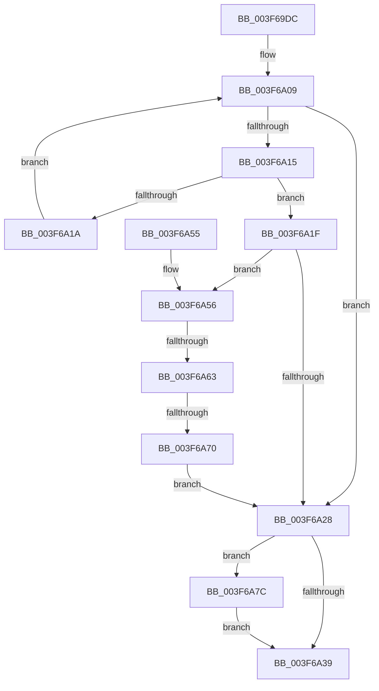

# HalpDmaDereferenceDomainObject

- RVA: `0x003F69DC`–`0x003F6A86` (길이 `170` bytes)
- VA: `0x00000001403F69DC`
- 실행 섹션: `.text`
- PDB 이름 있음: `예`; PDB Function 태그: `예`
- unwind 정보 RVA: `0x00098114`
- 디코드: `48`개 명령, `170/170` bytes 표시
- 미해석 바이트: `0` (있으면 어셈블리에 `.byte`로 보존)

> 이 문서는 커널 이미지의 기계어와 PDB 기호를 분석해 생성했습니다. 4번과 5번은 함수 원형과 자료형을 바이너리 사용 방식에서 추정한 C 해석이며 원본 소스 복구 결과는 아닙니다.

## 1. Dependencies

- 직접 호출 지점: **3**; 고유 호출 대상: **3**
- 직접 호출자로 확인된 함수: **15**
- RIP 상대 이미지 참조: **2**

### Outgoing calls
- `0x003F69FB` → [KeAcquireSpinLockRaiseToDpc](../20/KeAcquireSpinLockRaiseToDpc_function_00208470.md) (function, `0x00208470`)
- `0x003F6A2F` → [KeReleaseSpinLock](../39/KeReleaseSpinLock_function_00392BA0.md) (function, `0x00392BA0`)
- `0x003F6A7F` → [HalpDmaDeleteDomain](../55/HalpDmaDeleteDomain_function_00551FC8.md) (function, `0x00551FC8`)

### Direct callers
- [HalpAllocateCommonBufferVectorInternal](../3E/HalpAllocateCommonBufferVectorInternal_function_003E848C.md) at `0x003E876D`
- [HalpAllocateDomainCommonBufferInternal](../3E/HalpAllocateDomainCommonBufferInternal_function_003E8B64.md) at `0x003E8F86`
- [HalpAllocateCommonBufferDmarThin](../3E/HalpAllocateCommonBufferDmarThin_function_003E8FF0.md) at `0x003E91BA`
- [HalpAllocateCommonBufferDmaThin](../3E/HalpAllocateCommonBufferDmaThin_function_003E9788.md) at `0x003E99C4`
- [HalFreeCommonBufferDmarThin](HalFreeCommonBufferDmarThin_function_003F6290.md) at `0x003F6332`
- [HalFreeCommonBufferDmaThin](HalFreeCommonBufferDmaThin_function_003F6800.md) at `0x003F6881`
- [HalFreeCommonBufferVector](HalFreeCommonBufferVector_function_003F87C0.md) at `0x003F8863`
- [HalJoinDmaDomain](../4E/HalJoinDmaDomain_function_004E3320.md) at `0x004E3450`
- [HalCreateCommonBufferFromMdl](../55/HalCreateCommonBufferFromMdl_function_00551680.md) at `0x00551A34`
- [HalFreeCommonBufferV3](../55/HalFreeCommonBufferV3_function_00551A70.md) at `0x00551B6B`
- [HalpDmaAllocateDomain](../55/HalpDmaAllocateDomain_function_00551C10.md) at `0x00551ED9`
- [HalpDmaIsAutomaticDomain](../55/HalpDmaIsAutomaticDomain_function_0055253C.md) at `0x00552560`
- [HalpLeaveDmaDomain](../55/HalpLeaveDmaDomain_function_00552600.md) at `0x005526EB`
- [HalCreateCommonBufferFromMdlDmaThin](../55/HalCreateCommonBufferFromMdlDmaThin_function_00552800.md) at `0x00552A59`
- [HalCreateCommonBufferFromMdlDmarThin](../55/HalCreateCommonBufferFromMdlDmarThin_function_00552DA0.md) at `0x00552F6B`

### Static image references
- `0x003F69F1` → RVA `0x00FC1888` (`.data`; read)
- `0x003F6A00` → RVA `0x00FC1890` (`.data`; read)

## 2. Other-region calls and transfers

- 다른 실행 섹션으로 향하는 call: **0**
- call이 아닌 외부 분기/꼬리 이동: **2**
  - `0x003F6A5D` → [sub_006EB978](../6E/Unknown_function_006EB978.md) (`tail-transfer`)
  - `0x003F6A6A` → [sub_006EB978](../6E/Unknown_function_006EB978.md) (`tail-transfer`)

## 3. Assembly (complete function range)

```asm
003F69DC  48 89 5C 24 08                  mov qword ptr [rsp + 8], rbx
003F69E1  48 89 74 24 10                  mov qword ptr [rsp + 0x10], rsi
003F69E6  57                              push rdi
003F69E7  48 83 EC 20                     sub rsp, 0x20
003F69EB  48 8B D9                        mov rbx, rcx
003F69EE  40 32 F6                        xor sil, sil
003F69F1  48 8D 0D 90 AE BC 00            lea rcx, [rip + 0xbcae90]
003F69F8  40 32 FF                        xor dil, dil
003F69FB  E8 70 1A E1 FF                  call 0x140208470
003F6A00  48 8B 0D 89 AE BC 00            mov rcx, qword ptr [rip + 0xbcae89]
003F6A07  8A D0                           mov dl, al
003F6A09  48 8D 05 80 AE BC 00            lea rax, [rip + 0xbcae80]
003F6A10  48 3B C8                        cmp rcx, rax
003F6A13  74 13                           je 0x1403f6a28
003F6A15  48 3B D9                        cmp rbx, rcx
003F6A18  74 05                           je 0x1403f6a1f
003F6A1A  48 8B 09                        mov rcx, qword ptr [rcx]
003F6A1D  EB EA                           jmp 0x1403f6a09
003F6A1F  83 43 70 FF                     add dword ptr [rbx + 0x70], -1
003F6A23  40 B7 01                        mov dil, 1
003F6A26  74 2E                           je 0x1403f6a56
003F6A28  48 8D 0D 59 AE BC 00            lea rcx, [rip + 0xbcae59]
003F6A2F  E8 6C C1 F9 FF                  call 0x140392ba0
003F6A34  40 84 F6                        test sil, sil
003F6A37  75 43                           jne 0x1403f6a7c
003F6A39  48 8B 5C 24 30                  mov rbx, qword ptr [rsp + 0x30]
003F6A3E  40 F6 DF                        neg dil
003F6A41  48 8B 74 24 38                  mov rsi, qword ptr [rsp + 0x38]
003F6A46  1B C0                           sbb eax, eax
003F6A48  F7 D0                           not eax
003F6A4A  25 0D 00 00 C0                  and eax, 0xc000000d
003F6A4F  48 83 C4 20                     add rsp, 0x20
003F6A53  5F                              pop rdi
003F6A54  C3                              ret
003F6A55  CC                              int3
003F6A56  48 8B 0B                        mov rcx, qword ptr [rbx]
003F6A59  48 39 59 08                     cmp qword ptr [rcx + 8], rbx
003F6A5D  0F 85 15 4F 2F 00               jne 0x1406eb978
003F6A63  48 8B 43 08                     mov rax, qword ptr [rbx + 8]
003F6A67  48 39 18                        cmp qword ptr [rax], rbx
003F6A6A  0F 85 08 4F 2F 00               jne 0x1406eb978
003F6A70  48 89 08                        mov qword ptr [rax], rcx
003F6A73  40 8A F7                        mov sil, dil
003F6A76  48 89 41 08                     mov qword ptr [rcx + 8], rax
003F6A7A  EB AC                           jmp 0x1403f6a28
003F6A7C  48 8B CB                        mov rcx, rbx
003F6A7F  E8 44 B5 15 00                  call 0x140551fc8
003F6A84  EB B3                           jmp 0x1403f6a39
```

## 4. C-style interpretation (structured pseudocode)

```c
__int64 __fastcall HalpDmaDereferenceDomainObject(__int64 a1)
{
    __int64 result;
    __int64 v_rdi;
    __int64 v_rsi;
    __int64 v_rsp;
    unsigned __int64 v_stack_p10;
    unsigned __int64 v_stack_p8;

    v_stack_p8 = v_rbx;
    v_stack_p10 = v_rsi;
    v_rsp = (v_rsp) - (32);
    v_rsi = 0;
    v_rdi = 0;
    result = KeAcquireSpinLockRaiseToDpc(v_rip + 12365456, a2, a3, a4);
loc_003F6A09:
    if ((*(unsigned __int64 *)(v_rip + 12365449)) == (v_rip + 12365440)) goto loc_003F6A28;
    if (a1 == (*(unsigned __int64 *)(v_rip + 12365449))) goto loc_003F6A1F;
    goto loc_003F6A09;
loc_003F6A1F:
    if (a1 == (*(unsigned __int64 *)(v_rip + 12365449))) goto loc_003F6A56;
loc_003F6A28:
    result = KeReleaseSpinLock(v_rip + 12365401, (unsigned __int8)(result), a3, a4);
    if (0 != 0) goto loc_003F6A7C;
loc_003F6A39:
    v_rdi = (unsigned __int8)(-(1));
    result = (unsigned int)(~(result));
    result = (unsigned int)((result) & (0xC000000DULL));
    v_rsp = (v_rsp) + (32);
    return result;
loc_003F6A56:
    *(unsigned __int64 *)(*(unsigned __int64 *)(v_stack_p8 + 8)) = *(unsigned __int64 *)(v_stack_p8);
    *(unsigned __int64 *)(*(unsigned __int64 *)(v_stack_p8) + 8) = *(unsigned __int64 *)(v_stack_p8 + 8);
    goto loc_003F6A28;
loc_003F6A7C:
    result = HalpDmaDeleteDomain(v_stack_p8, (unsigned __int8)(result), a3, a4);
    goto loc_003F6A39;
}
```

## 5. (Beta) C Style

```c
int64_t HalpDmaDereferenceDomainObject(int64_t Arg1)
{
    int64_t result;
    int64_t local_rdi;
    int64_t local_rsi;
    int64_t local_rsp;
    uint64_t v_stack_p10;
    uint64_t v_stack_p8;

    v_stack_p8 = local_rbx;
    v_stack_p10 = local_rsi;
    local_rsp = (local_rsp) - (32);
    local_rsi = 0;
    local_rdi = 0;
    result = KeAcquireSpinLockRaiseToDpc(v_rip + 12365456, a2, a3, a4);
loc_003F6A09:
    if ((*(uint64_t *)(v_rip + 0xBCAE89)) == (v_rip + 12365440)) goto loc_003F6A28;
    if (Arg1 == (*(uint64_t *)(v_rip + 0xBCAE89))) goto loc_003F6A1F;
    goto loc_003F6A09;
loc_003F6A1F:
    if (Arg1 == (*(uint64_t *)(v_rip + 0xBCAE89))) goto loc_003F6A56;
loc_003F6A28:
    result = KeReleaseSpinLock(v_rip + 12365401, (uint8_t)(result), a3, a4);
    if (0 != 0) goto loc_003F6A7C;
loc_003F6A39:
    local_rdi = (uint8_t)(-(1));
    result = (uint32_t)(~(result));
    result = (uint32_t)((result) & (0xC000000DULL));
    local_rsp = (local_rsp) + (32);
    return result;
loc_003F6A56:
    *(uint64_t *)(*(uint64_t *)(v_stack_p8 + 0x8)) = *(uint64_t *)(v_stack_p8);
    *(uint64_t *)(*(uint64_t *)(v_stack_p8) + 0x8) = *(uint64_t *)(v_stack_p8 + 0x8);
    goto loc_003F6A28;
loc_003F6A7C:
    result = HalpDmaDeleteDomain(v_stack_p8, (uint8_t)(result), a3, a4);
    goto loc_003F6A39;
}
```

## 6. Execution-region graph

[열기: 2D/3D 그래프와 함수 탐색 컨트롤 패널](../../../control-panel.html?section=text&rva=0x003F69DC&view=graph)

- 2D 그래프는 위에서 아래로 흐르고, 3D 그래프는 빈 공간을 드래그해 회전합니다. Shift+드래그는 이동, 휠은 확대·축소, 함수 노드 선택은 대상 보고서 이동입니다.

### Static fallback


