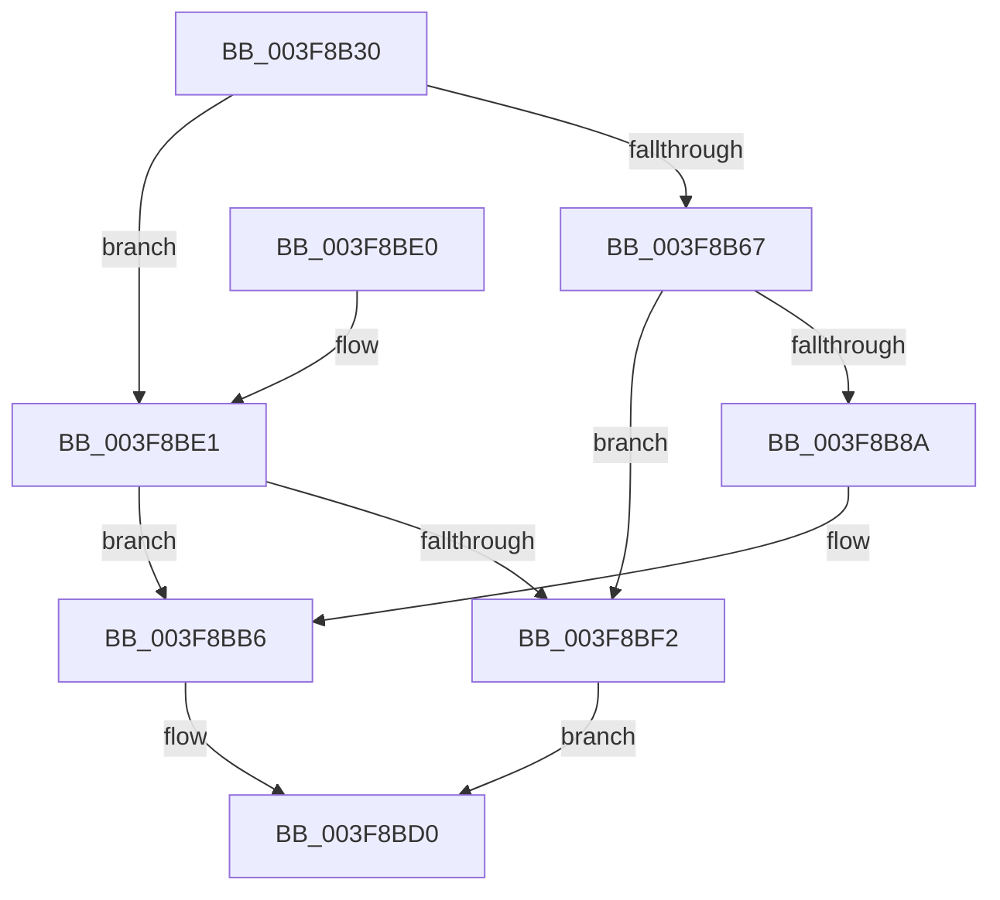

# HalpIommuAllocateAndZeroPageTable

- RVA: `0x003F8B30`–`0x003F8BF6` (길이 `198` bytes)
- VA: `0x00000001403F8B30`
- 실행 섹션: `.text`
- PDB 이름 있음: `예`; PDB Function 태그: `아니요`
- unwind 정보 RVA: `0x00096260`
- 디코드: `59`개 명령, `198/198` bytes 표시
- 미해석 바이트: `0` (있으면 어셈블리에 `.byte`로 보존)

> 이 문서는 커널 이미지의 기계어와 PDB 기호를 분석해 생성했습니다. 4번과 5번은 함수 원형과 자료형을 바이너리 사용 방식에서 추정한 C 해석이며 원본 소스 복구 결과는 아닙니다.

## 1. Dependencies

- 직접 호출 지점: **5**; 고유 호출 대상: **5**
- 직접 호출자로 확인된 함수: **3**
- RIP 상대 이미지 참조: **0**

### Outgoing calls
- `0x003F8B80` → [HalpAllocPhysicalMemoryEx](../../init/C7/HalpAllocPhysicalMemoryEx_function_00C771DC.md) (function, `0x00C771DC`)
- `0x003F8BAE` → [HalpMap](HalpMap_function_003F88F4.md) (function, `0x003F88F4`)
- `0x003F8BBE` → [memset](../6C/memset_function_006C6C40.md) (function, `0x006C6C40`)
- `0x003F8BC8` → [HalpIommuFlushPhysicalPtesFromCacheSize](../30/HalpIommuFlushPhysicalPtesFromCacheSize_function_0030885C.md) (function, `0x0030885C`)
- `0x003F8BE5` → [HalpMmAllocCtxAlloc](../3E/HalpMmAllocCtxAlloc_function_003E10B8.md) (function, `0x003E10B8`)

### Direct callers
- [HalpIommuMapLogical](../30/HalpIommuMapLogical_function_00308290.md) at `0x003084FB`
- [HalpIommuInitializeDmarPageTable](../56/HalpIommuInitializeDmarPageTable_function_00568F24.md) at `0x00569019`
- [HalpIommuInitializeDmarPageTable](../56/HalpIommuInitializeDmarPageTable_function_00568F24.md) at `0x0056905B`
- [HalpIommuMapLogicalRange](../56/HalpIommuMapLogicalRange_function_005690DC.md) at `0x00569215`

### Static image references
- 디코드된 RIP-relative 메모리 참조가 없습니다.

## 2. Other-region calls and transfers

- 다른 실행 섹션으로 향하는 call: **1**
  - `0x003F8B80` → [HalpAllocPhysicalMemoryEx](../../init/C7/HalpAllocPhysicalMemoryEx_function_00C771DC.md) (`.text` → `INIT`)
- 별도 외부 분기/꼬리 이동을 확인하지 못했습니다.

## 3. Assembly (complete function range)

```asm
003F8B30  48 89 5C 24 08                  mov qword ptr [rsp + 8], rbx
003F8B35  48 89 74 24 10                  mov qword ptr [rsp + 0x10], rsi
003F8B3A  57                              push rdi
003F8B3B  48 83 EC 30                     sub rsp, 0x30
003F8B3F  48 8B C1                        mov rax, rcx
003F8B42  BB 01 00 00 00                  mov ebx, 1
003F8B47  8B CA                           mov ecx, edx
003F8B49  8B FB                           mov edi, ebx
003F8B4B  4D 8B D0                        mov r10, r8
003F8B4E  8B 4C 88 24                     mov ecx, dword ptr [rax + rcx*4 + 0x24]
003F8B52  48 D3 E7                        shl rdi, cl
003F8B55  8B 48 1C                        mov ecx, dword ptr [rax + 0x1c]
003F8B58  8B C3                           mov eax, ebx
003F8B5A  D3 E0                           shl eax, cl
003F8B5C  83 C0 08                        add eax, 8
003F8B5F  0F AF F8                        imul edi, eax
003F8B62  4D 85 C0                        test r8, r8
003F8B65  74 7A                           je 0x1403f8be1
003F8B67  48 83 64 24 20 00               and qword ptr [rsp + 0x20], 0
003F8B6D  44 8D 87 FF 0F 00 00            lea r8d, [rdi + 0xfff]
003F8B74  41 C1 E8 0C                     shr r8d, 0xc
003F8B78  45 33 C9                        xor r9d, r9d
003F8B7B  33 D2                           xor edx, edx
003F8B7D  49 8B CA                        mov rcx, r10
003F8B80  E8 57 E6 87 00                  call 0x140c771dc
003F8B85  48 85 C0                        test rax, rax
003F8B88  74 68                           je 0x1403f8bf2
003F8B8A  48 83 64 24 28 00               and qword ptr [rsp + 0x28], 0
003F8B90  48 8D 97 FF 0F 00 00            lea rdx, [rdi + 0xfff]
003F8B97  48 C1 EA 0C                     shr rdx, 0xc
003F8B9B  45 33 C9                        xor r9d, r9d
003F8B9E  44 8B C3                        mov r8d, ebx
003F8BA1  8B F7                           mov esi, edi
003F8BA3  48 8B C8                        mov rcx, rax
003F8BA6  C7 44 24 20 04 00 00 00         mov dword ptr [rsp + 0x20], 4
003F8BAE  E8 41 FD FF FF                  call 0x1403f88f4
003F8BB3  48 8B D8                        mov rbx, rax
003F8BB6  4C 8B C6                        mov r8, rsi
003F8BB9  33 D2                           xor edx, edx
003F8BBB  48 8B CB                        mov rcx, rbx
003F8BBE  E8 7D E0 2C 00                  call 0x1406c6c40
003F8BC3  8B D7                           mov edx, edi
003F8BC5  48 8B CB                        mov rcx, rbx
003F8BC8  E8 8F FC F0 FF                  call 0x14030885c
003F8BCD  48 8B C3                        mov rax, rbx
003F8BD0  48 8B 5C 24 40                  mov rbx, qword ptr [rsp + 0x40]
003F8BD5  48 8B 74 24 48                  mov rsi, qword ptr [rsp + 0x48]
003F8BDA  48 83 C4 30                     add rsp, 0x30
003F8BDE  5F                              pop rdi
003F8BDF  C3                              ret
003F8BE0  CC                              int3
003F8BE1  8B D7                           mov edx, edi
003F8BE3  8B F7                           mov esi, edi
003F8BE5  E8 CE 84 FE FF                  call 0x1403e10b8
003F8BEA  48 8B D8                        mov rbx, rax
003F8BED  48 85 C0                        test rax, rax
003F8BF0  75 C4                           jne 0x1403f8bb6
003F8BF2  33 C0                           xor eax, eax
003F8BF4  EB DA                           jmp 0x1403f8bd0
```

## 4. C-style interpretation (structured pseudocode)

```c
__int64 __fastcall HalpIommuAllocateAndZeroPageTable(__int64 a1, int a2, __int64 a3, int a4)
{
    __int64 result;
    __int64 v_rdi;
    __int64 v_rsp;
    unsigned __int64 v_stack_m10;
    unsigned __int64 v_stack_m18;
    unsigned __int64 v_stack_p10;
    unsigned __int64 v_stack_p8;

    v_stack_p8 = v_rbx;
    v_stack_p10 = v_rsi;
    v_rsp = (v_rsp) - (48);
    v_rdi = (1) << ((unsigned __int8)((unsigned int)(*(unsigned int *)(a1 + (unsigned int)(a2) * 4 + 36))));
    result = (unsigned int)((1) << ((unsigned __int8)((unsigned int)(*(unsigned int *)(a1 + 28)))));
    result = (unsigned int)((result) + (8));
    v_rdi = (unsigned int)((v_rdi) * ((unsigned int)(result)));
    if (a3 == 0) goto loc_003F8BE1;
    a3 = (unsigned int)((v_rdi + 4095) >> (12));
    a4 = 0;
    a2 = 0;
    result = HalpAllocPhysicalMemoryEx(a3, a2, a3, a4);
    if (result == 0) goto loc_003F8BF2;
    a2 = (v_rdi + 4095) >> (12);
    a4 = 0;
    v_stack_m18 = 4;
    result = HalpMap(result, a2, 1, a4);
loc_003F8BB6:
    a2 = 0;
    result = memset(result, a2, (unsigned int)((unsigned int)(v_rdi)), a4);
    result = HalpIommuFlushPhysicalPtesFromCacheSize(result, (unsigned int)((unsigned int)(v_rdi)), (unsigned int)((unsigned int)(v_rdi)), a4);
loc_003F8BD0:
    v_rsp = (v_rsp) + (48);
    return result;
loc_003F8BE1:
    result = HalpMmAllocCtxAlloc(result, (unsigned int)((unsigned int)(v_rdi)), (unsigned int)((unsigned int)(v_rdi)), a4);
    if (result != 0) goto loc_003F8BB6;
loc_003F8BF2:
    result = 0;
    goto loc_003F8BD0;
}
```

## 5. (Beta) C Style

```c
int64_t HalpIommuAllocateAndZeroPageTable(void *Arg1, int32_t Arg2, int64_t Arg3, int32_t Arg4)
{
    uint8_t *arg1 = (uint8_t *)Arg1;

    int64_t result;
    int64_t local_rdi;
    int64_t local_rsp;
    uint64_t v_stack_m10;
    uint64_t v_stack_m18;
    uint64_t v_stack_p10;
    uint64_t v_stack_p8;

    v_stack_p8 = local_rbx;
    v_stack_p10 = local_rsi;
    local_rsp = (local_rsp) - (48);
    local_rdi = (1) << ((uint8_t)((uint32_t)(*(uint32_t *)(arg1 + (uint32_t)(Arg2) * 4 + 0x24))));
    result = (uint32_t)((1) << ((uint8_t)((uint32_t)(*(uint32_t *)(arg1 + 0x1C)))));
    result = (uint32_t)((result) + (8));
    local_rdi = (uint32_t)((local_rdi) * ((uint32_t)(result)));
    if (Arg3 == 0) goto loc_003F8BE1;
    Arg3 = (uint32_t)((local_rdi + 4095) >> (12));
    Arg4 = 0;
    Arg2 = 0;
    result = HalpAllocPhysicalMemoryEx(Arg3, Arg2, Arg3, Arg4);
    if (result == 0) goto loc_003F8BF2;
    Arg2 = (local_rdi + 4095) >> (12);
    Arg4 = 0;
    v_stack_m18 = 4;
    result = HalpMap(result, Arg2, 1, Arg4);
loc_003F8BB6:
    Arg2 = 0;
    result = memset(result, Arg2, (uint32_t)((uint32_t)(local_rdi)), Arg4);
    result = HalpIommuFlushPhysicalPtesFromCacheSize(result, (uint32_t)((uint32_t)(local_rdi)), (uint32_t)((uint32_t)(local_rdi)), Arg4);
loc_003F8BD0:
    local_rsp = (local_rsp) + (48);
    return result;
loc_003F8BE1:
    result = HalpMmAllocCtxAlloc(result, (uint32_t)((uint32_t)(local_rdi)), (uint32_t)((uint32_t)(local_rdi)), Arg4);
    if (result != 0) goto loc_003F8BB6;
loc_003F8BF2:
    result = 0;
    goto loc_003F8BD0;
}
```

### 관측된 메모리 오프셋

구조체 형식이 확인되지 않은 접근은 인자 기준의 오프셋으로만 기록했습니다.

| 기준 인자 | 오프셋 표현 | 폭 (bit) | 접근 |
|---|---:|---:|---|
| `Arg1` | `+ 0x1C` | `32` | `R` |
| `Arg1` | `+ 0x24 + rcx*4` | `32` | `R` |

## 6. Execution-region graph

[열기: 2D/3D 그래프와 함수 탐색 컨트롤 패널](../../../control-panel.html?section=text&rva=0x003F8B30&view=graph)

- 2D 그래프는 위에서 아래로 흐르고, 3D 그래프는 빈 공간을 드래그해 회전합니다. Shift+드래그는 이동, 휠은 확대·축소, 함수 노드 선택은 대상 보고서 이동입니다.

### Static fallback


