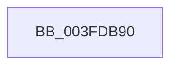

# HalpLbrCaptureStack

- RVA: `0x003FDB90`–`0x003FDBBE` (길이 `46` bytes)
- VA: `0x00000001403FDB90`
- 실행 섹션: `.text`
- PDB 이름 있음: `예`; PDB Function 태그: `아니요`
- unwind 정보 RVA: `0x00099CC0`
- 디코드: `13`개 명령, `46/46` bytes 표시
- 미해석 바이트: `0` (있으면 어셈블리에 `.byte`로 보존)

> 이 문서는 커널 이미지의 기계어와 PDB 기호를 분석해 생성했습니다. 4번과 5번은 함수 원형과 자료형을 바이너리 사용 방식에서 추정한 C 해석이며 원본 소스 복구 결과는 아닙니다.

## 1. Dependencies

- 직접 호출 지점: **0**; 고유 호출 대상: **0**
- 직접 호출자로 확인된 함수: **0**
- RIP 상대 이미지 참조: **1**

### Outgoing calls
- 직접 디코드된 call 명령이 없습니다.

### Direct callers
- 이 함수 시작 RVA로 연결되는 직접 call은 확인되지 않았습니다. 간접 호출은 완전히 역산할 수 없습니다.

### Static image references
- `0x003FDBA4` → RVA `0x00F8F99C` (`.data`; read)

## 2. Other-region calls and transfers

- 다른 실행 섹션으로 향하는 call: **0**
- call이 아닌 외부 분기/꼬리 이동: **1**
  - `0x003FDBB8` → [sub_003FDD66](Unknown_function_003FDD66.md) (`tail-transfer`)

## 3. Assembly (complete function range)

```asm
003FDB90  40 53                           push rbx
003FDB92  41 57                           push r15
003FDB94  48 83 EC 18                     sub rsp, 0x18
003FDB98  45 33 C9                        xor r9d, r9d
003FDB9B  4C 8B D2                        mov r10, rdx
003FDB9E  41 8B D1                        mov edx, r9d
003FDBA1  45 89 08                        mov dword ptr [r8], r9d
003FDBA4  39 15 F2 1D B9 00               cmp dword ptr [rip + 0xb91df2], edx
003FDBAA  4D 8B F8                        mov r15, r8
003FDBAD  45 8B D9                        mov r11d, r9d
003FDBB0  48 89 54 24 40                  mov qword ptr [rsp + 0x40], rdx
003FDBB5  41 8B D9                        mov ebx, r9d
003FDBB8  0F 84 A8 01 00 00               je 0x1403fdd66
```

## 4. C-style interpretation (structured pseudocode)

```c
void __fastcall HalpLbrCaptureStack(__int64 a1, __int64 a2, __int64 a3, int a4)
{
    __int64 v_rsp;
    unsigned __int64 v_stack_p18;

    v_rsp = (v_rsp) - (24);
    a4 = 0;
    *(unsigned int *)(a3) = 0;
    v_stack_p18 = 0;
}
```

## 5. (Beta) C Style

```c
void HalpLbrCaptureStack(int64_t Arg1, int64_t Arg2, void *Arg3, int32_t Arg4)
{
    uint8_t *arg3 = (uint8_t *)Arg3;

    int64_t local_rsp;
    uint64_t v_stack_p18;

    local_rsp = (local_rsp) - (24);
    Arg4 = 0;
    *(uint32_t *)(arg3) = 0;
    v_stack_p18 = 0;
}
```

### 관측된 메모리 오프셋

구조체 형식이 확인되지 않은 접근은 인자 기준의 오프셋으로만 기록했습니다.

| 기준 인자 | 오프셋 표현 | 폭 (bit) | 접근 |
|---|---:|---:|---|
| `Arg3` | `+ 0x0` | `32` | `W` |

## 6. Execution-region graph

[열기: 2D/3D 그래프와 함수 탐색 컨트롤 패널](../../../control-panel.html?section=text&rva=0x003FDB90&view=graph)

- 2D 그래프는 위에서 아래로 흐르고, 3D 그래프는 빈 공간을 드래그해 회전합니다. Shift+드래그는 이동, 휠은 확대·축소, 함수 노드 선택은 대상 보고서 이동입니다.

### Static fallback


