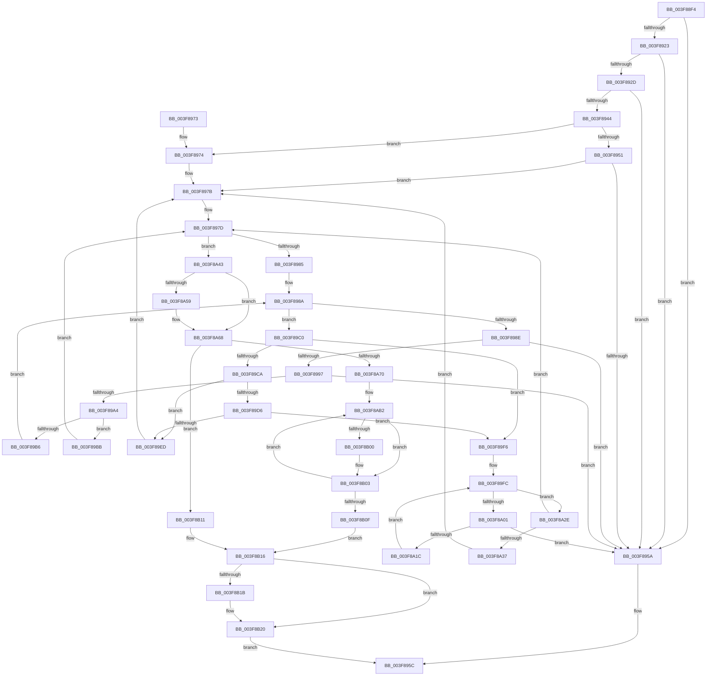

# HalpMap

- RVA: `0x003F88F4`–`0x003F8B28` (길이 `564` bytes)
- VA: `0x00000001403F88F4`
- 실행 섹션: `.text`
- PDB 이름 있음: `예`; PDB Function 태그: `아니요`
- unwind 정보 RVA: `0x00098300`
- 디코드: `146`개 명령, `564/564` bytes 표시
- 미해석 바이트: `0` (있으면 어셈블리에 `.byte`로 보존)

> 이 문서는 커널 이미지의 기계어와 PDB 기호를 분석해 생성했습니다. 4번과 5번은 함수 원형과 자료형을 바이너리 사용 방식에서 추정한 C 해석이며 원본 소스 복구 결과는 아닙니다.

## 1. Dependencies

- 직접 호출 지점: **5**; 고유 호출 대상: **3**
- 직접 호출자로 확인된 함수: **20**
- RIP 상대 이미지 참조: **3**

### Outgoing calls
- `0x003F899A` → [HalpMmGetPteAddressSafe](../54/HalpMmGetPteAddressSafe_function_00544AF4.md) (function, `0x00544AF4`)
- `0x003F89CD` → [HalpIsHeap64KRegionExecutable](../54/HalpIsHeap64KRegionExecutable_function_005447EC.md) (function, `0x005447EC`)
- `0x003F89E4` → [HalpIsHeap64KRegionExecutable](../54/HalpIsHeap64KRegionExecutable_function_005447EC.md) (function, `0x005447EC`)
- `0x003F8A0E` → [HalpMmGetPteAddressSafe](../54/HalpMmGetPteAddressSafe_function_00544AF4.md) (function, `0x00544AF4`)
- `0x003F8B1B` → [HalpFlushTLB](../4F/HalpFlushTLB_function_004F5E9C.md) (function, `0x004F5E9C`)

### Direct callers
- [HalpPciMapMmConfigPhysicalAddress](../23/HalpPciMapMmConfigPhysicalAddress_function_00236340.md) at `0x002363CC`
- [HalpAcpiCheckAndMapTable](HalpAcpiCheckAndMapTable_function_003F75D8.md) at `0x003F77CF`
- [HalpAcpiCheckAndMapTable](HalpAcpiCheckAndMapTable_function_003F75D8.md) at `0x003F784B`
- [HalpAcpiGetRsdt](HalpAcpiGetRsdt_function_003F806C.md) at `0x003F8247`
- [HalpMapPhysicalMemory64](HalpMapPhysicalMemory64_function_003F88C8.md) at `0x003F88E0`
- [HalpIommuAllocateAndZeroPageTable](HalpIommuAllocateAndZeroPageTable_function_003F8B30.md) at `0x003F8BAE`
- [HalMapIoSpace](../4F/HalMapIoSpace_function_004FCD40.md) at `0x004FCD75`
- [HalpAcpiAllocateMemory](../53/HalpAcpiAllocateMemory_function_0053ECE0.md) at `0x0053ED3D`
- [HalpAllocateEarlyPages](../54/HalpAllocateEarlyPages_function_00544770.md) at `0x005447BC`
- [HalpMapEarlyPages](../54/HalpMapEarlyPages_function_00544860.md) at `0x00544876`
- [HalpMapPhysicalMemoryWriteThrough64](../54/HalpMapPhysicalMemoryWriteThrough64_function_00544890.md) at `0x005448A8`
- [HalpMmAllocateMemoryInternal](../54/HalpMmAllocateMemoryInternal_function_00544990.md) at `0x00544A4F`
- [HalpPowerWriteResetCommand](../54/HalpPowerWriteResetCommand_function_00546744.md) at `0x005467B3`
- [HalpInterruptParseMadt](../55/HalpInterruptParseMadt_function_00557E74.md) at `0x00558141`
- [HalpUsbLegacyStopOhciInterrupt](../56/HalpUsbLegacyStopOhciInterrupt_function_00563AA0.md) at `0x00563B33`
- [HalpBlkAllocateAndShadowMemory](../../init/C2/HalpBlkAllocateAndShadowMemory_function_00C23314.md) at `0x00C23381`
- [HalpBlkAllocatePageTablePage](../../init/C2/HalpBlkAllocatePageTablePage_function_00C23410.md) at `0x00C23476`
- [HalpBlkInitializePageTables](../../init/C2/HalpBlkInitializePageTables_function_00C23608.md) at `0x00C23654`
- [HalpSetupAcpiPhase0](../../init/C2/HalpSetupAcpiPhase0_function_00C23EDC.md) at `0x00C240D2`
- [HalpSetupAcpiPhase0](../../init/C2/HalpSetupAcpiPhase0_function_00C23EDC.md) at `0x00C24101`
- [HalpAllocPhysicalMemoryEx](../../init/C7/HalpAllocPhysicalMemoryEx_function_00C771DC.md) at `0x00C77255`
- [HalpAcpiTableCacheInit](../../init/C7/HalpAcpiTableCacheInit_function_00C77650.md) at `0x00C777C7`
- [HalpAcpiTableCacheInit](../../init/C7/HalpAcpiTableCacheInit_function_00C77650.md) at `0x00C77859`

### Static image references
- `0x003F8951` → RVA `0x00E10218` (`.data`; read)
- `0x003F8974` → RVA `0x00E10220` (`.data`; read)
- `0x003F8A61` → RVA `0x00E10220` (`.data`; write)

## 2. Other-region calls and transfers

- 다른 실행 섹션으로 향하는 call: **0**
- 별도 외부 분기/꼬리 이동을 확인하지 못했습니다.

## 3. Assembly (complete function range)

```asm
003F88F4  48 8B C4                        mov rax, rsp
003F88F7  48 89 58 08                     mov qword ptr [rax + 8], rbx
003F88FB  48 89 68 10                     mov qword ptr [rax + 0x10], rbp
003F88FF  44 88 48 20                     mov byte ptr [rax + 0x20], r9b
003F8903  44 89 40 18                     mov dword ptr [rax + 0x18], r8d
003F8907  56                              push rsi
003F8908  57                              push rdi
003F8909  41 54                           push r12
003F890B  41 56                           push r14
003F890D  41 57                           push r15
003F890F  48 83 EC 30                     sub rsp, 0x30
003F8913  41 BA 01 00 00 00               mov r10d, 1
003F8919  8B EA                           mov ebp, edx
003F891B  48 8B D9                        mov rbx, rcx
003F891E  45 3B C2                        cmp r8d, r10d
003F8921  77 37                           ja 0x1403f895a
003F8923  83 BC 24 80 00 00 00 20         cmp dword ptr [rsp + 0x80], 0x20
003F892B  77 2D                           ja 0x1403f895a
003F892D  8B 84 24 80 00 00 00            mov eax, dword ptr [rsp + 0x80]
003F8934  48 B9 14 00 00 00 01 00 00 00   movabs rcx, 0x100000014
003F893E  48 0F A3 C1                     bt rcx, rax
003F8942  73 16                           jae 0x1403f895a
003F8944  48 8B BC 24 88 00 00 00         mov rdi, qword ptr [rsp + 0x88]
003F894C  48 85 FF                        test rdi, rdi
003F894F  74 23                           je 0x1403f8974
003F8951  48 3B 3D C0 78 A1 00            cmp rdi, qword ptr [rip + 0xa178c0]
003F8958  72 21                           jb 0x1403f897b
003F895A  33 C0                           xor eax, eax
003F895C  48 8B 5C 24 60                  mov rbx, qword ptr [rsp + 0x60]
003F8961  48 8B 6C 24 68                  mov rbp, qword ptr [rsp + 0x68]
003F8966  48 83 C4 30                     add rsp, 0x30
003F896A  41 5F                           pop r15
003F896C  41 5E                           pop r14
003F896E  41 5C                           pop r12
003F8970  5F                              pop rdi
003F8971  5E                              pop rsi
003F8972  C3                              ret
003F8973  CC                              int3
003F8974  48 8B 3D A5 78 A1 00            mov rdi, qword ptr [rip + 0xa178a5]
003F897B  33 F6                           xor esi, esi
003F897D  3B F5                           cmp esi, ebp
003F897F  0F 83 BE 00 00 00               jae 0x1403f8a43
003F8985  33 F6                           xor esi, esi
003F8987  4C 8B F7                        mov r14, rdi
003F898A  3B F5                           cmp esi, ebp
003F898C  73 32                           jae 0x1403f89c0
003F898E  4C 3B 35 83 78 A1 00            cmp r14, qword ptr [rip + 0xa17883]
003F8995  74 C3                           je 0x1403f895a
003F8997  49 8B CE                        mov rcx, r14
003F899A  E8 55 C1 14 00                  call 0x140544af4
003F899F  48 85 C0                        test rax, rax
003F89A2  74 B6                           je 0x1403f895a
003F89A4  49 81 C6 00 10 00 00            add r14, 0x1000
003F89AB  41 BA 01 00 00 00               mov r10d, 1
003F89B1  44 84 10                        test byte ptr [rax], r10b
003F89B4  75 05                           jne 0x1403f89bb
003F89B6  41 03 F2                        add esi, r10d
003F89B9  EB CF                           jmp 0x1403f898a
003F89BB  49 8B FE                        mov rdi, r14
003F89BE  EB BD                           jmp 0x1403f897d
003F89C0  83 BC 24 80 00 00 00 20         cmp dword ptr [rsp + 0x80], 0x20
003F89C8  75 2C                           jne 0x1403f89f6
003F89CA  48 8B CF                        mov rcx, rdi
003F89CD  E8 1A BE 14 00                  call 0x1405447ec
003F89D2  84 C0                           test al, al
003F89D4  75 17                           jne 0x1403f89ed
003F89D6  8B CD                           mov ecx, ebp
003F89D8  C1 E1 0C                        shl ecx, 0xc
003F89DB  81 E9 00 10 00 00               sub ecx, 0x1000
003F89E1  48 03 CF                        add rcx, rdi
003F89E4  E8 03 BE 14 00                  call 0x1405447ec
003F89E9  84 C0                           test al, al
003F89EB  74 09                           je 0x1403f89f6
003F89ED  48 81 C7 00 10 00 00            add rdi, 0x1000
003F89F4  EB 85                           jmp 0x1403f897b
003F89F6  45 33 F6                        xor r14d, r14d
003F89F9  45 33 FF                        xor r15d, r15d
003F89FC  44 3B FD                        cmp r15d, ebp
003F89FF  73 2D                           jae 0x1403f8a2e
003F8A01  45 8B E7                        mov r12d, r15d
003F8A04  41 C1 E4 0C                     shl r12d, 0xc
003F8A08  4C 03 E7                        add r12, rdi
003F8A0B  49 8B CC                        mov rcx, r12
003F8A0E  E8 E1 C0 14 00                  call 0x140544af4
003F8A13  48 85 C0                        test rax, rax
003F8A16  0F 84 3E FF FF FF               je 0x1403f895a
003F8A1C  41 BA 01 00 00 00               mov r10d, 1
003F8A22  44 84 10                        test byte ptr [rax], r10b
003F8A25  4D 0F 45 F4                     cmovne r14, r12
003F8A29  45 03 FA                        add r15d, r10d
003F8A2C  EB CE                           jmp 0x1403f89fc
003F8A2E  4D 85 F6                        test r14, r14
003F8A31  0F 84 46 FF FF FF               je 0x1403f897d
003F8A37  49 8D BE 00 10 00 00            lea rdi, [r14 + 0x1000]
003F8A3E  E9 38 FF FF FF                  jmp 0x1403f897b
003F8A43  4C 8B CB                        mov r9, rbx
003F8A46  41 81 E1 FF 0F 00 00            and r9d, 0xfff
003F8A4D  4C 0B CF                        or r9, rdi
003F8A50  48 3B 3D C9 77 A1 00            cmp rdi, qword ptr [rip + 0xa177c9]
003F8A57  75 0F                           jne 0x1403f8a68
003F8A59  C1 E5 0C                        shl ebp, 0xc
003F8A5C  8B C5                           mov eax, ebp
003F8A5E  48 03 C7                        add rax, rdi
003F8A61  48 89 05 B8 77 A1 00            mov qword ptr [rip + 0xa177b8], rax
003F8A68  85 F6                           test esi, esi
003F8A6A  0F 84 A1 00 00 00               je 0x1403f8b11
003F8A70  83 BC 24 80 00 00 00 04         cmp dword ptr [rsp + 0x80], 4
003F8A78  48 BA 00 00 00 00 00 00 00 80   movabs rdx, 0x8000000000000000
003F8A82  B8 03 00 00 00                  mov eax, 3
003F8A87  49 0F 45 C2                     cmovne rax, r10
003F8A8B  48 8B C8                        mov rcx, rax
003F8A8E  48 0B CA                        or rcx, rdx
003F8A91  83 BC 24 80 00 00 00 20         cmp dword ptr [rsp + 0x80], 0x20
003F8A99  48 0F 44 C8                     cmove rcx, rax
003F8A9D  48 8B D1                        mov rdx, rcx
003F8AA0  48 83 CA 18                     or rdx, 0x18
003F8AA4  44 39 54 24 70                  cmp dword ptr [rsp + 0x70], r10d
003F8AA9  44 8A 54 24 78                  mov r10b, byte ptr [rsp + 0x78]
003F8AAE  48 0F 44 D1                     cmove rdx, rcx
003F8AB2  48 B9 00 F0 FF FF FF FF 0F 00   movabs rcx, 0xffffffffff000
003F8ABC  48 8B C3                        mov rax, rbx
003F8ABF  48 23 C1                        and rax, rcx
003F8AC2  49 B8 FF FF FF FF 0F 00 00 00   movabs r8, 0xfffffffff
003F8ACC  48 8B CF                        mov rcx, rdi
003F8ACF  48 0B C2                        or rax, rdx
003F8AD2  48 C1 E9 0C                     shr rcx, 0xc
003F8AD6  49 23 C8                        and rcx, r8
003F8AD9  49 B8 00 00 00 00 80 F6 FF FF   movabs r8, 0xfffff68000000000
003F8AE3  49 8D 0C C8                     lea rcx, [r8 + rcx*8]
003F8AE7  48 81 C3 00 10 00 00            add rbx, 0x1000
003F8AEE  48 89 4C 24 20                  mov qword ptr [rsp + 0x20], rcx
003F8AF3  48 8B 4C 24 20                  mov rcx, qword ptr [rsp + 0x20]
003F8AF8  48 89 01                        mov qword ptr [rcx], rax
003F8AFB  45 84 D2                        test r10b, r10b
003F8AFE  74 03                           je 0x1403f8b03
003F8B00  0F 01 3F                        invlpg byte ptr [rdi]
003F8B03  48 81 C7 00 10 00 00            add rdi, 0x1000
003F8B0A  83 C6 FF                        add esi, -1
003F8B0D  75 A3                           jne 0x1403f8ab2
003F8B0F  EB 05                           jmp 0x1403f8b16
003F8B11  44 8A 54 24 78                  mov r10b, byte ptr [rsp + 0x78]
003F8B16  45 84 D2                        test r10b, r10b
003F8B19  75 05                           jne 0x1403f8b20
003F8B1B  E8 7C D3 0F 00                  call 0x1404f5e9c
003F8B20  49 8B C1                        mov rax, r9
003F8B23  E9 34 FE FF FF                  jmp 0x1403f895c
```

## 4. C-style interpretation (structured pseudocode)

```c
__int64 __fastcall HalpMap(__int64 a1, int a2, int a3, unsigned __int8 a4, unsigned int a5, __int64 a6)
{
    __int64 result;
    __int64 v_r12;
    __int64 v_r14;
    __int64 v_r15;
    __int64 v_rbp;
    __int64 v_rbx;
    __int64 v_rdi;
    __int64 v_rsi;
    __int64 v_rsp;
    unsigned __int64 v_stack_p10;
    unsigned __int64 v_stack_p20;
    unsigned int v_stack_p70;
    unsigned __int8 v_stack_p78;
    unsigned __int64 v_stack_p8;

    *(unsigned __int64 *)(v_rsp + 8) = v_rbx;
    *(unsigned __int64 *)(v_rsp + 16) = v_rbp;
    *(unsigned __int8 *)(v_rsp + 32) = a4;
    *(unsigned int *)(v_rsp + 24) = a3;
    v_rsp = (v_rsp) - (48);
    if (a3 > 1) goto loc_003F895A;
    if (a5 > 32) goto loc_003F895A;
    if (a5 >= 32) goto loc_003F895A;
    if (a6 == 0) goto loc_003F8974;
    if (a6 < (*(unsigned __int64 *)(v_rip + 10582208))) goto loc_003F897B;
loc_003F895A:
    result = 0;
loc_003F895C:
    v_rsp = (v_rsp) + (48);
    return result;
loc_003F8974:
loc_003F897B:
    v_rsi = 0;
loc_003F897D:
    if (0 >= ((unsigned int)(v_stack_p10))) goto loc_003F8A43;
    v_rsi = 0;
loc_003F898A:
    if (0 >= ((unsigned int)(v_stack_p10))) goto loc_003F89C0;
    if ((*(unsigned __int64 *)(v_rip + 10582181)) == (*(unsigned __int64 *)(v_rip + 10582147))) goto loc_003F895A;
    result = HalpMmGetPteAddressSafe(*(unsigned __int64 *)(v_rip + 10582181), a2, a3, a4);
    if (result == 0) goto loc_003F895A;
    v_r14 = (*(unsigned __int64 *)(v_rip + 10582181)) + (0x1000ULL);
    if (((*(unsigned __int8 *)(result)) & (1)) != 0) goto loc_003F89BB;
    v_rsi = (unsigned int)((v_rsi) + (1));
    goto loc_003F898A;
loc_003F89BB:
    goto loc_003F897D;
loc_003F89C0:
    if (a5 != 32) goto loc_003F89F6;
    result = HalpIsHeap64KRegionExecutable(v_r14, a2, a3, a4);
    if ((unsigned __int8)(result) != 0) goto loc_003F89ED;
    a1 = (unsigned int)(((unsigned int)((unsigned int)(v_stack_p10))) << (12));
    a1 = (unsigned int)((a1) - (0x1000ULL));
    a1 = (a1) + (v_r14);
    result = HalpIsHeap64KRegionExecutable(a1, a2, a3, a4);
    if ((unsigned __int8)(result) == 0) goto loc_003F89F6;
loc_003F89ED:
    v_rdi = (v_r14) + (0x1000ULL);
    goto loc_003F897B;
loc_003F89F6:
    v_r14 = 0;
    v_r15 = 0;
loc_003F89FC:
    if (0 >= ((unsigned int)(v_stack_p10))) goto loc_003F8A2E;
    v_r12 = (unsigned int)((0) << (12));
    v_r12 = (v_r12) + (v_rdi);
    result = HalpMmGetPteAddressSafe(v_r12, a2, a3, a4);
    if (result == 0) goto loc_003F895A;
    if (((*(unsigned __int8 *)(result)) & (1)) != 0) { v_r14 = v_r12; }
    v_r15 = (unsigned int)((v_r15) + (1));
    goto loc_003F89FC;
loc_003F8A2E:
    if (v_r14 == 0) goto loc_003F897D;
    goto loc_003F897B;
loc_003F8A43:
    a4 = (unsigned int)((v_stack_p8) & (0xFFFULL));
    a4 = (a4) | (v_r14 + 4096);
    v_rbp = v_stack_p10;
    if ((v_r14 + 4096) == (*(unsigned __int64 *)(v_rip + 10581961))) {
        v_rbp = (unsigned int)((v_stack_p10) << (12));
        result = (unsigned int)(v_rbp);
        result = (result) + (v_r14 + 4096);
        *(unsigned __int64 *)(v_rip + 10581944) = result;
    }
    if ((unsigned int)(v_rsi) == 0) goto loc_003F8B11;
    result = 3;
    if (a5 != 4) { result = 1; }
    a1 = (result) | (a2);
    if (a5 == 32) { a1 = result; }
    a2 = (a1) | (24);
    if (v_stack_p70 == 1) { a2 = a1; }
loc_003F8AB2:
    result = (v_stack_p8) & (a1);
    result = (result) | (a2);
    a1 = (v_r14 + 4096) >> (12);
    a1 = (a1) & (a3);
    v_rbx = (v_stack_p8) + (0x1000ULL);
    v_stack_p20 = a3 + a1 * 8;
    *(unsigned __int64 *)(v_stack_p20) = result;
    if ((unsigned __int8)(v_stack_p78) != 0) {
    }
    v_rdi = (v_r14 + 4096) + (0x1000ULL);
    v_rsi = (unsigned int)((v_rsi) + (-1));
    if (condition_is_not_equal) goto loc_003F8AB2;
    goto loc_003F8B16;
loc_003F8B11:
loc_003F8B16:
    if ((unsigned __int8)(v_stack_p78) == 0) {
        result = HalpFlushTLB(v_stack_p20, a2, a3, a4);
    }
    goto loc_003F895C;
}
```

## 5. (Beta) C Style

```c
int64_t HalpMap(int64_t Arg1, int32_t Arg2, int32_t Arg3, uint8_t Arg4, uint32_t Arg5, int64_t Arg6)
{
    int64_t result;
    int64_t local_r12;
    int64_t local_r14;
    int64_t local_r15;
    int64_t local_rbp;
    int64_t local_rbx;
    int64_t local_rdi;
    int64_t local_rsi;
    int64_t local_rsp;
    uint64_t v_stack_p10;
    uint64_t v_stack_p20;
    uint32_t v_stack_p70;
    uint8_t v_stack_p78;
    uint64_t v_stack_p8;

    *(uint64_t *)(local_rsp + 0x8) = local_rbx;
    *(uint64_t *)(local_rsp + 0x10) = local_rbp;
    *(uint8_t *)(local_rsp + 0x20) = Arg4;
    *(uint32_t *)(local_rsp + 0x18) = Arg3;
    local_rsp = (local_rsp) - (48);
    if (Arg3 > 1) goto loc_003F895A;
    if (Arg5 > 32) goto loc_003F895A;
    if (Arg5 >= 32) goto loc_003F895A;
    if (Arg6 == 0) goto loc_003F8974;
    if (Arg6 < (*(uint64_t *)(v_rip + 0xA178C0))) goto loc_003F897B;
loc_003F895A:
    result = 0;
loc_003F895C:
    local_rsp = (local_rsp) + (48);
    return result;
loc_003F8974:
loc_003F897B:
    local_rsi = 0;
loc_003F897D:
    if (0 >= ((uint32_t)(v_stack_p10))) goto loc_003F8A43;
    local_rsi = 0;
loc_003F898A:
    if (0 >= ((uint32_t)(v_stack_p10))) goto loc_003F89C0;
    if ((*(uint64_t *)(v_rip + 0xA178A5)) == (*(uint64_t *)(v_rip + 0xA17883))) goto loc_003F895A;
    result = HalpMmGetPteAddressSafe(*(uint64_t *)(v_rip + 0xA178A5), Arg2, Arg3, Arg4);
    if (result == 0) goto loc_003F895A;
    local_r14 = (*(uint64_t *)(v_rip + 0xA178A5)) + (0x1000ULL);
    if (((*(uint8_t *)(result)) & (1)) != 0) goto loc_003F89BB;
    local_rsi = (uint32_t)((local_rsi) + (1));
    goto loc_003F898A;
loc_003F89BB:
    goto loc_003F897D;
loc_003F89C0:
    if (Arg5 != 32) goto loc_003F89F6;
    result = HalpIsHeap64KRegionExecutable(local_r14, Arg2, Arg3, Arg4);
    if ((uint8_t)(result) != 0) goto loc_003F89ED;
    Arg1 = (uint32_t)(((uint32_t)((uint32_t)(v_stack_p10))) << (12));
    Arg1 = (uint32_t)((Arg1) - (0x1000ULL));
    Arg1 = (Arg1) + (local_r14);
    result = HalpIsHeap64KRegionExecutable(Arg1, Arg2, Arg3, Arg4);
    if ((uint8_t)(result) == 0) goto loc_003F89F6;
loc_003F89ED:
    local_rdi = (local_r14) + (0x1000ULL);
    goto loc_003F897B;
loc_003F89F6:
    local_r14 = 0;
    local_r15 = 0;
loc_003F89FC:
    if (0 >= ((uint32_t)(v_stack_p10))) goto loc_003F8A2E;
    local_r12 = (uint32_t)((0) << (12));
    local_r12 = (local_r12) + (local_rdi);
    result = HalpMmGetPteAddressSafe(local_r12, Arg2, Arg3, Arg4);
    if (result == 0) goto loc_003F895A;
    if (((*(uint8_t *)(result)) & (1)) != 0) { local_r14 = local_r12; }
    local_r15 = (uint32_t)((local_r15) + (1));
    goto loc_003F89FC;
loc_003F8A2E:
    if (local_r14 == 0) goto loc_003F897D;
    goto loc_003F897B;
loc_003F8A43:
    Arg4 = (uint32_t)((v_stack_p8) & (0xFFFULL));
    Arg4 = (Arg4) | (local_r14 + 4096);
    local_rbp = v_stack_p10;
    if ((local_r14 + 4096) == (*(uint64_t *)(v_rip + 0xA177C9))) {
        local_rbp = (uint32_t)((v_stack_p10) << (12));
        result = (uint32_t)(local_rbp);
        result = (result) + (local_r14 + 4096);
        *(uint64_t *)(v_rip + 0xA177B8) = result;
    }
    if ((uint32_t)(local_rsi) == 0) goto loc_003F8B11;
    result = 3;
    if (Arg5 != 4) { result = 1; }
    Arg1 = (result) | (Arg2);
    if (Arg5 == 32) { Arg1 = result; }
    Arg2 = (Arg1) | (24);
    if (v_stack_p70 == 1) { Arg2 = Arg1; }
loc_003F8AB2:
    result = (v_stack_p8) & (Arg1);
    result = (result) | (Arg2);
    Arg1 = (local_r14 + 4096) >> (12);
    Arg1 = (Arg1) & (Arg3);
    local_rbx = (v_stack_p8) + (0x1000ULL);
    v_stack_p20 = Arg3 + Arg1 * 8;
    *(uint64_t *)(v_stack_p20) = result;
    if ((uint8_t)(v_stack_p78) != 0) {
    }
    local_rdi = (local_r14 + 4096) + (0x1000ULL);
    local_rsi = (uint32_t)((local_rsi) + (-1));
    if (condition_is_not_equal) goto loc_003F8AB2;
    goto loc_003F8B16;
loc_003F8B11:
loc_003F8B16:
    if ((uint8_t)(v_stack_p78) == 0) {
        result = HalpFlushTLB(v_stack_p20, Arg2, Arg3, Arg4);
    }
    goto loc_003F895C;
}
```

## 6. Execution-region graph

[열기: 2D/3D 그래프와 함수 탐색 컨트롤 패널](../../../control-panel.html?section=text&rva=0x003F88F4&view=graph)

- 2D 그래프는 위에서 아래로 흐르고, 3D 그래프는 빈 공간을 드래그해 회전합니다. Shift+드래그는 이동, 휠은 확대·축소, 함수 노드 선택은 대상 보고서 이동입니다.

### Static fallback


