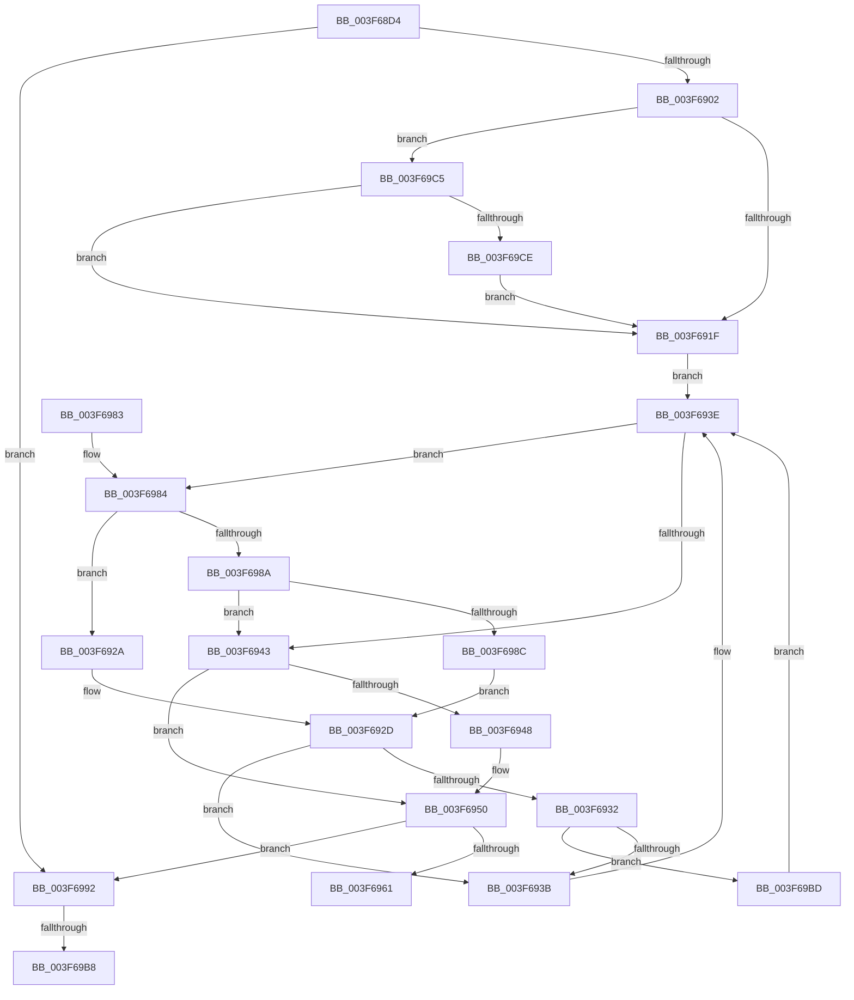

# HalpPopCommonBufferEntry

- RVA: `0x003F68D4`–`0x003F69D6` (길이 `258` bytes)
- VA: `0x00000001403F68D4`
- 실행 섹션: `.text`
- PDB 이름 있음: `예`; PDB Function 태그: `예`
- unwind 정보 RVA: `0x000980E4`
- 디코드: `71`개 명령, `258/258` bytes 표시
- 미해석 바이트: `0` (있으면 어셈블리에 `.byte`로 보존)

> 이 문서는 커널 이미지의 기계어와 PDB 기호를 분석해 생성했습니다. 4번과 5번은 함수 원형과 자료형을 바이너리 사용 방식에서 추정한 C 해석이며 원본 소스 복구 결과는 아닙니다.

## 1. Dependencies

- 직접 호출 지점: **4**; 고유 호출 대상: **3**
- 직접 호출자로 확인된 함수: **3**
- RIP 상대 이미지 참조: **2**

### Outgoing calls
- `0x003F6906` → [KeAcquireSpinLockRaiseToDpc](../20/KeAcquireSpinLockRaiseToDpc_function_00208470.md) (function, `0x00208470`)
- `0x003F694B` → [RtlRbRemoveNode](../2E/RtlRbRemoveNode_function_002E4C10.md) (function, `0x002E4C10`)
- `0x003F6957` → [KeReleaseSpinLock](../39/KeReleaseSpinLock_function_00392BA0.md) (function, `0x00392BA0`)
- `0x003F6999` → [KeAcquireSpinLockRaiseToDpc](../20/KeAcquireSpinLockRaiseToDpc_function_00208470.md) (function, `0x00208470`)

### Direct callers
- [HalFreeCommonBufferDmarThin](HalFreeCommonBufferDmarThin_function_003F6290.md) at `0x003F62C3`
- [HalFreeCommonBufferDmaThin](HalFreeCommonBufferDmaThin_function_003F6800.md) at `0x003F682E`
- [HalFreeCommonBufferV3](../55/HalFreeCommonBufferV3_function_00551A70.md) at `0x00551AA5`

### Static image references
- `0x003F6992` → RVA `0x00FC1888` (`.data`; read)
- `0x003F699E` → RVA `0x00FC1890` (`.data`; read)

## 2. Other-region calls and transfers

- 다른 실행 섹션으로 향하는 call: **0**
- call이 아닌 외부 분기/꼬리 이동: **2**
  - `0x003F69B2` → [sub_006EB8E8 + 0x7A](../6E/Unknown_function_006EB8E8.md) (`tail-transfer`)
  - `0x003F69B8` → [sub_006EB8E8](../6E/Unknown_function_006EB8E8.md) (`tail-transfer`)

## 3. Assembly (complete function range)

```asm
003F68D4  48 8B C4                        mov rax, rsp
003F68D7  48 89 58 08                     mov qword ptr [rax + 8], rbx
003F68DB  48 89 68 10                     mov qword ptr [rax + 0x10], rbp
003F68DF  48 89 70 18                     mov qword ptr [rax + 0x18], rsi
003F68E3  48 89 78 20                     mov qword ptr [rax + 0x20], rdi
003F68E7  41 54                           push r12
003F68E9  41 56                           push r14
003F68EB  41 57                           push r15
003F68ED  48 83 EC 20                     sub rsp, 0x20
003F68F1  33 FF                           xor edi, edi
003F68F3  48 8B DA                        mov rbx, rdx
003F68F6  4C 8B F1                        mov r14, rcx
003F68F9  48 85 D2                        test rdx, rdx
003F68FC  0F 84 90 00 00 00               je 0x1403f6992
003F6902  48 8D 4A 50                     lea rcx, [rdx + 0x50]
003F6906  E8 65 1B E1 FF                  call 0x140208470
003F690B  48 8D 4B 40                     lea rcx, [rbx + 0x40]
003F690F  40 8A E8                        mov bpl, al
003F6912  F6 41 08 01                     test byte ptr [rcx + 8], 1
003F6916  48 8B 11                        mov rdx, qword ptr [rcx]
003F6919  0F 85 A6 00 00 00               jne 0x1403f69c5
003F691F  44 0F B6 41 08                  movzx r8d, byte ptr [rcx + 8]
003F6924  41 83 E0 01                     and r8d, 1
003F6928  EB 14                           jmp 0x1403f693e
003F692A  48 8B 02                        mov rax, qword ptr [rdx]
003F692D  45 85 C0                        test r8d, r8d
003F6930  74 09                           je 0x1403f693b
003F6932  48 85 C0                        test rax, rax
003F6935  0F 85 82 00 00 00               jne 0x1403f69bd
003F693B  48 8B D0                        mov rdx, rax
003F693E  48 85 D2                        test rdx, rdx
003F6941  75 41                           jne 0x1403f6984
003F6943  48 85 D2                        test rdx, rdx
003F6946  74 08                           je 0x1403f6950
003F6948  48 8B FA                        mov rdi, rdx
003F694B  E8 C0 E2 EE FF                  call 0x1402e4c10
003F6950  40 8A D5                        mov dl, bpl
003F6953  48 8D 4B 50                     lea rcx, [rbx + 0x50]
003F6957  E8 44 C2 F9 FF                  call 0x140392ba0
003F695C  48 85 FF                        test rdi, rdi
003F695F  74 31                           je 0x1403f6992
003F6961  48 8B 5C 24 40                  mov rbx, qword ptr [rsp + 0x40]
003F6966  48 8B C7                        mov rax, rdi
003F6969  48 8B 7C 24 58                  mov rdi, qword ptr [rsp + 0x58]
003F696E  48 8B 6C 24 48                  mov rbp, qword ptr [rsp + 0x48]
003F6973  48 8B 74 24 50                  mov rsi, qword ptr [rsp + 0x50]
003F6978  48 83 C4 20                     add rsp, 0x20
003F697C  41 5F                           pop r15
003F697E  41 5E                           pop r14
003F6980  41 5C                           pop r12
003F6982  C3                              ret
003F6983  CC                              int3
003F6984  4C 39 72 18                     cmp qword ptr [rdx + 0x18], r14
003F6988  77 A0                           ja 0x1403f692a
003F698A  74 B7                           je 0x1403f6943
003F698C  48 8B 42 08                     mov rax, qword ptr [rdx + 8]
003F6990  EB 9B                           jmp 0x1403f692d
003F6992  48 8D 0D EF AE BC 00            lea rcx, [rip + 0xbcaeef]
003F6999  E8 D2 1A E1 FF                  call 0x140208470
003F699E  48 8B 1D EB AE BC 00            mov rbx, qword ptr [rip + 0xbcaeeb]
003F69A5  4C 8D 25 E4 AE BC 00            lea r12, [rip + 0xbcaee4]
003F69AC  40 8A F0                        mov sil, al
003F69AF  49 3B DC                        cmp rbx, r12
003F69B2  0F 84 AA 4F 2F 00               je 0x1406eb962
003F69B8  E9 2B 4F 2F 00                  jmp 0x1406eb8e8
003F69BD  48 33 D0                        xor rdx, rax
003F69C0  E9 79 FF FF FF                  jmp 0x1403f693e
003F69C5  48 85 D2                        test rdx, rdx
003F69C8  0F 84 51 FF FF FF               je 0x1403f691f
003F69CE  48 33 D1                        xor rdx, rcx
003F69D1  E9 49 FF FF FF                  jmp 0x1403f691f
```

## 4. C-style interpretation (structured pseudocode)

```c
__int64 __fastcall HalpPopCommonBufferEntry(__int64 a1, __int64 a2)
{
    __int64 result;
    __int64 v_rdi;
    __int64 v_rsp;
    unsigned __int64 v_stack_p10;
    unsigned __int64 v_stack_p18;
    unsigned __int64 v_stack_p20;
    unsigned __int64 v_stack_p8;

    *(unsigned __int64 *)(v_rsp + 8) = v_rbx;
    *(unsigned __int64 *)(v_rsp + 16) = v_rbp;
    *(unsigned __int64 *)(v_rsp + 24) = v_rsi;
    *(unsigned __int64 *)(v_rsp + 32) = v_rdi;
    v_rsp = (v_rsp) - (32);
    v_rdi = 0;
    if (a2 == 0) goto loc_003F6992;
    result = KeAcquireSpinLockRaiseToDpc(a2 + 80, a2, a3, a4);
    if (((*(unsigned __int8 *)(a2 + 64 + 8)) & (1)) != 0) goto loc_003F69C5;
loc_003F691F:
    a3 = (unsigned int)((*(unsigned __int8 *)(a2 + 64 + 8)) & (1));
    goto loc_003F693E;
loc_003F692A:
loc_003F692D:
    if ((unsigned int)(a3) == 0) goto loc_003F693B;
    if (*(unsigned __int64 *)(*(unsigned __int64 *)(a2 + 64)) != 0) goto loc_003F69BD;
loc_003F693B:
loc_003F693E:
    if (*(unsigned __int64 *)(*(unsigned __int64 *)(a2 + 64)) != 0) goto loc_003F6984;
loc_003F6943:
    result = *(unsigned __int64 *)(*(unsigned __int64 *)(a2 + 64));
    if (*(unsigned __int64 *)(*(unsigned __int64 *)(a2 + 64)) != 0) {
        v_rdi = *(unsigned __int64 *)(*(unsigned __int64 *)(a2 + 64));
        result = RtlRbRemoveNode(a2 + 64, *(unsigned __int64 *)(*(unsigned __int64 *)(a2 + 64)), a3, a4);
    }
    result = KeReleaseSpinLock(a2 + 80, (unsigned __int8)((unsigned __int8)(result)), a3, a4);
    if (v_rdi == 0) goto loc_003F6992;
    v_rsp = (v_rsp) + (32);
    return v_rdi;
loc_003F6984:
    if ((*(unsigned __int64 *)((unsigned __int8)((unsigned __int8)(result)) + 24)) > a1) goto loc_003F692A;
    if ((*(unsigned __int64 *)((unsigned __int8)((unsigned __int8)(result)) + 24)) == a1) goto loc_003F6943;
    goto loc_003F692D;
loc_003F6992:
    result = KeAcquireSpinLockRaiseToDpc(v_rip + 12365551, (unsigned __int8)((unsigned __int8)(result)), a3, a4);
loc_003F69BD:
    a2 = ((unsigned __int8)((unsigned __int8)(result))) ^ (result);
    goto loc_003F693E;
loc_003F69C5:
    if (a2 == 0) goto loc_003F691F;
    a2 = (a2) ^ (v_rip + 12365551);
    goto loc_003F691F;
}
```

## 5. (Beta) C Style

```c
int64_t HalpPopCommonBufferEntry(int64_t Arg1, void *Arg2)
{
    uint8_t *arg2 = (uint8_t *)Arg2;

    int64_t result;
    int64_t local_rdi;
    int64_t local_rsp;
    uint64_t v_stack_p10;
    uint64_t v_stack_p18;
    uint64_t v_stack_p20;
    uint64_t v_stack_p8;

    *(uint64_t *)(local_rsp + 0x8) = local_rbx;
    *(uint64_t *)(local_rsp + 0x10) = local_rbp;
    *(uint64_t *)(local_rsp + 0x18) = local_rsi;
    *(uint64_t *)(local_rsp + 0x20) = local_rdi;
    local_rsp = (local_rsp) - (32);
    local_rdi = 0;
    if (Arg2 == NULL) goto loc_003F6992;
    result = KeAcquireSpinLockRaiseToDpc(Arg2 + 80, Arg2, a3, a4);
    if (((*(uint8_t *)(arg2 + 0x40 + 0x8)) & (1)) != 0) goto loc_003F69C5;
loc_003F691F:
    a3 = (uint32_t)((*(uint8_t *)(arg2 + 0x40 + 0x8)) & (1));
    goto loc_003F693E;
loc_003F692A:
loc_003F692D:
    if ((uint32_t)(a3) == 0) goto loc_003F693B;
    if (*(uint64_t *)(*(uint64_t *)(arg2 + 0x40)) != 0) goto loc_003F69BD;
loc_003F693B:
loc_003F693E:
    if (*(uint64_t *)(*(uint64_t *)(arg2 + 0x40)) != 0) goto loc_003F6984;
loc_003F6943:
    result = *(uint64_t *)(*(uint64_t *)(arg2 + 0x40));
    if (*(uint64_t *)(*(uint64_t *)(arg2 + 0x40)) != 0) {
        local_rdi = *(uint64_t *)(*(uint64_t *)(arg2 + 0x40));
        result = RtlRbRemoveNode(Arg2 + 64, *(uint64_t *)(*(uint64_t *)(arg2 + 0x40)), a3, a4);
    }
    result = KeReleaseSpinLock(Arg2 + 80, (uint8_t)((uint8_t)(result)), a3, a4);
    if (local_rdi == 0) goto loc_003F6992;
    local_rsp = (local_rsp) + (32);
    return local_rdi;
loc_003F6984:
    if ((*(uint64_t *)((uint8_t)((uint8_t)(result)) + 0x18)) > Arg1) goto loc_003F692A;
    if ((*(uint64_t *)((uint8_t)((uint8_t)(result)) + 0x18)) == Arg1) goto loc_003F6943;
    goto loc_003F692D;
loc_003F6992:
    result = KeAcquireSpinLockRaiseToDpc(v_rip + 12365551, (uint8_t)((uint8_t)(result)), a3, a4);
loc_003F69BD:
    Arg2 = ((uint8_t)((uint8_t)(result))) ^ (result);
    goto loc_003F693E;
loc_003F69C5:
    if (Arg2 == NULL) goto loc_003F691F;
    Arg2 = (Arg2) ^ (v_rip + 12365551);
    goto loc_003F691F;
}
```

### 관측된 메모리 오프셋

구조체 형식이 확인되지 않은 접근은 인자 기준의 오프셋으로만 기록했습니다.

| 기준 인자 | 오프셋 표현 | 폭 (bit) | 접근 |
|---|---:|---:|---|
| `Arg2` | `+ 0x0` | `64` | `R` |
| `Arg2` | `+ 0x8` | `8` | `R` |
| `Arg2` | `+ 0x40` | `64` | `R` |
| `Arg2` | `+ 0x50` | `64` | `R` |

## 6. Execution-region graph

[열기: 2D/3D 그래프와 함수 탐색 컨트롤 패널](../../../control-panel.html?section=text&rva=0x003F68D4&view=graph)

- 2D 그래프는 위에서 아래로 흐르고, 3D 그래프는 빈 공간을 드래그해 회전합니다. Shift+드래그는 이동, 휠은 확대·축소, 함수 노드 선택은 대상 보고서 이동입니다.

### Static fallback


