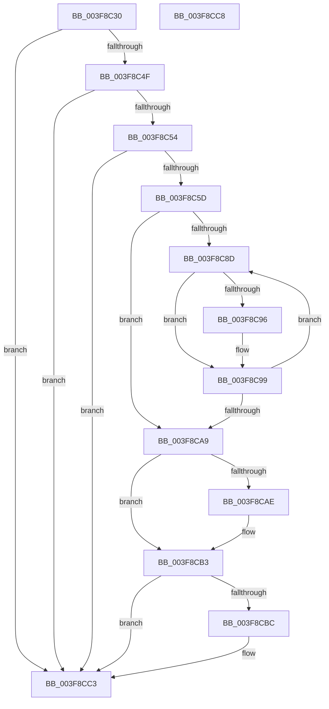

# HalpUnmapVirtualAddress

- RVA: `0x003F8C30`–`0x003F8CC9` (길이 `153` bytes)
- VA: `0x00000001403F8C30`
- 실행 섹션: `.text`
- PDB 이름 있음: `예`; PDB Function 태그: `아니요`
- unwind 정보 RVA: `0x0005C788`
- 디코드: `40`개 명령, `153/153` bytes 표시
- 미해석 바이트: `0` (있으면 어셈블리에 `.byte`로 보존)

> 이 문서는 커널 이미지의 기계어와 PDB 기호를 분석해 생성했습니다. 4번과 5번은 함수 원형과 자료형을 바이너리 사용 방식에서 추정한 C 해석이며 원본 소스 복구 결과는 아닙니다.

## 1. Dependencies

- 직접 호출 지점: **1**; 고유 호출 대상: **1**
- 직접 호출자로 확인된 함수: **13**
- RIP 상대 이미지 참조: **4**

### Outgoing calls
- `0x003F8CAE` → [HalpFlushTLB](../4F/HalpFlushTLB_function_004F5E9C.md) (function, `0x004F5E9C`)

### Direct callers
- [HalpAcpiGetTableWork](HalpAcpiGetTableWork_function_003F6CDC.md) at `0x003F6DC3`
- [HalpAcpiIsCachedTableCompromised](HalpAcpiIsCachedTableCompromised_function_003F6E78.md) at `0x003F6F2A`
- [HalUnmapIoSpace](../56/HalUnmapIoSpace_function_005615B0.md) at `0x005615C2`
- [HalpHpetDiscover](../56/HalpHpetDiscover_function_00561E98.md) at `0x005622C8`
- [HalpUsbLegacyStopOhciInterrupt](../56/HalpUsbLegacyStopOhciInterrupt_function_00563AA0.md) at `0x00563BA1`
- [WdHwDestroyHardwareRegister](../56/WdHwDestroyHardwareRegister_function_0056DE4C.md) at `0x0056DE6F`
- [HalpIvtLegacyProcessDrhdEntry](../57/HalpIvtLegacyProcessDrhdEntry_function_00578C58.md) at `0x005793AD`
- [HalpIvtProcessDrhdEntry](../57/HalpIvtProcessDrhdEntry_function_005794B4.md) at `0x00579C98`
- [sub_006EBA20](../6E/Unknown_function_006EBA20.md) at `0x006EBB1D`
- [HalpCheckLowMemoryPreSleep](../../pagelk/B5/HalpCheckLowMemoryPreSleep_function_00B5EB88.md) at `0x00B5EC9F`
- [HalpCheckLowMemoryPostSleep](../../pagelk/B7/HalpCheckLowMemoryPostSleep_function_00B7A458.md) at `0x00B7A558`
- [HalpBlkInitializeVirtualAddressSpace](../../init/C2/HalpBlkInitializeVirtualAddressSpace_function_00C2368C.md) at `0x00C23770`
- [HalpAcpiTableCacheInit](../../init/C7/HalpAcpiTableCacheInit_function_00C77650.md) at `0x00C7782C`
- [HalpAcpiTableCacheInit](../../init/C7/HalpAcpiTableCacheInit_function_00C77650.md) at `0x00C778C4`
- [HalpAcpiTableCacheInit](../../init/C7/HalpAcpiTableCacheInit_function_00C77650.md) at `0x00C778E8`

### Static image references
- `0x003F8C46` → RVA `0x00E10210` (`.data`; read)
- `0x003F8C54` → RVA `0x00E10228` (`.data`; read)
- `0x003F8CB3` → RVA `0x00E10220` (`.data`; read)
- `0x003F8CBC` → RVA `0x00E10220` (`.data`; write)

## 2. Other-region calls and transfers

- 다른 실행 섹션으로 향하는 call: **0**
- 별도 외부 분기/꼬리 이동을 확인하지 못했습니다.

## 3. Assembly (complete function range)

```asm
003F8C30  48 83 EC 28                     sub rsp, 0x28
003F8C34  4C 8B C9                        mov r9, rcx
003F8C37  8B C2                           mov eax, edx
003F8C39  48 C1 E0 0C                     shl rax, 0xc
003F8C3D  48 FF C9                        dec rcx
003F8C40  48 03 C8                        add rcx, rax
003F8C43  44 8B D2                        mov r10d, edx
003F8C46  4C 3B 0D C3 75 A1 00            cmp r9, qword ptr [rip + 0xa175c3]
003F8C4D  72 74                           jb 0x1403f8cc3
003F8C4F  49 3B C9                        cmp rcx, r9
003F8C52  72 6F                           jb 0x1403f8cc3
003F8C54  48 3B 0D CD 75 A1 00            cmp rcx, qword ptr [rip + 0xa175cd]
003F8C5B  77 66                           ja 0x1403f8cc3
003F8C5D  49 81 E1 00 F0 FF FF            and r9, 0xfffffffffffff000
003F8C64  48 B9 FF FF FF FF 0F 00 00 00   movabs rcx, 0xfffffffff
003F8C6E  49 8B C1                        mov rax, r9
003F8C71  48 C1 E8 0C                     shr rax, 0xc
003F8C75  48 23 C1                        and rax, rcx
003F8C78  48 B9 00 00 00 00 80 F6 FF FF   movabs rcx, 0xfffff68000000000
003F8C82  48 8D 0C C1                     lea rcx, [rcx + rax*8]
003F8C86  49 8B C1                        mov rax, r9
003F8C89  85 D2                           test edx, edx
003F8C8B  74 1C                           je 0x1403f8ca9
003F8C8D  48 83 21 00                     and qword ptr [rcx], 0
003F8C91  45 84 C0                        test r8b, r8b
003F8C94  74 03                           je 0x1403f8c99
003F8C96  0F 01 38                        invlpg byte ptr [rax]
003F8C99  48 05 00 10 00 00               add rax, 0x1000
003F8C9F  48 83 C1 08                     add rcx, 8
003F8CA3  49 83 EA 01                     sub r10, 1
003F8CA7  75 E4                           jne 0x1403f8c8d
003F8CA9  45 84 C0                        test r8b, r8b
003F8CAC  75 05                           jne 0x1403f8cb3
003F8CAE  E8 E9 D1 0F 00                  call 0x1404f5e9c
003F8CB3  4C 39 0D 66 75 A1 00            cmp qword ptr [rip + 0xa17566], r9
003F8CBA  76 07                           jbe 0x1403f8cc3
003F8CBC  4C 89 0D 5D 75 A1 00            mov qword ptr [rip + 0xa1755d], r9
003F8CC3  48 83 C4 28                     add rsp, 0x28
003F8CC7  C3                              ret
003F8CC8  CC                              int3
```

## 4. C-style interpretation (structured pseudocode)

```c
__int64 __fastcall HalpUnmapVirtualAddress(__int64 a1, int a2, unsigned __int8 a3)
{
    __int64 result;
    __int64 v_r10;
    __int64 v_rsp;

    v_rsp = (v_rsp) - (40);
    result = ((unsigned int)(a2)) << (12);
    a1 = (a1) - 1;
    a1 = (a1) + (result);
    if (a1 < (*(unsigned __int64 *)(v_rip + 10581443))) goto loc_003F8CC3;
    if (a1 < a1) goto loc_003F8CC3;
    if (a1 > (*(unsigned __int64 *)(v_rip + 10581453))) goto loc_003F8CC3;
    a4 = (a1) & (0xFFFFFFFFFFFFF000ULL);
    result = (a4) >> (12);
    result = (result) & (a1);
    if (a2 == 0) goto loc_003F8CA9;
loc_003F8C8D:
    if (a3 != 0) {
    }
    result = (a4) + (0x1000ULL);
    a1 = (a1 + result * 8) + (8);
    v_r10 = ((unsigned int)(a2)) - (1);
    if (condition_is_not_equal) goto loc_003F8C8D;
loc_003F8CA9:
    if (a3 == 0) {
        result = HalpFlushTLB(a1, a2, a3, a4);
    }
    if ((*(unsigned __int64 *)(v_rip + 10581350)) >= = a4) {
        *(unsigned __int64 *)(v_rip + 10581341) = a4;
    }
    v_rsp = (v_rsp) + (40);
    return result;
}
```

## 5. (Beta) C Style

```c
int64_t HalpUnmapVirtualAddress(int64_t Arg1, int32_t Arg2, uint8_t Arg3)
{
    int64_t result;
    int64_t local_r10;
    int64_t local_rsp;

    local_rsp = (local_rsp) - (40);
    result = ((uint32_t)(Arg2)) << (12);
    Arg1 = (Arg1) - 1;
    Arg1 = (Arg1) + (result);
    if (Arg1 < (*(uint64_t *)(v_rip + 0xA175C3))) goto loc_003F8CC3;
    if (Arg1 < Arg1) goto loc_003F8CC3;
    if (Arg1 > (*(uint64_t *)(v_rip + 0xA175CD))) goto loc_003F8CC3;
    a4 = (Arg1) & (0xFFFFFFFFFFFFF000ULL);
    result = (a4) >> (12);
    result = (result) & (Arg1);
    if (Arg2 == 0) goto loc_003F8CA9;
loc_003F8C8D:
    if (Arg3 != 0) {
    }
    result = (a4) + (0x1000ULL);
    Arg1 = (Arg1 + result * 8) + (8);
    local_r10 = ((uint32_t)(Arg2)) - (1);
    if (condition_is_not_equal) goto loc_003F8C8D;
loc_003F8CA9:
    if (Arg3 == 0) {
        result = HalpFlushTLB(Arg1, Arg2, Arg3, a4);
    }
    if ((*(uint64_t *)(v_rip + 0xA17566)) >= = a4) {
        *(uint64_t *)(v_rip + 0xA1755D) = a4;
    }
    local_rsp = (local_rsp) + (40);
    return result;
}
```

## 6. Execution-region graph

[열기: 2D/3D 그래프와 함수 탐색 컨트롤 패널](../../../control-panel.html?section=text&rva=0x003F8C30&view=graph)

- 2D 그래프는 위에서 아래로 흐르고, 3D 그래프는 빈 공간을 드래그해 회전합니다. Shift+드래그는 이동, 휠은 확대·축소, 함수 노드 선택은 대상 보고서 이동입니다.

### Static fallback


