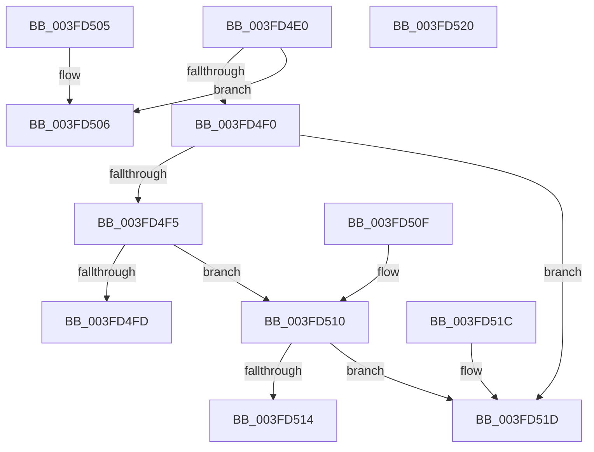

# IoGetRequestorProcess

- RVA: `0x003FD4E0`–`0x003FD521` (길이 `65` bytes)
- VA: `0x00000001403FD4E0`
- 실행 섹션: `.text`
- PDB 이름 있음: `예`; PDB Function 태그: `아니요`
- unwind 정보 RVA: `0x000DB714`
- 디코드: `23`개 명령, `65/65` bytes 표시
- 미해석 바이트: `0` (있으면 어셈블리에 `.byte`로 보존)

> 이 문서는 커널 이미지의 기계어와 PDB 기호를 분석해 생성했습니다. 4번과 5번은 함수 원형과 자료형을 바이너리 사용 방식에서 추정한 C 해석이며 원본 소스 복구 결과는 아닙니다.

## 1. Dependencies

- 직접 호출 지점: **0**; 고유 호출 대상: **0**
- 직접 호출자로 확인된 함수: **7**
- RIP 상대 이미지 참조: **0**

### Outgoing calls
- 직접 디코드된 call 명령이 없습니다.

### Direct callers
- [FsRtlPrivateCheckWaitingLocks](../38/FsRtlPrivateCheckWaitingLocks_function_0038DCBC.md) at `0x0038DD36`
- [IopDoesCompletionNeedsApc](IopDoesCompletionNeedsApc_function_003FD094.md) at `0x003FD0B7`
- [FsRtlProcessFileLock](FsRtlProcessFileLock_function_003FD0E0.md) at `0x003FD13A`
- [FsRtlProcessFileLock](FsRtlProcessFileLock_function_003FD0E0.md) at `0x003FD1B7`
- [FsRtlProcessFileLock](FsRtlProcessFileLock_function_003FD0E0.md) at `0x003FD208`
- [FsRtlCheckLockForWriteAccess](FsRtlCheckLockForWriteAccess_function_003FD260.md) at `0x003FD2CA`
- [FsRtlCheckLockForReadAccess](FsRtlCheckLockForReadAccess_function_003FD300.md) at `0x003FD360`
- [FsRtlPrivateFastUnlockAll](FsRtlPrivateFastUnlockAll_function_003FD554.md) at `0x003FD89E`
- [sub_006EBCF4](../6E/Unknown_function_006EBCF4.md) at `0x006EBCF4`

### Static image references
- 디코드된 RIP-relative 메모리 참조가 없습니다.

## 2. Other-region calls and transfers

- 다른 실행 섹션으로 향하는 call: **0**
- 별도 외부 분기/꼬리 이동을 확인하지 못했습니다.

## 3. Assembly (complete function range)

```asm
003FD4E0  F7 41 10 00 20 00 00            test dword ptr [rcx + 0x10], 0x2000
003FD4E7  48 8B 91 98 00 00 00            mov rdx, qword ptr [rcx + 0x98]
003FD4EE  75 16                           jne 0x1403fd506
003FD4F0  48 85 D2                        test rdx, rdx
003FD4F3  74 28                           je 0x1403fd51d
003FD4F5  0F B6 41 46                     movzx eax, byte ptr [rcx + 0x46]
003FD4F9  84 C0                           test al, al
003FD4FB  75 13                           jne 0x1403fd510
003FD4FD  48 8B 82 20 02 00 00            mov rax, qword ptr [rdx + 0x220]
003FD504  C3                              ret
003FD505  CC                              int3
003FD506  48 8B 41 58                     mov rax, qword ptr [rcx + 0x58]
003FD50A  48 83 E0 F9                     and rax, 0xfffffffffffffff9
003FD50E  C3                              ret
003FD50F  CC                              int3
003FD510  3C 01                           cmp al, 1
003FD512  75 09                           jne 0x1403fd51d
003FD514  48 8B 82 B8 00 00 00            mov rax, qword ptr [rdx + 0xb8]
003FD51B  C3                              ret
003FD51C  CC                              int3
003FD51D  33 C0                           xor eax, eax
003FD51F  C3                              ret
003FD520  CC                              int3
```

## 4. C-style interpretation (structured pseudocode)

```c
__int64 __fastcall IoGetRequestorProcess(__int64 a1)
{
    __int64 result;

    if (((*(unsigned int *)(a1 + 16)) & (0x2000ULL)) != 0) goto loc_003FD506;
    if (*(unsigned __int64 *)(a1 + 152) == 0) goto loc_003FD51D;
    if ((unsigned __int8)(*(unsigned __int8 *)(a1 + 70)) != 0) goto loc_003FD510;
    return *(unsigned __int64 *)(*(unsigned __int64 *)(a1 + 152) + 544);
loc_003FD506:
    result = (*(unsigned __int64 *)(a1 + 88)) & (-7);
    return result;
loc_003FD510:
    if (((unsigned __int8)(result)) != 1) goto loc_003FD51D;
    return *(unsigned __int64 *)(*(unsigned __int64 *)(a1 + 152) + 184);
loc_003FD51D:
    result = 0;
    return result;
}
```

## 5. (Beta) C Style

```c
int64_t IoGetRequestorProcess(void *Arg1)
{
    uint8_t *arg1 = (uint8_t *)Arg1;

    int64_t result;

    if (((*(uint32_t *)(arg1 + 0x10)) & (0x2000ULL)) != 0) goto loc_003FD506;
    if (*(uint64_t *)(arg1 + 0x98) == 0) goto loc_003FD51D;
    if ((uint8_t)(*(uint8_t *)(arg1 + 0x46)) != 0) goto loc_003FD510;
    return *(uint64_t *)(*(uint64_t *)(arg1 + 0x98) + 0x220);
loc_003FD506:
    result = (*(uint64_t *)(arg1 + 0x58)) & (-7);
    return result;
loc_003FD510:
    if (((uint8_t)(result)) != 1) goto loc_003FD51D;
    return *(uint64_t *)(*(uint64_t *)(arg1 + 0x98) + 0xB8);
loc_003FD51D:
    result = 0;
    return result;
}
```

### 관측된 메모리 오프셋

구조체 형식이 확인되지 않은 접근은 인자 기준의 오프셋으로만 기록했습니다.

| 기준 인자 | 오프셋 표현 | 폭 (bit) | 접근 |
|---|---:|---:|---|
| `Arg1` | `+ 0x10` | `32` | `R` |
| `Arg1` | `+ 0x46` | `8` | `R` |
| `Arg1` | `+ 0x58` | `64` | `R` |
| `Arg1` | `+ 0x98` | `64` | `R` |

## 6. Execution-region graph

[열기: 2D/3D 그래프와 함수 탐색 컨트롤 패널](../../../control-panel.html?section=text&rva=0x003FD4E0&view=graph)

- 2D 그래프는 위에서 아래로 흐르고, 3D 그래프는 빈 공간을 드래그해 회전합니다. Shift+드래그는 이동, 휠은 확대·축소, 함수 노드 선택은 대상 보고서 이동입니다.

### Static fallback


