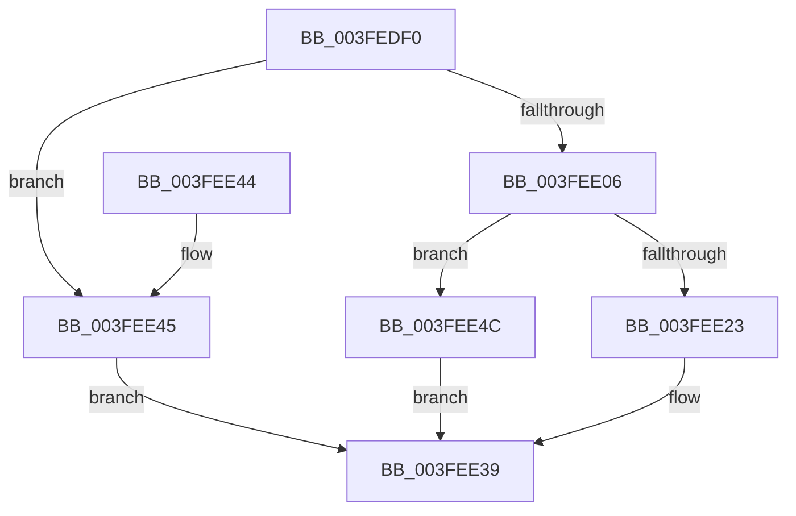

# IoQueryFullDriverPath

- RVA: `0x003FEDF0`–`0x003FEE53` (길이 `99` bytes)
- VA: `0x00000001403FEDF0`
- 실행 섹션: `.text`
- PDB 이름 있음: `예`; PDB Function 태그: `아니요`
- unwind 정보 RVA: `0x0008A6D8`
- 디코드: `29`개 명령, `99/99` bytes 표시
- 미해석 바이트: `0` (있으면 어셈블리에 `.byte`로 보존)

> 이 문서는 커널 이미지의 기계어와 PDB 기호를 분석해 생성했습니다. 4번과 5번은 함수 원형과 자료형을 바이너리 사용 방식에서 추정한 C 해석이며 원본 소스 복구 결과는 아닙니다.

## 1. Dependencies

- 직접 호출 지점: **2**; 고유 호출 대상: **2**
- 직접 호출자로 확인된 함수: **1**
- RIP 상대 이미지 참조: **0**

### Outgoing calls
- `0x003FEE15` → [ExAllocatePool2](../../poolcode/B8/ExAllocatePool2_function_00B820F0.md) (function, `0x00B820F0`)
- `0x003FEE32` → [RtlCopyUnicodeString](RtlCopyUnicodeString_function_003FEF30.md) (function, `0x003FEF30`)

### Direct callers
- [PiGetDriverImageDirectory](../../page/A6/PiGetDriverImageDirectory_function_00A6F2C4.md) at `0x00A6F31B`

### Static image references
- 디코드된 RIP-relative 메모리 참조가 없습니다.

## 2. Other-region calls and transfers

- 다른 실행 섹션으로 향하는 call: **1**
  - `0x003FEE15` → [ExAllocatePool2](../../poolcode/B8/ExAllocatePool2_function_00B820F0.md) (`.text` → `POOLCODE`)
- 별도 외부 분기/꼬리 이동을 확인하지 못했습니다.

## 3. Assembly (complete function range)

```asm
003FEDF0  48 89 5C 24 08                  mov qword ptr [rsp + 8], rbx
003FEDF5  57                              push rdi
003FEDF6  48 83 EC 20                     sub rsp, 0x20
003FEDFA  48 8B 59 28                     mov rbx, qword ptr [rcx + 0x28]
003FEDFE  48 8B FA                        mov rdi, rdx
003FEE01  48 85 DB                        test rbx, rbx
003FEE04  74 3F                           je 0x1403fee45
003FEE06  0F B7 53 4A                     movzx edx, word ptr [rbx + 0x4a]
003FEE0A  B9 00 01 00 00                  mov ecx, 0x100
003FEE0F  41 B8 49 6F 4E 32               mov r8d, 0x324e6f49
003FEE15  E8 D6 32 78 00                  call 0x140b820f0
003FEE1A  48 89 47 08                     mov qword ptr [rdi + 8], rax
003FEE1E  48 85 C0                        test rax, rax
003FEE21  74 29                           je 0x1403fee4c
003FEE23  0F B7 43 4A                     movzx eax, word ptr [rbx + 0x4a]
003FEE27  48 8D 53 48                     lea rdx, [rbx + 0x48]
003FEE2B  48 8B CF                        mov rcx, rdi
003FEE2E  66 89 47 02                     mov word ptr [rdi + 2], ax
003FEE32  E8 F9 00 00 00                  call 0x1403fef30
003FEE37  33 C0                           xor eax, eax
003FEE39  48 8B 5C 24 30                  mov rbx, qword ptr [rsp + 0x30]
003FEE3E  48 83 C4 20                     add rsp, 0x20
003FEE42  5F                              pop rdi
003FEE43  C3                              ret
003FEE44  CC                              int3
003FEE45  B8 25 02 00 C0                  mov eax, 0xc0000225
003FEE4A  EB ED                           jmp 0x1403fee39
003FEE4C  B8 9A 00 00 C0                  mov eax, 0xc000009a
003FEE51  EB E6                           jmp 0x1403fee39
```

## 4. C-style interpretation (structured pseudocode)

```c
__int64 __fastcall IoQueryFullDriverPath(__int64 a1, __int64 a2)
{
    __int64 result;
    __int64 v_rsp;
    unsigned __int64 v_stack_p8;

    v_stack_p8 = v_rbx;
    v_rsp = (v_rsp) - (32);
    if (*(unsigned __int64 *)(a1 + 40) == 0) goto loc_003FEE45;
    result = ExAllocatePool2(256, *(unsigned __int16 *)(*(unsigned __int64 *)(a1 + 40) + 74), (unsigned int)(0x324E6F49ULL), a4);
    *(unsigned __int64 *)(a2 + 8) = result;
    if (result == 0) goto loc_003FEE4C;
    *(unsigned __int16 *)(a2 + 2) = (unsigned __int16)(*(unsigned __int16 *)(*(unsigned __int64 *)(a1 + 40) + 74));
    result = RtlCopyUnicodeString(a2, *(unsigned __int64 *)(a1 + 40) + 72, (unsigned int)(0x324E6F49ULL), a4);
    result = 0;
loc_003FEE39:
    v_rsp = (v_rsp) + (32);
    return result;
loc_003FEE45:
    goto loc_003FEE39;
loc_003FEE4C:
    goto loc_003FEE39;
}
```

## 5. (Beta) C Style

```c
int64_t IoQueryFullDriverPath(void *Arg1, void *Arg2)
{
    uint8_t *arg1 = (uint8_t *)Arg1;
    uint8_t *arg2 = (uint8_t *)Arg2;

    int64_t result;
    int64_t local_rsp;
    uint64_t v_stack_p8;

    v_stack_p8 = local_rbx;
    local_rsp = (local_rsp) - (32);
    if (*(uint64_t *)(arg1 + 0x28) == 0) goto loc_003FEE45;
    result = ExAllocatePool2(256, *(uint16_t *)(*(uint64_t *)(arg1 + 0x28) + 0x4A), (uint32_t)(0x324E6F49ULL), a4);
    *(uint64_t *)(arg2 + 0x8) = result;
    if (result == 0) goto loc_003FEE4C;
    *(uint16_t *)(arg2 + 0x2) = (uint16_t)(*(uint16_t *)(*(uint64_t *)(arg1 + 0x28) + 0x4A));
    result = RtlCopyUnicodeString(Arg2, *(uint64_t *)(arg1 + 0x28) + 72, (uint32_t)(0x324E6F49ULL), a4);
    result = 0;
loc_003FEE39:
    local_rsp = (local_rsp) + (32);
    return result;
loc_003FEE45:
    goto loc_003FEE39;
loc_003FEE4C:
    goto loc_003FEE39;
}
```

### 관측된 메모리 오프셋

구조체 형식이 확인되지 않은 접근은 인자 기준의 오프셋으로만 기록했습니다.

| 기준 인자 | 오프셋 표현 | 폭 (bit) | 접근 |
|---|---:|---:|---|
| `Arg1` | `+ 0x28` | `64` | `R` |
| `Arg2` | `+ 0x2` | `16` | `W` |
| `Arg2` | `+ 0x8` | `64` | `W` |

## 6. Execution-region graph

[열기: 2D/3D 그래프와 함수 탐색 컨트롤 패널](../../../control-panel.html?section=text&rva=0x003FEDF0&view=graph)

- 2D 그래프는 위에서 아래로 흐르고, 3D 그래프는 빈 공간을 드래그해 회전합니다. Shift+드래그는 이동, 휠은 확대·축소, 함수 노드 선택은 대상 보고서 이동입니다.

### Static fallback


