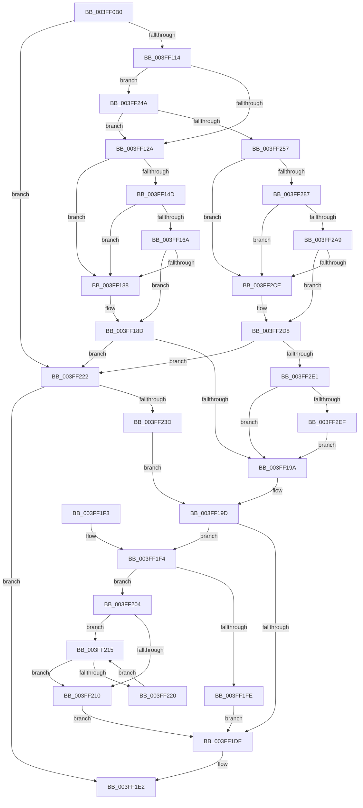

# IopAllocateMdl

- RVA: `0x003FF0B0`–`0x003FF30A` (길이 `602` bytes)
- VA: `0x00000001403FF0B0`
- 실행 섹션: `.text`
- PDB 이름 있음: `예`; PDB Function 태그: `아니요`
- unwind 정보 RVA: `0x0009A008`
- 디코드: `157`개 명령, `602/602` bytes 표시
- 미해석 바이트: `0` (있으면 어셈블리에 `.byte`로 보존)

> 이 문서는 커널 이미지의 기계어와 PDB 기호를 분석해 생성했습니다. 4번과 5번은 함수 원형과 자료형을 바이너리 사용 방식에서 추정한 C 해석이며 원본 소스 복구 결과는 아닙니다.

## 1. Dependencies

- 직접 호출 지점: **8**; 고유 호출 대상: **4**
- 직접 호출자로 확인된 함수: **2**
- RIP 상대 이미지 참조: **2**

### Outgoing calls
- `0x003FF140` → [ExpInterlockedPopEntrySList](../6B/ExpInterlockedPopEntrySList_function_006BA570.md) (function, `0x006BA570`)
- `0x003FF15D` → [ExpInterlockedPopEntrySList](../6B/ExpInterlockedPopEntrySList_function_006BA570.md) (function, `0x006BA570`)
- `0x003FF17B` → [guard_dispatch_icall](../6B/guard_dispatch_icall_function_006BAAD0.md) (function, `0x006BAAD0`)
- `0x003FF230` → [ExAllocatePool2](../../poolcode/B8/ExAllocatePool2_function_00B820F0.md) (function, `0x00B820F0`)
- `0x003FF27A` → [ExpInterlockedPopEntrySList](../6B/ExpInterlockedPopEntrySList_function_006BA570.md) (function, `0x006BA570`)
- `0x003FF29C` → [ExpInterlockedPopEntrySList](../6B/ExpInterlockedPopEntrySList_function_006BA570.md) (function, `0x006BA570`)
- `0x003FF2C1` → [guard_dispatch_icall](../6B/guard_dispatch_icall_function_006BAAD0.md) (function, `0x006BAAD0`)
- `0x003FF300` → [VfPtMiscPoolNotification](VfPtMiscPoolNotification_function_003FF310.md) (function, `0x003FF310`)

### Direct callers
- [IopAllocateAndPopulateWriteIrp](../40/IopAllocateAndPopulateWriteIrp_function_004011F4.md) at `0x004013DE`
- [IopMcCreatePartialMdl](../../page/72/IopMcCreatePartialMdl_function_00723034.md) at `0x00723074`

### Static image references
- `0x003FF114` → RVA `0x00F04240` (`.data`; read)
- `0x003FF24A` → RVA `0x00F04ABC` (`.data`; read)

## 2. Other-region calls and transfers

- 다른 실행 섹션으로 향하는 call: **1**
  - `0x003FF230` → [ExAllocatePool2](../../poolcode/B8/ExAllocatePool2_function_00B820F0.md) (`.text` → `POOLCODE`)
- 별도 외부 분기/꼬리 이동을 확인하지 못했습니다.

## 3. Assembly (complete function range)

```asm
003FF0B0  44 88 4C 24 20                  mov byte ptr [rsp + 0x20], r9b
003FF0B5  44 88 44 24 18                  mov byte ptr [rsp + 0x18], r8b
003FF0BA  89 54 24 10                     mov dword ptr [rsp + 0x10], edx
003FF0BE  53                              push rbx
003FF0BF  55                              push rbp
003FF0C0  56                              push rsi
003FF0C1  57                              push rdi
003FF0C2  41 54                           push r12
003FF0C4  41 55                           push r13
003FF0C6  41 56                           push r14
003FF0C8  41 57                           push r15
003FF0CA  48 83 EC 28                     sub rsp, 0x28
003FF0CE  44 8B AC 24 98 00 00 00         mov r13d, dword ptr [rsp + 0x98]
003FF0D6  33 C0                           xor eax, eax
003FF0D8  41 83 C5 30                     add r13d, 0x30
003FF0DC  8B F2                           mov esi, edx
003FF0DE  48 81 C6 FF 0F 00 00            add rsi, 0xfff
003FF0E5  8B FA                           mov edi, edx
003FF0E7  44 8B F9                        mov r15d, ecx
003FF0EA  4C 8B F1                        mov r14, rcx
003FF0ED  45 8B CF                        mov r9d, r15d
003FF0F0  44 0F B7 E0                     movzx r12d, ax
003FF0F4  41 81 E1 FF 0F 00 00            and r9d, 0xfff
003FF0FB  49 03 F1                        add rsi, r9
003FF0FE  48 C1 EE 0C                     shr rsi, 0xc
003FF102  45 8D 6C F5 00                  lea r13d, [r13 + rsi*8]
003FF107  41 81 FD B8 00 00 00            cmp r13d, 0xb8
003FF10E  0F 87 0E 01 00 00               ja 0x1403ff222
003FF114  38 05 26 51 B0 00               cmp byte ptr [rip + 0xb05126], al
003FF11A  44 8D 60 08                     lea r12d, [rax + 8]
003FF11E  41 BD B8 00 00 00               mov r13d, 0xb8
003FF124  0F 85 20 01 00 00               jne 0x1403ff24a
003FF12A  65 48 8B 2C 25 20 00 00 00      mov rbp, qword ptr gs:[0x20]
003FF133  48 8B BD 30 08 00 00            mov rdi, qword ptr [rbp + 0x830]
003FF13A  48 8B CF                        mov rcx, rdi
003FF13D  FF 47 14                        inc dword ptr [rdi + 0x14]
003FF140  E8 2B B4 2B 00                  call 0x1406ba570
003FF145  48 8B D8                        mov rbx, rax
003FF148  48 85 C0                        test rax, rax
003FF14B  75 3B                           jne 0x1403ff188
003FF14D  FF 47 18                        inc dword ptr [rdi + 0x18]
003FF150  48 8B BD 38 08 00 00            mov rdi, qword ptr [rbp + 0x838]
003FF157  48 8B CF                        mov rcx, rdi
003FF15A  FF 47 14                        inc dword ptr [rdi + 0x14]
003FF15D  E8 0E B4 2B 00                  call 0x1406ba570
003FF162  48 8B D8                        mov rbx, rax
003FF165  48 85 C0                        test rax, rax
003FF168  75 1E                           jne 0x1403ff188
003FF16A  8B 57 2C                        mov edx, dword ptr [rdi + 0x2c]
003FF16D  48 8B 47 30                     mov rax, qword ptr [rdi + 0x30]
003FF171  44 8B 47 28                     mov r8d, dword ptr [rdi + 0x28]
003FF175  8B 4F 24                        mov ecx, dword ptr [rdi + 0x24]
003FF178  FF 47 18                        inc dword ptr [rdi + 0x18]
003FF17B  E8 50 B9 2B 00                  call 0x1406baad0
003FF180  48 8B D8                        mov rbx, rax
003FF183  48 85 C0                        test rax, rax
003FF186  74 05                           je 0x1403ff18d
003FF188  8B 45 24                        mov eax, dword ptr [rbp + 0x24]
003FF18B  89 03                           mov dword ptr [rbx], eax
003FF18D  8B 7C 24 78                     mov edi, dword ptr [rsp + 0x78]
003FF191  48 85 DB                        test rbx, rbx
003FF194  0F 84 88 00 00 00               je 0x1403ff222
003FF19A  0F B7 03                        movzx eax, word ptr [rbx]
003FF19D  66 89 43 0C                     mov word ptr [rbx + 0xc], ax
003FF1A1  66 83 C6 06                     add si, 6
003FF1A5  48 8B 84 24 90 00 00 00         mov rax, qword ptr [rsp + 0x90]
003FF1AD  49 81 E6 00 F0 FF FF            and r14, 0xfffffffffffff000
003FF1B4  66 C1 E6 03                     shl si, 3
003FF1B8  41 81 E7 FF 0F 00 00            and r15d, 0xfff
003FF1BF  48 C7 03 00 00 00 00            mov qword ptr [rbx], 0
003FF1C6  66 89 73 08                     mov word ptr [rbx + 8], si
003FF1CA  4C 89 73 20                     mov qword ptr [rbx + 0x20], r14
003FF1CE  44 89 7B 2C                     mov dword ptr [rbx + 0x2c], r15d
003FF1D2  89 7B 28                        mov dword ptr [rbx + 0x28], edi
003FF1D5  66 44 89 63 0A                  mov word ptr [rbx + 0xa], r12w
003FF1DA  48 85 C0                        test rax, rax
003FF1DD  75 15                           jne 0x1403ff1f4
003FF1DF  48 8B C3                        mov rax, rbx
003FF1E2  48 83 C4 28                     add rsp, 0x28
003FF1E6  41 5F                           pop r15
003FF1E8  41 5E                           pop r14
003FF1EA  41 5D                           pop r13
003FF1EC  41 5C                           pop r12
003FF1EE  5F                              pop rdi
003FF1EF  5E                              pop rsi
003FF1F0  5D                              pop rbp
003FF1F1  5B                              pop rbx
003FF1F2  C3                              ret
003FF1F3  CC                              int3
003FF1F4  80 BC 24 80 00 00 00 00         cmp byte ptr [rsp + 0x80], 0
003FF1FC  75 06                           jne 0x1403ff204
003FF1FE  48 89 58 08                     mov qword ptr [rax + 8], rbx
003FF202  EB DB                           jmp 0x1403ff1df
003FF204  48 8B 48 08                     mov rcx, qword ptr [rax + 8]
003FF208  48 8B 01                        mov rax, qword ptr [rcx]
003FF20B  48 85 C0                        test rax, rax
003FF20E  75 05                           jne 0x1403ff215
003FF210  48 89 19                        mov qword ptr [rcx], rbx
003FF213  EB CA                           jmp 0x1403ff1df
003FF215  48 8B C8                        mov rcx, rax
003FF218  48 8B 00                        mov rax, qword ptr [rax]
003FF21B  48 85 C0                        test rax, rax
003FF21E  74 F0                           je 0x1403ff210
003FF220  EB F3                           jmp 0x1403ff215
003FF222  41 8B D5                        mov edx, r13d
003FF225  B9 42 00 00 00                  mov ecx, 0x42
003FF22A  41 B8 4D 64 6C 20               mov r8d, 0x206c644d
003FF230  E8 BB 2E 78 00                  call 0x140b820f0
003FF235  48 8B D8                        mov rbx, rax
003FF238  48 85 C0                        test rax, rax
003FF23B  74 A5                           je 0x1403ff1e2
003FF23D  65 8B 04 25 A4 01 00 00         mov eax, dword ptr gs:[0x1a4]
003FF245  E9 53 FF FF FF                  jmp 0x1403ff19d
003FF24A  83 3D 6B 58 B0 00 01            cmp dword ptr [rip + 0xb0586b], 1
003FF251  0F 85 D3 FE FF FF               jne 0x1403ff12a
003FF257  65 48 8B 04 25 20 00 00 00      mov rax, qword ptr gs:[0x20]
003FF260  48 89 44 24 70                  mov qword ptr [rsp + 0x70], rax
003FF265  C6 84 24 88 00 00 00 01         mov byte ptr [rsp + 0x88], 1
003FF26D  48 8B A8 30 08 00 00            mov rbp, qword ptr [rax + 0x830]
003FF274  48 8B CD                        mov rcx, rbp
003FF277  FF 45 14                        inc dword ptr [rbp + 0x14]
003FF27A  E8 F1 B2 2B 00                  call 0x1406ba570
003FF27F  48 8B D8                        mov rbx, rax
003FF282  48 85 C0                        test rax, rax
003FF285  75 47                           jne 0x1403ff2ce
003FF287  FF 45 18                        inc dword ptr [rbp + 0x18]
003FF28A  48 8B 6C 24 70                  mov rbp, qword ptr [rsp + 0x70]
003FF28F  48 8B AD 38 08 00 00            mov rbp, qword ptr [rbp + 0x838]
003FF296  48 8B CD                        mov rcx, rbp
003FF299  FF 45 14                        inc dword ptr [rbp + 0x14]
003FF29C  E8 CF B2 2B 00                  call 0x1406ba570
003FF2A1  48 8B D8                        mov rbx, rax
003FF2A4  48 85 C0                        test rax, rax
003FF2A7  75 25                           jne 0x1403ff2ce
003FF2A9  8B 55 2C                        mov edx, dword ptr [rbp + 0x2c]
003FF2AC  44 8B 45 28                     mov r8d, dword ptr [rbp + 0x28]
003FF2B0  8B 4D 24                        mov ecx, dword ptr [rbp + 0x24]
003FF2B3  FF 45 18                        inc dword ptr [rbp + 0x18]
003FF2B6  88 84 24 88 00 00 00            mov byte ptr [rsp + 0x88], al
003FF2BD  48 8B 45 30                     mov rax, qword ptr [rbp + 0x30]
003FF2C1  E8 0A B8 2B 00                  call 0x1406baad0
003FF2C6  48 8B D8                        mov rbx, rax
003FF2C9  48 85 C0                        test rax, rax
003FF2CC  74 0A                           je 0x1403ff2d8
003FF2CE  48 8B 44 24 70                  mov rax, qword ptr [rsp + 0x70]
003FF2D3  8B 40 24                        mov eax, dword ptr [rax + 0x24]
003FF2D6  89 03                           mov dword ptr [rbx], eax
003FF2D8  48 85 DB                        test rbx, rbx
003FF2DB  0F 84 41 FF FF FF               je 0x1403ff222
003FF2E1  80 BC 24 88 00 00 00 00         cmp byte ptr [rsp + 0x88], 0
003FF2E9  0F 84 AB FE FF FF               je 0x1403ff19a
003FF2EF  48 0F BF 53 08                  movsx rdx, word ptr [rbx + 8]
003FF2F4  45 33 C9                        xor r9d, r9d
003FF2F7  41 B8 4D 64 6C 20               mov r8d, 0x206c644d
003FF2FD  48 8B CB                        mov rcx, rbx
003FF300  E8 0B 00 00 00                  call 0x1403ff310
003FF305  E9 90 FE FF FF                  jmp 0x1403ff19a
```

## 4. C-style interpretation (structured pseudocode)

```c
__int64 __fastcall IopAllocateMdl(__int64 a1, int a2, unsigned __int8 a3, unsigned __int8 a4, __int64 a5, unsigned int a6)
{
    __int64 result;
    __int64 v_r13;
    __int64 v_r14;
    __int64 v_r15;
    __int64 v_rsi;
    __int64 v_rsp;
    unsigned int v_stack_p10;
    unsigned __int8 v_stack_p18;
    unsigned __int8 v_stack_p20;
    unsigned __int64 v_stack_p70;
    unsigned __int8 v_stack_p80;
    unsigned __int8 v_stack_p88;

    v_stack_p20 = a4;
    v_stack_p18 = a3;
    v_stack_p10 = a2;
    v_rsp = (v_rsp) - (40);
    result = 0;
    v_r13 = (unsigned int)(((unsigned int)(a6)) + (48));
    v_rsi = ((unsigned int)(a2)) + (0xFFFULL);
    a4 = (unsigned int)(((unsigned int)((unsigned int)((unsigned int)((unsigned int)(a1))))) & (0xFFFULL));
    v_rsi = (v_rsi) + (a4);
    v_rsi = (v_rsi) >> (12);
    if (((unsigned int)(v_r13 + v_rsi * 8)) > 184) goto loc_003FF222;
    if ((*(unsigned __int8 *)(v_rip + 11555110)) != 0) goto loc_003FF24A;
loc_003FF12A:
    result = ExpInterlockedPopEntrySList(*(unsigned __int64 *)(*(unsigned __int64 *)(gs_base + (0 + 32)) + 2096), a2, a3, a4);
    if (result != 0) goto loc_003FF188;
    result = ExpInterlockedPopEntrySList(*(unsigned __int64 *)(*(unsigned __int64 *)(gs_base + (0 + 32)) + 2104), a2, a3, a4);
    if (result != 0) goto loc_003FF188;
    result = guard_dispatch_icall((unsigned int)(*(unsigned int *)(*(unsigned __int64 *)(*(unsigned __int64 *)(gs_base + (0 + 32)) + 2104) + 36)), (unsigned int)(*(unsigned int *)(*(unsigned __int64 *)(*(unsigned __int64 *)(gs_base + (0 + 32)) + 2104) + 44)), (unsigned int)(*(unsigned int *)(*(unsigned __int64 *)(*(unsigned __int64 *)(gs_base + (0 + 32)) + 2104) + 40)), a4);
    if (result != 0) {
        result = *(unsigned int *)(*(unsigned __int64 *)(gs_base + (0 + 32)) + 36);
        *(unsigned int *)(result) = (unsigned int)(result);
    }
    if (result == 0) goto loc_003FF222;
loc_003FF19A:
loc_003FF19D:
    *(unsigned __int16 *)(result + 12) = (unsigned __int16)(*(unsigned __int16 *)(result));
    v_rsi = (unsigned __int16)((v_rsi) + (6));
    v_r14 = (a1) & (0xFFFFFFFFFFFFF000ULL);
    v_rsi = (unsigned __int16)((v_rsi) << (3));
    v_r15 = (unsigned int)(((unsigned int)((unsigned int)(a1))) & (0xFFFULL));
    *(unsigned __int64 *)(result) = 0;
    *(unsigned __int16 *)(result + 8) = (unsigned __int16)(v_rsi);
    *(unsigned __int64 *)(result + 32) = v_r14;
    *(unsigned int *)(result + 44) = (unsigned int)(v_r15);
    *(unsigned int *)(result + 40) = (unsigned int)((unsigned int)(v_stack_p10));
    *(unsigned __int16 *)(result + 10) = (unsigned __int16)(result + 8);
    if (a5 != 0) goto loc_003FF1F4;
loc_003FF1DF:
loc_003FF1E2:
    v_rsp = (v_rsp) + (40);
    return result;
loc_003FF1F4:
    if (v_stack_p80 != 0) goto loc_003FF204;
    *(unsigned __int64 *)(result + 8) = result;
    goto loc_003FF1DF;
loc_003FF204:
    if (*(unsigned __int64 *)(*(unsigned __int64 *)(result + 8)) != 0) goto loc_003FF215;
loc_003FF210:
    *(unsigned __int64 *)(*(unsigned __int64 *)(result + 8)) = result;
    goto loc_003FF1DF;
loc_003FF215:
    if (*(unsigned __int64 *)(*(unsigned __int64 *)(*(unsigned __int64 *)(result + 8))) == 0) goto loc_003FF210;
    goto loc_003FF215;
loc_003FF222:
    result = ExAllocatePool2(66, 184, (unsigned int)(0x206C644DULL), a4);
    if (result == 0) goto loc_003FF1E2;
    goto loc_003FF19D;
loc_003FF24A:
    if ((*(unsigned int *)(v_rip + 11556971)) != 1) goto loc_003FF12A;
    v_stack_p70 = *(unsigned __int64 *)(gs_base + (0 + 32));
    v_stack_p88 = 1;
    result = ExpInterlockedPopEntrySList(*(unsigned __int64 *)(*(unsigned __int64 *)(gs_base + (0 + 32)) + 2096), 184, (unsigned int)(0x206C644DULL), a4);
    if (result != 0) goto loc_003FF2CE;
    result = ExpInterlockedPopEntrySList(*(unsigned __int64 *)(v_stack_p70 + 2104), 184, (unsigned int)(0x206C644DULL), a4);
    if (result != 0) goto loc_003FF2CE;
    v_stack_p88 = (unsigned __int8)(result);
    result = guard_dispatch_icall((unsigned int)(*(unsigned int *)(*(unsigned __int64 *)(v_stack_p70 + 2104) + 36)), (unsigned int)(*(unsigned int *)(*(unsigned __int64 *)(v_stack_p70 + 2104) + 44)), (unsigned int)(*(unsigned int *)(*(unsigned __int64 *)(v_stack_p70 + 2104) + 40)), a4);
    if (result != 0) {
        result = v_stack_p70;
        result = *(unsigned int *)(result + 36);
        *(unsigned int *)(result) = (unsigned int)(result);
    }
    if (result == 0) goto loc_003FF222;
    if (v_stack_p88 == 0) goto loc_003FF19A;
    a4 = 0;
    result = VfPtMiscPoolNotification(result, (__int16)(*(unsigned __int16 *)(result + 8)), (unsigned int)(0x206C644DULL), a4);
    goto loc_003FF19A;
}
```

## 5. (Beta) C Style

```c
int64_t IopAllocateMdl(int64_t Arg1, int32_t Arg2, uint8_t Arg3, uint8_t Arg4, int64_t Arg5, void *Arg6)
{
    uint8_t *arg6 = (uint8_t *)Arg6;

    int64_t result;
    int64_t local_r13;
    int64_t local_r14;
    int64_t local_r15;
    int64_t local_rsi;
    int64_t local_rsp;
    uint32_t v_stack_p10;
    uint8_t v_stack_p18;
    uint8_t v_stack_p20;
    uint64_t v_stack_p70;
    uint8_t v_stack_p80;
    uint8_t v_stack_p88;

    v_stack_p20 = Arg4;
    v_stack_p18 = Arg3;
    v_stack_p10 = Arg2;
    local_rsp = (local_rsp) - (40);
    result = 0;
    local_r13 = (uint32_t)(((uint32_t)(Arg6)) + (48));
    local_rsi = ((uint32_t)(Arg2)) + (0xFFFULL);
    Arg4 = (uint32_t)(((uint32_t)((uint32_t)((uint32_t)((uint32_t)(Arg1))))) & (0xFFFULL));
    local_rsi = (local_rsi) + (Arg4);
    local_rsi = (local_rsi) >> (12);
    if (((uint32_t)(local_r13 + local_rsi * 8)) > 184) goto loc_003FF222;
    if ((*(uint8_t *)(v_rip + 0xB05126)) != 0) goto loc_003FF24A;
loc_003FF12A:
    result = ExpInterlockedPopEntrySList(*(uint64_t *)(*(uint64_t *)(gs_base + (0 + 0x20)) + 0x830), Arg2, Arg3, Arg4);
    if (result != 0) goto loc_003FF188;
    result = ExpInterlockedPopEntrySList(*(uint64_t *)(*(uint64_t *)(gs_base + (0 + 0x20)) + 0x838), Arg2, Arg3, Arg4);
    if (result != 0) goto loc_003FF188;
    result = guard_dispatch_icall((uint32_t)(*(uint32_t *)(*(uint64_t *)(*(uint64_t *)(gs_base + (0 + 0x20)) + 0x838) + 0x24)), (uint32_t)(*(uint32_t *)(*(uint64_t *)(*(uint64_t *)(gs_base + (0 + 0x20)) + 0x838) + 0x2C)), (uint32_t)(*(uint32_t *)(*(uint64_t *)(*(uint64_t *)(gs_base + (0 + 0x20)) + 0x838) + 0x28)), Arg4);
    if (result != 0) {
        result = *(uint32_t *)(*(uint64_t *)(gs_base + (0 + 0x20)) + 0x24);
        *(uint32_t *)(result) = (uint32_t)(result);
    }
    if (result == 0) goto loc_003FF222;
loc_003FF19A:
loc_003FF19D:
    *(uint16_t *)(result + 0xC) = (uint16_t)(*(uint16_t *)(result));
    local_rsi = (uint16_t)((local_rsi) + (6));
    local_r14 = (Arg1) & (0xFFFFFFFFFFFFF000ULL);
    local_rsi = (uint16_t)((local_rsi) << (3));
    local_r15 = (uint32_t)(((uint32_t)((uint32_t)(Arg1))) & (0xFFFULL));
    *(uint64_t *)(result) = 0;
    *(uint16_t *)(result + 0x8) = (uint16_t)(local_rsi);
    *(uint64_t *)(result + 0x20) = local_r14;
    *(uint32_t *)(result + 0x2C) = (uint32_t)(local_r15);
    *(uint32_t *)(result + 0x28) = (uint32_t)((uint32_t)(v_stack_p10));
    *(uint16_t *)(result + 0xA) = (uint16_t)(result + 8);
    if (Arg5 != 0) goto loc_003FF1F4;
loc_003FF1DF:
loc_003FF1E2:
    local_rsp = (local_rsp) + (40);
    return result;
loc_003FF1F4:
    if (v_stack_p80 != 0) goto loc_003FF204;
    *(uint64_t *)(result + 0x8) = result;
    goto loc_003FF1DF;
loc_003FF204:
    if (*(uint64_t *)(*(uint64_t *)(result + 0x8)) != 0) goto loc_003FF215;
loc_003FF210:
    *(uint64_t *)(*(uint64_t *)(result + 0x8)) = result;
    goto loc_003FF1DF;
loc_003FF215:
    if (*(uint64_t *)(*(uint64_t *)(*(uint64_t *)(result + 0x8))) == 0) goto loc_003FF210;
    goto loc_003FF215;
loc_003FF222:
    result = ExAllocatePool2(66, 184, (uint32_t)(0x206C644DULL), Arg4);
    if (result == 0) goto loc_003FF1E2;
    goto loc_003FF19D;
loc_003FF24A:
    if ((*(uint32_t *)(v_rip + 0xB0586B)) != 1) goto loc_003FF12A;
    v_stack_p70 = *(uint64_t *)(gs_base + (0 + 0x20));
    v_stack_p88 = 1;
    result = ExpInterlockedPopEntrySList(*(uint64_t *)(*(uint64_t *)(gs_base + (0 + 0x20)) + 0x830), 184, (uint32_t)(0x206C644DULL), Arg4);
    if (result != 0) goto loc_003FF2CE;
    result = ExpInterlockedPopEntrySList(*(uint64_t *)(v_stack_p70 + 0x838), 184, (uint32_t)(0x206C644DULL), Arg4);
    if (result != 0) goto loc_003FF2CE;
    v_stack_p88 = (uint8_t)(result);
    result = guard_dispatch_icall((uint32_t)(*(uint32_t *)(*(uint64_t *)(v_stack_p70 + 0x838) + 0x24)), (uint32_t)(*(uint32_t *)(*(uint64_t *)(v_stack_p70 + 0x838) + 0x2C)), (uint32_t)(*(uint32_t *)(*(uint64_t *)(v_stack_p70 + 0x838) + 0x28)), Arg4);
    if (result != 0) {
        result = v_stack_p70;
        result = *(uint32_t *)(result + 0x24);
        *(uint32_t *)(result) = (uint32_t)(result);
    }
    if (result == 0) goto loc_003FF222;
    if (v_stack_p88 == 0) goto loc_003FF19A;
    Arg4 = 0;
    result = VfPtMiscPoolNotification(result, (int16_t)(*(uint16_t *)(result + 0x8)), (uint32_t)(0x206C644DULL), Arg4);
    goto loc_003FF19A;
}
```

### 관측된 메모리 오프셋

구조체 형식이 확인되지 않은 접근은 인자 기준의 오프셋으로만 기록했습니다.

| 기준 인자 | 오프셋 표현 | 폭 (bit) | 접근 |
|---|---:|---:|---|
| `Arg6` | `+ 0x0 + rsi*8` | `32` | `R` |

## 6. Execution-region graph

[열기: 2D/3D 그래프와 함수 탐색 컨트롤 패널](../../../control-panel.html?section=text&rva=0x003FF0B0&view=graph)

- 2D 그래프는 위에서 아래로 흐르고, 3D 그래프는 빈 공간을 드래그해 회전합니다. Shift+드래그는 이동, 휠은 확대·축소, 함수 노드 선택은 대상 보고서 이동입니다.

### Static fallback


