# IopCheckDeviceAndDriver

- RVA: `0x003FCBE0`–`0x003FCE30` (길이 `592` bytes)
- VA: `0x00000001403FCBE0`
- 실행 섹션: `.text`
- PDB 이름 있음: `예`; PDB Function 태그: `예`
- unwind 정보 RVA: `0x00099920`
- 디코드: `140`개 명령, `592/592` bytes 표시
- 미해석 바이트: `0` (있으면 어셈블리에 `.byte`로 보존)

> 이 문서는 커널 이미지의 기계어와 PDB 기호를 분석해 생성했습니다. 4번과 5번은 함수 원형과 자료형을 바이너리 사용 방식에서 추정한 C 해석이며 원본 소스 복구 결과는 아닙니다.

## 1. Dependencies

- 직접 호출 지점: **11**; 고유 호출 대상: **10**
- 직접 호출자로 확인된 함수: **1**
- RIP 상대 이미지 참조: **4**

### Outgoing calls
- `0x003FCCBB` → [KxWaitForLockChainValid](../21/KxWaitForLockChainValid_function_00217AA0.md) (function, `0x00217AA0`)
- `0x003FCCEA` → [KeDisableInterrupts](../21/KeDisableInterrupts_function_00217BE0.md) (function, `0x00217BE0`)
- `0x003FCCF9` → [KiHaltOnAddressWakeEntireList](../21/KiHaltOnAddressWakeEntireList_function_00217AF4.md) (function, `0x00217AF4`)
- `0x003FCD35` → [KiReleaseQueuedSpinLockInstrumented](../21/KiReleaseQueuedSpinLockInstrumented_function_002179F0.md) (function, `0x002179F0`)
- `0x003FCD4B` → [KiLowerIrqlProcessIrqlFlags](../4F/KiLowerIrqlProcessIrqlFlags_function_004F5698.md) (function, `0x004F5698`)
- `0x003FCD7E` → [KiAcquireQueuedSpinLockInstrumented](../27/KiAcquireQueuedSpinLockInstrumented_function_00275850.md) (function, `0x00275850`)
- `0x003FCD99` → [KiRaiseIrqlProcessIrqlFlags](../4F/KiRaiseIrqlProcessIrqlFlags_function_004F56FC.md) (function, `0x004F56FC`)
- `0x003FCDA6` → [KxWaitForLockOwnerShip](../25/KxWaitForLockOwnerShip_function_00257EB0.md) (function, `0x00257EB0`)
- `0x003FCDCE` → [KiRemoveSystemWorkPriorityKick](../26/KiRemoveSystemWorkPriorityKick_function_002631D0.md) (function, `0x002631D0`)
- `0x003FCE14` → [IoAddTriageDumpDataBlock](../42/IoAddTriageDumpDataBlock_function_00428374.md) (function, `0x00428374`)
- `0x003FCE25` → [IoAddTriageDumpDataBlock](../42/IoAddTriageDumpDataBlock_function_00428374.md) (function, `0x00428374`)

### Direct callers
- [IopParseDevice](../../page/89/IopParseDevice_function_0089E510.md) at `0x0089E6F4`

### Static image references
- `0x003FCC07` → RVA `0x00FC6D20` (`ALMOSTRO`; read)
- `0x003FCC28` → RVA `0x00FC6B06` (`ALMOSTRO`; read)
- `0x003FCCDF` → RVA `0x00F21B20` (`.data`; read)
- `0x003FCD1F` → RVA `0x00F0DE58` (`.data`; read)

## 2. Other-region calls and transfers

- 다른 실행 섹션으로 향하는 call: **0**
- call이 아닌 외부 분기/꼬리 이동: **2**
  - `0x003FCE09` → [sub_006EBCD6](../6E/Unknown_function_006EBCD6.md) (`tail-transfer`)
  - `0x003FCE2B` → [sub_006EBCD6](../6E/Unknown_function_006EBCD6.md) (`tail-transfer`)

## 3. Assembly (complete function range)

```asm
003FCBE0  48 89 5C 24 08                  mov qword ptr [rsp + 8], rbx
003FCBE5  48 89 6C 24 10                  mov qword ptr [rsp + 0x10], rbp
003FCBEA  48 89 74 24 18                  mov qword ptr [rsp + 0x18], rsi
003FCBEF  57                              push rdi
003FCBF0  48 83 EC 30                     sub rsp, 0x30
003FCBF4  48 8B F2                        mov rsi, rdx
003FCBF7  48 8B E9                        mov rbp, rcx
003FCBFA  44 0F 20 C7                     mov rdi, cr8
003FCBFE  B8 02 00 00 00                  mov eax, 2
003FCC03  44 0F 22 C0                     mov cr8, rax
003FCC07  83 3D 12 A1 BC 00 00            cmp dword ptr [rip + 0xbca112], 0
003FCC0E  0F 85 7E 01 00 00               jne 0x1403fcd92
003FCC14  65 48 8B 04 25 28 00 00 00      mov rax, qword ptr gs:[0x28]
003FCC1D  48 8D 88 A0 00 00 00            lea rcx, [rax + 0xa0]
003FCC24  48 8B 51 08                     mov rdx, qword ptr [rcx + 8]
003FCC28  F6 05 D7 9E BC 00 21            test byte ptr [rip + 0xbc9ed7], 0x21
003FCC2F  0F 85 3B 01 00 00               jne 0x1403fcd70
003FCC35  48 8B C1                        mov rax, rcx
003FCC38  48 87 02                        xchg qword ptr [rdx], rax
003FCC3B  48 85 C0                        test rax, rax
003FCC3E  0F 85 5F 01 00 00               jne 0x1403fcda3
003FCC44  48 8B 86 38 01 00 00            mov rax, qword ptr [rsi + 0x138]
003FCC4B  33 DB                           xor ebx, ebx
003FCC4D  8B 48 20                        mov ecx, dword ptr [rax + 0x20]
003FCC50  F6 C1 1F                        test cl, 0x1f
003FCC53  0F 85 2F 01 00 00               jne 0x1403fcd88
003FCC59  8B 46 30                        mov eax, dword ptr [rsi + 0x30]
003FCC5C  84 C0                           test al, al
003FCC5E  0F 88 24 01 00 00               js 0x1403fcd88
003FCC64  A8 08                           test al, 8
003FCC66  0F 85 6C 01 00 00               jne 0x1403fcdd8
003FCC6C  8B 46 04                        mov eax, dword ptr [rsi + 4]
003FCC6F  FF C0                           inc eax
003FCC71  89 46 04                        mov dword ptr [rsi + 4], eax
003FCC74  85 C0                           test eax, eax
003FCC76  0F 8E 86 01 00 00               jle 0x1403fce02
003FCC7C  8B EB                           mov ebp, ebx
003FCC7E  65 48 8B 04 25 28 00 00 00      mov rax, qword ptr gs:[0x28]
003FCC87  F6 05 78 9E BC 00 01            test byte ptr [rip + 0xbc9e78], 1
003FCC8E  48 8D B0 A0 00 00 00            lea rsi, [rax + 0xa0]
003FCC95  0F 85 84 00 00 00               jne 0x1403fcd1f
003FCC9B  0F 0D 0E                        prefetchw byte ptr [rsi]
003FCC9E  48 8B 06                        mov rax, qword ptr [rsi]
003FCCA1  48 85 C0                        test rax, rax
003FCCA4  75 1A                           jne 0x1403fccc0
003FCCA6  48 8B 4E 08                     mov rcx, qword ptr [rsi + 8]
003FCCAA  48 8B C6                        mov rax, rsi
003FCCAD  F0 48 0F B1 19                  lock cmpxchg qword ptr [rcx], rbx
003FCCB2  0F 84 82 00 00 00               je 0x1403fcd3a
003FCCB8  48 8B CE                        mov rcx, rsi
003FCCBB  E8 E0 AD E1 FF                  call 0x140217aa0
003FCCC0  4C 8D 40 08                     lea r8, [rax + 8]
003FCCC4  48 89 1E                        mov qword ptr [rsi], rbx
003FCCC7  48 8B 4E 08                     mov rcx, qword ptr [rsi + 8]
003FCCCB  48 8B C1                        mov rax, rcx
003FCCCE  49 87 00                        xchg qword ptr [r8], rax
003FCCD1  32 C1                           xor al, cl
003FCCD3  A8 04                           test al, 4
003FCCD5  74 63                           je 0x1403fcd3a
003FCCD7  F0 09 1C 24                     lock or dword ptr [rsp], ebx
003FCCDB  49 C1 E8 05                     shr r8, 5
003FCCDF  4C 8D 0D 3A 4E B2 00            lea r9, [rip + 0xb24e3a]
003FCCE6  41 83 E0 7F                     and r8d, 0x7f
003FCCEA  E8 F1 AE E1 FF                  call 0x140217be0
003FCCEF  4B 87 1C C1                     xchg qword ptr [r9 + r8*8], rbx
003FCCF3  48 8B D3                        mov rdx, rbx
003FCCF6  0F B6 F0                        movzx esi, al
003FCCF9  E8 F6 AD E1 FF                  call 0x140217af4
003FCCFE  40 84 F6                        test sil, sil
003FCD01  74 37                           je 0x1403fcd3a
003FCD03  65 48 8B 0C 25 20 00 00 00      mov rcx, qword ptr gs:[0x20]
003FCD0C  4C 8B 81 B8 8E 00 00            mov r8, qword ptr [rcx + 0x8eb8]
003FCD13  4D 85 C0                        test r8, r8
003FCD16  0F 85 94 00 00 00               jne 0x1403fcdb0
003FCD1C  FB                              sti
003FCD1D  EB 1B                           jmp 0x1403fcd3a
003FCD1F  8B 05 33 11 B1 00               mov eax, dword ptr [rip + 0xb11133]
003FCD25  85 C0                           test eax, eax
003FCD27  0F 85 6E FF FF FF               jne 0x1403fcc9b
003FCD2D  48 8B 54 24 38                  mov rdx, qword ptr [rsp + 0x38]
003FCD32  48 8B CE                        mov rcx, rsi
003FCD35  E8 B6 AC E1 FF                  call 0x1402179f0
003FCD3A  83 3D DF 9F BC 00 00            cmp dword ptr [rip + 0xbc9fdf], 0
003FCD41  74 0D                           je 0x1403fcd50
003FCD43  44 0F 20 C1                     mov rcx, cr8
003FCD47  40 0F B6 D7                     movzx edx, dil
003FCD4B  E8 48 89 0F 00                  call 0x1404f5698
003FCD50  40 0F B6 CF                     movzx ecx, dil
003FCD54  44 0F 22 C1                     mov cr8, rcx
003FCD58  48 8B 5C 24 40                  mov rbx, qword ptr [rsp + 0x40]
003FCD5D  8B C5                           mov eax, ebp
003FCD5F  48 8B 6C 24 48                  mov rbp, qword ptr [rsp + 0x48]
003FCD64  48 8B 74 24 50                  mov rsi, qword ptr [rsp + 0x50]
003FCD69  48 83 C4 30                     add rsp, 0x30
003FCD6D  5F                              pop rdi
003FCD6E  C3                              ret
003FCD6F  CC                              int3
003FCD70  8B 05 E2 10 B1 00               mov eax, dword ptr [rip + 0xb110e2]
003FCD76  85 C0                           test eax, eax
003FCD78  0F 85 B7 FE FF FF               jne 0x1403fcc35
003FCD7E  E8 CD 8A E7 FF                  call 0x140275850
003FCD83  E9 BC FE FF FF                  jmp 0x1403fcc44
003FCD88  BD 0E 00 00 C0                  mov ebp, 0xc000000e
003FCD8D  E9 EC FE FF FF                  jmp 0x1403fcc7e
003FCD92  0F B6 D0                        movzx edx, al
003FCD95  40 0F B6 CF                     movzx ecx, dil
003FCD99  E8 5E 89 0F 00                  call 0x1404f56fc
003FCD9E  E9 71 FE FF FF                  jmp 0x1403fcc14
003FCDA3  48 8B D0                        mov rdx, rax
003FCDA6  E8 05 B1 E5 FF                  call 0x140257eb0
003FCDAB  E9 94 FE FF FF                  jmp 0x1403fcc44
003FCDB0  41 0F 0D 08                     prefetchw byte ptr [r8]
003FCDB4  41 8B 00                        mov eax, dword ptr [r8]
003FCDB7  8B D0                           mov edx, eax
003FCDB9  0F BA F2 15                     btr edx, 0x15
003FCDBD  F0 41 0F B1 10                  lock cmpxchg dword ptr [r8], edx
003FCDC2  75 F3                           jne 0x1403fcdb7
003FCDC4  0F BA E0 15                     bt eax, 0x15
003FCDC8  0F 83 4E FF FF FF               jae 0x1403fcd1c
003FCDCE  E8 FD 63 E6 FF                  call 0x1402631d0
003FCDD3  E9 44 FF FF FF                  jmp 0x1403fcd1c
003FCDD8  39 5E 04                        cmp dword ptr [rsi + 4], ebx
003FCDDB  0F 84 8B FE FF FF               je 0x1403fcc6c
003FCDE1  48 39 5D 28                     cmp qword ptr [rbp + 0x28], rbx
003FCDE5  0F 85 81 FE FF FF               jne 0x1403fcc6c
003FCDEB  F7 45 54 00 04 00 00            test dword ptr [rbp + 0x54], 0x400
003FCDF2  0F 85 74 FE FF FF               jne 0x1403fcc6c
003FCDF8  BD 22 00 00 C0                  mov ebp, 0xc0000022
003FCDFD  E9 7C FE FF FF                  jmp 0x1403fcc7e
003FCE02  48 8B 4E 08                     mov rcx, qword ptr [rsi + 8]
003FCE06  48 85 C9                        test rcx, rcx
003FCE09  0F 84 C7 EE 2E 00               je 0x1406ebcd6
003FCE0F  BA 50 01 00 00                  mov edx, 0x150
003FCE14  E8 5B B5 02 00                  call 0x140428374
003FCE19  48 8B 4E 08                     mov rcx, qword ptr [rsi + 8]
003FCE1D  0F B7 51 38                     movzx edx, word ptr [rcx + 0x38]
003FCE21  48 8B 49 40                     mov rcx, qword ptr [rcx + 0x40]
003FCE25  E8 4A B5 02 00                  call 0x140428374
003FCE2A  90                              nop
003FCE2B  E9 A6 EE 2E 00                  jmp 0x1406ebcd6
```

## 4. C-style interpretation (structured pseudocode)

```c
__int64 __fastcall IopCheckDeviceAndDriver(__int64 a1, __int64 a2)
{
    __int64 result;
    __int64 v_rbx;
    __int64 v_rsp;
    unsigned int v_stack_m38;
    unsigned __int64 v_stack_p0;
    unsigned __int64 v_stack_p10;
    unsigned __int64 v_stack_p18;
    unsigned __int64 v_stack_p8;

    v_stack_p8 = v_rbx;
    v_stack_p10 = v_rbp;
    v_stack_p18 = v_rsi;
    v_rsp = (v_rsp) - (48);
    if ((*(unsigned int *)(v_rip + 12362002)) != 0) goto loc_003FCD92;
loc_003FCC14:
    if (((*(unsigned __int8 *)(v_rip + 12361431)) & (33)) != 0) goto loc_003FCD70;
loc_003FCC35:
    if (*(unsigned __int64 *)(gs_base + (0 + 40)) + 160 != 0) goto loc_003FCDA3;
loc_003FCC44:
    v_rbx = 0;
    if ((((unsigned __int8)((unsigned int)(*(unsigned int *)(*(unsigned __int64 *)(a2 + 312) + 32)))) & (31)) != 0) goto loc_003FCD88;
    if (sign_flag) goto loc_003FCD88;
    if ((((unsigned __int8)((unsigned int)(*(unsigned int *)(a2 + 48)))) & (8)) != 0) goto loc_003FCDD8;
loc_003FCC6C:
    result = (unsigned int)(((unsigned int)(*(unsigned int *)(a2 + 4))) + 1);
    *(unsigned int *)(a2 + 4) = (unsigned int)(result);
    if (condition_is_less_or_equal) goto loc_003FCE02;
loc_003FCC7E:
    if (((*(unsigned __int8 *)(v_rip + 12361336)) & (1)) != 0) goto loc_003FCD1F;
loc_003FCC9B:
    if (*(unsigned __int64 *)(*(unsigned __int64 *)(gs_base + (0 + 40)) + 160) != 0) goto loc_003FCCC0;
    if (*(unsigned __int64 *)(*(unsigned __int64 *)(gs_base + (0 + 40)) + 160) == 0) goto loc_003FCD3A;
    result = KxWaitForLockChainValid(*(unsigned __int64 *)(gs_base + (0 + 40)) + 160, *(unsigned __int64 *)(*(unsigned __int64 *)(gs_base + (0 + 40)) + 160 + 8), a3, a4);
loc_003FCCC0:
    *(unsigned __int64 *)(*(unsigned __int64 *)(gs_base + (0 + 40)) + 160) = 0;
    result = (unsigned __int8)((*(unsigned __int64 *)(*(unsigned __int64 *)(gs_base + (0 + 40)) + 160 + 8)) ^ ((unsigned __int8)(*(unsigned __int64 *)(*(unsigned __int64 *)(gs_base + (0 + 40)) + 160 + 8))));
    if ((((unsigned __int8)(result)) & (4)) == 0) goto loc_003FCD3A;
    a3 = (result + 8) >> (5);
    a3 = (unsigned int)((a3) & (127));
    result = KeDisableInterrupts(*(unsigned __int64 *)(*(unsigned __int64 *)(gs_base + (0 + 40)) + 160 + 8), *(unsigned __int64 *)(*(unsigned __int64 *)(gs_base + (0 + 40)) + 160 + 8), a3, v_rip + 11685434);
    result = KiHaltOnAddressWakeEntireList(*(unsigned __int64 *)(*(unsigned __int64 *)(gs_base + (0 + 40)) + 160 + 8), 0, a3, v_rip + 11685434);
    if ((unsigned __int8)((unsigned __int8)(result)) == 0) goto loc_003FCD3A;
    if (*(unsigned __int64 *)(*(unsigned __int64 *)(gs_base + (0 + 32)) + 36536) != 0) goto loc_003FCDB0;
loc_003FCD1C:
    goto loc_003FCD3A;
loc_003FCD1F:
    if ((unsigned int)((unsigned int)(*(unsigned int *)(v_rip + 11604275))) != 0) goto loc_003FCC9B;
    result = KiReleaseQueuedSpinLockInstrumented((unsigned __int8)(result), v_stack_p0, *(unsigned __int64 *)(*(unsigned __int64 *)(gs_base + (0 + 32)) + 36536), v_rip + 11685434);
loc_003FCD3A:
    if ((*(unsigned int *)(v_rip + 12361695)) != 0) {
        a1 = 2;
        a2 = (unsigned __int8)(v_cr8);
        result = KiLowerIrqlProcessIrqlFlags(a1, a2, *(unsigned __int64 *)(*(unsigned __int64 *)(gs_base + (0 + 32)) + 36536), v_rip + 11685434);
    }
    v_rsp = (v_rsp) + (48);
    return 0;
loc_003FCD70:
    if ((unsigned int)((unsigned int)(*(unsigned int *)(v_rip + 11604194))) != 0) goto loc_003FCC35;
    result = KiAcquireQueuedSpinLockInstrumented((unsigned __int8)(v_cr8), a2, *(unsigned __int64 *)(*(unsigned __int64 *)(gs_base + (0 + 32)) + 36536), v_rip + 11685434);
    goto loc_003FCC44;
loc_003FCD88:
    goto loc_003FCC7E;
loc_003FCD92:
    result = KiRaiseIrqlProcessIrqlFlags((unsigned __int8)(v_cr8), (unsigned __int8)(result), *(unsigned __int64 *)(*(unsigned __int64 *)(gs_base + (0 + 32)) + 36536), v_rip + 11685434);
    goto loc_003FCC14;
loc_003FCDA3:
    result = KxWaitForLockOwnerShip((unsigned __int8)(v_cr8), result, *(unsigned __int64 *)(*(unsigned __int64 *)(gs_base + (0 + 32)) + 36536), v_rip + 11685434);
    goto loc_003FCC44;
loc_003FCDB0:
loc_003FCDB7:
    if ((unsigned int)((unsigned int)(*(unsigned int *)(v_rip + 11604194))) != 0) goto loc_003FCDB7;
    if (condition_is_above_or_equal) goto loc_003FCD1C;
    result = KiRemoveSystemWorkPriorityKick((unsigned __int8)(v_cr8), (unsigned int)((unsigned int)((unsigned int)(*(unsigned int *)(*(unsigned __int64 *)(*(unsigned __int64 *)(gs_base + (0 + 32)) + 36536))))), *(unsigned __int64 *)(*(unsigned __int64 *)(gs_base + (0 + 32)) + 36536), v_rip + 11685434);
    goto loc_003FCD1C;
loc_003FCDD8:
    if ((*(unsigned int *)(v_stack_p18 + 4)) == ((unsigned int)(v_stack_p8))) goto loc_003FCC6C;
    if ((*(unsigned __int64 *)((unsigned int)(0xC000000EULL) + 40)) != v_stack_p8) goto loc_003FCC6C;
    if (((*(unsigned int *)((unsigned int)(0xC000000EULL) + 84)) & (0x400ULL)) != 0) goto loc_003FCC6C;
    goto loc_003FCC7E;
loc_003FCE02:
    result = IoAddTriageDumpDataBlock(*(unsigned __int64 *)(v_stack_p18 + 8), 336, *(unsigned __int64 *)(*(unsigned __int64 *)(gs_base + (0 + 32)) + 36536), v_rip + 11685434);
    result = IoAddTriageDumpDataBlock(*(unsigned __int64 *)(*(unsigned __int64 *)(v_stack_p18 + 8) + 64), *(unsigned __int16 *)(*(unsigned __int64 *)(v_stack_p18 + 8) + 56), *(unsigned __int64 *)(*(unsigned __int64 *)(gs_base + (0 + 32)) + 36536), v_rip + 11685434);
}
```

## 5. (Beta) C Style

```c
int64_t IopCheckDeviceAndDriver(void *Arg1, void *Arg2)
{
    uint8_t *arg1 = (uint8_t *)Arg1;
    uint8_t *arg2 = (uint8_t *)Arg2;

    int64_t result;
    int64_t local_rbx;
    int64_t local_rsp;
    uint32_t v_stack_m38;
    uint64_t v_stack_p0;
    uint64_t v_stack_p10;
    uint64_t v_stack_p18;
    uint64_t v_stack_p8;

    v_stack_p8 = local_rbx;
    v_stack_p10 = local_rbp;
    v_stack_p18 = local_rsi;
    local_rsp = (local_rsp) - (48);
    if ((*(uint32_t *)(v_rip + 0xBCA112)) != 0) goto loc_003FCD92;
loc_003FCC14:
    if (((*(uint8_t *)(v_rip + 0xBC9ED7)) & (33)) != 0) goto loc_003FCD70;
loc_003FCC35:
    if (*(uint64_t *)(gs_base + (0 + 0x28)) + 160 != 0) goto loc_003FCDA3;
loc_003FCC44:
    local_rbx = 0;
    if ((((uint8_t)((uint32_t)(*(uint32_t *)(*(uint64_t *)(arg2 + 0x138) + 0x20)))) & (31)) != 0) goto loc_003FCD88;
    if (sign_flag) goto loc_003FCD88;
    if ((((uint8_t)((uint32_t)(*(uint32_t *)(arg2 + 0x30)))) & (8)) != 0) goto loc_003FCDD8;
loc_003FCC6C:
    result = (uint32_t)(((uint32_t)(*(uint32_t *)(arg2 + 0x4))) + 1);
    *(uint32_t *)(arg2 + 0x4) = (uint32_t)(result);
    if (condition_is_less_or_equal) goto loc_003FCE02;
loc_003FCC7E:
    if (((*(uint8_t *)(v_rip + 0xBC9E78)) & (1)) != 0) goto loc_003FCD1F;
loc_003FCC9B:
    if (*(uint64_t *)(*(uint64_t *)(gs_base + (0 + 0x28)) + 0xA0) != 0) goto loc_003FCCC0;
    if (*(uint64_t *)(*(uint64_t *)(gs_base + (0 + 0x28)) + 0xA0) == 0) goto loc_003FCD3A;
    result = KxWaitForLockChainValid(*(uint64_t *)(gs_base + (0 + 0x28)) + 160, *(uint64_t *)(*(uint64_t *)(gs_base + (0 + 0x28)) + 0xA0 + 0x8), a3, a4);
loc_003FCCC0:
    *(uint64_t *)(*(uint64_t *)(gs_base + (0 + 0x28)) + 0xA0) = 0;
    result = (uint8_t)((*(uint64_t *)(*(uint64_t *)(gs_base + (0 + 0x28)) + 0xA0 + 0x8)) ^ ((uint8_t)(*(uint64_t *)(*(uint64_t *)(gs_base + (0 + 0x28)) + 0xA0 + 0x8))));
    if ((((uint8_t)(result)) & (4)) == 0) goto loc_003FCD3A;
    a3 = (result + 8) >> (5);
    a3 = (uint32_t)((a3) & (127));
    result = KeDisableInterrupts(*(uint64_t *)(*(uint64_t *)(gs_base + (0 + 0x28)) + 0xA0 + 0x8), *(uint64_t *)(*(uint64_t *)(gs_base + (0 + 0x28)) + 0xA0 + 0x8), a3, v_rip + 11685434);
    result = KiHaltOnAddressWakeEntireList(*(uint64_t *)(*(uint64_t *)(gs_base + (0 + 0x28)) + 0xA0 + 0x8), 0, a3, v_rip + 11685434);
    if ((uint8_t)((uint8_t)(result)) == 0) goto loc_003FCD3A;
    if (*(uint64_t *)(*(uint64_t *)(gs_base + (0 + 0x20)) + 0x8EB8) != 0) goto loc_003FCDB0;
loc_003FCD1C:
    goto loc_003FCD3A;
loc_003FCD1F:
    if ((uint32_t)((uint32_t)(*(uint32_t *)(v_rip + 0xB11133))) != 0) goto loc_003FCC9B;
    result = KiReleaseQueuedSpinLockInstrumented((uint8_t)(result), v_stack_p0, *(uint64_t *)(*(uint64_t *)(gs_base + (0 + 0x20)) + 0x8EB8), v_rip + 11685434);
loc_003FCD3A:
    if ((*(uint32_t *)(v_rip + 0xBC9FDF)) != 0) {
        Arg1 = 2;
        Arg2 = (uint8_t)(v_cr8);
        result = KiLowerIrqlProcessIrqlFlags(Arg1, Arg2, *(uint64_t *)(*(uint64_t *)(gs_base + (0 + 0x20)) + 0x8EB8), v_rip + 11685434);
    }
    local_rsp = (local_rsp) + (48);
    return 0;
loc_003FCD70:
    if ((uint32_t)((uint32_t)(*(uint32_t *)(v_rip + 0xB110E2))) != 0) goto loc_003FCC35;
    result = KiAcquireQueuedSpinLockInstrumented((uint8_t)(v_cr8), Arg2, *(uint64_t *)(*(uint64_t *)(gs_base + (0 + 0x20)) + 0x8EB8), v_rip + 11685434);
    goto loc_003FCC44;
loc_003FCD88:
    goto loc_003FCC7E;
loc_003FCD92:
    result = KiRaiseIrqlProcessIrqlFlags((uint8_t)(v_cr8), (uint8_t)(result), *(uint64_t *)(*(uint64_t *)(gs_base + (0 + 0x20)) + 0x8EB8), v_rip + 11685434);
    goto loc_003FCC14;
loc_003FCDA3:
    result = KxWaitForLockOwnerShip((uint8_t)(v_cr8), result, *(uint64_t *)(*(uint64_t *)(gs_base + (0 + 0x20)) + 0x8EB8), v_rip + 11685434);
    goto loc_003FCC44;
loc_003FCDB0:
loc_003FCDB7:
    if ((uint32_t)((uint32_t)(*(uint32_t *)(v_rip + 0xB110E2))) != 0) goto loc_003FCDB7;
    if (condition_is_above_or_equal) goto loc_003FCD1C;
    result = KiRemoveSystemWorkPriorityKick((uint8_t)(v_cr8), (uint32_t)((uint32_t)((uint32_t)(*(uint32_t *)(*(uint64_t *)(*(uint64_t *)(gs_base + (0 + 0x20)) + 0x8EB8))))), *(uint64_t *)(*(uint64_t *)(gs_base + (0 + 0x20)) + 0x8EB8), v_rip + 11685434);
    goto loc_003FCD1C;
loc_003FCDD8:
    if ((*(uint32_t *)(v_stack_p18 + 0x4)) == ((uint32_t)(v_stack_p8))) goto loc_003FCC6C;
    if ((*(uint64_t *)((uint32_t)(0xC000000EULL) + 0x28)) != v_stack_p8) goto loc_003FCC6C;
    if (((*(uint32_t *)((uint32_t)(0xC000000EULL) + 0x54)) & (0x400ULL)) != 0) goto loc_003FCC6C;
    goto loc_003FCC7E;
loc_003FCE02:
    result = IoAddTriageDumpDataBlock(*(uint64_t *)(v_stack_p18 + 0x8), 336, *(uint64_t *)(*(uint64_t *)(gs_base + (0 + 0x20)) + 0x8EB8), v_rip + 11685434);
    result = IoAddTriageDumpDataBlock(*(uint64_t *)(*(uint64_t *)(v_stack_p18 + 0x8) + 0x40), *(uint16_t *)(*(uint64_t *)(v_stack_p18 + 0x8) + 0x38), *(uint64_t *)(*(uint64_t *)(gs_base + (0 + 0x20)) + 0x8EB8), v_rip + 11685434);
}
```

### 관측된 메모리 오프셋

구조체 형식이 확인되지 않은 접근은 인자 기준의 오프셋으로만 기록했습니다.

| 기준 인자 | 오프셋 표현 | 폭 (bit) | 접근 |
|---|---:|---:|---|
| `Arg1` | `+ 0x28` | `64` | `R` |
| `Arg1` | `+ 0x54` | `32` | `R` |
| `Arg2` | `+ 0x4` | `32` | `R` |
| `Arg2` | `+ 0x4` | `32` | `W` |
| `Arg2` | `+ 0x8` | `64` | `R` |
| `Arg2` | `+ 0x30` | `32` | `R` |
| `Arg2` | `+ 0x138` | `64` | `R` |

## 6. Execution-region graph

[열기: 2D/3D 그래프와 함수 탐색 컨트롤 패널](../../../control-panel.html?section=text&rva=0x003FCBE0&view=graph)

- 2D 그래프는 위에서 아래로 흐르고, 3D 그래프는 빈 공간을 드래그해 회전합니다. Shift+드래그는 이동, 휠은 확대·축소, 함수 노드 선택은 대상 보고서 이동입니다.

### Static fallback

```mermaid
flowchart TD
  bb_003FCBE0[BB_003FCBE0]
  bb_003FCC14[BB_003FCC14]
  bb_003FCC35[BB_003FCC35]
  bb_003FCC44[BB_003FCC44]
  bb_003FCC59[BB_003FCC59]
  bb_003FCC64[BB_003FCC64]
  bb_003FCC6C[BB_003FCC6C]
  bb_003FCC7C[BB_003FCC7C]
  bb_003FCC7E[BB_003FCC7E]
  bb_003FCC9B[BB_003FCC9B]
  bb_003FCCA6[BB_003FCCA6]
  bb_003FCCB8[BB_003FCCB8]
  bb_003FCCC0[BB_003FCCC0]
  bb_003FCCD7[BB_003FCCD7]
  bb_003FCD03[BB_003FCD03]
  bb_003FCD1C[BB_003FCD1C]
  bb_003FCD1F[BB_003FCD1F]
  bb_003FCD2D[BB_003FCD2D]
  bb_003FCD3A[BB_003FCD3A]
  bb_003FCD43[BB_003FCD43]
  bb_003FCD50[BB_003FCD50]
  bb_003FCD6F[BB_003FCD6F]
  bb_003FCD70[BB_003FCD70]
  bb_003FCD7E[BB_003FCD7E]
  bb_003FCD88[BB_003FCD88]
  bb_003FCD92[BB_003FCD92]
  bb_003FCDA3[BB_003FCDA3]
  bb_003FCDB0[BB_003FCDB0]
  bb_003FCDB7[BB_003FCDB7]
  bb_003FCDC4[BB_003FCDC4]
  bb_003FCDCE[BB_003FCDCE]
  bb_003FCDD8[BB_003FCDD8]
  bb_003FCDE1[BB_003FCDE1]
  bb_003FCDEB[BB_003FCDEB]
  bb_003FCDF8[BB_003FCDF8]
  bb_003FCE02[BB_003FCE02]
  bb_003FCE0F[BB_003FCE0F]
  bb_003FCBE0 -->|branch| bb_003FCD92
  bb_003FCBE0 -->|fallthrough| bb_003FCC14
  bb_003FCC14 -->|branch| bb_003FCD70
  bb_003FCC14 -->|fallthrough| bb_003FCC35
  bb_003FCC35 -->|branch| bb_003FCDA3
  bb_003FCC35 -->|fallthrough| bb_003FCC44
  bb_003FCC44 -->|branch| bb_003FCD88
  bb_003FCC44 -->|fallthrough| bb_003FCC59
  bb_003FCC59 -->|branch| bb_003FCD88
  bb_003FCC59 -->|fallthrough| bb_003FCC64
  bb_003FCC64 -->|branch| bb_003FCDD8
  bb_003FCC64 -->|fallthrough| bb_003FCC6C
  bb_003FCC6C -->|branch| bb_003FCE02
  bb_003FCC6C -->|fallthrough| bb_003FCC7C
  bb_003FCC7C -->|flow| bb_003FCC7E
  bb_003FCC7E -->|branch| bb_003FCD1F
  bb_003FCC7E -->|fallthrough| bb_003FCC9B
  bb_003FCC9B -->|branch| bb_003FCCC0
  bb_003FCC9B -->|fallthrough| bb_003FCCA6
  bb_003FCCA6 -->|branch| bb_003FCD3A
  bb_003FCCA6 -->|fallthrough| bb_003FCCB8
  bb_003FCCB8 -->|flow| bb_003FCCC0
  bb_003FCCC0 -->|branch| bb_003FCD3A
  bb_003FCCC0 -->|fallthrough| bb_003FCCD7
  bb_003FCCD7 -->|branch| bb_003FCD3A
  bb_003FCCD7 -->|fallthrough| bb_003FCD03
  bb_003FCD03 -->|branch| bb_003FCDB0
  bb_003FCD03 -->|fallthrough| bb_003FCD1C
  bb_003FCD1C -->|branch| bb_003FCD3A
  bb_003FCD1F -->|branch| bb_003FCC9B
  bb_003FCD1F -->|fallthrough| bb_003FCD2D
  bb_003FCD2D -->|flow| bb_003FCD3A
  bb_003FCD3A -->|branch| bb_003FCD50
  bb_003FCD3A -->|fallthrough| bb_003FCD43
  bb_003FCD43 -->|flow| bb_003FCD50
  bb_003FCD6F -->|flow| bb_003FCD70
  bb_003FCD70 -->|branch| bb_003FCC35
  bb_003FCD70 -->|fallthrough| bb_003FCD7E
  bb_003FCD7E -->|branch| bb_003FCC44
  bb_003FCD88 -->|branch| bb_003FCC7E
  bb_003FCD92 -->|branch| bb_003FCC14
  bb_003FCDA3 -->|branch| bb_003FCC44
  bb_003FCDB0 -->|flow| bb_003FCDB7
  bb_003FCDB7 -->|branch| bb_003FCDB7
  bb_003FCDB7 -->|fallthrough| bb_003FCDC4
  bb_003FCDC4 -->|branch| bb_003FCD1C
  bb_003FCDC4 -->|fallthrough| bb_003FCDCE
  bb_003FCDCE -->|branch| bb_003FCD1C
  bb_003FCDD8 -->|branch| bb_003FCC6C
  bb_003FCDD8 -->|fallthrough| bb_003FCDE1
  bb_003FCDE1 -->|branch| bb_003FCC6C
  bb_003FCDE1 -->|fallthrough| bb_003FCDEB
  bb_003FCDEB -->|branch| bb_003FCC6C
  bb_003FCDEB -->|fallthrough| bb_003FCDF8
  bb_003FCDF8 -->|branch| bb_003FCC7E
  bb_003FCE02 -->|fallthrough| bb_003FCE0F
```


