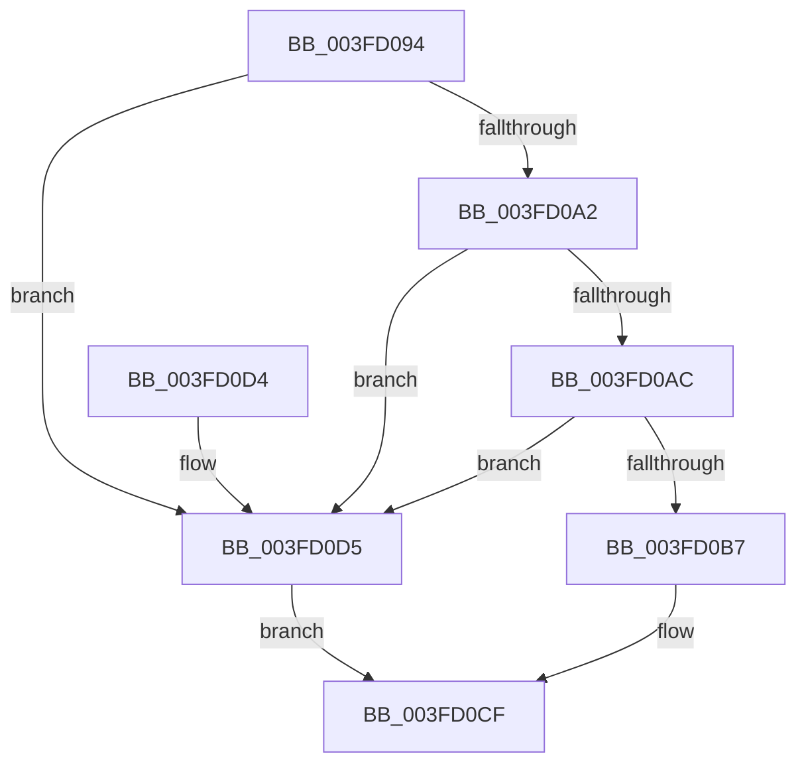

# IopDoesCompletionNeedsApc

- RVA: `0x003FD094`–`0x003FD0D9` (길이 `69` bytes)
- VA: `0x00000001403FD094`
- 실행 섹션: `.text`
- PDB 이름 있음: `예`; PDB Function 태그: `아니요`
- unwind 정보 RVA: `0x00069B1C`
- 디코드: `21`개 명령, `69/69` bytes 표시
- 미해석 바이트: `0` (있으면 어셈블리에 `.byte`로 보존)

> 이 문서는 커널 이미지의 기계어와 PDB 기호를 분석해 생성했습니다. 4번과 5번은 함수 원형과 자료형을 바이너리 사용 방식에서 추정한 C 해석이며 원본 소스 복구 결과는 아닙니다.

## 1. Dependencies

- 직접 호출 지점: **1**; 고유 호출 대상: **1**
- 직접 호출자로 확인된 함수: **2**
- RIP 상대 이미지 참조: **0**

### Outgoing calls
- `0x003FD0B7` → [IoGetRequestorProcess](IoGetRequestorProcess_function_003FD4E0.md) (function, `0x003FD4E0`)

### Direct callers
- [IopCompleteIrpInFileObjectList](../24/IopCompleteIrpInFileObjectList_function_0024F330.md) at `0x0024F918`
- [IopfCompleteRequest](../29/IopfCompleteRequest_function_0029B5F8.md) at `0x0029BAC3`
- [IopfCompleteRequest](../29/IopfCompleteRequest_function_0029B5F8.md) at `0x0029BAF1`

### Static image references
- 디코드된 RIP-relative 메모리 참조가 없습니다.

## 2. Other-region calls and transfers

- 다른 실행 섹션으로 향하는 call: **0**
- 별도 외부 분기/꼬리 이동을 확인하지 못했습니다.

## 3. Assembly (complete function range)

```asm
003FD094  48 83 EC 28                     sub rsp, 0x28
003FD098  8B 41 10                        mov eax, dword ptr [rcx + 0x10]
003FD09B  83 E0 50                        and eax, 0x50
003FD09E  3C 50                           cmp al, 0x50
003FD0A0  75 33                           jne 0x1403fd0d5
003FD0A2  8B 41 30                        mov eax, dword ptr [rcx + 0x30]
003FD0A5  3D 16 00 00 80                  cmp eax, 0x80000016
003FD0AA  74 29                           je 0x1403fd0d5
003FD0AC  BA 00 00 00 C0                  mov edx, 0xc0000000
003FD0B1  23 C2                           and eax, edx
003FD0B3  3B C2                           cmp eax, edx
003FD0B5  74 1E                           je 0x1403fd0d5
003FD0B7  E8 24 04 00 00                  call 0x1403fd4e0
003FD0BC  65 48 8B 0C 25 88 01 00 00      mov rcx, qword ptr gs:[0x188]
003FD0C5  48 3B 81 B8 00 00 00            cmp rax, qword ptr [rcx + 0xb8]
003FD0CC  0F 95 C0                        setne al
003FD0CF  48 83 C4 28                     add rsp, 0x28
003FD0D3  C3                              ret
003FD0D4  CC                              int3
003FD0D5  32 C0                           xor al, al
003FD0D7  EB F6                           jmp 0x1403fd0cf
```

## 4. C-style interpretation (structured pseudocode)

```c
__int64 __fastcall IopDoesCompletionNeedsApc(__int64 a1)
{
    __int64 result;
    __int64 v_rsp;

    v_rsp = (v_rsp) - (40);
    result = (unsigned int)(((unsigned int)(*(unsigned int *)(a1 + 16))) & (80));
    if (((unsigned __int8)(result)) != 80) goto loc_003FD0D5;
    if (((unsigned int)((unsigned int)(*(unsigned int *)(a1 + 48)))) == 0x80000016ULL) goto loc_003FD0D5;
    result = (unsigned int)(((unsigned int)(*(unsigned int *)(a1 + 48))) & ((unsigned int)((unsigned int)(0xC0000000ULL))));
    if (((unsigned int)(result)) == ((unsigned int)((unsigned int)(0xC0000000ULL)))) goto loc_003FD0D5;
    result = IoGetRequestorProcess(a1, (unsigned int)(0xC0000000ULL), a3, a4);
    result = (result != (*(unsigned __int64 *)(*(unsigned __int64 *)(gs_base + (0 + 392)) + 184))) ? 1 : 0;
loc_003FD0CF:
    v_rsp = (v_rsp) + (40);
    return result;
loc_003FD0D5:
    result = 0;
    goto loc_003FD0CF;
}
```

## 5. (Beta) C Style

```c
int64_t IopDoesCompletionNeedsApc(void *Arg1)
{
    uint8_t *arg1 = (uint8_t *)Arg1;

    int64_t result;
    int64_t local_rsp;

    local_rsp = (local_rsp) - (40);
    result = (uint32_t)(((uint32_t)(*(uint32_t *)(arg1 + 0x10))) & (80));
    if (((uint8_t)(result)) != 80) goto loc_003FD0D5;
    if (((uint32_t)((uint32_t)(*(uint32_t *)(arg1 + 0x30)))) == 0x80000016ULL) goto loc_003FD0D5;
    result = (uint32_t)(((uint32_t)(*(uint32_t *)(arg1 + 0x30))) & ((uint32_t)((uint32_t)(0xC0000000ULL))));
    if (((uint32_t)(result)) == ((uint32_t)((uint32_t)(0xC0000000ULL)))) goto loc_003FD0D5;
    result = IoGetRequestorProcess(Arg1, (uint32_t)(0xC0000000ULL), a3, a4);
    result = (result != (*(uint64_t *)(*(uint64_t *)(gs_base + (0 + 0x188)) + 0xB8))) ? 1 : 0;
loc_003FD0CF:
    local_rsp = (local_rsp) + (40);
    return result;
loc_003FD0D5:
    result = 0;
    goto loc_003FD0CF;
}
```

### 관측된 메모리 오프셋

구조체 형식이 확인되지 않은 접근은 인자 기준의 오프셋으로만 기록했습니다.

| 기준 인자 | 오프셋 표현 | 폭 (bit) | 접근 |
|---|---:|---:|---|
| `Arg1` | `+ 0x10` | `32` | `R` |
| `Arg1` | `+ 0x30` | `32` | `R` |

## 6. Execution-region graph

[열기: 2D/3D 그래프와 함수 탐색 컨트롤 패널](../../../control-panel.html?section=text&rva=0x003FD094&view=graph)

- 2D 그래프는 위에서 아래로 흐르고, 3D 그래프는 빈 공간을 드래그해 회전합니다. Shift+드래그는 이동, 휠은 확대·축소, 함수 노드 선택은 대상 보고서 이동입니다.

### Static fallback


