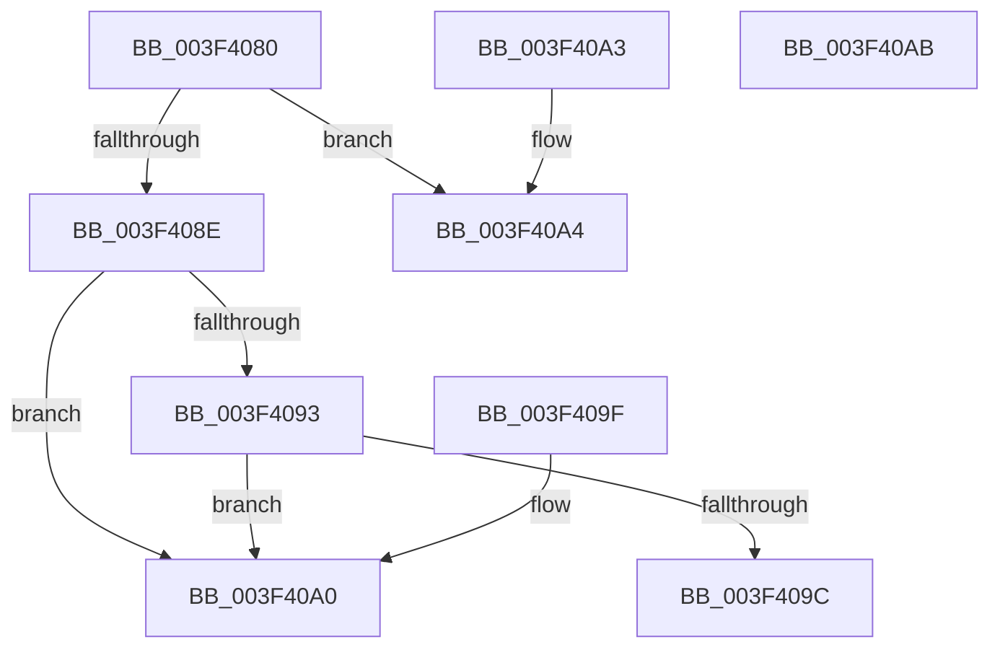

# IopIrpHasExtensionType

- RVA: `0x003F4080`–`0x003F40AC` (길이 `44` bytes)
- VA: `0x00000001403F4080`
- 실행 섹션: `.text`
- PDB 이름 있음: `예`; PDB Function 태그: `아니요`
- unwind 정보 RVA: `0x000DB714`
- 디코드: `19`개 명령, `44/44` bytes 표시
- 미해석 바이트: `0` (있으면 어셈블리에 `.byte`로 보존)

> 이 문서는 커널 이미지의 기계어와 PDB 기호를 분석해 생성했습니다. 4번과 5번은 함수 원형과 자료형을 바이너리 사용 방식에서 추정한 C 해석이며 원본 소스 복구 결과는 아닙니다.

## 1. Dependencies

- 직접 호출 지점: **0**; 고유 호출 대상: **0**
- 직접 호출자로 확인된 함수: **10**
- RIP 상대 이미지 참조: **0**

### Outgoing calls
- 직접 디코드된 call 명령이 없습니다.

### Direct callers
- [IoReuseIrp](../24/IoReuseIrp_function_0024DD70.md) at `0x0024DEED`
- [IoMakeAssociatedIrpPriv](../29/IoMakeAssociatedIrpPriv_function_0029D818.md) at `0x0029DB77`
- [IoMakeAssociatedIrpPriv](../29/IoMakeAssociatedIrpPriv_function_0029D818.md) at `0x0029DB93`
- [IoPropagateIrpExtensionEx](../46/IoPropagateIrpExtensionEx_function_00461250.md) at `0x004612B2`
- [IoPropagateIrpExtensionEx](../46/IoPropagateIrpExtensionEx_function_00461250.md) at `0x004612E3`
- [IoPropagateIrpExtensionEx](../46/IoPropagateIrpExtensionEx_function_00461250.md) at `0x00461308`
- [IoPropagateIrpExtensionEx](../46/IoPropagateIrpExtensionEx_function_00461250.md) at `0x00461358`
- [IoPropagateIrpExtensionEx](../46/IoPropagateIrpExtensionEx_function_00461250.md) at `0x00461388`
- [IoPropagateIrpExtensionEx](../46/IoPropagateIrpExtensionEx_function_00461250.md) at `0x004613EF`
- [IopFreeCopyObjectsFromIrp](../4E/IopFreeCopyObjectsFromIrp_function_004E8834.md) at `0x004E8842`
- [IoClearAdapterCryptoEngineExtension](../59/IoClearAdapterCryptoEngineExtension_function_00598450.md) at `0x0059845E`
- [IoClearFsTrackOffsetState](../59/IoClearFsTrackOffsetState_function_005984A0.md) at `0x005984AC`
- [IoGetAdapterCryptoEngineExtension](../59/IoGetAdapterCryptoEngineExtension_function_005984E0.md) at `0x005984EF`
- [IoSetFsZeroingOffset](../59/IoSetFsZeroingOffset_function_00598580.md) at `0x00598591`
- [IoSetFsZeroingOffsetRequired](../59/IoSetFsZeroingOffsetRequired_function_005985C0.md) at `0x005985CC`
- [sub_006F997E](../6F/Unknown_function_006F997E.md) at `0x006F9984`
- [sub_006F997E](../6F/Unknown_function_006F997E.md) at `0x006F9999`

### Static image references
- 디코드된 RIP-relative 메모리 참조가 없습니다.

## 2. Other-region calls and transfers

- 다른 실행 섹션으로 향하는 call: **0**
- 별도 외부 분기/꼬리 이동을 확인하지 못했습니다.

## 3. Assembly (complete function range)

```asm
003F4080  48 8B 81 C8 00 00 00            mov rax, qword ptr [rcx + 0xc8]
003F4087  90                              nop
003F4088  80 79 47 00                     cmp byte ptr [rcx + 0x47], 0
003F408C  7C 16                           jl 0x1403f40a4
003F408E  48 85 C0                        test rax, rax
003F4091  74 0D                           je 0x1403f40a0
003F4093  0F B7 48 02                     movzx ecx, word ptr [rax + 2]
003F4097  0F A3 D1                        bt ecx, edx
003F409A  73 04                           jae 0x1403f40a0
003F409C  B0 01                           mov al, 1
003F409E  C3                              ret
003F409F  CC                              int3
003F40A0  32 C0                           xor al, al
003F40A2  C3                              ret
003F40A3  CC                              int3
003F40A4  83 FA 02                        cmp edx, 2
003F40A7  0F 94 C0                        sete al
003F40AA  C3                              ret
003F40AB  CC                              int3
```

## 4. C-style interpretation (structured pseudocode)

```c
__int64 __fastcall IopIrpHasExtensionType(__int64 a1, int a2)
{
    __int64 result;

    if ((*(unsigned __int8 *)(a1 + 71)) < 0) goto loc_003F40A4;
    if (*(unsigned __int64 *)(a1 + 200) == 0) goto loc_003F40A0;
    if (condition_is_above_or_equal) goto loc_003F40A0;
    return 1;
loc_003F40A0:
    result = 0;
    return result;
loc_003F40A4:
    result = (a2 == 2) ? 1 : 0;
    return result;
}
```

## 5. (Beta) C Style

```c
int64_t IopIrpHasExtensionType(void *Arg1, int32_t Arg2)
{
    uint8_t *arg1 = (uint8_t *)Arg1;

    int64_t result;

    if ((*(uint8_t *)(arg1 + 0x47)) < 0) goto loc_003F40A4;
    if (*(uint64_t *)(arg1 + 0xC8) == 0) goto loc_003F40A0;
    if (condition_is_above_or_equal) goto loc_003F40A0;
    return 1;
loc_003F40A0:
    result = 0;
    return result;
loc_003F40A4:
    result = (Arg2 == 2) ? 1 : 0;
    return result;
}
```

### 관측된 메모리 오프셋

구조체 형식이 확인되지 않은 접근은 인자 기준의 오프셋으로만 기록했습니다.

| 기준 인자 | 오프셋 표현 | 폭 (bit) | 접근 |
|---|---:|---:|---|
| `Arg1` | `+ 0x47` | `8` | `R` |
| `Arg1` | `+ 0xC8` | `64` | `R` |

## 6. Execution-region graph

[열기: 2D/3D 그래프와 함수 탐색 컨트롤 패널](../../../control-panel.html?section=text&rva=0x003F4080&view=graph)

- 2D 그래프는 위에서 아래로 흐르고, 3D 그래프는 빈 공간을 드래그해 회전합니다. Shift+드래그는 이동, 휠은 확대·축소, 함수 노드 선택은 대상 보고서 이동입니다.

### Static fallback


