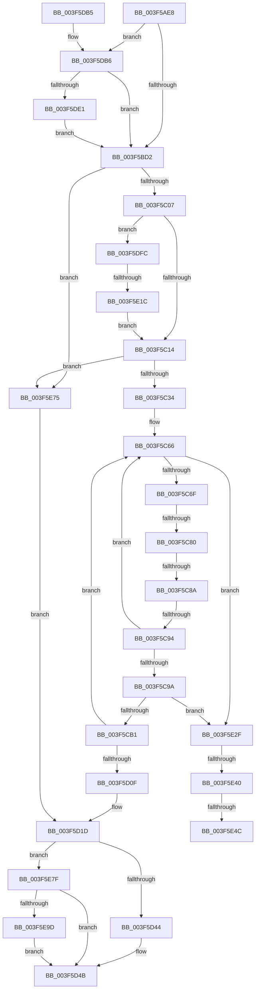

# IopLiveDumpAllocateDumpBuffers

- RVA: `0x003F5AE8`–`0x003F5EB0` (길이 `968` bytes)
- VA: `0x00000001403F5AE8`
- 실행 섹션: `.text`
- PDB 이름 있음: `예`; PDB Function 태그: `예`
- unwind 정보 RVA: `0x0009801C`
- 디코드: `233`개 명령, `968/968` bytes 표시
- 미해석 바이트: `0` (있으면 어셈블리에 `.byte`로 보존)

> 이 문서는 커널 이미지의 기계어와 PDB 기호를 분석해 생성했습니다. 4번과 5번은 함수 원형과 자료형을 바이너리 사용 방식에서 추정한 C 해석이며 원본 소스 복구 결과는 아닙니다.

## 1. Dependencies

- 직접 호출 지점: **14**; 고유 호출 대상: **8**
- 직접 호출자로 확인된 함수: **1**
- RIP 상대 이미지 참조: **2**

### Outgoing calls
- `0x003F5B21` → [IopLiveDumpGetMillisecondCounter](IopLiveDumpGetMillisecondCounter_function_003F5964.md) (function, `0x003F5964`)
- `0x003F5BF2` → [ExAllocatePool2](../../poolcode/B8/ExAllocatePool2_function_00B820F0.md) (function, `0x00B820F0`)
- `0x003F5C1F` → [ExAllocatePool2](../../poolcode/B8/ExAllocatePool2_function_00B820F0.md) (function, `0x00B820F0`)
- `0x003F5C41` → [IopLiveDumpDiscardVirtualAddressRange](../29/IopLiveDumpDiscardVirtualAddressRange_function_002977F4.md) (function, `0x002977F4`)
- `0x003F5C53` → [IopLiveDumpDiscardVirtualAddressRange](../29/IopLiveDumpDiscardVirtualAddressRange_function_002977F4.md) (function, `0x002977F4`)
- `0x003F5CA3` → [MmAllocateIndependentPages](../../page/AA/MmAllocateIndependentPages_function_00AA0CE0.md) (function, `0x00AA0CE0`)
- `0x003F5CF6` → [IopLiveDumpDiscardVirtualAddressRange](../29/IopLiveDumpDiscardVirtualAddressRange_function_002977F4.md) (function, `0x002977F4`)
- `0x003F5CFE` → [IopLiveDumpIsUnderMemoryPressure](IopLiveDumpIsUnderMemoryPressure_function_003F5EB8.md) (function, `0x003F5EB8`)
- `0x003F5D20` → [IopLiveDumpFreeDumpBuffers](IopLiveDumpFreeDumpBuffers_function_003F5FE8.md) (function, `0x003F5FE8`)
- `0x003F5D54` → [IopLiveDumpGetMillisecondCounter](IopLiveDumpGetMillisecondCounter_function_003F5964.md) (function, `0x003F5964`)
- `0x003F5D9A` → [IopLiveDumpTraceEstimatedAndAllocatedPageCount](IopLiveDumpTraceEstimatedAndAllocatedPageCount_function_003F59B8.md) (function, `0x003F59B8`)
- `0x003F5E07` → [ExAllocatePool2](../../poolcode/B8/ExAllocatePool2_function_00B820F0.md) (function, `0x00B820F0`)
- `0x003F5E25` → [IopLiveDumpDiscardVirtualAddressRange](../29/IopLiveDumpDiscardVirtualAddressRange_function_002977F4.md) (function, `0x002977F4`)
- `0x003F5E6A` → [IopLiveDumpTraceEstimatedPageCountNotAvailable](../5A/IopLiveDumpTraceEstimatedPageCountNotAvailable_function_005A416C.md) (function, `0x005A416C`)

### Direct callers
- [IopLiveDumpAllocAndInitResources](../59/IopLiveDumpAllocAndInitResources_function_005993B0.md) at `0x00599764`

### Static image references
- `0x003F5B26` → RVA `0x00E0A9D4` (`.data`; read)
- `0x003F5C9A` → RVA `0x00E0A9D0` (`.data`; read)

## 2. Other-region calls and transfers

- 다른 실행 섹션으로 향하는 call: **4**
  - `0x003F5BF2` → [ExAllocatePool2](../../poolcode/B8/ExAllocatePool2_function_00B820F0.md) (`.text` → `POOLCODE`)
  - `0x003F5C1F` → [ExAllocatePool2](../../poolcode/B8/ExAllocatePool2_function_00B820F0.md) (`.text` → `POOLCODE`)
  - `0x003F5CA3` → [MmAllocateIndependentPages](../../page/AA/MmAllocateIndependentPages_function_00AA0CE0.md) (`.text` → `PAGE`)
  - `0x003F5E07` → [ExAllocatePool2](../../poolcode/B8/ExAllocatePool2_function_00B820F0.md) (`.text` → `POOLCODE`)
- call이 아닌 외부 분기/꼬리 이동: **7**
  - `0x003F5C7A` → [sub_006EB392 + 0x45](../6E/Unknown_function_006EB392.md) (`tail-transfer`)
  - `0x003F5C84` → [sub_006EB392 + 0x99](../6E/Unknown_function_006EB392.md) (`tail-transfer`)
  - `0x003F5C8E` → [sub_006EB392 + 0x119](../6E/Unknown_function_006EB392.md) (`tail-transfer`)
  - `0x003F5E16` → [sub_006EB392](../6E/Unknown_function_006EB392.md) (`tail-transfer`)
  - `0x003F5E3A` → [sub_006EB392 + 0x2A9](../6E/Unknown_function_006EB392.md) (`tail-transfer`)
  - `0x003F5E46` → [sub_006EB392 + 0x168](../6E/Unknown_function_006EB392.md) (`tail-transfer`)
  - `0x003F5E70` → [sub_006EB392 + 0x168](../6E/Unknown_function_006EB392.md) (`tail-transfer`)

## 3. Assembly (complete function range)

```asm
003F5AE8  40 55                           push rbp
003F5AEA  53                              push rbx
003F5AEB  56                              push rsi
003F5AEC  57                              push rdi
003F5AED  41 54                           push r12
003F5AEF  41 55                           push r13
003F5AF1  41 56                           push r14
003F5AF3  41 57                           push r15
003F5AF5  48 8D 6C 24 E1                  lea rbp, [rsp - 0x1f]
003F5AFA  48 81 EC 98 00 00 00            sub rsp, 0x98
003F5B01  33 FF                           xor edi, edi
003F5B03  48 8B D9                        mov rbx, rcx
003F5B06  33 C9                           xor ecx, ecx
003F5B08  48 89 7D CF                     mov qword ptr [rbp - 0x31], rdi
003F5B0C  44 8B F7                        mov r14d, edi
003F5B0F  48 89 7D 6F                     mov qword ptr [rbp + 0x6f], rdi
003F5B13  48 89 7D C7                     mov qword ptr [rbp - 0x39], rdi
003F5B17  44 8B E7                        mov r12d, edi
003F5B1A  48 89 7D B7                     mov qword ptr [rbp - 0x49], rdi
003F5B1E  44 8B EF                        mov r13d, edi
003F5B21  E8 3E FE FF FF                  call 0x1403f5964
003F5B26  44 8B 0D A7 4E A1 00            mov r9d, dword ptr [rip + 0xa14ea7]
003F5B2D  48 89 45 E7                     mov qword ptr [rbp - 0x19], rax
003F5B31  48 89 BB C8 02 00 00            mov qword ptr [rbx + 0x2c8], rdi
003F5B38  48 89 BB E8 02 00 00            mov qword ptr [rbx + 0x2e8], rdi
003F5B3F  48 89 BB A8 02 00 00            mov qword ptr [rbx + 0x2a8], rdi
003F5B46  4D 8D 51 FF                     lea r10, [r9 - 1]
003F5B4A  48 8B 53 68                     mov rdx, qword ptr [rbx + 0x68]
003F5B4E  49 F7 D2                        not r10
003F5B51  48 8B 43 60                     mov rax, qword ptr [rbx + 0x60]
003F5B55  48 FF CA                        dec rdx
003F5B58  4C 8B 43 78                     mov r8, qword ptr [rbx + 0x78]
003F5B5C  48 FF C8                        dec rax
003F5B5F  49 03 C1                        add rax, r9
003F5B62  49 03 D1                        add rdx, r9
003F5B65  49 23 C2                        and rax, r10
003F5B68  49 23 D2                        and rdx, r10
003F5B6B  48 89 43 60                     mov qword ptr [rbx + 0x60], rax
003F5B6F  49 FF C8                        dec r8
003F5B72  48 89 53 68                     mov qword ptr [rbx + 0x68], rdx
003F5B76  4D 03 C1                        add r8, r9
003F5B79  33 D2                           xor edx, edx
003F5B7B  4D 23 C2                        and r8, r10
003F5B7E  49 F7 F1                        div r9
003F5B81  33 D2                           xor edx, edx
003F5B83  4C 89 43 78                     mov qword ptr [rbx + 0x78], r8
003F5B87  4C 8B D8                        mov r11, rax
003F5B8A  48 89 45 67                     mov qword ptr [rbp + 0x67], rax
003F5B8E  48 89 45 D7                     mov qword ptr [rbp - 0x29], rax
003F5B92  48 8B 83 80 00 00 00            mov rax, qword ptr [rbx + 0x80]
003F5B99  48 FF C8                        dec rax
003F5B9C  49 03 C1                        add rax, r9
003F5B9F  49 23 C2                        and rax, r10
003F5BA2  48 89 83 80 00 00 00            mov qword ptr [rbx + 0x80], rax
003F5BA9  49 F7 F1                        div r9
003F5BAC  33 D2                           xor edx, edx
003F5BAE  48 8B C8                        mov rcx, rax
003F5BB1  49 8B C0                        mov rax, r8
003F5BB4  49 F7 F1                        div r9
003F5BB7  8B 53 50                        mov edx, dword ptr [rbx + 0x50]
003F5BBA  48 03 C8                        add rcx, rax
003F5BBD  4C 03 D9                        add r11, rcx
003F5BC0  48 89 4D BF                     mov qword ptr [rbp - 0x41], rcx
003F5BC4  4C 89 5D DF                     mov qword ptr [rbp - 0x21], r11
003F5BC8  0F BA E2 09                     bt edx, 9
003F5BCC  0F 82 E4 01 00 00               jb 0x1403f5db6
003F5BD2  4A 8D 34 DD FF 0F 00 00         lea rsi, [r11*8 + 0xfff]
003F5BDA  41 BF 4C 64 6D 70               mov r15d, 0x706d644c
003F5BE0  48 81 E6 00 F0 FF FF            and rsi, 0xfffffffffffff000
003F5BE7  45 8B C7                        mov r8d, r15d
003F5BEA  48 8B D6                        mov rdx, rsi
003F5BED  B9 40 00 00 00                  mov ecx, 0x40
003F5BF2  E8 F9 C4 78 00                  call 0x140b820f0
003F5BF7  48 89 83 F0 02 00 00            mov qword ptr [rbx + 0x2f0], rax
003F5BFE  48 85 C0                        test rax, rax
003F5C01  0F 84 6E 02 00 00               je 0x1403f5e75
003F5C07  F7 43 50 00 00 04 00            test dword ptr [rbx + 0x50], 0x40000
003F5C0E  0F 85 E8 01 00 00               jne 0x1403f5dfc
003F5C14  45 8B C7                        mov r8d, r15d
003F5C17  48 8B D6                        mov rdx, rsi
003F5C1A  B9 40 00 00 00                  mov ecx, 0x40
003F5C1F  E8 CC C4 78 00                  call 0x140b820f0
003F5C24  48 89 83 F8 02 00 00            mov qword ptr [rbx + 0x2f8], rax
003F5C2B  48 85 C0                        test rax, rax
003F5C2E  0F 84 41 02 00 00               je 0x1403f5e75
003F5C34  48 8B 93 F0 02 00 00            mov rdx, qword ptr [rbx + 0x2f0]
003F5C3B  4C 8B C6                        mov r8, rsi
003F5C3E  48 8B CB                        mov rcx, rbx
003F5C41  E8 AE 1B EA FF                  call 0x1402977f4
003F5C46  48 8B 93 F8 02 00 00            mov rdx, qword ptr [rbx + 0x2f8]
003F5C4D  4C 8B C6                        mov r8, rsi
003F5C50  48 8B CB                        mov rcx, rbx
003F5C53  E8 9C 1B EA FF                  call 0x1402977f4
003F5C58  48 89 7D 77                     mov qword ptr [rbp + 0x77], rdi
003F5C5C  41 BF 01 00 00 00               mov r15d, 1
003F5C62  48 8B 45 67                     mov rax, qword ptr [rbp + 0x67]
003F5C66  4C 3B F0                        cmp r14, rax
003F5C69  0F 83 C0 01 00 00               jae 0x1403f5e2f
003F5C6F  48 89 7D 7F                     mov qword ptr [rbp + 0x7f], rdi
003F5C73  49 8B F6                        mov rsi, r14
003F5C76  41 83 FF 01                     cmp r15d, 1
003F5C7A  0F 84 57 57 2F 00               je 0x1406eb3d7
003F5C80  41 83 FF 02                     cmp r15d, 2
003F5C84  0F 84 A1 57 2F 00               je 0x1406eb42b
003F5C8A  41 83 FF 03                     cmp r15d, 3
003F5C8E  0F 84 17 58 2F 00               je 0x1406eb4ab
003F5C94  41 83 FF 04                     cmp r15d, 4
003F5C98  75 CC                           jne 0x1403f5c66
003F5C9A  8B 0D 30 4D A1 00               mov ecx, dword ptr [rip + 0xa14d30]
003F5CA0  83 CA FF                        or edx, 0xffffffff
003F5CA3  E8 38 B0 6A 00                  call 0x140aa0ce0
003F5CA8  48 85 C0                        test rax, rax
003F5CAB  0F 84 7E 01 00 00               je 0x1403f5e2f
003F5CB1  48 8B 8B F0 02 00 00            mov rcx, qword ptr [rbx + 0x2f0]
003F5CB8  8B 15 16 4D A1 00               mov edx, dword ptr [rip + 0xa14d16]
003F5CBE  44 8B 05 0B 4D A1 00            mov r8d, dword ptr [rip + 0xa14d0b]
003F5CC5  4C 03 E2                        add r12, rdx
003F5CC8  48 FF 45 B7                     inc qword ptr [rbp - 0x49]
003F5CCC  4A 89 04 F1                     mov qword ptr [rcx + r14*8], rax
003F5CD0  48 8B 8B F8 02 00 00            mov rcx, qword ptr [rbx + 0x2f8]
003F5CD7  48 01 93 A8 02 00 00            add qword ptr [rbx + 0x2a8], rdx
003F5CDE  48 8B D0                        mov rdx, rax
003F5CE1  48 FF 83 E8 02 00 00            inc qword ptr [rbx + 0x2e8]
003F5CE8  4A 89 3C F1                     mov qword ptr [rcx + r14*8], rdi
003F5CEC  49 FF C6                        inc r14
003F5CEF  48 8B CB                        mov rcx, rbx
003F5CF2  4C 89 75 77                     mov qword ptr [rbp + 0x77], r14
003F5CF6  E8 F9 1A EA FF                  call 0x1402977f4
003F5CFB  48 8B CB                        mov rcx, rbx
003F5CFE  E8 B5 01 00 00                  call 0x1403f5eb8
003F5D03  84 C0                           test al, al
003F5D05  48 8B 45 67                     mov rax, qword ptr [rbp + 0x67]
003F5D09  0F 84 57 FF FF FF               je 0x1403f5c66
003F5D0F  0F BA 6B 50 0C                  bts dword ptr [rbx + 0x50], 0xc
003F5D14  BE 40 02 00 C0                  mov esi, 0xc0000240
003F5D19  4C 8B 75 6F                     mov r14, qword ptr [rbp + 0x6f]
003F5D1D  48 8B CB                        mov rcx, rbx
003F5D20  E8 C3 02 00 00                  call 0x1403f5fe8
003F5D25  48 89 BB A8 02 00 00            mov qword ptr [rbx + 0x2a8], rdi
003F5D2C  4C 3B 63 68                     cmp r12, qword ptr [rbx + 0x68]
003F5D30  4C 0F 42 E7                     cmovb r12, rdi
003F5D34  4C 89 A3 B0 02 00 00            mov qword ptr [rbx + 0x2b0], r12
003F5D3B  4D 85 ED                        test r13, r13
003F5D3E  0F 85 3B 01 00 00               jne 0x1403f5e7f
003F5D44  48 89 BB B8 02 00 00            mov qword ptr [rbx + 0x2b8], rdi
003F5D4B  33 C9                           xor ecx, ecx
003F5D4D  48 89 BB C0 02 00 00            mov qword ptr [rbx + 0x2c0], rdi
003F5D54  E8 0B FC FF FF                  call 0x1403f5964
003F5D59  8B 15 75 4C A1 00               mov edx, dword ptr [rip + 0xa14c75]
003F5D5F  48 2B 45 E7                     sub rax, qword ptr [rbp - 0x19]
003F5D63  44 8B D2                        mov r10d, edx
003F5D66  4C 0F AF 55 B7                  imul r10, qword ptr [rbp - 0x49]
003F5D6B  8B CA                           mov ecx, edx
003F5D6D  48 89 83 00 03 00 00            mov qword ptr [rbx + 0x300], rax
003F5D74  48 0F AF 4D C7                  imul rcx, qword ptr [rbp - 0x39]
003F5D79  44 8B CA                        mov r9d, edx
003F5D7C  4C 89 54 24 28                  mov qword ptr [rsp + 0x28], r10
003F5D81  44 8B C2                        mov r8d, edx
003F5D84  48 89 4C 24 20                  mov qword ptr [rsp + 0x20], rcx
003F5D89  4C 0F AF 45 CF                  imul r8, qword ptr [rbp - 0x31]
003F5D8E  48 0F AF 55 DF                  imul rdx, qword ptr [rbp - 0x21]
003F5D93  4D 0F AF CE                     imul r9, r14
003F5D97  48 8B CB                        mov rcx, rbx
003F5D9A  E8 19 FC FF FF                  call 0x1403f59b8
003F5D9F  8B C6                           mov eax, esi
003F5DA1  48 81 C4 98 00 00 00            add rsp, 0x98
003F5DA8  41 5F                           pop r15
003F5DAA  41 5E                           pop r14
003F5DAC  41 5D                           pop r13
003F5DAE  41 5C                           pop r12
003F5DB0  5F                              pop rdi
003F5DB1  5E                              pop rsi
003F5DB2  5B                              pop rbx
003F5DB3  5D                              pop rbp
003F5DB4  C3                              ret
003F5DB5  CC                              int3
003F5DB6  48 8B 8B 78 04 00 00            mov rcx, qword ptr [rbx + 0x478]
003F5DBD  48 8B C7                        mov rax, rdi
003F5DC0  48 F7 C1 FF 0F 00 00            test rcx, 0xfff
003F5DC7  0F 95 C0                        setne al
003F5DCA  48 C1 E9 0C                     shr rcx, 0xc
003F5DCE  48 03 C1                        add rax, rcx
003F5DD1  49 8B C9                        mov rcx, r9
003F5DD4  49 0F AF CB                     imul rcx, r11
003F5DD8  48 3B C8                        cmp rcx, rax
003F5DDB  0F 86 F1 FD FF FF               jbe 0x1403f5bd2
003F5DE1  0F BA EA 0A                     bts edx, 0xa
003F5DE5  49 23 C2                        and rax, r10
003F5DE8  89 53 50                        mov dword ptr [rbx + 0x50], edx
003F5DEB  33 D2                           xor edx, edx
003F5DED  49 F7 F1                        div r9
003F5DF0  4C 8B D8                        mov r11, rax
003F5DF3  48 89 45 DF                     mov qword ptr [rbp - 0x21], rax
003F5DF7  E9 D6 FD FF FF                  jmp 0x1403f5bd2
003F5DFC  45 8B C7                        mov r8d, r15d
003F5DFF  48 8B D6                        mov rdx, rsi
003F5E02  B9 40 00 00 00                  mov ecx, 0x40
003F5E07  E8 E4 C2 78 00                  call 0x140b820f0
003F5E0C  48 89 83 70 03 00 00            mov qword ptr [rbx + 0x370], rax
003F5E13  48 85 C0                        test rax, rax
003F5E16  0F 84 76 55 2F 00               je 0x1406eb392
003F5E1C  4C 8B C6                        mov r8, rsi
003F5E1F  48 8B D0                        mov rdx, rax
003F5E22  48 8B CB                        mov rcx, rbx
003F5E25  E8 CA 19 EA FF                  call 0x1402977f4
003F5E2A  E9 E5 FD FF FF                  jmp 0x1403f5c14
003F5E2F  48 8B 83 A8 02 00 00            mov rax, qword ptr [rbx + 0x2a8]
003F5E36  48 3B 43 68                     cmp rax, qword ptr [rbx + 0x68]
003F5E3A  0F 82 FB 57 2F 00               jb 0x1406eb63b
003F5E40  8B F7                           mov esi, edi
003F5E42  48 3B 43 60                     cmp rax, qword ptr [rbx + 0x60]
003F5E46  0F 83 AE 56 2F 00               jae 0x1406eb4fa
003F5E4C  48 8B 83 30 02 00 00            mov rax, qword ptr [rbx + 0x230]
003F5E53  0F BA A8 50 10 00 00 0F         bts dword ptr [rax + 0x1050], 0xf
003F5E5B  4C 8B 43 68                     mov r8, qword ptr [rbx + 0x68]
003F5E5F  48 8B 53 60                     mov rdx, qword ptr [rbx + 0x60]
003F5E63  48 8B 8B A8 02 00 00            mov rcx, qword ptr [rbx + 0x2a8]
003F5E6A  E8 FD E2 1A 00                  call 0x1405a416c
003F5E6F  90                              nop
003F5E70  E9 85 56 2F 00                  jmp 0x1406eb4fa
003F5E75  BE 9A 00 00 C0                  mov esi, 0xc000009a
003F5E7A  E9 9E FE FF FF                  jmp 0x1403f5d1d
003F5E7F  48 8B 43 78                     mov rax, qword ptr [rbx + 0x78]
003F5E83  49 8B CD                        mov rcx, r13
003F5E86  4C 3B E8                        cmp r13, rax
003F5E89  48 0F 47 C8                     cmova rcx, rax
003F5E8D  48 89 8B B8 02 00 00            mov qword ptr [rbx + 0x2b8], rcx
003F5E94  4C 2B E9                        sub r13, rcx
003F5E97  0F 84 AE FE FF FF               je 0x1403f5d4b
003F5E9D  48 8B BB 80 00 00 00            mov rdi, qword ptr [rbx + 0x80]
003F5EA4  4C 3B EF                        cmp r13, rdi
003F5EA7  49 0F 46 FD                     cmovbe rdi, r13
003F5EAB  E9 9B FE FF FF                  jmp 0x1403f5d4b
```

## 4. C-style interpretation (structured pseudocode)

```c
__int64 __fastcall IopLiveDumpAllocateDumpBuffers(__int64 a1)
{
    __int64 result;
    __int64 v_r10;
    __int64 v_r11;
    __int64 v_r12;
    __int64 v_r13;
    __int64 v_r14;
    __int64 v_rdi;
    __int64 v_rsi;
    __int64 v_rsp;
    unsigned __int64 v_stack_m5F;
    unsigned __int64 v_stack_m78;
    unsigned __int64 v_stack_m80;
    unsigned __int64 v_stack_m88;
    unsigned __int64 v_stack_m90;
    unsigned __int64 v_stack_m98;
    unsigned __int64 v_stack_mA0;
    unsigned __int64 v_stack_mA8;
    unsigned __int64 v_stack_mB0;
    unsigned __int64 v_stack_mB8;
    unsigned __int64 v_stack_p10;
    unsigned __int64 v_stack_p18;
    unsigned __int64 v_stack_p20;
    unsigned __int64 v_stack_p8;

    v_rsp = (v_rsp) - (152);
    v_rdi = 0;
    a1 = 0;
    v_stack_m90 = 0;
    v_stack_p10 = 0;
    v_stack_m98 = 0;
    v_stack_mA8 = 0;
    result = IopLiveDumpGetMillisecondCounter(a1, a2, a3, a4);
    v_stack_m78 = result;
    *(unsigned __int64 *)(a1 + 712) = 0;
    *(unsigned __int64 *)(a1 + 744) = 0;
    *(unsigned __int64 *)(a1 + 680) = 0;
    v_r10 = ~((unsigned int)(*(unsigned int *)(v_rip + 10571431)) - 1);
    a2 = (*(unsigned __int64 *)(a1 + 104)) - 1;
    result = (*(unsigned __int64 *)(a1 + 96)) - 1;
    result = (result) + ((unsigned int)(*(unsigned int *)(v_rip + 10571431)));
    a2 = (a2) + ((unsigned int)(*(unsigned int *)(v_rip + 10571431)));
    result = (result) & (v_r10);
    a2 = (a2) & (v_r10);
    *(unsigned __int64 *)(a1 + 96) = result;
    a3 = (*(unsigned __int64 *)(a1 + 120)) - 1;
    *(unsigned __int64 *)(a1 + 104) = a2;
    a3 = (a3) + ((unsigned int)(*(unsigned int *)(v_rip + 10571431)));
    a2 = 0;
    a3 = (a3) & (v_r10);
    a2 = 0;
    *(unsigned __int64 *)(a1 + 120) = a3;
    v_stack_p8 = result;
    v_stack_m88 = result;
    result = (*(unsigned __int64 *)(a1 + 128)) - 1;
    result = (result) + ((unsigned int)(*(unsigned int *)(v_rip + 10571431)));
    result = (result) & (v_r10);
    *(unsigned __int64 *)(a1 + 128) = result;
    a2 = 0;
    a1 = (result) + (a3);
    v_r11 = (result) + (a1);
    v_stack_mA0 = a1;
    v_stack_m80 = v_r11;
    if (condition_is_below) goto loc_003F5DB6;
loc_003F5BD2:
    v_rsi = (v_r11 * 8 + 4095) & (0xFFFFFFFFFFFFF000ULL);
    result = ExAllocatePool2(64, v_rsi, (unsigned int)((unsigned int)((unsigned int)(0x706D644CULL))), (unsigned int)(*(unsigned int *)(v_rip + 10571431)));
    *(unsigned __int64 *)(a1 + 752) = result;
    if (result == 0) goto loc_003F5E75;
    if (((*(unsigned int *)(a1 + 80)) & (0x40000ULL)) != 0) goto loc_003F5DFC;
loc_003F5C14:
    result = ExAllocatePool2(64, v_rsi, (unsigned int)((unsigned int)((unsigned int)(0x706D644CULL))), (unsigned int)(*(unsigned int *)(v_rip + 10571431)));
    *(unsigned __int64 *)(a1 + 760) = result;
    if (result == 0) goto loc_003F5E75;
    result = IopLiveDumpDiscardVirtualAddressRange(a1, *(unsigned __int64 *)(a1 + 752), v_rsi, (unsigned int)(*(unsigned int *)(v_rip + 10571431)));
    result = IopLiveDumpDiscardVirtualAddressRange(a1, *(unsigned __int64 *)(a1 + 760), v_rsi, (unsigned int)(*(unsigned int *)(v_rip + 10571431)));
    v_stack_p18 = 0;
loc_003F5C66:
    if (0 >= v_stack_p8) goto loc_003F5E2F;
    v_stack_p20 = 0;
    if (1 != 4) goto loc_003F5C66;
    a2 = (unsigned int)((*(unsigned __int64 *)(a1 + 760)) | (0xFFFFFFFFULL));
    result = MmAllocateIndependentPages((unsigned int)(*(unsigned int *)(v_rip + 10571056)), a2, v_rsi, (unsigned int)(*(unsigned int *)(v_rip + 10571431)));
    if (result == 0) goto loc_003F5E2F;
    v_r12 = (0) + ((unsigned int)(*(unsigned int *)(v_rip + 10571030)));
    *(unsigned __int64 *)(*(unsigned __int64 *)(a1 + 752) + 0 * 8) = result;
    *(unsigned __int64 *)(*(unsigned __int64 *)(a1 + 760) + 0 * 8) = 0;
    v_r14 = (0) + 1;
    v_stack_p18 = v_r14;
    result = IopLiveDumpDiscardVirtualAddressRange(a1, result, (unsigned int)(*(unsigned int *)(v_rip + 10571019)), (unsigned int)(*(unsigned int *)(v_rip + 10571431)));
    result = IopLiveDumpIsUnderMemoryPressure(a1, result, (unsigned int)(*(unsigned int *)(v_rip + 10571019)), (unsigned int)(*(unsigned int *)(v_rip + 10571431)));
    if ((unsigned __int8)(result) == 0) goto loc_003F5C66;
loc_003F5D1D:
    result = IopLiveDumpFreeDumpBuffers(a1, result, (unsigned int)(*(unsigned int *)(v_rip + 10571019)), (unsigned int)(*(unsigned int *)(v_rip + 10571431)));
    *(unsigned __int64 *)(a1 + 680) = 0;
    if (v_r12 < (*(unsigned __int64 *)(a1 + 104))) { v_r12 = 0; }
    *(unsigned __int64 *)(a1 + 688) = v_r12;
    if (0 != 0) goto loc_003F5E7F;
    *(unsigned __int64 *)(a1 + 696) = 0;
loc_003F5D4B:
    a1 = 0;
    *(unsigned __int64 *)(a1 + 704) = 0;
    result = IopLiveDumpGetMillisecondCounter(a1, result, (unsigned int)(*(unsigned int *)(v_rip + 10571019)), (unsigned int)(*(unsigned int *)(v_rip + 10571431)));
    result = (result) - (v_stack_m78);
    v_r10 = ((unsigned int)((unsigned int)((unsigned int)(*(unsigned int *)(v_rip + 10570869))))) * (v_stack_mA8);
    *(unsigned __int64 *)(a1 + 768) = result;
    a1 = ((unsigned int)((unsigned int)((unsigned int)(*(unsigned int *)(v_rip + 10570869))))) * (v_stack_m98);
    v_stack_mB0 = v_r10;
    v_stack_mB8 = a1;
    a3 = ((unsigned int)((unsigned int)((unsigned int)(*(unsigned int *)(v_rip + 10570869))))) * (v_stack_m90);
    a2 = ((unsigned int)(*(unsigned int *)(v_rip + 10570869))) * (v_stack_m80);
    a4 = ((unsigned int)((unsigned int)((unsigned int)(*(unsigned int *)(v_rip + 10570869))))) * (v_stack_p10);
    result = IopLiveDumpTraceEstimatedAndAllocatedPageCount(a1, a2, a3, a4);
    v_rsp = (v_rsp) + (152);
    return (unsigned int)((unsigned int)((unsigned int)(0xC0000240ULL)));
loc_003F5DB6:
    result = (((*(unsigned __int64 *)(a1 + 1144)) & (0xFFFULL)) != 0) ? 1 : 0;
    a1 = (*(unsigned __int64 *)(a1 + 1144)) >> (12);
    result = (result) + (a1);
    a1 = (a4) * (v_r11);
    if (a1 <= result) goto loc_003F5BD2;
    result = (result) & (v_r10);
    *(unsigned int *)(a1 + 80) = (unsigned int)(a2);
    a2 = 0;
    v_stack_m80 = result;
    goto loc_003F5BD2;
loc_003F5DFC:
    result = ExAllocatePool2(64, (unsigned int)(0xC0000240ULL), 1, a4);
    *(unsigned __int64 *)(a1 + 880) = result;
    result = IopLiveDumpDiscardVirtualAddressRange(a1, result, (unsigned int)(0xC0000240ULL), a4);
    goto loc_003F5C14;
loc_003F5E2F:
    result = IopLiveDumpTraceEstimatedPageCountNotAvailable(*(unsigned __int64 *)(a1 + 680), *(unsigned __int64 *)(a1 + 96), *(unsigned __int64 *)(a1 + 104), a4);
loc_003F5E75:
    goto loc_003F5D1D;
loc_003F5E7F:
    a1 = 0;
    if (0 > (*(unsigned __int64 *)(a1 + 120))) { a1 = *(unsigned __int64 *)(a1 + 120); }
    *(unsigned __int64 *)(a1 + 696) = a1;
    v_r13 = (0) - (a1);
    if (condition_is_equal) goto loc_003F5D4B;
    v_rdi = *(unsigned __int64 *)(a1 + 128);
    if (v_r13 <= (*(unsigned __int64 *)(a1 + 128))) { v_rdi = v_r13; }
    goto loc_003F5D4B;
}
```

## 5. (Beta) C Style

```c
int64_t IopLiveDumpAllocateDumpBuffers(void *Arg1)
{
    uint8_t *arg1 = (uint8_t *)Arg1;

    int64_t result;
    int64_t local_r10;
    int64_t local_r11;
    int64_t local_r12;
    int64_t local_r13;
    int64_t local_r14;
    int64_t local_rdi;
    int64_t local_rsi;
    int64_t local_rsp;
    uint64_t v_stack_m5F;
    uint64_t v_stack_m78;
    uint64_t v_stack_m80;
    uint64_t v_stack_m88;
    uint64_t v_stack_m90;
    uint64_t v_stack_m98;
    uint64_t v_stack_mA0;
    uint64_t v_stack_mA8;
    uint64_t v_stack_mB0;
    uint64_t v_stack_mB8;
    uint64_t v_stack_p10;
    uint64_t v_stack_p18;
    uint64_t v_stack_p20;
    uint64_t v_stack_p8;

    local_rsp = (local_rsp) - (152);
    local_rdi = 0;
    Arg1 = 0;
    v_stack_m90 = 0;
    v_stack_p10 = 0;
    v_stack_m98 = 0;
    v_stack_mA8 = 0;
    result = IopLiveDumpGetMillisecondCounter(Arg1, a2, a3, a4);
    v_stack_m78 = result;
    *(uint64_t *)(arg1 + 0x2C8) = 0;
    *(uint64_t *)(arg1 + 0x2E8) = 0;
    *(uint64_t *)(arg1 + 0x2A8) = 0;
    local_r10 = ~((uint32_t)(*(uint32_t *)(v_rip + 0xA14EA7)) - 1);
    a2 = (*(uint64_t *)(arg1 + 0x68)) - 1;
    result = (*(uint64_t *)(arg1 + 0x60)) - 1;
    result = (result) + ((uint32_t)(*(uint32_t *)(v_rip + 0xA14EA7)));
    a2 = (a2) + ((uint32_t)(*(uint32_t *)(v_rip + 0xA14EA7)));
    result = (result) & (local_r10);
    a2 = (a2) & (local_r10);
    *(uint64_t *)(arg1 + 0x60) = result;
    a3 = (*(uint64_t *)(arg1 + 0x78)) - 1;
    *(uint64_t *)(arg1 + 0x68) = a2;
    a3 = (a3) + ((uint32_t)(*(uint32_t *)(v_rip + 0xA14EA7)));
    a2 = 0;
    a3 = (a3) & (local_r10);
    a2 = 0;
    *(uint64_t *)(arg1 + 0x78) = a3;
    v_stack_p8 = result;
    v_stack_m88 = result;
    result = (*(uint64_t *)(arg1 + 0x80)) - 1;
    result = (result) + ((uint32_t)(*(uint32_t *)(v_rip + 0xA14EA7)));
    result = (result) & (local_r10);
    *(uint64_t *)(arg1 + 0x80) = result;
    a2 = 0;
    Arg1 = (result) + (a3);
    local_r11 = (result) + (Arg1);
    v_stack_mA0 = Arg1;
    v_stack_m80 = local_r11;
    if (condition_is_below) goto loc_003F5DB6;
loc_003F5BD2:
    local_rsi = (local_r11 * 8 + 4095) & (0xFFFFFFFFFFFFF000ULL);
    result = ExAllocatePool2(64, local_rsi, (uint32_t)((uint32_t)((uint32_t)(0x706D644CULL))), (uint32_t)(*(uint32_t *)(v_rip + 0xA14EA7)));
    *(uint64_t *)(arg1 + 0x2F0) = result;
    if (result == 0) goto loc_003F5E75;
    if (((*(uint32_t *)(arg1 + 0x50)) & (0x40000ULL)) != 0) goto loc_003F5DFC;
loc_003F5C14:
    result = ExAllocatePool2(64, local_rsi, (uint32_t)((uint32_t)((uint32_t)(0x706D644CULL))), (uint32_t)(*(uint32_t *)(v_rip + 0xA14EA7)));
    *(uint64_t *)(arg1 + 0x2F8) = result;
    if (result == 0) goto loc_003F5E75;
    result = IopLiveDumpDiscardVirtualAddressRange(Arg1, *(uint64_t *)(arg1 + 0x2F0), local_rsi, (uint32_t)(*(uint32_t *)(v_rip + 0xA14EA7)));
    result = IopLiveDumpDiscardVirtualAddressRange(Arg1, *(uint64_t *)(arg1 + 0x2F8), local_rsi, (uint32_t)(*(uint32_t *)(v_rip + 0xA14EA7)));
    v_stack_p18 = 0;
loc_003F5C66:
    if (0 >= v_stack_p8) goto loc_003F5E2F;
    v_stack_p20 = 0;
    if (1 != 4) goto loc_003F5C66;
    a2 = (uint32_t)((*(uint64_t *)(arg1 + 0x2F8)) | (0xFFFFFFFFULL));
    result = MmAllocateIndependentPages((uint32_t)(*(uint32_t *)(v_rip + 0xA14D30)), a2, local_rsi, (uint32_t)(*(uint32_t *)(v_rip + 0xA14EA7)));
    if (result == 0) goto loc_003F5E2F;
    local_r12 = (0) + ((uint32_t)(*(uint32_t *)(v_rip + 0xA14D16)));
    *(uint64_t *)(*(uint64_t *)(arg1 + 0x2F0) + 0x0 * 8) = result;
    *(uint64_t *)(*(uint64_t *)(arg1 + 0x2F8) + 0x0 * 8) = 0;
    local_r14 = (0) + 1;
    v_stack_p18 = local_r14;
    result = IopLiveDumpDiscardVirtualAddressRange(Arg1, result, (uint32_t)(*(uint32_t *)(v_rip + 0xA14D0B)), (uint32_t)(*(uint32_t *)(v_rip + 0xA14EA7)));
    result = IopLiveDumpIsUnderMemoryPressure(Arg1, result, (uint32_t)(*(uint32_t *)(v_rip + 0xA14D0B)), (uint32_t)(*(uint32_t *)(v_rip + 0xA14EA7)));
    if ((uint8_t)(result) == 0) goto loc_003F5C66;
loc_003F5D1D:
    result = IopLiveDumpFreeDumpBuffers(Arg1, result, (uint32_t)(*(uint32_t *)(v_rip + 0xA14D0B)), (uint32_t)(*(uint32_t *)(v_rip + 0xA14EA7)));
    *(uint64_t *)(arg1 + 0x2A8) = 0;
    if (local_r12 < (*(uint64_t *)(arg1 + 0x68))) { local_r12 = 0; }
    *(uint64_t *)(arg1 + 0x2B0) = local_r12;
    if (0 != 0) goto loc_003F5E7F;
    *(uint64_t *)(arg1 + 0x2B8) = 0;
loc_003F5D4B:
    Arg1 = 0;
    *(uint64_t *)(arg1 + 0x2C0) = 0;
    result = IopLiveDumpGetMillisecondCounter(Arg1, result, (uint32_t)(*(uint32_t *)(v_rip + 0xA14D0B)), (uint32_t)(*(uint32_t *)(v_rip + 0xA14EA7)));
    result = (result) - (v_stack_m78);
    local_r10 = ((uint32_t)((uint32_t)((uint32_t)(*(uint32_t *)(v_rip + 0xA14C75))))) * (v_stack_mA8);
    *(uint64_t *)(arg1 + 0x300) = result;
    Arg1 = ((uint32_t)((uint32_t)((uint32_t)(*(uint32_t *)(v_rip + 0xA14C75))))) * (v_stack_m98);
    v_stack_mB0 = local_r10;
    v_stack_mB8 = Arg1;
    a3 = ((uint32_t)((uint32_t)((uint32_t)(*(uint32_t *)(v_rip + 0xA14C75))))) * (v_stack_m90);
    a2 = ((uint32_t)(*(uint32_t *)(v_rip + 0xA14C75))) * (v_stack_m80);
    a4 = ((uint32_t)((uint32_t)((uint32_t)(*(uint32_t *)(v_rip + 0xA14C75))))) * (v_stack_p10);
    result = IopLiveDumpTraceEstimatedAndAllocatedPageCount(Arg1, a2, a3, a4);
    local_rsp = (local_rsp) + (152);
    return (uint32_t)((uint32_t)((uint32_t)(0xC0000240ULL)));
loc_003F5DB6:
    result = (((*(uint64_t *)(arg1 + 0x478)) & (0xFFFULL)) != 0) ? 1 : 0;
    Arg1 = (*(uint64_t *)(arg1 + 0x478)) >> (12);
    result = (result) + (Arg1);
    Arg1 = (a4) * (local_r11);
    if (Arg1 <= result) goto loc_003F5BD2;
    result = (result) & (local_r10);
    *(uint32_t *)(arg1 + 0x50) = (uint32_t)(a2);
    a2 = 0;
    v_stack_m80 = result;
    goto loc_003F5BD2;
loc_003F5DFC:
    result = ExAllocatePool2(64, (uint32_t)(0xC0000240ULL), 1, a4);
    *(uint64_t *)(arg1 + 0x370) = result;
    result = IopLiveDumpDiscardVirtualAddressRange(Arg1, result, (uint32_t)(0xC0000240ULL), a4);
    goto loc_003F5C14;
loc_003F5E2F:
    result = IopLiveDumpTraceEstimatedPageCountNotAvailable(*(uint64_t *)(arg1 + 0x2A8), *(uint64_t *)(arg1 + 0x60), *(uint64_t *)(arg1 + 0x68), a4);
loc_003F5E75:
    goto loc_003F5D1D;
loc_003F5E7F:
    Arg1 = 0;
    if (0 > (*(uint64_t *)(arg1 + 0x78))) { Arg1 = *(uint64_t *)(arg1 + 0x78); }
    *(void **)(arg1 + 0x2B8) = Arg1;
    local_r13 = (0) - (Arg1);
    if (condition_is_equal) goto loc_003F5D4B;
    local_rdi = *(uint64_t *)(arg1 + 0x80);
    if (local_r13 <= (*(uint64_t *)(arg1 + 0x80))) { local_rdi = local_r13; }
    goto loc_003F5D4B;
}
```

### 관측된 메모리 오프셋

구조체 형식이 확인되지 않은 접근은 인자 기준의 오프셋으로만 기록했습니다.

| 기준 인자 | 오프셋 표현 | 폭 (bit) | 접근 |
|---|---:|---:|---|
| `Arg1` | `+ 0x50` | `32` | `R` |
| `Arg1` | `+ 0x50` | `32` | `R/W` |
| `Arg1` | `+ 0x50` | `32` | `W` |
| `Arg1` | `+ 0x60` | `64` | `R` |
| `Arg1` | `+ 0x60` | `64` | `W` |
| `Arg1` | `+ 0x68` | `64` | `R` |
| `Arg1` | `+ 0x68` | `64` | `W` |
| `Arg1` | `+ 0x78` | `64` | `R` |
| `Arg1` | `+ 0x78` | `64` | `W` |
| `Arg1` | `+ 0x80` | `64` | `R` |
| `Arg1` | `+ 0x80` | `64` | `W` |
| `Arg1` | `+ 0x230` | `64` | `R` |
| `Arg1` | `+ 0x2A8` | `64` | `R` |
| `Arg1` | `+ 0x2A8` | `64` | `R/W` |
| `Arg1` | `+ 0x2A8` | `64` | `W` |
| `Arg1` | `+ 0x2B0` | `64` | `W` |
| `Arg1` | `+ 0x2B8` | `64` | `W` |
| `Arg1` | `+ 0x2C0` | `64` | `W` |
| `Arg1` | `+ 0x2C8` | `64` | `W` |
| `Arg1` | `+ 0x2E8` | `64` | `R/W` |
| `Arg1` | `+ 0x2E8` | `64` | `W` |
| `Arg1` | `+ 0x2F0` | `64` | `R` |
| `Arg1` | `+ 0x2F0` | `64` | `W` |
| `Arg1` | `+ 0x2F8` | `64` | `R` |
| `Arg1` | `+ 0x2F8` | `64` | `W` |
| `Arg1` | `+ 0x300` | `64` | `W` |
| `Arg1` | `+ 0x370` | `64` | `W` |
| `Arg1` | `+ 0x478` | `64` | `R` |

## 6. Execution-region graph

[열기: 2D/3D 그래프와 함수 탐색 컨트롤 패널](../../../control-panel.html?section=text&rva=0x003F5AE8&view=graph)

- 2D 그래프는 위에서 아래로 흐르고, 3D 그래프는 빈 공간을 드래그해 회전합니다. Shift+드래그는 이동, 휠은 확대·축소, 함수 노드 선택은 대상 보고서 이동입니다.

### Static fallback


