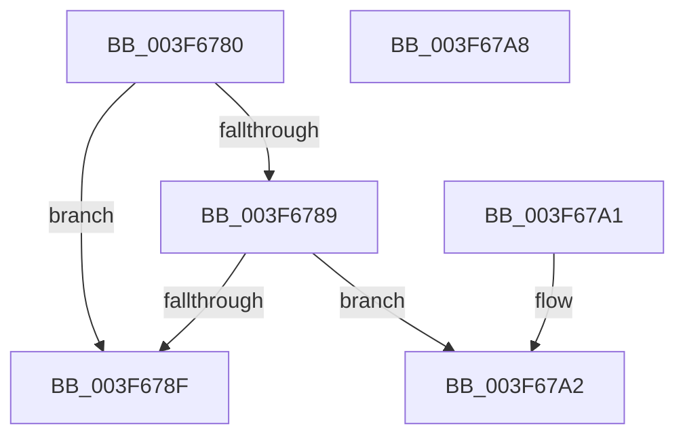

# IopLiveDumpCheckTermination

- RVA: `0x003F6780`–`0x003F67A9` (길이 `41` bytes)
- VA: `0x00000001403F6780`
- 실행 섹션: `.text`
- PDB 이름 있음: `예`; PDB Function 태그: `아니요`
- unwind 정보 RVA: `0x000DB714`
- 디코드: `15`개 명령, `41/41` bytes 표시
- 미해석 바이트: `0` (있으면 어셈블리에 `.byte`로 보존)

> 이 문서는 커널 이미지의 기계어와 PDB 기호를 분석해 생성했습니다. 4번과 5번은 함수 원형과 자료형을 바이너리 사용 방식에서 추정한 C 해석이며 원본 소스 복구 결과는 아닙니다.

## 1. Dependencies

- 직접 호출 지점: **0**; 고유 호출 대상: **0**
- 직접 호출자로 확인된 함수: **2**
- RIP 상대 이미지 참조: **0**

### Outgoing calls
- 직접 디코드된 call 명령이 없습니다.

### Direct callers
- [IopLiveDumpWriteDumpFile](IopLiveDumpWriteDumpFile_function_003F6360.md) at `0x003F6416`
- [IopLiveDumpWriteDumpFileWithExtraPages](../59/IopLiveDumpWriteDumpFileWithExtraPages_function_0059F910.md) at `0x0059FB03`

### Static image references
- 디코드된 RIP-relative 메모리 참조가 없습니다.

## 2. Other-region calls and transfers

- 다른 실행 섹션으로 향하는 call: **0**
- 별도 외부 분기/꼬리 이동을 확인하지 못했습니다.

## 3. Assembly (complete function range)

```asm
003F6780  48 8B 41 48                     mov rax, qword ptr [rcx + 0x48]
003F6784  48 85 C0                        test rax, rax
003F6787  74 06                           je 0x1403f678f
003F6789  83 78 04 00                     cmp dword ptr [rax + 4], 0
003F678D  75 13                           jne 0x1403f67a2
003F678F  8B 82 A0 05 00 00               mov eax, dword ptr [rdx + 0x5a0]
003F6795  24 01                           and al, 1
003F6797  F6 D8                           neg al
003F6799  1B C0                           sbb eax, eax
003F679B  25 4B 00 00 C0                  and eax, 0xc000004b
003F67A0  C3                              ret
003F67A1  CC                              int3
003F67A2  B8 20 01 00 C0                  mov eax, 0xc0000120
003F67A7  C3                              ret
003F67A8  CC                              int3
```

## 4. C-style interpretation (structured pseudocode)

```c
__int64 __fastcall IopLiveDumpCheckTermination(__int64 a1, __int64 a2)
{
    __int64 result;

    if (*(unsigned __int64 *)(a1 + 72) == 0) goto loc_003F678F;
    if ((*(unsigned int *)(*(unsigned __int64 *)(a1 + 72) + 4)) != 0) goto loc_003F67A2;
loc_003F678F:
    result = (unsigned __int8)(((unsigned int)(*(unsigned int *)(a2 + 1440))) & (1));
    result = (unsigned __int8)(-(result));
    result = (unsigned int)((result) & (0xC000004BULL));
    return result;
loc_003F67A2:
    return (unsigned int)(0xC0000120ULL);
}
```

## 5. (Beta) C Style

```c
int64_t IopLiveDumpCheckTermination(void *Arg1, void *Arg2)
{
    uint8_t *arg1 = (uint8_t *)Arg1;
    uint8_t *arg2 = (uint8_t *)Arg2;

    int64_t result;

    if (*(uint64_t *)(arg1 + 0x48) == 0) goto loc_003F678F;
    if ((*(uint32_t *)(*(uint64_t *)(arg1 + 0x48) + 0x4)) != 0) goto loc_003F67A2;
loc_003F678F:
    result = (uint8_t)(((uint32_t)(*(uint32_t *)(arg2 + 0x5A0))) & (1));
    result = (uint8_t)(-(result));
    result = (uint32_t)((result) & (0xC000004BULL));
    return result;
loc_003F67A2:
    return (uint32_t)(0xC0000120ULL);
}
```

### 관측된 메모리 오프셋

구조체 형식이 확인되지 않은 접근은 인자 기준의 오프셋으로만 기록했습니다.

| 기준 인자 | 오프셋 표현 | 폭 (bit) | 접근 |
|---|---:|---:|---|
| `Arg1` | `+ 0x48` | `64` | `R` |
| `Arg2` | `+ 0x5A0` | `32` | `R` |

## 6. Execution-region graph

[열기: 2D/3D 그래프와 함수 탐색 컨트롤 패널](../../../control-panel.html?section=text&rva=0x003F6780&view=graph)

- 2D 그래프는 위에서 아래로 흐르고, 3D 그래프는 빈 공간을 드래그해 회전합니다. Shift+드래그는 이동, 휠은 확대·축소, 함수 노드 선택은 대상 보고서 이동입니다.

### Static fallback


