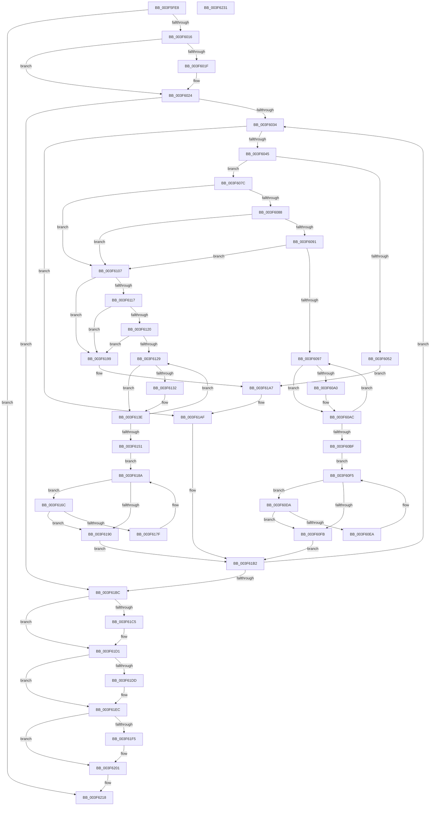

# IopLiveDumpFreeDumpBuffers

- RVA: `0x003F5FE8`–`0x003F6232` (길이 `586` bytes)
- VA: `0x00000001403F5FE8`
- 실행 섹션: `.text`
- PDB 이름 있음: `예`; PDB Function 태그: `아니요`
- unwind 정보 RVA: `0x00060300`
- 디코드: `148`개 명령, `586/586` bytes 표시
- 미해석 바이트: `0` (있으면 어셈블리에 `.byte`로 보존)

> 이 문서는 커널 이미지의 기계어와 PDB 기호를 분석해 생성했습니다. 4번과 5번은 함수 원형과 자료형을 바이너리 사용 방식에서 추정한 C 해석이며 원본 소스 복구 결과는 아닙니다.

## 1. Dependencies

- 직접 호출 지점: **13**; 고유 호출 대상: **6**
- 직접 호출자로 확인된 함수: **4**
- RIP 상대 이미지 참조: **2**

### Outgoing calls
- `0x003F601F` → [VslAbortLiveDump](../58/VslAbortLiveDump_function_0058DE64.md) (function, `0x0058DE64`)
- `0x003F605A` → [MiFreePagesFromMdl](MiFreePagesFromMdl_function_003F8300.md) (function, `0x003F8300`)
- `0x003F606A` → [ExFreePoolWithTag](../../poolcode/B8/ExFreePoolWithTag_function_00B82870.md) (function, `0x00B82870`)
- `0x003F60A7` → [MmUnmapLockedPages](../24/MmUnmapLockedPages_function_00246E60.md) (function, `0x00246E60`)
- `0x003F60B2` → [ExFreePoolWithTag](../../poolcode/B8/ExFreePoolWithTag_function_00B82870.md) (function, `0x00B82870`)
- `0x003F60D3` → [IopLiveDumpFreeIoSpaceRanges](../59/IopLiveDumpFreeIoSpaceRanges_function_0059BEE4.md) (function, `0x0059BEE4`)
- `0x003F6139` → [MmUnmapLockedPages](../24/MmUnmapLockedPages_function_00246E60.md) (function, `0x00246E60`)
- `0x003F6144` → [ExFreePoolWithTag](../../poolcode/B8/ExFreePoolWithTag_function_00B82870.md) (function, `0x00B82870`)
- `0x003F6165` → [IopLiveDumpFreeIoSpaceRanges](../59/IopLiveDumpFreeIoSpaceRanges_function_0059BEE4.md) (function, `0x0059BEE4`)
- `0x003F61A2` → [MmFreeIndependentPages](../2A/MmFreeIndependentPages_function_002A2510.md) (function, `0x002A2510`)
- `0x003F61C8` → [ExFreePoolWithTag](../../poolcode/B8/ExFreePoolWithTag_function_00B82870.md) (function, `0x00B82870`)
- `0x003F61E0` → [ExFreePoolWithTag](../../poolcode/B8/ExFreePoolWithTag_function_00B82870.md) (function, `0x00B82870`)
- `0x003F61F8` → [ExFreePoolWithTag](../../poolcode/B8/ExFreePoolWithTag_function_00B82870.md) (function, `0x00B82870`)

### Direct callers
- [IopLiveDumpAllocateDumpBuffers](IopLiveDumpAllocateDumpBuffers_function_003F5AE8.md) at `0x003F5D20`
- [IopLiveDumpWriteDumpFile](IopLiveDumpWriteDumpFile_function_003F6360.md) at `0x003F6525`
- [IopLiveDumpReleaseResources](../59/IopLiveDumpReleaseResources_function_0059DF1C.md) at `0x0059E074`
- [IopLiveDumpWriteDumpFileWithExtraPages](../59/IopLiveDumpWriteDumpFileWithExtraPages_function_0059F910.md) at `0x005A019F`

### Static image references
- `0x003F6016` → RVA `0x00FC6A84` (`ALMOSTRO`; read)
- `0x003F6199` → RVA `0x00E0A9D0` (`.data`; read)

## 2. Other-region calls and transfers

- 다른 실행 섹션으로 향하는 call: **6**
  - `0x003F606A` → [ExFreePoolWithTag](../../poolcode/B8/ExFreePoolWithTag_function_00B82870.md) (`.text` → `POOLCODE`)
  - `0x003F60B2` → [ExFreePoolWithTag](../../poolcode/B8/ExFreePoolWithTag_function_00B82870.md) (`.text` → `POOLCODE`)
  - `0x003F6144` → [ExFreePoolWithTag](../../poolcode/B8/ExFreePoolWithTag_function_00B82870.md) (`.text` → `POOLCODE`)
  - `0x003F61C8` → [ExFreePoolWithTag](../../poolcode/B8/ExFreePoolWithTag_function_00B82870.md) (`.text` → `POOLCODE`)
  - `0x003F61E0` → [ExFreePoolWithTag](../../poolcode/B8/ExFreePoolWithTag_function_00B82870.md) (`.text` → `POOLCODE`)
  - `0x003F61F8` → [ExFreePoolWithTag](../../poolcode/B8/ExFreePoolWithTag_function_00B82870.md) (`.text` → `POOLCODE`)
- 별도 외부 분기/꼬리 이동을 확인하지 못했습니다.

## 3. Assembly (complete function range)

```asm
003F5FE8  48 89 5C 24 08                  mov qword ptr [rsp + 8], rbx
003F5FED  48 89 6C 24 10                  mov qword ptr [rsp + 0x10], rbp
003F5FF2  48 89 74 24 18                  mov qword ptr [rsp + 0x18], rsi
003F5FF7  57                              push rdi
003F5FF8  41 56                           push r14
003F5FFA  41 57                           push r15
003F5FFC  48 83 EC 20                     sub rsp, 0x20
003F6000  45 33 F6                        xor r14d, r14d
003F6003  48 8D 99 A8 02 00 00            lea rbx, [rcx + 0x2a8]
003F600A  41 8B FE                        mov edi, r14d
003F600D  48 85 DB                        test rbx, rbx
003F6010  0F 84 02 02 00 00               je 0x1403f6218
003F6016  44 38 35 67 0A BD 00            cmp byte ptr [rip + 0xbd0a67], r14b
003F601D  74 05                           je 0x1403f6024
003F601F  E8 40 7E 19 00                  call 0x14058de64
003F6024  41 BF 4C 64 6D 70               mov r15d, 0x706d644c
003F602A  4C 39 73 40                     cmp qword ptr [rbx + 0x40], r14
003F602E  0F 86 88 01 00 00               jbe 0x1403f61bc
003F6034  48 8B 43 48                     mov rax, qword ptr [rbx + 0x48]
003F6038  4C 8B 04 F8                     mov r8, qword ptr [rax + rdi*8]
003F603C  4D 85 C0                        test r8, r8
003F603F  0F 84 6A 01 00 00               je 0x1403f61af
003F6045  48 8B 43 50                     mov rax, qword ptr [rbx + 0x50]
003F6049  48 8B 0C F8                     mov rcx, qword ptr [rax + rdi*8]
003F604D  48 85 C9                        test rcx, rcx
003F6050  74 2A                           je 0x1403f607c
003F6052  45 33 C9                        xor r9d, r9d
003F6055  45 33 C0                        xor r8d, r8d
003F6058  33 D2                           xor edx, edx
003F605A  E8 A1 22 00 00                  call 0x1403f8300
003F605F  48 8B 4B 50                     mov rcx, qword ptr [rbx + 0x50]
003F6063  41 8B D7                        mov edx, r15d
003F6066  48 8B 0C F9                     mov rcx, qword ptr [rcx + rdi*8]
003F606A  E8 01 C8 78 00                  call 0x140b82870
003F606F  48 8B 43 50                     mov rax, qword ptr [rbx + 0x50]
003F6073  4C 89 34 F8                     mov qword ptr [rax + rdi*8], r14
003F6077  E9 2B 01 00 00                  jmp 0x1403f61a7
003F607C  48 8B B3 88 00 00 00            mov rsi, qword ptr [rbx + 0x88]
003F6083  48 85 F6                        test rsi, rsi
003F6086  74 7F                           je 0x1403f6107
003F6088  4C 39 B3 80 00 00 00            cmp qword ptr [rbx + 0x80], r14
003F608F  74 76                           je 0x1403f6107
003F6091  48 3B 7B 78                     cmp rdi, qword ptr [rbx + 0x78]
003F6095  75 70                           jne 0x1403f6107
003F6097  F6 46 0A 01                     test byte ptr [rsi + 0xa], 1
003F609B  48 8B 2E                        mov rbp, qword ptr [rsi]
003F609E  74 0C                           je 0x1403f60ac
003F60A0  48 8B 4E 18                     mov rcx, qword ptr [rsi + 0x18]
003F60A4  48 8B D6                        mov rdx, rsi
003F60A7  E8 B4 0D E5 FF                  call 0x140246e60
003F60AC  41 8B D7                        mov edx, r15d
003F60AF  48 8B CE                        mov rcx, rsi
003F60B2  E8 B9 C7 78 00                  call 0x140b82870
003F60B7  48 8B F5                        mov rsi, rbp
003F60BA  48 85 ED                        test rbp, rbp
003F60BD  75 D8                           jne 0x1403f6097
003F60BF  8B 93 98 00 00 00               mov edx, dword ptr [rbx + 0x98]
003F60C5  48 8D 8B 90 00 00 00            lea rcx, [rbx + 0x90]
003F60CC  4C 89 B3 88 00 00 00            mov qword ptr [rbx + 0x88], r14
003F60D3  E8 0C 5E 1A 00                  call 0x14059bee4
003F60D8  EB 1B                           jmp 0x1403f60f5
003F60DA  48 8B 83 80 00 00 00            mov rax, qword ptr [rbx + 0x80]
003F60E1  48 03 43 78                     add rax, qword ptr [rbx + 0x78]
003F60E5  48 3B F8                        cmp rdi, rax
003F60E8  73 11                           jae 0x1403f60fb
003F60EA  48 8B 43 48                     mov rax, qword ptr [rbx + 0x48]
003F60EE  4C 89 34 F8                     mov qword ptr [rax + rdi*8], r14
003F60F2  48 FF C7                        inc rdi
003F60F5  48 3B 7B 40                     cmp rdi, qword ptr [rbx + 0x40]
003F60F9  72 DF                           jb 0x1403f60da
003F60FB  4C 89 B3 80 00 00 00            mov qword ptr [rbx + 0x80], r14
003F6102  E9 AB 00 00 00                  jmp 0x1403f61b2
003F6107  48 8B B3 B0 00 00 00            mov rsi, qword ptr [rbx + 0xb0]
003F610E  48 85 F6                        test rsi, rsi
003F6111  0F 84 82 00 00 00               je 0x1403f6199
003F6117  4C 39 B3 A8 00 00 00            cmp qword ptr [rbx + 0xa8], r14
003F611E  74 79                           je 0x1403f6199
003F6120  48 3B BB A0 00 00 00            cmp rdi, qword ptr [rbx + 0xa0]
003F6127  75 70                           jne 0x1403f6199
003F6129  F6 46 0A 01                     test byte ptr [rsi + 0xa], 1
003F612D  48 8B 2E                        mov rbp, qword ptr [rsi]
003F6130  74 0C                           je 0x1403f613e
003F6132  48 8B 4E 18                     mov rcx, qword ptr [rsi + 0x18]
003F6136  48 8B D6                        mov rdx, rsi
003F6139  E8 22 0D E5 FF                  call 0x140246e60
003F613E  41 8B D7                        mov edx, r15d
003F6141  48 8B CE                        mov rcx, rsi
003F6144  E8 27 C7 78 00                  call 0x140b82870
003F6149  48 8B F5                        mov rsi, rbp
003F614C  48 85 ED                        test rbp, rbp
003F614F  75 D8                           jne 0x1403f6129
003F6151  8B 93 C0 00 00 00               mov edx, dword ptr [rbx + 0xc0]
003F6157  48 8D 8B B8 00 00 00            lea rcx, [rbx + 0xb8]
003F615E  4C 89 B3 B0 00 00 00            mov qword ptr [rbx + 0xb0], r14
003F6165  E8 7A 5D 1A 00                  call 0x14059bee4
003F616A  EB 1E                           jmp 0x1403f618a
003F616C  48 8B 83 A0 00 00 00            mov rax, qword ptr [rbx + 0xa0]
003F6173  48 03 83 A8 00 00 00            add rax, qword ptr [rbx + 0xa8]
003F617A  48 3B F8                        cmp rdi, rax
003F617D  73 11                           jae 0x1403f6190
003F617F  48 8B 43 48                     mov rax, qword ptr [rbx + 0x48]
003F6183  4C 89 34 F8                     mov qword ptr [rax + rdi*8], r14
003F6187  48 FF C7                        inc rdi
003F618A  48 3B 7B 40                     cmp rdi, qword ptr [rbx + 0x40]
003F618E  72 DC                           jb 0x1403f616c
003F6190  4C 89 B3 A8 00 00 00            mov qword ptr [rbx + 0xa8], r14
003F6197  EB 19                           jmp 0x1403f61b2
003F6199  8B 15 31 48 A1 00               mov edx, dword ptr [rip + 0xa14831]
003F619F  49 8B C8                        mov rcx, r8
003F61A2  E8 69 C3 EA FF                  call 0x1402a2510
003F61A7  48 8B 43 48                     mov rax, qword ptr [rbx + 0x48]
003F61AB  4C 89 34 F8                     mov qword ptr [rax + rdi*8], r14
003F61AF  48 FF C7                        inc rdi
003F61B2  48 3B 7B 40                     cmp rdi, qword ptr [rbx + 0x40]
003F61B6  0F 82 78 FE FF FF               jb 0x1403f6034
003F61BC  48 8B 4B 48                     mov rcx, qword ptr [rbx + 0x48]
003F61C0  48 85 C9                        test rcx, rcx
003F61C3  74 0C                           je 0x1403f61d1
003F61C5  41 8B D7                        mov edx, r15d
003F61C8  E8 A3 C6 78 00                  call 0x140b82870
003F61CD  4C 89 73 48                     mov qword ptr [rbx + 0x48], r14
003F61D1  48 8B 8B C8 00 00 00            mov rcx, qword ptr [rbx + 0xc8]
003F61D8  48 85 C9                        test rcx, rcx
003F61DB  74 0F                           je 0x1403f61ec
003F61DD  41 8B D7                        mov edx, r15d
003F61E0  E8 8B C6 78 00                  call 0x140b82870
003F61E5  4C 89 B3 C8 00 00 00            mov qword ptr [rbx + 0xc8], r14
003F61EC  48 8B 4B 50                     mov rcx, qword ptr [rbx + 0x50]
003F61F0  48 85 C9                        test rcx, rcx
003F61F3  74 0C                           je 0x1403f6201
003F61F5  41 8B D7                        mov edx, r15d
003F61F8  E8 73 C6 78 00                  call 0x140b82870
003F61FD  4C 89 73 50                     mov qword ptr [rbx + 0x50], r14
003F6201  4C 89 73 40                     mov qword ptr [rbx + 0x40], r14
003F6205  44 89 73 28                     mov dword ptr [rbx + 0x28], r14d
003F6209  4C 89 33                        mov qword ptr [rbx], r14
003F620C  4C 89 73 08                     mov qword ptr [rbx + 8], r14
003F6210  4C 89 73 10                     mov qword ptr [rbx + 0x10], r14
003F6214  4C 89 73 18                     mov qword ptr [rbx + 0x18], r14
003F6218  48 8B 5C 24 40                  mov rbx, qword ptr [rsp + 0x40]
003F621D  48 8B 6C 24 48                  mov rbp, qword ptr [rsp + 0x48]
003F6222  48 8B 74 24 50                  mov rsi, qword ptr [rsp + 0x50]
003F6227  48 83 C4 20                     add rsp, 0x20
003F622B  41 5F                           pop r15
003F622D  41 5E                           pop r14
003F622F  5F                              pop rdi
003F6230  C3                              ret
003F6231  CC                              int3
```

## 4. C-style interpretation (structured pseudocode)

```c
__int64 __fastcall IopLiveDumpFreeDumpBuffers(__int64 a1, int a2, __int64 a3, int a4)
{
    __int64 result;
    __int64 v_r14;
    __int64 v_rdi;
    __int64 v_rsp;
    unsigned __int64 v_stack_p10;
    unsigned __int64 v_stack_p18;
    unsigned __int64 v_stack_p8;

    v_stack_p8 = v_rbx;
    v_stack_p10 = v_rbp;
    v_stack_p18 = v_rsi;
    v_rsp = (v_rsp) - (32);
    v_r14 = 0;
    if (a1 + 680 == 0) goto loc_003F6218;
    if ((*(unsigned __int8 *)(v_rip + 12388967)) != 0) {
        result = VslAbortLiveDump(a1, a2, a3, a4);
    }
    if ((*(unsigned __int64 *)(a1 + 680 + 64)) <= 0) goto loc_003F61BC;
loc_003F6034:
    if (*(unsigned __int64 *)(*(unsigned __int64 *)(a1 + 680 + 72) + 0 * 8) == 0) goto loc_003F61AF;
    if (*(unsigned __int64 *)(*(unsigned __int64 *)(a1 + 680 + 80) + 0 * 8) == 0) goto loc_003F607C;
    a4 = 0;
    a3 = 0;
    a2 = 0;
    result = MiFreePagesFromMdl(*(unsigned __int64 *)(*(unsigned __int64 *)(a1 + 680 + 80) + 0 * 8), a2, a3, a4);
    result = ExFreePoolWithTag(*(unsigned __int64 *)(*(unsigned __int64 *)(a1 + 680 + 80) + 0 * 8), (unsigned int)((unsigned int)((unsigned int)(0x706D644CULL))), a3, a4);
    *(unsigned __int64 *)(*(unsigned __int64 *)(a1 + 680 + 80) + 0 * 8) = 0;
    goto loc_003F61A7;
loc_003F607C:
    if (*(unsigned __int64 *)(a1 + 680 + 136) == 0) goto loc_003F6107;
    if ((*(unsigned __int64 *)(a1 + 680 + 128)) == 0) goto loc_003F6107;
    if (0 != (*(unsigned __int64 *)(a1 + 680 + 120))) goto loc_003F6107;
loc_003F6097:
    result = *(unsigned __int64 *)(a1 + 680 + 80);
    if (((*(unsigned __int8 *)(*(unsigned __int64 *)(a1 + 680 + 136) + 10)) & (1)) != 0) {
        a1 = *(unsigned __int64 *)(*(unsigned __int64 *)(a1 + 680 + 136) + 24);
        a2 = *(unsigned __int64 *)(a1 + 680 + 136);
        result = MmUnmapLockedPages(a1, a2, a3, a4);
    }
    result = ExFreePoolWithTag(*(unsigned __int64 *)(a1 + 680 + 136), (unsigned int)((unsigned int)((unsigned int)(0x706D644CULL))), a3, a4);
    if (*(unsigned __int64 *)(*(unsigned __int64 *)(a1 + 680 + 136)) != 0) goto loc_003F6097;
    *(unsigned __int64 *)(a1 + 680 + 136) = 0;
    result = IopLiveDumpFreeIoSpaceRanges(a1 + 680 + 144, (unsigned int)(*(unsigned int *)(a1 + 680 + 152)), a3, a4);
    goto loc_003F60F5;
loc_003F60DA:
    result = (*(unsigned __int64 *)(a1 + 680 + 128)) + (*(unsigned __int64 *)(a1 + 680 + 120));
    if (0 >= result) goto loc_003F60FB;
    *(unsigned __int64 *)(*(unsigned __int64 *)(a1 + 680 + 72) + 0 * 8) = 0;
    v_rdi = (0) + 1;
loc_003F60F5:
    if (v_rdi < (*(unsigned __int64 *)(a1 + 680 + 64))) goto loc_003F60DA;
loc_003F60FB:
    *(unsigned __int64 *)(a1 + 680 + 128) = 0;
    goto loc_003F61B2;
loc_003F6107:
    if (*(unsigned __int64 *)(a1 + 680 + 176) == 0) goto loc_003F6199;
    if ((*(unsigned __int64 *)(a1 + 680 + 168)) == 0) goto loc_003F6199;
    if (v_rdi != (*(unsigned __int64 *)(a1 + 680 + 160))) goto loc_003F6199;
loc_003F6129:
    result = *(unsigned __int64 *)(a1 + 680 + 72);
    if (((*(unsigned __int8 *)(*(unsigned __int64 *)(a1 + 680 + 176) + 10)) & (1)) != 0) {
        a1 = *(unsigned __int64 *)(*(unsigned __int64 *)(a1 + 680 + 176) + 24);
        a2 = *(unsigned __int64 *)(a1 + 680 + 176);
        result = MmUnmapLockedPages(a1, a2, a3, a4);
    }
    result = ExFreePoolWithTag(*(unsigned __int64 *)(a1 + 680 + 176), (unsigned int)((unsigned int)((unsigned int)(0x706D644CULL))), a3, a4);
    if (*(unsigned __int64 *)(*(unsigned __int64 *)(a1 + 680 + 176)) != 0) goto loc_003F6129;
    *(unsigned __int64 *)(a1 + 680 + 176) = 0;
    result = IopLiveDumpFreeIoSpaceRanges(a1 + 680 + 184, (unsigned int)(*(unsigned int *)(a1 + 680 + 192)), a3, a4);
    goto loc_003F618A;
loc_003F616C:
    result = (*(unsigned __int64 *)(a1 + 680 + 160)) + (*(unsigned __int64 *)(a1 + 680 + 168));
    if (v_rdi >= result) goto loc_003F6190;
    *(unsigned __int64 *)(*(unsigned __int64 *)(a1 + 680 + 72) + v_rdi * 8) = 0;
    v_rdi = (v_rdi) + 1;
loc_003F618A:
    if (v_rdi < (*(unsigned __int64 *)(a1 + 680 + 64))) goto loc_003F616C;
loc_003F6190:
    *(unsigned __int64 *)(a1 + 680 + 168) = 0;
    goto loc_003F61B2;
loc_003F6199:
    result = MmFreeIndependentPages(0, (unsigned int)(*(unsigned int *)(v_rip + 10569777)), a3, a4);
loc_003F61A7:
    *(unsigned __int64 *)(*(unsigned __int64 *)(a1 + 680 + 72) + v_rdi * 8) = 0;
loc_003F61AF:
    v_rdi = (v_rdi) + 1;
loc_003F61B2:
    if (v_rdi < (*(unsigned __int64 *)(a1 + 680 + 64))) goto loc_003F6034;
loc_003F61BC:
    result = *(unsigned __int64 *)(a1 + 680 + 72);
    if (*(unsigned __int64 *)(a1 + 680 + 72) != 0) {
        a2 = (unsigned int)((unsigned int)(0x706D644CULL));
        result = ExFreePoolWithTag(*(unsigned __int64 *)(a1 + 680 + 72), a2, a3, a4);
        *(unsigned __int64 *)(a1 + 680 + 72) = 0;
    }
    if (*(unsigned __int64 *)(a1 + 680 + 200) != 0) {
        a2 = (unsigned int)((unsigned int)(0x706D644CULL));
        result = ExFreePoolWithTag(*(unsigned __int64 *)(a1 + 680 + 200), a2, a3, a4);
        *(unsigned __int64 *)(a1 + 680 + 200) = 0;
    }
    if (*(unsigned __int64 *)(a1 + 680 + 80) != 0) {
        a2 = (unsigned int)((unsigned int)(0x706D644CULL));
        result = ExFreePoolWithTag(*(unsigned __int64 *)(a1 + 680 + 80), a2, a3, a4);
        *(unsigned __int64 *)(a1 + 680 + 80) = 0;
    }
    *(unsigned __int64 *)(a1 + 680 + 64) = 0;
    *(unsigned int *)(a1 + 680 + 40) = 0;
    *(unsigned __int64 *)(a1 + 680) = 0;
    *(unsigned __int64 *)(a1 + 680 + 8) = 0;
    *(unsigned __int64 *)(a1 + 680 + 16) = 0;
    *(unsigned __int64 *)(a1 + 680 + 24) = 0;
loc_003F6218:
    v_rsp = (v_rsp) + (32);
    return result;
}
```

## 5. (Beta) C Style

```c
int64_t IopLiveDumpFreeDumpBuffers(void *Arg1, int32_t Arg2, int64_t Arg3, int32_t Arg4)
{
    uint8_t *arg1 = (uint8_t *)Arg1;

    int64_t result;
    int64_t local_r14;
    int64_t local_rdi;
    int64_t local_rsp;
    uint64_t v_stack_p10;
    uint64_t v_stack_p18;
    uint64_t v_stack_p8;

    v_stack_p8 = local_rbx;
    v_stack_p10 = local_rbp;
    v_stack_p18 = local_rsi;
    local_rsp = (local_rsp) - (32);
    local_r14 = 0;
    if (Arg1 + 680 == 0) goto loc_003F6218;
    if ((*(uint8_t *)(v_rip + 0xBD0A67)) != 0) {
        result = VslAbortLiveDump(Arg1, Arg2, Arg3, Arg4);
    }
    if ((*(uint64_t *)(arg1 + 0x2A8 + 0x40)) <= 0) goto loc_003F61BC;
loc_003F6034:
    if (*(uint64_t *)(*(uint64_t *)(arg1 + 0x2A8 + 0x48) + 0x0 * 8) == 0) goto loc_003F61AF;
    if (*(uint64_t *)(*(uint64_t *)(arg1 + 0x2A8 + 0x50) + 0x0 * 8) == 0) goto loc_003F607C;
    Arg4 = 0;
    Arg3 = 0;
    Arg2 = 0;
    result = MiFreePagesFromMdl(*(uint64_t *)(*(uint64_t *)(arg1 + 0x2A8 + 0x50) + 0x0 * 8), Arg2, Arg3, Arg4);
    result = ExFreePoolWithTag(*(uint64_t *)(*(uint64_t *)(arg1 + 0x2A8 + 0x50) + 0x0 * 8), (uint32_t)((uint32_t)((uint32_t)(0x706D644CULL))), Arg3, Arg4);
    *(uint64_t *)(*(uint64_t *)(arg1 + 0x2A8 + 0x50) + 0x0 * 8) = 0;
    goto loc_003F61A7;
loc_003F607C:
    if (*(uint64_t *)(arg1 + 0x2A8 + 0x88) == 0) goto loc_003F6107;
    if ((*(uint64_t *)(arg1 + 0x2A8 + 0x80)) == 0) goto loc_003F6107;
    if (0 != (*(uint64_t *)(arg1 + 0x2A8 + 0x78))) goto loc_003F6107;
loc_003F6097:
    result = *(uint64_t *)(arg1 + 0x2A8 + 0x50);
    if (((*(uint8_t *)(*(uint64_t *)(arg1 + 0x2A8 + 0x88) + 0xA)) & (1)) != 0) {
        Arg1 = *(uint64_t *)(*(uint64_t *)(arg1 + 0x2A8 + 0x88) + 0x18);
        Arg2 = *(uint64_t *)(arg1 + 0x2A8 + 0x88);
        result = MmUnmapLockedPages(Arg1, Arg2, Arg3, Arg4);
    }
    result = ExFreePoolWithTag(*(uint64_t *)(arg1 + 0x2A8 + 0x88), (uint32_t)((uint32_t)((uint32_t)(0x706D644CULL))), Arg3, Arg4);
    if (*(uint64_t *)(*(uint64_t *)(arg1 + 0x2A8 + 0x88)) != 0) goto loc_003F6097;
    *(uint64_t *)(arg1 + 0x2A8 + 0x88) = 0;
    result = IopLiveDumpFreeIoSpaceRanges(Arg1 + 680 + 144, (uint32_t)(*(uint32_t *)(arg1 + 0x2A8 + 0x98)), Arg3, Arg4);
    goto loc_003F60F5;
loc_003F60DA:
    result = (*(uint64_t *)(arg1 + 0x2A8 + 0x80)) + (*(uint64_t *)(arg1 + 0x2A8 + 0x78));
    if (0 >= result) goto loc_003F60FB;
    *(uint64_t *)(*(uint64_t *)(arg1 + 0x2A8 + 0x48) + 0x0 * 8) = 0;
    local_rdi = (0) + 1;
loc_003F60F5:
    if (local_rdi < (*(uint64_t *)(arg1 + 0x2A8 + 0x40))) goto loc_003F60DA;
loc_003F60FB:
    *(uint64_t *)(arg1 + 0x2A8 + 0x80) = 0;
    goto loc_003F61B2;
loc_003F6107:
    if (*(uint64_t *)(arg1 + 0x2A8 + 0xB0) == 0) goto loc_003F6199;
    if ((*(uint64_t *)(arg1 + 0x2A8 + 0xA8)) == 0) goto loc_003F6199;
    if (local_rdi != (*(uint64_t *)(arg1 + 0x2A8 + 0xA0))) goto loc_003F6199;
loc_003F6129:
    result = *(uint64_t *)(arg1 + 0x2A8 + 0x48);
    if (((*(uint8_t *)(*(uint64_t *)(arg1 + 0x2A8 + 0xB0) + 0xA)) & (1)) != 0) {
        Arg1 = *(uint64_t *)(*(uint64_t *)(arg1 + 0x2A8 + 0xB0) + 0x18);
        Arg2 = *(uint64_t *)(arg1 + 0x2A8 + 0xB0);
        result = MmUnmapLockedPages(Arg1, Arg2, Arg3, Arg4);
    }
    result = ExFreePoolWithTag(*(uint64_t *)(arg1 + 0x2A8 + 0xB0), (uint32_t)((uint32_t)((uint32_t)(0x706D644CULL))), Arg3, Arg4);
    if (*(uint64_t *)(*(uint64_t *)(arg1 + 0x2A8 + 0xB0)) != 0) goto loc_003F6129;
    *(uint64_t *)(arg1 + 0x2A8 + 0xB0) = 0;
    result = IopLiveDumpFreeIoSpaceRanges(Arg1 + 680 + 184, (uint32_t)(*(uint32_t *)(arg1 + 0x2A8 + 0xC0)), Arg3, Arg4);
    goto loc_003F618A;
loc_003F616C:
    result = (*(uint64_t *)(arg1 + 0x2A8 + 0xA0)) + (*(uint64_t *)(arg1 + 0x2A8 + 0xA8));
    if (local_rdi >= result) goto loc_003F6190;
    *(uint64_t *)(*(uint64_t *)(arg1 + 0x2A8 + 0x48) + local_rdi * 8) = 0;
    local_rdi = (local_rdi) + 1;
loc_003F618A:
    if (local_rdi < (*(uint64_t *)(arg1 + 0x2A8 + 0x40))) goto loc_003F616C;
loc_003F6190:
    *(uint64_t *)(arg1 + 0x2A8 + 0xA8) = 0;
    goto loc_003F61B2;
loc_003F6199:
    result = MmFreeIndependentPages(0, (uint32_t)(*(uint32_t *)(v_rip + 0xA14831)), Arg3, Arg4);
loc_003F61A7:
    *(uint64_t *)(*(uint64_t *)(arg1 + 0x2A8 + 0x48) + local_rdi * 8) = 0;
loc_003F61AF:
    local_rdi = (local_rdi) + 1;
loc_003F61B2:
    if (local_rdi < (*(uint64_t *)(arg1 + 0x2A8 + 0x40))) goto loc_003F6034;
loc_003F61BC:
    result = *(uint64_t *)(arg1 + 0x2A8 + 0x48);
    if (*(uint64_t *)(arg1 + 0x2A8 + 0x48) != 0) {
        Arg2 = (uint32_t)((uint32_t)(0x706D644CULL));
        result = ExFreePoolWithTag(*(uint64_t *)(arg1 + 0x2A8 + 0x48), Arg2, Arg3, Arg4);
        *(uint64_t *)(arg1 + 0x2A8 + 0x48) = 0;
    }
    if (*(uint64_t *)(arg1 + 0x2A8 + 0xC8) != 0) {
        Arg2 = (uint32_t)((uint32_t)(0x706D644CULL));
        result = ExFreePoolWithTag(*(uint64_t *)(arg1 + 0x2A8 + 0xC8), Arg2, Arg3, Arg4);
        *(uint64_t *)(arg1 + 0x2A8 + 0xC8) = 0;
    }
    if (*(uint64_t *)(arg1 + 0x2A8 + 0x50) != 0) {
        Arg2 = (uint32_t)((uint32_t)(0x706D644CULL));
        result = ExFreePoolWithTag(*(uint64_t *)(arg1 + 0x2A8 + 0x50), Arg2, Arg3, Arg4);
        *(uint64_t *)(arg1 + 0x2A8 + 0x50) = 0;
    }
    *(uint64_t *)(arg1 + 0x2A8 + 0x40) = 0;
    *(uint32_t *)(arg1 + 0x2A8 + 0x28) = 0;
    *(uint64_t *)(arg1 + 0x2A8) = 0;
    *(uint64_t *)(arg1 + 0x2A8 + 0x8) = 0;
    *(uint64_t *)(arg1 + 0x2A8 + 0x10) = 0;
    *(uint64_t *)(arg1 + 0x2A8 + 0x18) = 0;
loc_003F6218:
    local_rsp = (local_rsp) + (32);
    return result;
}
```

### 관측된 메모리 오프셋

구조체 형식이 확인되지 않은 접근은 인자 기준의 오프셋으로만 기록했습니다.

| 기준 인자 | 오프셋 표현 | 폭 (bit) | 접근 |
|---|---:|---:|---|
| `Arg1` | `+ 0x2A8` | `64` | `R` |

## 6. Execution-region graph

[열기: 2D/3D 그래프와 함수 탐색 컨트롤 패널](../../../control-panel.html?section=text&rva=0x003F5FE8&view=graph)

- 2D 그래프는 위에서 아래로 흐르고, 3D 그래프는 빈 공간을 드래그해 회전합니다. Shift+드래그는 이동, 휠은 확대·축소, 함수 노드 선택은 대상 보고서 이동입니다.

### Static fallback


