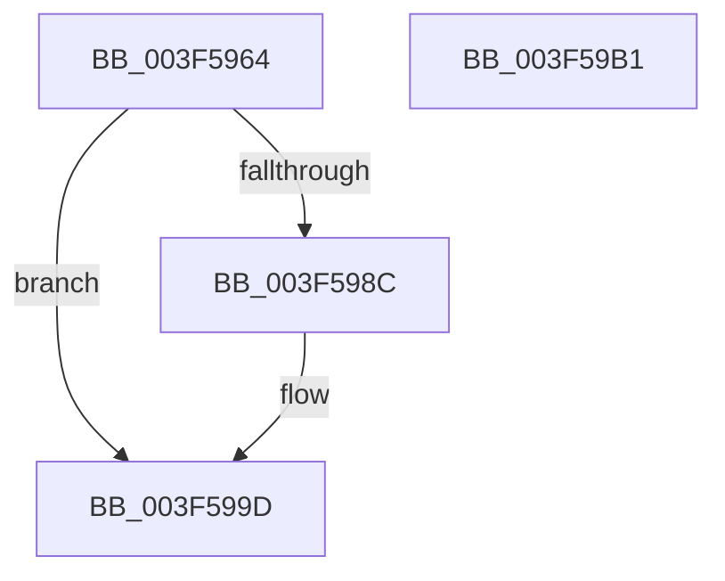

# IopLiveDumpGetMillisecondCounter

- RVA: `0x003F5964`–`0x003F59B2` (길이 `78` bytes)
- VA: `0x00000001403F5964`
- 실행 섹션: `.text`
- PDB 이름 있음: `예`; PDB Function 태그: `아니요`
- unwind 정보 RVA: `0x0005CF00`
- 디코드: `21`개 명령, `78/78` bytes 표시
- 미해석 바이트: `0` (있으면 어셈블리에 `.byte`로 보존)

> 이 문서는 커널 이미지의 기계어와 PDB 기호를 분석해 생성했습니다. 4번과 5번은 함수 원형과 자료형을 바이너리 사용 방식에서 추정한 C 해석이며 원본 소스 복구 결과는 아닙니다.

## 1. Dependencies

- 직접 호출 지점: **1**; 고유 호출 대상: **1**
- 직접 호출자로 확인된 함수: **17**
- RIP 상대 이미지 참조: **5**

### Outgoing calls
- `0x003F596E` → [KeQueryPerformanceCounter](../37/KeQueryPerformanceCounter_function_0037E7E0.md) (function, `0x0037E7E0`)

### Direct callers
- [IopLiveDumpAllocateDumpBuffers](IopLiveDumpAllocateDumpBuffers_function_003F5AE8.md) at `0x003F5B21`
- [IopLiveDumpAllocateDumpBuffers](IopLiveDumpAllocateDumpBuffers_function_003F5AE8.md) at `0x003F5D54`
- [IoCaptureLiveDump](../4E/IoCaptureLiveDump_function_004E085C.md) at `0x004E091D`
- [IoCaptureLiveDump](../4E/IoCaptureLiveDump_function_004E085C.md) at `0x004E0DA4`
- [IoCaptureLiveDump](../4E/IoCaptureLiveDump_function_004E085C.md) at `0x004E0DD4`
- [IoCaptureLiveDump](../4E/IoCaptureLiveDump_function_004E085C.md) at `0x004E0EC4`
- [IoWriteDeferredLiveDumpData](../59/IoWriteDeferredLiveDumpData_function_00598CD0.md) at `0x00598D22`
- [IoWriteDeferredLiveDumpData](../59/IoWriteDeferredLiveDumpData_function_00598CD0.md) at `0x00598D36`
- [IopLiveDumpAllocAndInitResources](../59/IopLiveDumpAllocAndInitResources_function_005993B0.md) at `0x005993E6`
- [IopLiveDumpAllocAndInitResources](../59/IopLiveDumpAllocAndInitResources_function_005993B0.md) at `0x005999FA`
- [IopLiveDumpAllocateExtraBuffers](../59/IopLiveDumpAllocateExtraBuffers_function_00599A9C.md) at `0x00599AD2`
- [IopLiveDumpAllocateExtraBuffers](../59/IopLiveDumpAllocateExtraBuffers_function_00599A9C.md) at `0x00599B2E`
- [IopLiveDumpAllocateExtraBuffers](../59/IopLiveDumpAllocateExtraBuffers_function_00599A9C.md) at `0x00599B9B`
- [IopLiveDumpAllocateExtraBuffers](../59/IopLiveDumpAllocateExtraBuffers_function_00599A9C.md) at `0x00599DA5`
- [IopLiveDumpCaptureMemoryPages](../59/IopLiveDumpCaptureMemoryPages_function_0059B0A0.md) at `0x0059B0D2`
- [IopLiveDumpCaptureMemoryPages](../59/IopLiveDumpCaptureMemoryPages_function_0059B0A0.md) at `0x0059B167`
- [IopLiveDumpCollectPages](../59/IopLiveDumpCollectPages_function_0059B328.md) at `0x0059B34A`
- [IopLiveDumpCollectPages](../59/IopLiveDumpCollectPages_function_0059B328.md) at `0x0059B4EE`
- [IopLiveDumpCollectPages](../59/IopLiveDumpCollectPages_function_0059B328.md) at `0x0059B5C4`
- [IopLiveDumpCollectPages](../59/IopLiveDumpCollectPages_function_0059B328.md) at `0x0059B5ED`
- [IopLiveDumpCollectPages](../59/IopLiveDumpCollectPages_function_0059B328.md) at `0x0059B665`
- [IopLiveDumpCorralProcessors](../59/IopLiveDumpCorralProcessors_function_0059B720.md) at `0x0059B808`
- [IopLiveDumpCorralProcessors](../59/IopLiveDumpCorralProcessors_function_0059B720.md) at `0x0059B900`
- [IopLiveDumpEnterCorralledState](../59/IopLiveDumpEnterCorralledState_function_0059BA40.md) at `0x0059BA67`
- [IopLiveDumpEstimateMemoryPages](../59/IopLiveDumpEstimateMemoryPages_function_0059BA80.md) at `0x0059BAB1`
- [IopLiveDumpEstimateMemoryPages](../59/IopLiveDumpEstimateMemoryPages_function_0059BA80.md) at `0x0059BB3B`
- [IopLiveDumpEstimateMemoryPages](../59/IopLiveDumpEstimateMemoryPages_function_0059BA80.md) at `0x0059BB62`
- [IopLiveDumpEstimateMemoryPages](../59/IopLiveDumpEstimateMemoryPages_function_0059BA80.md) at `0x0059BCF5`
- [IopLiveDumpGenerateIptSecondaryData](../59/IopLiveDumpGenerateIptSecondaryData_function_0059C074.md) at `0x0059C0B2`
- [IopLiveDumpGenerateIptSecondaryData](../59/IopLiveDumpGenerateIptSecondaryData_function_0059C074.md) at `0x0059C223`
- [IopLiveDumpInitiateCorralStateChange](../59/IopLiveDumpInitiateCorralStateChange_function_0059CA5C.md) at `0x0059CA87`
- [IopLiveDumpInitiateCorralStateChange](../59/IopLiveDumpInitiateCorralStateChange_function_0059CA5C.md) at `0x0059CAD4`
- [IopLiveDumpMarkImportantDumpData](../59/IopLiveDumpMarkImportantDumpData_function_0059CCA4.md) at `0x0059CD27`
- [IopLiveDumpMarkImportantDumpData](../59/IopLiveDumpMarkImportantDumpData_function_0059CCA4.md) at `0x0059CDD6`
- [IopLiveDumpMarkRequiredDumpData](../59/IopLiveDumpMarkRequiredDumpData_function_0059D070.md) at `0x0059D0AF`
- [IopLiveDumpMarkRequiredDumpData](../59/IopLiveDumpMarkRequiredDumpData_function_0059D070.md) at `0x0059D226`
- [IopLiveDumpMirrorPhysicalMemoryCallback](../59/IopLiveDumpMirrorPhysicalMemoryCallback_function_0059D260.md) at `0x0059D284`
- [IopLiveDumpMirrorPhysicalMemoryCallback](../59/IopLiveDumpMirrorPhysicalMemoryCallback_function_0059D260.md) at `0x0059D4BB`
- [IopLiveDumpPopulateBitmapForDump](../59/IopLiveDumpPopulateBitmapForDump_function_0059D9B0.md) at `0x0059D9E4`
- [IopLiveDumpPopulateBitmapForDump](../59/IopLiveDumpPopulateBitmapForDump_function_0059D9B0.md) at `0x0059DD26`
- [IopLiveDumpRemoveSystemCacheFromDump](../59/IopLiveDumpRemoveSystemCacheFromDump_function_0059E1B0.md) at `0x0059E1DE`
- [IopLiveDumpRemoveSystemCacheFromDump](../59/IopLiveDumpRemoveSystemCacheFromDump_function_0059E1B0.md) at `0x0059E222`

### Static image references
- `0x003F597C` → RVA `0x00F8D088` (`.data`; read)
- `0x003F598C` → RVA `0x00E66170` (`.data`; read)
- `0x003F5993` → RVA `0x00E66168` (`.data`; read)
- `0x003F599D` → RVA `0x00E66170` (`.data`; write)
- `0x003F59A4` → RVA `0x00E66168` (`.data`; write)

## 2. Other-region calls and transfers

- 다른 실행 섹션으로 향하는 call: **0**
- 별도 외부 분기/꼬리 이동을 확인하지 못했습니다.

## 3. Assembly (complete function range)

```asm
003F5964  40 53                           push rbx
003F5966  48 83 EC 20                     sub rsp, 0x20
003F596A  8A D9                           mov bl, cl
003F596C  33 C9                           xor ecx, ecx
003F596E  E8 6D 8E F8 FF                  call 0x14037e7e0
003F5973  48 69 C0 E8 03 00 00            imul rax, rax, 0x3e8
003F597A  48 99                           cqo
003F597C  48 F7 3D 05 77 B9 00            idiv qword ptr [rip + 0xb97705]
003F5983  48 8B C8                        mov rcx, rax
003F5986  33 C0                           xor eax, eax
003F5988  84 DB                           test bl, bl
003F598A  75 11                           jne 0x1403f599d
003F598C  48 8B 05 DD 07 A7 00            mov rax, qword ptr [rip + 0xa707dd]
003F5993  48 2B 05 CE 07 A7 00            sub rax, qword ptr [rip + 0xa707ce]
003F599A  48 03 C1                        add rax, rcx
003F599D  48 89 05 CC 07 A7 00            mov qword ptr [rip + 0xa707cc], rax
003F59A4  48 89 0D BD 07 A7 00            mov qword ptr [rip + 0xa707bd], rcx
003F59AB  48 83 C4 20                     add rsp, 0x20
003F59AF  5B                              pop rbx
003F59B0  C3                              ret
003F59B1  CC                              int3
```

## 4. C-style interpretation (structured pseudocode)

```c
__int64 __fastcall IopLiveDumpGetMillisecondCounter(int a1)
{
    __int64 result;
    __int64 v_rsp;

    v_rsp = (v_rsp) - (32);
    a1 = 0;
    result = KeQueryPerformanceCounter(a1, a2, a3, a4);
    result = (result) * (result);
    result = 0;
    if ((unsigned __int8)((unsigned __int8)(a1)) == 0) {
        result = *(unsigned __int64 *)(v_rip + 10946525);
        result = (result) - (*(unsigned __int64 *)(v_rip + 10946510));
        result = (result) + (result);
    }
    *(unsigned __int64 *)(v_rip + 10946508) = result;
    *(unsigned __int64 *)(v_rip + 10946493) = result;
    v_rsp = (v_rsp) + (32);
    return result;
}
```

## 5. (Beta) C Style

```c
int64_t IopLiveDumpGetMillisecondCounter(int32_t Arg1)
{
    int64_t result;
    int64_t local_rsp;

    local_rsp = (local_rsp) - (32);
    Arg1 = 0;
    result = KeQueryPerformanceCounter(Arg1, a2, a3, a4);
    result = (result) * (result);
    result = 0;
    if ((uint8_t)((uint8_t)(Arg1)) == 0) {
        result = *(uint64_t *)(v_rip + 0xA707DD);
        result = (result) - (*(uint64_t *)(v_rip + 0xA707CE));
        result = (result) + (result);
    }
    *(uint64_t *)(v_rip + 0xA707CC) = result;
    *(uint64_t *)(v_rip + 0xA707BD) = result;
    local_rsp = (local_rsp) + (32);
    return result;
}
```

## 6. Execution-region graph

[열기: 2D/3D 그래프와 함수 탐색 컨트롤 패널](../../../control-panel.html?section=text&rva=0x003F5964&view=graph)

- 2D 그래프는 위에서 아래로 흐르고, 3D 그래프는 빈 공간을 드래그해 회전합니다. Shift+드래그는 이동, 휠은 확대·축소, 함수 노드 선택은 대상 보고서 이동입니다.

### Static fallback


