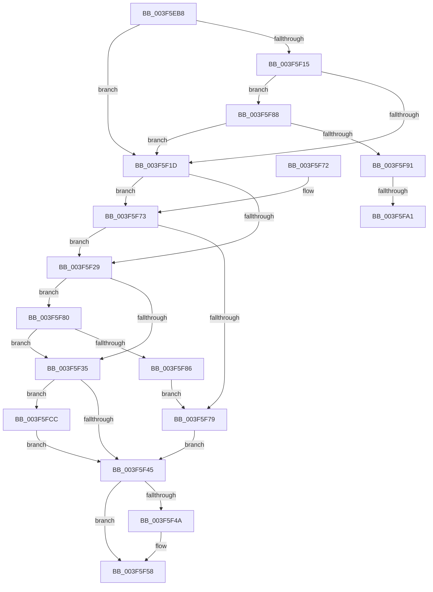

# IopLiveDumpIsUnderMemoryPressure

- RVA: `0x003F5EB8`–`0x003F5FE2` (길이 `298` bytes)
- VA: `0x00000001403F5EB8`
- 실행 섹션: `.text`
- PDB 이름 있음: `예`; PDB Function 태그: `예`
- unwind 정보 RVA: `0x00098048`
- 디코드: `77`개 명령, `298/298` bytes 표시
- 미해석 바이트: `0` (있으면 어셈블리에 `.byte`로 보존)

> 이 문서는 커널 이미지의 기계어와 PDB 기호를 분석해 생성했습니다. 4번과 5번은 함수 원형과 자료형을 바이너리 사용 방식에서 추정한 C 해석이며 원본 소스 복구 결과는 아닙니다.

## 1. Dependencies

- 직접 호출 지점: **2**; 고유 호출 대상: **2**
- 직접 호출자로 확인된 함수: **5**
- RIP 상대 이미지 참조: **1**

### Outgoing calls
- `0x003F5EFF` → [ZwQuerySystemInformation](../6A/ZwQuerySystemInformation_function_006AD790.md) (function, `0x006AD790`)
- `0x003F5F62` → [_security_check_cookie](../6A/_security_check_cookie_function_006AC640.md) (function, `0x006AC640`)

### Direct callers
- [IopLiveDumpAllocateDumpBuffers](IopLiveDumpAllocateDumpBuffers_function_003F5AE8.md) at `0x003F5CFE`
- [IopLiveDumpAllocAndInitResources](../59/IopLiveDumpAllocAndInitResources_function_005993B0.md) at `0x005994B2`
- [IopLiveDumpAllocAndInitResources](../59/IopLiveDumpAllocAndInitResources_function_005993B0.md) at `0x0059955A`
- [IopLiveDumpAllocAndInitResources](../59/IopLiveDumpAllocAndInitResources_function_005993B0.md) at `0x005995F6`
- [IopLiveDumpAllocAndInitResources](../59/IopLiveDumpAllocAndInitResources_function_005993B0.md) at `0x005996D9`
- [IopLiveDumpAllocAndInitResources](../59/IopLiveDumpAllocAndInitResources_function_005993B0.md) at `0x00599742`
- [IopLiveDumpAllocAndInitResources](../59/IopLiveDumpAllocAndInitResources_function_005993B0.md) at `0x00599872`
- [IopLiveDumpAllocateExtraBuffers](../59/IopLiveDumpAllocateExtraBuffers_function_00599A9C.md) at `0x00599D4A`
- [IopLiveDumpAllocateIptBuffers](../59/IopLiveDumpAllocateIptBuffers_function_0059A694.md) at `0x0059A746`
- [IopLiveDumpAllocateIptBuffers](../59/IopLiveDumpAllocateIptBuffers_function_0059A694.md) at `0x0059A805`
- [sub_006EB392](../6E/Unknown_function_006EB392.md) at `0x006EB629`

### Static image references
- `0x003F5EC2` → RVA `0x00E0A740` (`.data`; read)

## 2. Other-region calls and transfers

- 다른 실행 섹션으로 향하는 call: **0**
- call이 아닌 외부 분기/꼬리 이동: **2**
  - `0x003F5F9B` → [sub_006EB64E](../6E/Unknown_function_006EB64E.md) (`tail-transfer`)
  - `0x003F5FC7` → [sub_006EB64E](../6E/Unknown_function_006EB64E.md) (`tail-transfer`)

## 3. Assembly (complete function range)

```asm
003F5EB8  48 89 5C 24 10                  mov qword ptr [rsp + 0x10], rbx
003F5EBD  57                              push rdi
003F5EBE  48 83 EC 60                     sub rsp, 0x60
003F5EC2  48 8B 05 77 48 A1 00            mov rax, qword ptr [rip + 0xa14877]
003F5EC9  48 33 C4                        xor rax, rsp
003F5ECC  48 89 44 24 58                  mov qword ptr [rsp + 0x58], rax
003F5ED1  0F 57 C0                        xorps xmm0, xmm0
003F5ED4  48 8D 54 24 20                  lea rdx, [rsp + 0x20]
003F5ED9  33 C0                           xor eax, eax
003F5EDB  48 8B F9                        mov rdi, rcx
003F5EDE  45 33 C9                        xor r9d, r9d
003F5EE1  48 89 44 24 50                  mov qword ptr [rsp + 0x50], rax
003F5EE6  32 DB                           xor bl, bl
003F5EE8  0F 11 44 24 20                  movups xmmword ptr [rsp + 0x20], xmm0
003F5EED  44 8D 40 38                     lea r8d, [rax + 0x38]
003F5EF1  41 8D 48 7E                     lea ecx, [r8 + 0x7e]
003F5EF5  0F 11 44 24 30                  movups xmmword ptr [rsp + 0x30], xmm0
003F5EFA  0F 11 44 24 40                  movups xmmword ptr [rsp + 0x40], xmm0
003F5EFF  E8 8C 78 2B 00                  call 0x1406ad790
003F5F04  48 8B 54 24 28                  mov rdx, qword ptr [rsp + 0x28]
003F5F09  44 8B C8                        mov r9d, eax
003F5F0C  4C 8B 44 24 20                  mov r8, qword ptr [rsp + 0x20]
003F5F11  85 C0                           test eax, eax
003F5F13  78 08                           js 0x1403f5f1d
003F5F15  8B 4F 28                        mov ecx, dword ptr [rdi + 0x28]
003F5F18  F6 C1 10                        test cl, 0x10
003F5F1B  75 6B                           jne 0x1403f5f88
003F5F1D  48 8B 87 A0 03 00 00            mov rax, qword ptr [rdi + 0x3a0]
003F5F24  48 85 C0                        test rax, rax
003F5F27  75 4A                           jne 0x1403f5f73
003F5F29  48 8B 87 A8 03 00 00            mov rax, qword ptr [rdi + 0x3a8]
003F5F30  48 85 C0                        test rax, rax
003F5F33  75 4B                           jne 0x1403f5f80
003F5F35  48 8B 8F B0 03 00 00            mov rcx, qword ptr [rdi + 0x3b0]
003F5F3C  48 85 C9                        test rcx, rcx
003F5F3F  0F 85 87 00 00 00               jne 0x1403f5fcc
003F5F45  45 85 C9                        test r9d, r9d
003F5F48  78 0E                           js 0x1403f5f58
003F5F4A  48 89 97 A0 04 00 00            mov qword ptr [rdi + 0x4a0], rdx
003F5F51  4C 89 87 A8 04 00 00            mov qword ptr [rdi + 0x4a8], r8
003F5F58  8A C3                           mov al, bl
003F5F5A  48 8B 4C 24 58                  mov rcx, qword ptr [rsp + 0x58]
003F5F5F  48 33 CC                        xor rcx, rsp
003F5F62  E8 D9 66 2B 00                  call 0x1406ac640
003F5F67  48 8B 5C 24 78                  mov rbx, qword ptr [rsp + 0x78]
003F5F6C  48 83 C4 60                     add rsp, 0x60
003F5F70  5F                              pop rdi
003F5F71  C3                              ret
003F5F72  CC                              int3
003F5F73  83 78 04 00                     cmp dword ptr [rax + 4], 0
003F5F77  74 B0                           je 0x1403f5f29
003F5F79  BB 01 00 00 00                  mov ebx, 1
003F5F7E  EB C5                           jmp 0x1403f5f45
003F5F80  83 78 04 00                     cmp dword ptr [rax + 4], 0
003F5F84  74 AF                           je 0x1403f5f35
003F5F86  EB F1                           jmp 0x1403f5f79
003F5F88  F7 47 50 00 20 00 00            test dword ptr [rdi + 0x50], 0x2000
003F5F8F  74 8C                           je 0x1403f5f1d
003F5F91  48 8B 87 98 04 00 00            mov rax, qword ptr [rdi + 0x498]
003F5F98  48 85 C0                        test rax, rax
003F5F9B  0F 85 AD 56 2F 00               jne 0x1406eb64e
003F5FA1  49 8B C0                        mov rax, r8
003F5FA4  48 C1 E8 14                     shr rax, 0x14
003F5FA8  C1 E8 0A                        shr eax, 0xa
003F5FAB  8D 04 80                        lea eax, [rax + rax*4]
003F5FAE  03 C0                           add eax, eax
003F5FB0  48 C1 E0 14                     shl rax, 0x14
003F5FB4  48 05 FF FF BF 6A               add rax, 0x6abfffff
003F5FBA  48 25 00 00 00 C0               and rax, 0xffffffffc0000000
003F5FC0  48 89 87 98 04 00 00            mov qword ptr [rdi + 0x498], rax
003F5FC7  E9 82 56 2F 00                  jmp 0x1406eb64e
003F5FCC  83 79 04 00                     cmp dword ptr [rcx + 4], 0
003F5FD0  0F B6 C3                        movzx eax, bl
003F5FD3  BB 01 00 00 00                  mov ebx, 1
003F5FD8  0F 45 C3                        cmovne eax, ebx
003F5FDB  8A D8                           mov bl, al
003F5FDD  E9 63 FF FF FF                  jmp 0x1403f5f45
```

## 4. C-style interpretation (structured pseudocode)

```c
__int64 __fastcall IopLiveDumpIsUnderMemoryPressure(__int64 a1, __int64 a2, __int64 a3, int a4)
{
    __int64 result;
    __int64 v_rbx;
    __int64 v_rsp;
    unsigned __int64 v_stack_m10;
    unsigned __int64 v_stack_m18;
    unsigned __int64 v_stack_m28;
    unsigned __int64 v_stack_m38;
    unsigned __int64 v_stack_m40;
    unsigned __int64 v_stack_m48;
    unsigned __int64 v_stack_p10;

    v_stack_p10 = v_rbx;
    v_rsp = (v_rsp) - (96);
    result = (*(unsigned __int64 *)(v_rip + 10569847)) ^ (v_rsp);
    v_stack_m10 = result;
    result = 0;
    a4 = 0;
    v_stack_m18 = 0;
    v_rbx = 0;
    v_stack_m48 = v_xmm0;
    v_stack_m38 = v_xmm0;
    v_stack_m28 = v_xmm0;
    result = ZwQuerySystemInformation(result + 56 + 126, v_stack_m48, result + 56, a4);
    if (sign_flag) goto loc_003F5F1D;
    if ((((unsigned __int8)((unsigned int)(*(unsigned int *)(a1 + 40)))) & (16)) != 0) goto loc_003F5F88;
loc_003F5F1D:
    if (*(unsigned __int64 *)(a1 + 928) != 0) goto loc_003F5F73;
loc_003F5F29:
    if (*(unsigned __int64 *)(a1 + 936) != 0) goto loc_003F5F80;
loc_003F5F35:
    if (*(unsigned __int64 *)(a1 + 944) != 0) goto loc_003F5FCC;
loc_003F5F45:
    if (!(sign_flag)) {
        *(unsigned __int64 *)(a1 + 1184) = v_stack_m40;
        *(unsigned __int64 *)(a1 + 1192) = v_stack_m48;
    }
    a1 = (v_stack_m10) ^ (v_rsp);
    result = _security_check_cookie(a1, v_stack_m40, v_stack_m48, (unsigned int)((unsigned int)(result)));
    v_rsp = (v_rsp) + (96);
    return result;
loc_003F5F73:
    if ((*(unsigned int *)(result + 4)) == 0) goto loc_003F5F29;
loc_003F5F79:
    goto loc_003F5F45;
loc_003F5F80:
    if ((*(unsigned int *)(result + 4)) == 0) goto loc_003F5F35;
    goto loc_003F5F79;
loc_003F5F88:
    if (((*(unsigned int *)(a1 + 80)) & (0x2000ULL)) == 0) goto loc_003F5F1D;
    result = (v_stack_m48) >> (20);
    result = (unsigned int)((result) >> (10));
    result = (unsigned int)((result + result * 4) + ((unsigned int)(result + result * 4)));
    result = (result) << (20);
    result = (result) + (0x6ABFFFFFULL);
    result = (result) & (0xFFFFFFFFC0000000ULL);
    *(unsigned __int64 *)(a1 + 1176) = result;
loc_003F5FCC:
    result = 1;
    if ((*(unsigned int *)(a1 + 4)) != 0) { result = 1; }
    goto loc_003F5F45;
}
```

## 5. (Beta) C Style

```c
int64_t IopLiveDumpIsUnderMemoryPressure(void *Arg1, int64_t Arg2, int64_t Arg3, int32_t Arg4)
{
    uint8_t *arg1 = (uint8_t *)Arg1;

    int64_t result;
    int64_t local_rbx;
    int64_t local_rsp;
    uint64_t v_stack_m10;
    uint64_t v_stack_m18;
    uint64_t v_stack_m28;
    uint64_t v_stack_m38;
    uint64_t v_stack_m40;
    uint64_t v_stack_m48;
    uint64_t v_stack_p10;

    v_stack_p10 = local_rbx;
    local_rsp = (local_rsp) - (96);
    result = (*(uint64_t *)(v_rip + 0xA14877)) ^ (local_rsp);
    v_stack_m10 = result;
    result = 0;
    Arg4 = 0;
    v_stack_m18 = 0;
    local_rbx = 0;
    v_stack_m48 = v_xmm0;
    v_stack_m38 = v_xmm0;
    v_stack_m28 = v_xmm0;
    result = ZwQuerySystemInformation(result + 56 + 126, v_stack_m48, result + 56, Arg4);
    if (sign_flag) goto loc_003F5F1D;
    if ((((uint8_t)((uint32_t)(*(uint32_t *)(arg1 + 0x28)))) & (16)) != 0) goto loc_003F5F88;
loc_003F5F1D:
    if (*(uint64_t *)(arg1 + 0x3A0) != 0) goto loc_003F5F73;
loc_003F5F29:
    if (*(uint64_t *)(arg1 + 0x3A8) != 0) goto loc_003F5F80;
loc_003F5F35:
    if (*(uint64_t *)(arg1 + 0x3B0) != 0) goto loc_003F5FCC;
loc_003F5F45:
    if (!(sign_flag)) {
        *(uint64_t *)(arg1 + 0x4A0) = v_stack_m40;
        *(uint64_t *)(arg1 + 0x4A8) = v_stack_m48;
    }
    Arg1 = (v_stack_m10) ^ (local_rsp);
    result = _security_check_cookie(Arg1, v_stack_m40, v_stack_m48, (uint32_t)((uint32_t)(result)));
    local_rsp = (local_rsp) + (96);
    return result;
loc_003F5F73:
    if ((*(uint32_t *)(result + 0x4)) == 0) goto loc_003F5F29;
loc_003F5F79:
    goto loc_003F5F45;
loc_003F5F80:
    if ((*(uint32_t *)(result + 0x4)) == 0) goto loc_003F5F35;
    goto loc_003F5F79;
loc_003F5F88:
    if (((*(uint32_t *)(arg1 + 0x50)) & (0x2000ULL)) == 0) goto loc_003F5F1D;
    result = (v_stack_m48) >> (20);
    result = (uint32_t)((result) >> (10));
    result = (uint32_t)((result + result * 4) + ((uint32_t)(result + result * 4)));
    result = (result) << (20);
    result = (result) + (0x6ABFFFFFULL);
    result = (result) & (0xFFFFFFFFC0000000ULL);
    *(uint64_t *)(arg1 + 0x498) = result;
loc_003F5FCC:
    result = 1;
    if ((*(uint32_t *)(arg1 + 0x4)) != 0) { result = 1; }
    goto loc_003F5F45;
}
```

### 관측된 메모리 오프셋

구조체 형식이 확인되지 않은 접근은 인자 기준의 오프셋으로만 기록했습니다.

| 기준 인자 | 오프셋 표현 | 폭 (bit) | 접근 |
|---|---:|---:|---|
| `Arg1` | `+ 0x28` | `32` | `R` |
| `Arg1` | `+ 0x50` | `32` | `R` |
| `Arg1` | `+ 0x3A0` | `64` | `R` |
| `Arg1` | `+ 0x3A8` | `64` | `R` |
| `Arg1` | `+ 0x3B0` | `64` | `R` |
| `Arg1` | `+ 0x498` | `64` | `R` |
| `Arg1` | `+ 0x498` | `64` | `W` |
| `Arg1` | `+ 0x4A0` | `64` | `W` |
| `Arg1` | `+ 0x4A8` | `64` | `W` |

## 6. Execution-region graph

[열기: 2D/3D 그래프와 함수 탐색 컨트롤 패널](../../../control-panel.html?section=text&rva=0x003F5EB8&view=graph)

- 2D 그래프는 위에서 아래로 흐르고, 3D 그래프는 빈 공간을 드래그해 회전합니다. Shift+드래그는 이동, 휠은 확대·축소, 함수 노드 선택은 대상 보고서 이동입니다.

### Static fallback


