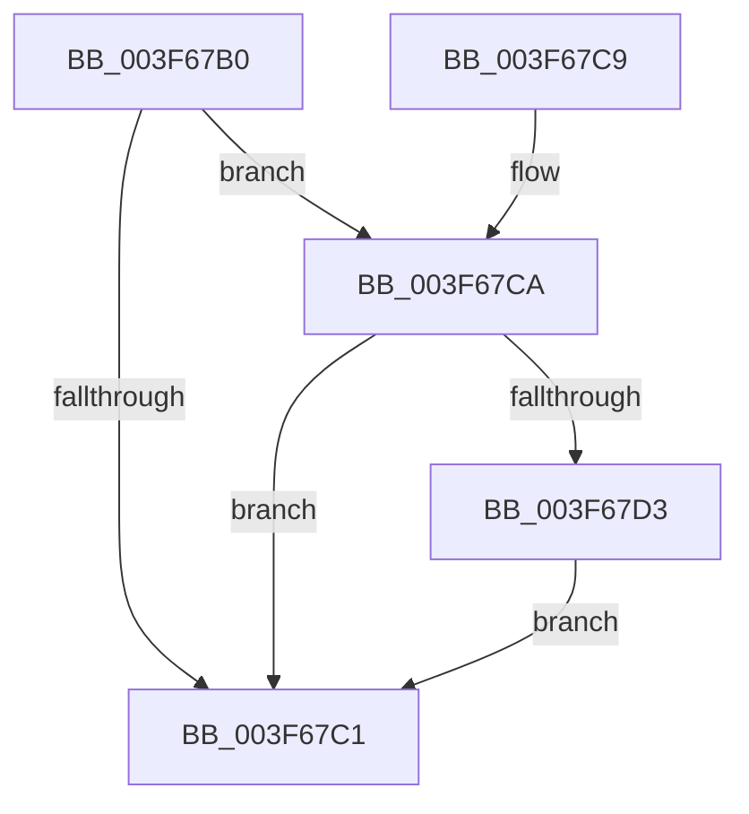

# IopLiveDumpShouldCheckChunkCRC

- RVA: `0x003F67B0`–`0x003F67D7` (길이 `39` bytes)
- VA: `0x00000001403F67B0`
- 실행 섹션: `.text`
- PDB 이름 있음: `예`; PDB Function 태그: `아니요`
- unwind 정보 RVA: `0x0006AD84`
- 디코드: `15`개 명령, `39/39` bytes 표시
- 미해석 바이트: `0` (있으면 어셈블리에 `.byte`로 보존)

> 이 문서는 커널 이미지의 기계어와 PDB 기호를 분석해 생성했습니다. 4번과 5번은 함수 원형과 자료형을 바이너리 사용 방식에서 추정한 C 해석이며 원본 소스 복구 결과는 아닙니다.

## 1. Dependencies

- 직접 호출 지점: **1**; 고유 호출 대상: **1**
- 직접 호출자로 확인된 함수: **3**
- RIP 상대 이미지 참조: **0**

### Outgoing calls
- `0x003F67CA` → [IopLiveDumpIsChunkInIOSpace](../59/IopLiveDumpIsChunkInIOSpace_function_0059CAFC.md) (function, `0x0059CAFC`)

### Direct callers
- [IopLiveDumpWriteDumpFile](IopLiveDumpWriteDumpFile_function_003F6360.md) at `0x003F6446`
- [IopLiveDumpWriteDumpFile](IopLiveDumpWriteDumpFile_function_003F6360.md) at `0x003F647E`
- [IopLiveDumpBufferDumpData](../59/IopLiveDumpBufferDumpData_function_0059A938.md) at `0x0059AAF4`
- [IopLiveDumpGetCapturePages](../59/IopLiveDumpGetCapturePages_function_0059C254.md) at `0x0059C2C0`

### Static image references
- 디코드된 RIP-relative 메모리 참조가 없습니다.

## 2. Other-region calls and transfers

- 다른 실행 섹션으로 향하는 call: **0**
- 별도 외부 분기/꼬리 이동을 확인하지 못했습니다.

## 3. Assembly (complete function range)

```asm
003F67B0  40 53                           push rbx
003F67B2  48 83 EC 20                     sub rsp, 0x20
003F67B6  33 DB                           xor ebx, ebx
003F67B8  48 39 99 C8 00 00 00            cmp qword ptr [rcx + 0xc8], rbx
003F67BF  75 09                           jne 0x1403f67ca
003F67C1  8A C3                           mov al, bl
003F67C3  48 83 C4 20                     add rsp, 0x20
003F67C7  5B                              pop rbx
003F67C8  C3                              ret
003F67C9  CC                              int3
003F67CA  E8 2D 63 1A 00                  call 0x14059cafc
003F67CF  85 C0                           test eax, eax
003F67D1  74 EE                           je 0x1403f67c1
003F67D3  B3 01                           mov bl, 1
003F67D5  EB EA                           jmp 0x1403f67c1
```

## 4. C-style interpretation (structured pseudocode)

```c
__int64 __fastcall IopLiveDumpShouldCheckChunkCRC(__int64 a1)
{
    __int64 result;
    __int64 v_rbx;
    __int64 v_rsp;

    v_rsp = (v_rsp) - (32);
    v_rbx = 0;
    if ((*(unsigned __int64 *)(a1 + 200)) != 0) goto loc_003F67CA;
loc_003F67C1:
    v_rsp = (v_rsp) + (32);
    return 0;
loc_003F67CA:
    result = IopLiveDumpIsChunkInIOSpace(a1, a2, a3, a4);
    if ((unsigned int)(result) == 0) goto loc_003F67C1;
    goto loc_003F67C1;
}
```

## 5. (Beta) C Style

```c
int64_t IopLiveDumpShouldCheckChunkCRC(void *Arg1)
{
    uint8_t *arg1 = (uint8_t *)Arg1;

    int64_t result;
    int64_t local_rbx;
    int64_t local_rsp;

    local_rsp = (local_rsp) - (32);
    local_rbx = 0;
    if ((*(uint64_t *)(arg1 + 0xC8)) != 0) goto loc_003F67CA;
loc_003F67C1:
    local_rsp = (local_rsp) + (32);
    return 0;
loc_003F67CA:
    result = IopLiveDumpIsChunkInIOSpace(Arg1, a2, a3, a4);
    if ((uint32_t)(result) == 0) goto loc_003F67C1;
    goto loc_003F67C1;
}
```

### 관측된 메모리 오프셋

구조체 형식이 확인되지 않은 접근은 인자 기준의 오프셋으로만 기록했습니다.

| 기준 인자 | 오프셋 표현 | 폭 (bit) | 접근 |
|---|---:|---:|---|
| `Arg1` | `+ 0xC8` | `64` | `R` |

## 6. Execution-region graph

[열기: 2D/3D 그래프와 함수 탐색 컨트롤 패널](../../../control-panel.html?section=text&rva=0x003F67B0&view=graph)

- 2D 그래프는 위에서 아래로 흐르고, 3D 그래프는 빈 공간을 드래그해 회전합니다. Shift+드래그는 이동, 휠은 확대·축소, 함수 노드 선택은 대상 보고서 이동입니다.

### Static fallback


