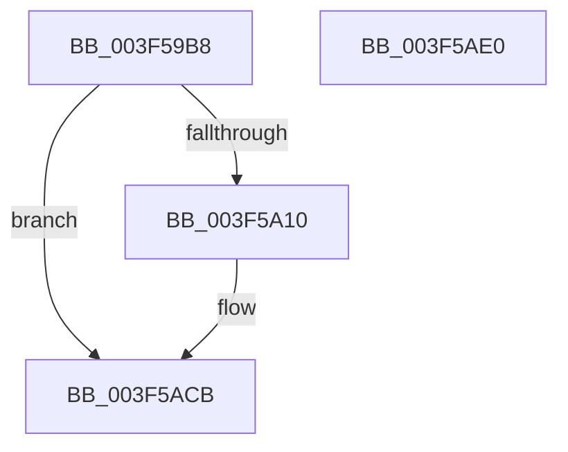

# IopLiveDumpTraceEstimatedAndAllocatedPageCount

- RVA: `0x003F59B8`–`0x003F5AE1` (길이 `297` bytes)
- VA: `0x00000001403F59B8`
- 실행 섹션: `.text`
- PDB 이름 있음: `예`; PDB Function 태그: `아니요`
- unwind 정보 RVA: `0x00098004`
- 디코드: `66`개 명령, `297/297` bytes 표시
- 미해석 바이트: `0` (있으면 어셈블리에 `.byte`로 보존)

> 이 문서는 커널 이미지의 기계어와 PDB 기호를 분석해 생성했습니다. 4번과 5번은 함수 원형과 자료형을 바이너리 사용 방식에서 추정한 C 해석이며 원본 소스 복구 결과는 아닙니다.

## 1. Dependencies

- 직접 호출 지점: **3**; 고유 호출 대상: **3**
- 직접 호출자로 확인된 함수: **1**
- RIP 상대 이미지 참조: **2**

### Outgoing calls
- `0x003F5A03` → [IopLiveDumpIsTracingEnabled](../4F/IopLiveDumpIsTracingEnabled_function_004FC5AC.md) (function, `0x004FC5AC`)
- `0x003F5AC6` → [IopLiveDumpTrace](../5A/IopLiveDumpTrace_function_005A4070.md) (function, `0x005A4070`)
- `0x003F5AD2` → [_security_check_cookie](../6A/_security_check_cookie_function_006AC640.md) (function, `0x006AC640`)

### Direct callers
- [IopLiveDumpAllocateDumpBuffers](IopLiveDumpAllocateDumpBuffers_function_003F5AE8.md) at `0x003F5D9A`

### Static image references
- `0x003F59D3` → RVA `0x00E0A740` (`.data`; read)
- `0x003F5A77` → RVA `0x00020D70` (`.rdata`; read)

## 2. Other-region calls and transfers

- 다른 실행 섹션으로 향하는 call: **0**
- 별도 외부 분기/꼬리 이동을 확인하지 못했습니다.

## 3. Assembly (complete function range)

```asm
003F59B8  48 8B C4                        mov rax, rsp
003F59BB  4C 89 48 20                     mov qword ptr [rax + 0x20], r9
003F59BF  4C 89 40 18                     mov qword ptr [rax + 0x18], r8
003F59C3  48 89 50 10                     mov qword ptr [rax + 0x10], rdx
003F59C7  55                              push rbp
003F59C8  48 8D 68 B1                     lea rbp, [rax - 0x4f]
003F59CC  48 81 EC E0 00 00 00            sub rsp, 0xe0
003F59D3  48 8B 05 66 4D A1 00            mov rax, qword ptr [rip + 0xa14d66]
003F59DA  48 33 C4                        xor rax, rsp
003F59DD  48 89 45 37                     mov qword ptr [rbp + 0x37], rax
003F59E1  8B 51 50                        mov edx, dword ptr [rcx + 0x50]
003F59E4  8B C2                           mov eax, edx
003F59E6  C1 E8 09                        shr eax, 9
003F59E9  83 E0 01                        and eax, 1
003F59EC  89 45 87                        mov dword ptr [rbp - 0x79], eax
003F59EF  8B C2                           mov eax, edx
003F59F1  C1 E8 0A                        shr eax, 0xa
003F59F4  83 E0 01                        and eax, 1
003F59F7  C1 EA 0C                        shr edx, 0xc
003F59FA  83 E2 01                        and edx, 1
003F59FD  89 45 8B                        mov dword ptr [rbp - 0x75], eax
003F5A00  89 55 8F                        mov dword ptr [rbp - 0x71], edx
003F5A03  E8 A4 6B 10 00                  call 0x1404fc5ac
003F5A08  84 C0                           test al, al
003F5A0A  0F 84 BB 00 00 00               je 0x1403f5acb
003F5A10  48 8D 45 5F                     lea rax, [rbp + 0x5f]
003F5A14  48 C7 45 9F 08 00 00 00         mov qword ptr [rbp - 0x61], 8
003F5A1C  48 89 45 97                     mov qword ptr [rbp - 0x69], rax
003F5A20  4C 8D 45 97                     lea r8, [rbp - 0x69]
003F5A24  48 8D 81 A8 02 00 00            lea rax, [rcx + 0x2a8]
003F5A2B  48 C7 45 AF 08 00 00 00         mov qword ptr [rbp - 0x51], 8
003F5A33  48 89 45 A7                     mov qword ptr [rbp - 0x59], rax
003F5A37  BA 0A 00 00 00                  mov edx, 0xa
003F5A3C  48 8D 45 67                     lea rax, [rbp + 0x67]
003F5A40  48 C7 45 BF 08 00 00 00         mov qword ptr [rbp - 0x41], 8
003F5A48  48 89 45 B7                     mov qword ptr [rbp - 0x49], rax
003F5A4C  48 8D 45 6F                     lea rax, [rbp + 0x6f]
003F5A50  48 89 45 C7                     mov qword ptr [rbp - 0x39], rax
003F5A54  48 8D 45 77                     lea rax, [rbp + 0x77]
003F5A58  48 89 45 D7                     mov qword ptr [rbp - 0x29], rax
003F5A5C  48 8D 45 7F                     lea rax, [rbp + 0x7f]
003F5A60  48 89 45 E7                     mov qword ptr [rbp - 0x19], rax
003F5A64  48 8D 45 87                     lea rax, [rbp - 0x79]
003F5A68  48 89 45 F7                     mov qword ptr [rbp - 9], rax
003F5A6C  48 8D 81 78 04 00 00            lea rax, [rcx + 0x478]
003F5A73  48 89 45 07                     mov qword ptr [rbp + 7], rax
003F5A77  48 8D 0D F2 B2 C2 FF            lea rcx, [rip - 0x3d4d0e]
003F5A7E  48 8D 45 8B                     lea rax, [rbp - 0x75]
003F5A82  48 C7 45 CF 08 00 00 00         mov qword ptr [rbp - 0x31], 8
003F5A8A  48 89 45 17                     mov qword ptr [rbp + 0x17], rax
003F5A8E  48 8D 45 8F                     lea rax, [rbp - 0x71]
003F5A92  48 89 45 27                     mov qword ptr [rbp + 0x27], rax
003F5A96  48 C7 45 DF 08 00 00 00         mov qword ptr [rbp - 0x21], 8
003F5A9E  48 C7 45 EF 08 00 00 00         mov qword ptr [rbp - 0x11], 8
003F5AA6  48 C7 45 FF 04 00 00 00         mov qword ptr [rbp - 1], 4
003F5AAE  48 C7 45 0F 08 00 00 00         mov qword ptr [rbp + 0xf], 8
003F5AB6  48 C7 45 1F 04 00 00 00         mov qword ptr [rbp + 0x1f], 4
003F5ABE  48 C7 45 2F 04 00 00 00         mov qword ptr [rbp + 0x2f], 4
003F5AC6  E8 A5 E5 1A 00                  call 0x1405a4070
003F5ACB  48 8B 4D 37                     mov rcx, qword ptr [rbp + 0x37]
003F5ACF  48 33 CC                        xor rcx, rsp
003F5AD2  E8 69 6B 2B 00                  call 0x1406ac640
003F5AD7  48 81 C4 E0 00 00 00            add rsp, 0xe0
003F5ADE  5D                              pop rbp
003F5ADF  C3                              ret
003F5AE0  CC                              int3
```

## 4. C-style interpretation (structured pseudocode)

```c
__int64 __fastcall IopLiveDumpTraceEstimatedAndAllocatedPageCount(__int64 a1, __int64 a2, __int64 a3, __int64 a4)
{
    __int64 result;
    __int64 v_rsp;

    *(unsigned __int64 *)(v_rsp + 32) = a4;
    *(unsigned __int64 *)(v_rsp + 24) = a3;
    *(unsigned __int64 *)(v_rsp + 16) = a2;
    v_rsp = (v_rsp) - (224);
    result = (*(unsigned __int64 *)(v_rip + 10571110)) ^ (v_rsp);
    *(unsigned __int64 *)(v_rsp - 79 + 55) = result;
    result = (unsigned int)(((unsigned int)((unsigned int)((unsigned int)(*(unsigned int *)(a1 + 80))))) >> (9));
    result = (unsigned int)((result) & (1));
    *(unsigned int *)(v_rsp - 79 - 121) = (unsigned int)(result);
    result = (unsigned int)(((unsigned int)((unsigned int)((unsigned int)(*(unsigned int *)(a1 + 80))))) >> (10));
    result = (unsigned int)((result) & (1));
    a2 = (unsigned int)(((unsigned int)(*(unsigned int *)(a1 + 80))) >> (12));
    a2 = (unsigned int)((a2) & (1));
    *(unsigned int *)(v_rsp - 79 - 117) = (unsigned int)(result);
    *(unsigned int *)(v_rsp - 79 - 113) = (unsigned int)(a2);
    result = IopLiveDumpIsTracingEnabled(a1, a2, a3, a4);
    if ((unsigned __int8)(result) != 0) {
        result = v_rsp - 79 + 95;
        *(unsigned __int64 *)(v_rsp - 79 - 97) = 8;
        *(unsigned __int64 *)(v_rsp - 79 - 105) = result;
        a3 = v_rsp - 79 - 105;
        result = a1 + 680;
        *(unsigned __int64 *)(v_rsp - 79 - 81) = 8;
        *(unsigned __int64 *)(v_rsp - 79 - 89) = result;
        a2 = 10;
        result = v_rsp - 79 + 103;
        *(unsigned __int64 *)(v_rsp - 79 - 65) = 8;
        *(unsigned __int64 *)(v_rsp - 79 - 73) = result;
        result = v_rsp - 79 + 111;
        *(unsigned __int64 *)(v_rsp - 79 - 57) = result;
        result = v_rsp - 79 + 119;
        *(unsigned __int64 *)(v_rsp - 79 - 41) = result;
        result = v_rsp - 79 + 127;
        *(unsigned __int64 *)(v_rsp - 79 - 25) = result;
        result = v_rsp - 79 - 121;
        *(unsigned __int64 *)(v_rsp - 79 - 9) = result;
        result = a1 + 1144;
        *(unsigned __int64 *)(v_rsp - 79 + 7) = result;
        a1 = v_rip - 4017422;
        result = v_rsp - 79 - 117;
        *(unsigned __int64 *)(v_rsp - 79 - 49) = 8;
        *(unsigned __int64 *)(v_rsp - 79 + 23) = result;
        result = v_rsp - 79 - 113;
        *(unsigned __int64 *)(v_rsp - 79 + 39) = result;
        *(unsigned __int64 *)(v_rsp - 79 - 33) = 8;
        *(unsigned __int64 *)(v_rsp - 79 - 17) = 8;
        *(unsigned __int64 *)(v_rsp - 79 - 1) = 4;
        *(unsigned __int64 *)(v_rsp - 79 + 15) = 8;
        *(unsigned __int64 *)(v_rsp - 79 + 31) = 4;
        *(unsigned __int64 *)(v_rsp - 79 + 47) = 4;
        result = IopLiveDumpTrace(a1, a2, a3, a4);
    }
    a1 = (*(unsigned __int64 *)(v_rsp - 79 + 55)) ^ (v_rsp);
    result = _security_check_cookie(a1, a2, a3, a4);
    v_rsp = (v_rsp) + (224);
    return result;
}
```

## 5. (Beta) C Style

```c
int64_t IopLiveDumpTraceEstimatedAndAllocatedPageCount(void *Arg1, int64_t Arg2, int64_t Arg3, int64_t Arg4)
{
    uint8_t *arg1 = (uint8_t *)Arg1;

    int64_t result;
    int64_t local_rsp;

    *(uint64_t *)(local_rsp + 0x20) = Arg4;
    *(uint64_t *)(local_rsp + 0x18) = Arg3;
    *(uint64_t *)(local_rsp + 0x10) = Arg2;
    local_rsp = (local_rsp) - (224);
    result = (*(uint64_t *)(v_rip + 0xA14D66)) ^ (local_rsp);
    *(uint64_t *)(local_rsp - 0x4F + 0x37) = result;
    result = (uint32_t)(((uint32_t)((uint32_t)((uint32_t)(*(uint32_t *)(arg1 + 0x50))))) >> (9));
    result = (uint32_t)((result) & (1));
    *(uint32_t *)(local_rsp - 0x4F - 0x79) = (uint32_t)(result);
    result = (uint32_t)(((uint32_t)((uint32_t)((uint32_t)(*(uint32_t *)(arg1 + 0x50))))) >> (10));
    result = (uint32_t)((result) & (1));
    Arg2 = (uint32_t)(((uint32_t)(*(uint32_t *)(arg1 + 0x50))) >> (12));
    Arg2 = (uint32_t)((Arg2) & (1));
    *(uint32_t *)(local_rsp - 0x4F - 0x75) = (uint32_t)(result);
    *(uint32_t *)(local_rsp - 0x4F - 0x71) = (uint32_t)(Arg2);
    result = IopLiveDumpIsTracingEnabled(Arg1, Arg2, Arg3, Arg4);
    if ((uint8_t)(result) != 0) {
        result = local_rsp - 79 + 95;
        *(uint64_t *)(local_rsp - 0x4F - 0x61) = 8;
        *(uint64_t *)(local_rsp - 0x4F - 0x69) = result;
        Arg3 = local_rsp - 79 - 105;
        result = Arg1 + 680;
        *(uint64_t *)(local_rsp - 0x4F - 0x51) = 8;
        *(uint64_t *)(local_rsp - 0x4F - 0x59) = result;
        Arg2 = 10;
        result = local_rsp - 79 + 103;
        *(uint64_t *)(local_rsp - 0x4F - 0x41) = 8;
        *(uint64_t *)(local_rsp - 0x4F - 0x49) = result;
        result = local_rsp - 79 + 111;
        *(uint64_t *)(local_rsp - 0x4F - 0x39) = result;
        result = local_rsp - 79 + 119;
        *(uint64_t *)(local_rsp - 0x4F - 0x29) = result;
        result = local_rsp - 79 + 127;
        *(uint64_t *)(local_rsp - 0x4F - 0x19) = result;
        result = local_rsp - 79 - 121;
        *(uint64_t *)(local_rsp - 0x4F - 0x9) = result;
        result = Arg1 + 1144;
        *(uint64_t *)(local_rsp - 0x4F + 0x7) = result;
        Arg1 = v_rip - 4017422;
        result = local_rsp - 79 - 117;
        *(uint64_t *)(local_rsp - 0x4F - 0x31) = 8;
        *(uint64_t *)(local_rsp - 0x4F + 0x17) = result;
        result = local_rsp - 79 - 113;
        *(uint64_t *)(local_rsp - 0x4F + 0x27) = result;
        *(uint64_t *)(local_rsp - 0x4F - 0x21) = 8;
        *(uint64_t *)(local_rsp - 0x4F - 0x11) = 8;
        *(uint64_t *)(local_rsp - 0x4F - 0x1) = 4;
        *(uint64_t *)(local_rsp - 0x4F + 0xF) = 8;
        *(uint64_t *)(local_rsp - 0x4F + 0x1F) = 4;
        *(uint64_t *)(local_rsp - 0x4F + 0x2F) = 4;
        result = IopLiveDumpTrace(Arg1, Arg2, Arg3, Arg4);
    }
    Arg1 = (*(uint64_t *)(local_rsp - 0x4F + 0x37)) ^ (local_rsp);
    result = _security_check_cookie(Arg1, Arg2, Arg3, Arg4);
    local_rsp = (local_rsp) + (224);
    return result;
}
```

### 관측된 메모리 오프셋

구조체 형식이 확인되지 않은 접근은 인자 기준의 오프셋으로만 기록했습니다.

| 기준 인자 | 오프셋 표현 | 폭 (bit) | 접근 |
|---|---:|---:|---|
| `Arg1` | `+ 0x50` | `32` | `R` |

## 6. Execution-region graph

[열기: 2D/3D 그래프와 함수 탐색 컨트롤 패널](../../../control-panel.html?section=text&rva=0x003F59B8&view=graph)

- 2D 그래프는 위에서 아래로 흐르고, 3D 그래프는 빈 공간을 드래그해 회전합니다. Shift+드래그는 이동, 휠은 확대·축소, 함수 노드 선택은 대상 보고서 이동입니다.

### Static fallback


