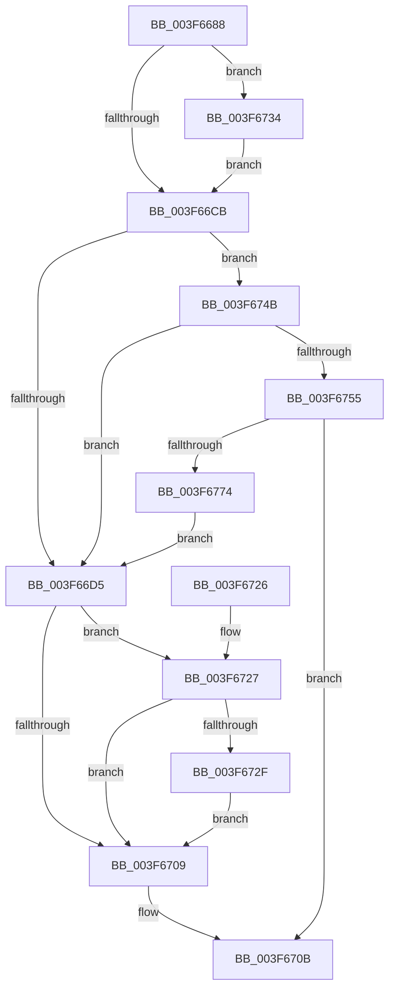

# IopLiveDumpWriteBuffer

- RVA: `0x003F6688`–`0x003F6779` (길이 `241` bytes)
- VA: `0x00000001403F6688`
- 실행 섹션: `.text`
- PDB 이름 있음: `예`; PDB Function 태그: `아니요`
- unwind 정보 RVA: `0x000980AC`
- 디코드: `66`개 명령, `241/241` bytes 표시
- 미해석 바이트: `0` (있으면 어셈블리에 `.byte`로 보존)

> 이 문서는 커널 이미지의 기계어와 PDB 기호를 분석해 생성했습니다. 4번과 5번은 함수 원형과 자료형을 바이너리 사용 방식에서 추정한 C 해석이며 원본 소스 복구 결과는 아닙니다.

## 1. Dependencies

- 직접 호출 지점: **3**; 고유 호출 대상: **3**
- 직접 호출자로 확인된 함수: **4**
- RIP 상대 이미지 참조: **0**

### Outgoing calls
- `0x003F66FE` → [ZwWriteFile](../6A/ZwWriteFile_function_006AD1D0.md) (function, `0x006AD1D0`)
- `0x003F6744` → [IopLiveDumpTraceWriteBuffer](../5A/IopLiveDumpTraceWriteBuffer_function_005A448C.md) (function, `0x005A448C`)
- `0x003F676B` → [SecureDump_Encrypt_DmpData](../5A/SecureDump_Encrypt_DmpData_function_005A2A10.md) (function, `0x005A2A10`)

### Direct callers
- [IopLiveDumpWriteDumpFile](IopLiveDumpWriteDumpFile_function_003F6360.md) at `0x003F6470`
- [IopLiveDumpWriteDumpFileWithExtraPages](../59/IopLiveDumpWriteDumpFileWithExtraPages_function_0059F910.md) at `0x0059FB8D`
- [IopLiveDumpWriteDumpFileWithExtraPages](../59/IopLiveDumpWriteDumpFileWithExtraPages_function_0059F910.md) at `0x0059FDDE`
- [IopLiveDumpWriteDumpFileWithExtraPages](../59/IopLiveDumpWriteDumpFileWithExtraPages_function_0059F910.md) at `0x0059FE67`
- [IopLiveDumpWriteDumpFileWithExtraPages](../59/IopLiveDumpWriteDumpFileWithExtraPages_function_0059F910.md) at `0x0059FEEB`
- [IopLiveDumpWriteDumpFileWithExtraPages](../59/IopLiveDumpWriteDumpFileWithExtraPages_function_0059F910.md) at `0x0059FF2C`
- [IopLiveDumpWriteDumpFileWithExtraPages](../59/IopLiveDumpWriteDumpFileWithExtraPages_function_0059F910.md) at `0x0059FF76`
- [IopLiveDumpWriteDumpFileWithExtraPages](../59/IopLiveDumpWriteDumpFileWithExtraPages_function_0059F910.md) at `0x0059FFA5`
- [IopLiveDumpWriteDumpFileWithExtraPages](../59/IopLiveDumpWriteDumpFileWithExtraPages_function_0059F910.md) at `0x0059FFEF`
- [IopLiveDumpWriteDumpFileWithExtraPages](../59/IopLiveDumpWriteDumpFileWithExtraPages_function_0059F910.md) at `0x005A001E`
- [IopLiveDumpWriteDumpFileWithExtraPages](../59/IopLiveDumpWriteDumpFileWithExtraPages_function_0059F910.md) at `0x005A0142`
- [IopLiveDumpWriteDumpFileWithExtraPages](../59/IopLiveDumpWriteDumpFileWithExtraPages_function_0059F910.md) at `0x005A0177`
- [IopLiveDumpWriteSecondaryData](../5A/IopLiveDumpWriteSecondaryData_function_005A01DC.md) at `0x005A0250`
- [IopLiveDumpWriteSecondaryData](../5A/IopLiveDumpWriteSecondaryData_function_005A01DC.md) at `0x005A0296`
- [IopLiveDumpWriteSecondaryData](../5A/IopLiveDumpWriteSecondaryData_function_005A01DC.md) at `0x005A02BF`
- [sub_006EB65A](../6E/Unknown_function_006EB65A.md) at `0x006EB897`
- [sub_006EB65A](../6E/Unknown_function_006EB65A.md) at `0x006EB8C7`

### Static image references
- 디코드된 RIP-relative 메모리 참조가 없습니다.

## 2. Other-region calls and transfers

- 다른 실행 섹션으로 향하는 call: **0**
- 별도 외부 분기/꼬리 이동을 확인하지 못했습니다.

## 3. Assembly (complete function range)

```asm
003F6688  48 8B C4                        mov rax, rsp
003F668B  48 89 58 08                     mov qword ptr [rax + 8], rbx
003F668F  48 89 70 10                     mov qword ptr [rax + 0x10], rsi
003F6693  48 89 78 18                     mov qword ptr [rax + 0x18], rdi
003F6697  4C 89 70 20                     mov qword ptr [rax + 0x20], r14
003F669B  41 57                           push r15
003F669D  48 83 EC 70                     sub rsp, 0x70
003F66A1  4C 8B B4 24 A0 00 00 00         mov r14, qword ptr [rsp + 0xa0]
003F66A9  0F 57 C0                        xorps xmm0, xmm0
003F66AC  48 83 60 D8 00                  and qword ptr [rax - 0x28], 0
003F66B1  49 8B D9                        mov rbx, r9
003F66B4  41 8B F8                        mov edi, r8d
003F66B7  48 8B F2                        mov rsi, rdx
003F66BA  4C 8B F9                        mov r15, rcx
003F66BD  41 F7 46 50 00 00 02 00         test dword ptr [r14 + 0x50], 0x20000
003F66C5  0F 11 40 E0                     movups xmmword ptr [rax - 0x20], xmm0
003F66C9  75 69                           jne 0x1403f6734
003F66CB  41 80 BE D8 03 00 00 00         cmp byte ptr [r14 + 0x3d8], 0
003F66D3  75 76                           jne 0x1403f674b
003F66D5  48 83 64 24 40 00               and qword ptr [rsp + 0x40], 0
003F66DB  48 8D 44 24 58                  lea rax, [rsp + 0x58]
003F66E0  48 89 5C 24 38                  mov qword ptr [rsp + 0x38], rbx
003F66E5  45 33 C9                        xor r9d, r9d
003F66E8  89 7C 24 30                     mov dword ptr [rsp + 0x30], edi
003F66EC  45 33 C0                        xor r8d, r8d
003F66EF  48 89 74 24 28                  mov qword ptr [rsp + 0x28], rsi
003F66F4  33 D2                           xor edx, edx
003F66F6  49 8B CF                        mov rcx, r15
003F66F9  48 89 44 24 20                  mov qword ptr [rsp + 0x20], rax
003F66FE  E8 CD 6A 2B 00                  call 0x1406ad1d0
003F6703  8B C8                           mov ecx, eax
003F6705  85 C0                           test eax, eax
003F6707  79 1E                           jns 0x1403f6727
003F6709  8B C1                           mov eax, ecx
003F670B  4C 8D 5C 24 70                  lea r11, [rsp + 0x70]
003F6710  49 8B 5B 10                     mov rbx, qword ptr [r11 + 0x10]
003F6714  49 8B 73 18                     mov rsi, qword ptr [r11 + 0x18]
003F6718  49 8B 7B 20                     mov rdi, qword ptr [r11 + 0x20]
003F671C  4D 8B 73 28                     mov r14, qword ptr [r11 + 0x28]
003F6720  49 8B E3                        mov rsp, r11
003F6723  41 5F                           pop r15
003F6725  C3                              ret
003F6726  CC                              int3
003F6727  8B 4C 24 58                     mov ecx, dword ptr [rsp + 0x58]
003F672B  85 C9                           test ecx, ecx
003F672D  78 DA                           js 0x1403f6709
003F672F  48 01 3B                        add qword ptr [rbx], rdi
003F6732  EB D5                           jmp 0x1403f6709
003F6734  44 8A 8C 24 A8 00 00 00         mov r9b, byte ptr [rsp + 0xa8]
003F673C  8B D7                           mov edx, edi
003F673E  4C 8B 03                        mov r8, qword ptr [rbx]
003F6741  48 8B CE                        mov rcx, rsi
003F6744  E8 43 DD 1A 00                  call 0x1405a448c
003F6749  EB 80                           jmp 0x1403f66cb
003F674B  80 BC 24 A8 00 00 00 00         cmp byte ptr [rsp + 0xa8], 0
003F6753  75 80                           jne 0x1403f66d5
003F6755  48 8D 44 24 50                  lea rax, [rsp + 0x50]
003F675A  48 8B D7                        mov rdx, rdi
003F675D  4C 8B CF                        mov r9, rdi
003F6760  48 89 44 24 20                  mov qword ptr [rsp + 0x20], rax
003F6765  4C 8B C6                        mov r8, rsi
003F6768  48 8B CE                        mov rcx, rsi
003F676B  E8 A0 C2 1A 00                  call 0x1405a2a10
003F6770  85 C0                           test eax, eax
003F6772  78 97                           js 0x1403f670b
003F6774  E9 5C FF FF FF                  jmp 0x1403f66d5
```

## 4. C-style interpretation (structured pseudocode)

```c
__int64 __fastcall IopLiveDumpWriteBuffer(__int64 a1, __int64 a2, int a3, __int64 a4, __int64 a5, unsigned __int8 a6)
{
    __int64 result;
    __int64 v_rsp;
    unsigned int v_stack_m18;
    unsigned __int64 v_stack_m20;
    unsigned __int64 v_stack_m38;
    unsigned __int64 v_stack_m40;
    unsigned int v_stack_m48;
    unsigned __int64 v_stack_m50;
    unsigned __int64 v_stack_m58;
    unsigned __int64 v_stack_m8;

    *(unsigned __int64 *)(v_rsp + 8) = v_rbx;
    *(unsigned __int64 *)(v_rsp + 16) = v_rsi;
    *(unsigned __int64 *)(v_rsp + 24) = v_rdi;
    *(unsigned __int64 *)(v_rsp + 32) = v_r14;
    v_rsp = (v_rsp) - (112);
    *(unsigned __int64 *)(v_rsp - 32) = v_xmm0;
    if (((*(unsigned int *)(a5 + 80)) & (0x20000ULL)) != 0) goto loc_003F6734;
loc_003F66CB:
    if ((*(unsigned __int8 *)(a5 + 984)) != 0) goto loc_003F674B;
loc_003F66D5:
    v_stack_m40 = a4;
    a4 = 0;
    v_stack_m48 = (unsigned int)((unsigned int)(a3));
    a3 = 0;
    v_stack_m50 = a2;
    a2 = 0;
    v_stack_m58 = v_stack_m20;
    result = ZwWriteFile(a1, a2, a3, a4);
    if (!sign_flag) goto loc_003F6727;
loc_003F6709:
loc_003F670B:
    return (unsigned int)((unsigned int)((unsigned int)((unsigned int)(result))));
loc_003F6727:
    if (sign_flag) goto loc_003F6709;
    goto loc_003F6709;
loc_003F6734:
    result = IopLiveDumpTraceWriteBuffer(*(unsigned __int64 *)(v_stack_m8 + 24), (unsigned int)((unsigned int)(*(unsigned __int64 *)(v_stack_m8 + 32))), *(unsigned __int64 *)(*(unsigned __int64 *)(v_stack_m8 + 16)), a6);
    goto loc_003F66CB;
loc_003F674B:
    if (a6 != 0) goto loc_003F66D5;
    v_stack_m50 = v_stack_m20;
    result = SecureDump_Encrypt_DmpData(*(unsigned __int64 *)(v_stack_m8 + 24), *(unsigned __int64 *)(v_stack_m8 + 32), *(unsigned __int64 *)(v_stack_m8 + 24), *(unsigned __int64 *)(v_stack_m8 + 32));
    if (sign_flag) goto loc_003F670B;
    goto loc_003F66D5;
}
```

## 5. (Beta) C Style

```c
int64_t IopLiveDumpWriteBuffer(int64_t Arg1, int64_t Arg2, int32_t Arg3, void *Arg4, void *Arg5, uint8_t Arg6)
{
    uint8_t *arg4 = (uint8_t *)Arg4;
    uint8_t *arg5 = (uint8_t *)Arg5;

    int64_t result;
    int64_t local_rsp;
    uint32_t v_stack_m18;
    uint64_t v_stack_m20;
    uint64_t v_stack_m38;
    uint64_t v_stack_m40;
    uint32_t v_stack_m48;
    uint64_t v_stack_m50;
    uint64_t v_stack_m58;
    uint64_t v_stack_m8;

    *(uint64_t *)(local_rsp + 0x8) = local_rbx;
    *(uint64_t *)(local_rsp + 0x10) = local_rsi;
    *(uint64_t *)(local_rsp + 0x18) = local_rdi;
    *(uint64_t *)(local_rsp + 0x20) = local_r14;
    local_rsp = (local_rsp) - (112);
    *(uint64_t *)(local_rsp - 0x20) = v_xmm0;
    if (((*(uint32_t *)(arg5 + 0x50)) & (0x20000ULL)) != 0) goto loc_003F6734;
loc_003F66CB:
    if ((*(uint8_t *)(arg5 + 0x3D8)) != 0) goto loc_003F674B;
loc_003F66D5:
    v_stack_m40 = Arg4;
    Arg4 = 0;
    v_stack_m48 = (uint32_t)((uint32_t)(Arg3));
    Arg3 = 0;
    v_stack_m50 = Arg2;
    Arg2 = 0;
    v_stack_m58 = v_stack_m20;
    result = ZwWriteFile(Arg1, Arg2, Arg3, Arg4);
    if (!sign_flag) goto loc_003F6727;
loc_003F6709:
loc_003F670B:
    return (uint32_t)((uint32_t)((uint32_t)((uint32_t)(result))));
loc_003F6727:
    if (sign_flag) goto loc_003F6709;
    goto loc_003F6709;
loc_003F6734:
    result = IopLiveDumpTraceWriteBuffer(*(uint64_t *)(v_stack_m8 + 0x18), (uint32_t)((uint32_t)(*(uint64_t *)(v_stack_m8 + 0x20))), *(uint64_t *)(*(uint64_t *)(v_stack_m8 + 0x10)), Arg6);
    goto loc_003F66CB;
loc_003F674B:
    if (Arg6 != 0) goto loc_003F66D5;
    v_stack_m50 = v_stack_m20;
    result = SecureDump_Encrypt_DmpData(*(uint64_t *)(v_stack_m8 + 0x18), *(uint64_t *)(v_stack_m8 + 0x20), *(uint64_t *)(v_stack_m8 + 0x18), *(uint64_t *)(v_stack_m8 + 0x20));
    if (sign_flag) goto loc_003F670B;
    goto loc_003F66D5;
}
```

### 관측된 메모리 오프셋

구조체 형식이 확인되지 않은 접근은 인자 기준의 오프셋으로만 기록했습니다.

| 기준 인자 | 오프셋 표현 | 폭 (bit) | 접근 |
|---|---:|---:|---|
| `Arg4` | `+ 0x0` | `64` | `R` |
| `Arg4` | `+ 0x0` | `64` | `R/W` |
| `Arg5` | `+ 0x50` | `32` | `R` |
| `Arg5` | `+ 0x3D8` | `8` | `R` |

## 6. Execution-region graph

[열기: 2D/3D 그래프와 함수 탐색 컨트롤 패널](../../../control-panel.html?section=text&rva=0x003F6688&view=graph)

- 2D 그래프는 위에서 아래로 흐르고, 3D 그래프는 빈 공간을 드래그해 회전합니다. Shift+드래그는 이동, 휠은 확대·축소, 함수 노드 선택은 대상 보고서 이동입니다.

### Static fallback


