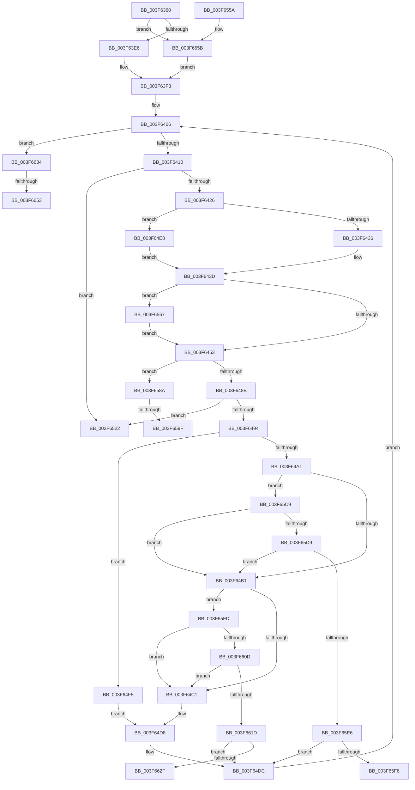

# IopLiveDumpWriteDumpFile

- RVA: `0x003F6360`–`0x003F6682` (길이 `802` bytes)
- VA: `0x00000001403F6360`
- 실행 섹션: `.text`
- PDB 이름 있음: `예`; PDB Function 태그: `예`
- unwind 정보 RVA: `0x00098070`
- 디코드: `192`개 명령, `802/802` bytes 표시
- 미해석 바이트: `0` (있으면 어셈블리에 `.byte`로 보존)

> 이 문서는 커널 이미지의 기계어와 PDB 기호를 분석해 생성했습니다. 4번과 5번은 함수 원형과 자료형을 바이너리 사용 방식에서 추정한 C 해석이며 원본 소스 복구 결과는 아닙니다.

## 1. Dependencies

- 직접 호출 지점: **12**; 고유 호출 대상: **10**
- 직접 호출자로 확인된 함수: **2**
- RIP 상대 이미지 참조: **3**

### Outgoing calls
- `0x003F6416` → [IopLiveDumpCheckTermination](IopLiveDumpCheckTermination_function_003F6780.md) (function, `0x003F6780`)
- `0x003F6446` → [IopLiveDumpShouldCheckChunkCRC](IopLiveDumpShouldCheckChunkCRC_function_003F67B0.md) (function, `0x003F67B0`)
- `0x003F6470` → [IopLiveDumpWriteBuffer](IopLiveDumpWriteBuffer_function_003F6688.md) (function, `0x003F6688`)
- `0x003F647E` → [IopLiveDumpShouldCheckChunkCRC](IopLiveDumpShouldCheckChunkCRC_function_003F67B0.md) (function, `0x003F67B0`)
- `0x003F64CF` → [MmFreeIndependentPages](../2A/MmFreeIndependentPages_function_002A2510.md) (function, `0x002A2510`)
- `0x003F64FD` → [MiFreePagesFromMdl](MiFreePagesFromMdl_function_003F8300.md) (function, `0x003F8300`)
- `0x003F650F` → [ExFreePoolWithTag](../../poolcode/B8/ExFreePoolWithTag_function_00B82870.md) (function, `0x00B82870`)
- `0x003F6525` → [IopLiveDumpFreeDumpBuffers](IopLiveDumpFreeDumpBuffers_function_003F5FE8.md) (function, `0x003F5FE8`)
- `0x003F6534` → [_security_check_cookie](../6A/_security_check_cookie_function_006AC640.md) (function, `0x006AC640`)
- `0x003F657C` → [RtlpComputeCrcInternal](../45/RtlpComputeCrcInternal_function_0045A800.md) (function, `0x0045A800`)
- `0x003F65B8` → [RtlpComputeCrcInternal](../45/RtlpComputeCrcInternal_function_0045A800.md) (function, `0x0045A800`)
- `0x003F663B` → [RtlNumberOfSetBitsEx](../41/RtlNumberOfSetBitsEx_function_00418CA0.md) (function, `0x00418CA0`)

### Direct callers
- [IoCaptureLiveDump](../4E/IoCaptureLiveDump_function_004E085C.md) at `0x004E0DC1`
- [IoWriteDeferredLiveDumpData](../59/IoWriteDeferredLiveDumpData_function_00598CD0.md) at `0x00598D2D`

### Static image references
- `0x003F6383` → RVA `0x00E0A740` (`.data`; read)
- `0x003F6436` → RVA `0x00E0A9D0` (`.data`; read)
- `0x003F656B` → RVA `0x0000B640` (`.rdata`; read)

## 2. Other-region calls and transfers

- 다른 실행 섹션으로 향하는 call: **1**
  - `0x003F650F` → [ExFreePoolWithTag](../../poolcode/B8/ExFreePoolWithTag_function_00B82870.md) (`.text` → `POOLCODE`)
- call이 아닌 외부 분기/꼬리 이동: **6**
  - `0x003F6599` → [sub_006EB65A](../6E/Unknown_function_006EB65A.md) (`tail-transfer`)
  - `0x003F65C4` → [sub_006EB65A](../6E/Unknown_function_006EB65A.md) (`tail-transfer`)
  - `0x003F65F8` → [sub_006EB65A + 0x38](../6E/Unknown_function_006EB65A.md) (`tail-transfer`)
  - `0x003F662F` → [sub_006EB65A + 0xA6](../6E/Unknown_function_006EB65A.md) (`tail-transfer`)
  - `0x003F664D` → [sub_006EB65A + 0x11D](../6E/Unknown_function_006EB65A.md) (`tail-transfer`)
  - `0x003F667D` → [sub_006EB65A + 0x11D](../6E/Unknown_function_006EB65A.md) (`tail-transfer`)

## 3. Assembly (complete function range)

```asm
003F6360  48 8B C4                        mov rax, rsp
003F6363  48 89 58 10                     mov qword ptr [rax + 0x10], rbx
003F6367  48 89 70 18                     mov qword ptr [rax + 0x18], rsi
003F636B  48 89 78 20                     mov qword ptr [rax + 0x20], rdi
003F636F  55                              push rbp
003F6370  41 54                           push r12
003F6372  41 55                           push r13
003F6374  41 56                           push r14
003F6376  41 57                           push r15
003F6378  48 8D 68 A1                     lea rbp, [rax - 0x5f]
003F637C  48 81 EC C0 00 00 00            sub rsp, 0xc0
003F6383  48 8B 05 B6 43 A1 00            mov rax, qword ptr [rip + 0xa143b6]
003F638A  48 33 C4                        xor rax, rsp
003F638D  48 89 45 27                     mov qword ptr [rbp + 0x27], rax
003F6391  48 83 65 CF 00                  and qword ptr [rbp - 0x31], 0
003F6396  48 8D B9 A8 02 00 00            lea rdi, [rcx + 0x2a8]
003F639D  4C 8B 61 40                     mov r12, qword ptr [rcx + 0x40]
003F63A1  33 C0                           xor eax, eax
003F63A3  4C 8B B9 30 02 00 00            mov r15, qword ptr [rcx + 0x230]
003F63AA  45 33 ED                        xor r13d, r13d
003F63AD  0F 57 C0                        xorps xmm0, xmm0
003F63B0  0F 57 C9                        xorps xmm1, xmm1
003F63B3  48 8B D9                        mov rbx, rcx
003F63B6  44 88 6D A7                     mov byte ptr [rbp - 0x59], r13b
003F63BA  48 89 45 B7                     mov qword ptr [rbp - 0x49], rax
003F63BE  0F 11 45 D7                     movups xmmword ptr [rbp - 0x29], xmm0
003F63C2  48 89 45 F7                     mov qword ptr [rbp - 9], rax
003F63C6  0F 11 45 E7                     movups xmmword ptr [rbp - 0x19], xmm0
003F63CA  48 89 45 1F                     mov qword ptr [rbp + 0x1f], rax
003F63CE  0F 11 4D FF                     movups xmmword ptr [rbp - 1], xmm1
003F63D2  4C 89 65 BF                     mov qword ptr [rbp - 0x41], r12
003F63D6  0F 11 4D 0F                     movups xmmword ptr [rbp + 0xf], xmm1
003F63DA  38 81 D8 03 00 00               cmp byte ptr [rcx + 0x3d8], al
003F63E0  0F 84 75 01 00 00               je 0x1403f655b
003F63E6  8B 81 E0 03 00 00               mov eax, dword ptr [rcx + 0x3e0]
003F63EC  49 03 87 20 20 00 00            add rax, qword ptr [r15 + 0x2020]
003F63F3  48 89 45 AF                     mov qword ptr [rbp - 0x51], rax
003F63F7  33 F6                           xor esi, esi
003F63F9  65 48 8B 04 25 88 01 00 00      mov rax, qword ptr gs:[0x188]
003F6402  48 89 45 C7                     mov qword ptr [rbp - 0x39], rax
003F6406  48 3B 77 38                     cmp rsi, qword ptr [rdi + 0x38]
003F640A  0F 83 24 02 00 00               jae 0x1403f6634
003F6410  48 8B D0                        mov rdx, rax
003F6413  48 8B CB                        mov rcx, rbx
003F6416  E8 65 03 00 00                  call 0x1403f6780
003F641B  44 8B F0                        mov r14d, eax
003F641E  85 C0                           test eax, eax
003F6420  0F 88 FC 00 00 00               js 0x1403f6522
003F6426  48 8B 47 38                     mov rax, qword ptr [rdi + 0x38]
003F642A  48 FF C8                        dec rax
003F642D  48 3B F0                        cmp rsi, rax
003F6430  0F 83 B2 00 00 00               jae 0x1403f64e8
003F6436  44 8B 25 93 45 A1 00            mov r12d, dword ptr [rip + 0xa14593]
003F643D  48 8B D6                        mov rdx, rsi
003F6440  45 8B F4                        mov r14d, r12d
003F6443  48 8B CF                        mov rcx, rdi
003F6446  E8 65 03 00 00                  call 0x1403f67b0
003F644B  84 C0                           test al, al
003F644D  0F 85 14 01 00 00               jne 0x1403f6567
003F6453  48 8B 57 48                     mov rdx, qword ptr [rdi + 0x48]
003F6457  4C 8D 4D AF                     lea r9, [rbp - 0x51]
003F645B  48 8B 4D BF                     mov rcx, qword ptr [rbp - 0x41]
003F645F  45 8B C4                        mov r8d, r12d
003F6462  44 88 6C 24 28                  mov byte ptr [rsp + 0x28], r13b
003F6467  48 89 5C 24 20                  mov qword ptr [rsp + 0x20], rbx
003F646C  48 8B 14 F2                     mov rdx, qword ptr [rdx + rsi*8]
003F6470  E8 13 02 00 00                  call 0x1403f6688
003F6475  48 8B D6                        mov rdx, rsi
003F6478  48 8B CF                        mov rcx, rdi
003F647B  44 8B F0                        mov r14d, eax
003F647E  E8 2D 03 00 00                  call 0x1403f67b0
003F6483  84 C0                           test al, al
003F6485  0F 85 FF 00 00 00               jne 0x1403f658a
003F648B  45 85 F6                        test r14d, r14d
003F648E  0F 88 8E 00 00 00               js 0x1403f6522
003F6494  48 8B 47 50                     mov rax, qword ptr [rdi + 0x50]
003F6498  48 8B 0C F0                     mov rcx, qword ptr [rax + rsi*8]
003F649C  48 85 C9                        test rcx, rcx
003F649F  75 54                           jne 0x1403f64f5
003F64A1  4C 8B B7 88 00 00 00            mov r14, qword ptr [rdi + 0x88]
003F64A8  4D 85 F6                        test r14, r14
003F64AB  0F 85 18 01 00 00               jne 0x1403f65c9
003F64B1  4C 8B B7 B0 00 00 00            mov r14, qword ptr [rdi + 0xb0]
003F64B8  4D 85 F6                        test r14, r14
003F64BB  0F 85 3C 01 00 00               jne 0x1403f65fd
003F64C1  48 8B 4F 48                     mov rcx, qword ptr [rdi + 0x48]
003F64C5  8B 15 05 45 A1 00               mov edx, dword ptr [rip + 0xa14505]
003F64CB  48 8B 0C F1                     mov rcx, qword ptr [rcx + rsi*8]
003F64CF  E8 3C C0 EA FF                  call 0x1402a2510
003F64D4  48 8B 47 48                     mov rax, qword ptr [rdi + 0x48]
003F64D8  4C 21 2C F0                     and qword ptr [rax + rsi*8], r13
003F64DC  48 8B 45 C7                     mov rax, qword ptr [rbp - 0x39]
003F64E0  48 FF C6                        inc rsi
003F64E3  E9 1E FF FF FF                  jmp 0x1403f6406
003F64E8  44 8B 67 28                     mov r12d, dword ptr [rdi + 0x28]
003F64EC  41 C1 E4 0C                     shl r12d, 0xc
003F64F0  E9 48 FF FF FF                  jmp 0x1403f643d
003F64F5  45 33 C9                        xor r9d, r9d
003F64F8  45 33 C0                        xor r8d, r8d
003F64FB  33 D2                           xor edx, edx
003F64FD  E8 FE 1D 00 00                  call 0x1403f8300
003F6502  48 8B 4F 50                     mov rcx, qword ptr [rdi + 0x50]
003F6506  BA 4C 64 6D 70                  mov edx, 0x706d644c
003F650B  48 8B 0C F1                     mov rcx, qword ptr [rcx + rsi*8]
003F650F  E8 5C C3 78 00                  call 0x140b82870
003F6514  48 8B 47 48                     mov rax, qword ptr [rdi + 0x48]
003F6518  4C 21 2C F0                     and qword ptr [rax + rsi*8], r13
003F651C  48 8B 47 50                     mov rax, qword ptr [rdi + 0x50]
003F6520  EB B6                           jmp 0x1403f64d8
003F6522  48 8B CB                        mov rcx, rbx
003F6525  E8 BE FA FF FF                  call 0x1403f5fe8
003F652A  41 8B C6                        mov eax, r14d
003F652D  48 8B 4D 27                     mov rcx, qword ptr [rbp + 0x27]
003F6531  48 33 CC                        xor rcx, rsp
003F6534  E8 07 61 2B 00                  call 0x1406ac640
003F6539  4C 8D 9C 24 C0 00 00 00         lea r11, [rsp + 0xc0]
003F6541  49 8B 5B 38                     mov rbx, qword ptr [r11 + 0x38]
003F6545  49 8B 73 40                     mov rsi, qword ptr [r11 + 0x40]
003F6549  49 8B 7B 48                     mov rdi, qword ptr [r11 + 0x48]
003F654D  49 8B E3                        mov rsp, r11
003F6550  41 5F                           pop r15
003F6552  41 5E                           pop r14
003F6554  41 5D                           pop r13
003F6556  41 5C                           pop r12
003F6558  5D                              pop rbp
003F6559  C3                              ret
003F655A  CC                              int3
003F655B  49 8B 87 20 20 00 00            mov rax, qword ptr [r15 + 0x2020]
003F6562  E9 8C FE FF FF                  jmp 0x1403f63f3
003F6567  48 8B 47 48                     mov rax, qword ptr [rdi + 0x48]
003F656B  4C 8D 0D CE 50 C1 FF            lea r9, [rip - 0x3eaf32]
003F6572  45 33 C0                        xor r8d, r8d
003F6575  49 8B D6                        mov rdx, r14
003F6578  48 8B 0C F0                     mov rcx, qword ptr [rax + rsi*8]
003F657C  E8 7F 42 06 00                  call 0x14045a800
003F6581  48 89 45 B7                     mov qword ptr [rbp - 0x49], rax
003F6585  E9 C9 FE FF FF                  jmp 0x1403f6453
003F658A  48 8B 87 C8 00 00 00            mov rax, qword ptr [rdi + 0xc8]
003F6591  48 8B 4D B7                     mov rcx, qword ptr [rbp - 0x49]
003F6595  48 39 0C F0                     cmp qword ptr [rax + rsi*8], rcx
003F6599  0F 85 BB 50 2F 00               jne 0x1406eb65a
003F659F  48 8B 47 48                     mov rax, qword ptr [rdi + 0x48]
003F65A3  4C 8D 0D 96 50 C1 FF            lea r9, [rip - 0x3eaf6a]
003F65AA  45 33 C0                        xor r8d, r8d
003F65AD  41 8B D4                        mov edx, r12d
003F65B0  C6 45 A7 01                     mov byte ptr [rbp - 0x59], 1
003F65B4  48 8B 0C F0                     mov rcx, qword ptr [rax + rsi*8]
003F65B8  E8 43 42 06 00                  call 0x14045a800
003F65BD  48 8B C8                        mov rcx, rax
003F65C0  48 89 45 B7                     mov qword ptr [rbp - 0x49], rax
003F65C4  E9 91 50 2F 00                  jmp 0x1406eb65a
003F65C9  48 8B 8F 80 00 00 00            mov rcx, qword ptr [rdi + 0x80]
003F65D0  48 85 C9                        test rcx, rcx
003F65D3  0F 84 D8 FE FF FF               je 0x1403f64b1
003F65D9  48 8B 57 78                     mov rdx, qword ptr [rdi + 0x78]
003F65DD  48 3B F2                        cmp rsi, rdx
003F65E0  0F 82 CB FE FF FF               jb 0x1403f64b1
003F65E6  48 8B C6                        mov rax, rsi
003F65E9  48 2B C2                        sub rax, rdx
003F65EC  48 FF C0                        inc rax
003F65EF  48 3B C1                        cmp rax, rcx
003F65F2  0F 85 E4 FE FF FF               jne 0x1403f64dc
003F65F8  E9 95 50 2F 00                  jmp 0x1406eb692
003F65FD  48 8B 8F A8 00 00 00            mov rcx, qword ptr [rdi + 0xa8]
003F6604  48 85 C9                        test rcx, rcx
003F6607  0F 84 B4 FE FF FF               je 0x1403f64c1
003F660D  48 8B 97 A0 00 00 00            mov rdx, qword ptr [rdi + 0xa0]
003F6614  48 3B F2                        cmp rsi, rdx
003F6617  0F 82 A4 FE FF FF               jb 0x1403f64c1
003F661D  48 8B C6                        mov rax, rsi
003F6620  48 2B C2                        sub rax, rdx
003F6623  48 FF C0                        inc rax
003F6626  48 3B C1                        cmp rax, rcx
003F6629  0F 85 AD FE FF FF               jne 0x1403f64dc
003F662F  E9 CC 50 2F 00                  jmp 0x1406eb700
003F6634  48 8D 8B 20 02 00 00            lea rcx, [rbx + 0x220]
003F663B  E8 60 26 02 00                  call 0x140418ca0
003F6640  8B 8B 40 04 00 00               mov ecx, dword ptr [rbx + 0x440]
003F6646  33 F6                           xor esi, esi
003F6648  48 8B F8                        mov rdi, rax
003F664B  85 C9                           test ecx, ecx
003F664D  0F 84 24 51 2F 00               je 0x1406eb777
003F6653  48 8B 83 38 04 00 00            mov rax, qword ptr [rbx + 0x438]
003F665A  0F 10 83 28 04 00 00            movups xmm0, xmmword ptr [rbx + 0x428]
003F6661  48 89 45 E7                     mov qword ptr [rbp - 0x19], rax
003F6665  48 8B 43 38                     mov rax, qword ptr [rbx + 0x38]
003F6669  48 89 45 F7                     mov qword ptr [rbp - 9], rax
003F666D  48 8D 45 D7                     lea rax, [rbp - 0x29]
003F6671  48 89 43 38                     mov qword ptr [rbx + 0x38], rax
003F6675  F3 0F 7F 45 D7                  movdqu xmmword ptr [rbp - 0x29], xmm0
003F667A  89 4D EF                        mov dword ptr [rbp - 0x11], ecx
003F667D  E9 F5 50 2F 00                  jmp 0x1406eb777
```

## 4. C-style interpretation (structured pseudocode)

```c
__int64 __fastcall IopLiveDumpWriteDumpFile(__int64 a1)
{
    __int64 result;
    __int64 v_r12;
    __int64 v_r13;
    __int64 v_rsi;
    __int64 v_rsp;
    unsigned __int64 v_stack_m28;
    unsigned __int8 v_stack_mC0;
    unsigned __int64 v_stack_mC8;

    *(unsigned __int64 *)(v_rsp + 16) = v_rbx;
    *(unsigned __int64 *)(v_rsp + 24) = v_rsi;
    *(unsigned __int64 *)(v_rsp + 32) = v_rdi;
    v_rsp = (v_rsp) - (192);
    result = (*(unsigned __int64 *)(v_rip + 10568630)) ^ (v_rsp);
    *(unsigned __int64 *)(v_rsp - 95 + 39) = result;
    result = 0;
    v_r13 = 0;
    *(unsigned __int8 *)(v_rsp - 95 - 89) = 0;
    *(unsigned __int64 *)(v_rsp - 95 - 73) = 0;
    *(unsigned __int64 *)(v_rsp - 95 - 41) = v_xmm0;
    *(unsigned __int64 *)(v_rsp - 95 - 9) = 0;
    *(unsigned __int64 *)(v_rsp - 95 - 25) = v_xmm0;
    *(unsigned __int64 *)(v_rsp - 95 + 31) = 0;
    *(unsigned __int64 *)(v_rsp - 95 - 1) = v_xmm1;
    *(unsigned __int64 *)(v_rsp - 95 - 65) = *(unsigned __int64 *)(a1 + 64);
    *(unsigned __int64 *)(v_rsp - 95 + 15) = v_xmm1;
    if ((*(unsigned __int8 *)(a1 + 984)) == 0) goto loc_003F655B;
    result = ((unsigned int)(*(unsigned int *)(a1 + 992))) + (*(unsigned __int64 *)(*(unsigned __int64 *)(a1 + 560) + 8224));
loc_003F63F3:
    *(unsigned __int64 *)(v_rsp - 95 - 81) = result;
    v_rsi = 0;
    *(unsigned __int64 *)(v_rsp - 95 - 57) = *(unsigned __int64 *)(gs_base + (0 + 392));
loc_003F6406:
    if (0 >= (*(unsigned __int64 *)(a1 + 680 + 56))) goto loc_003F6634;
    result = IopLiveDumpCheckTermination(a1, *(unsigned __int64 *)(gs_base + (0 + 392)), a3, a4);
    if (sign_flag) goto loc_003F6522;
    result = (*(unsigned __int64 *)(a1 + 680 + 56)) - 1;
    if (0 >= result) goto loc_003F64E8;
loc_003F643D:
    result = IopLiveDumpShouldCheckChunkCRC(a1 + 680, 0, a3, a4);
    if ((unsigned __int8)(result) != 0) goto loc_003F6567;
loc_003F6453:
    v_stack_mC0 = 0;
    v_stack_mC8 = a1;
    result = IopLiveDumpWriteBuffer(*(unsigned __int64 *)(v_rsp - 95 - 65), *(unsigned __int64 *)(*(unsigned __int64 *)(a1 + 680 + 72) + v_rsi * 8), (unsigned int)((unsigned int)((unsigned int)(*(unsigned int *)(v_rip + 10569107)))), v_rsp - 95 - 81);
    result = IopLiveDumpShouldCheckChunkCRC(a1 + 680, 0, (unsigned int)((unsigned int)((unsigned int)(*(unsigned int *)(v_rip + 10569107)))), v_rsp - 95 - 81);
    if ((unsigned __int8)(result) != 0) goto loc_003F658A;
    if (sign_flag) goto loc_003F6522;
    if (*(unsigned __int64 *)(*(unsigned __int64 *)(a1 + 680 + 80) + v_rsi * 8) != 0) goto loc_003F64F5;
    if (*(unsigned __int64 *)(a1 + 680 + 136) != 0) goto loc_003F65C9;
loc_003F64B1:
    if (*(unsigned __int64 *)(a1 + 680 + 176) != 0) goto loc_003F65FD;
loc_003F64C1:
    result = MmFreeIndependentPages(*(unsigned __int64 *)(*(unsigned __int64 *)(a1 + 680 + 72) + v_rsi * 8), (unsigned int)(*(unsigned int *)(v_rip + 10568965)), (unsigned int)((unsigned int)((unsigned int)(*(unsigned int *)(v_rip + 10569107)))), v_rsp - 95 - 81);
loc_003F64D8:
loc_003F64DC:
    v_rsi = (v_rsi) + 1;
    goto loc_003F6406;
loc_003F64E8:
    v_r12 = (unsigned int)(((unsigned int)(*(unsigned int *)(a1 + 680 + 40))) << (12));
    goto loc_003F643D;
loc_003F64F5:
    a4 = 0;
    a3 = 0;
    a2 = 0;
    result = MiFreePagesFromMdl(*(unsigned __int64 *)(*(unsigned __int64 *)(a1 + 680 + 72) + v_rsi * 8), a2, a3, a4);
    result = ExFreePoolWithTag(*(unsigned __int64 *)(*(unsigned __int64 *)(a1 + 680 + 80) + v_rsi * 8), (unsigned int)(0x706D644CULL), a3, a4);
    goto loc_003F64D8;
loc_003F6522:
    result = IopLiveDumpFreeDumpBuffers(a1, (unsigned int)(0x706D644CULL), a3, a4);
    a1 = (*(unsigned __int64 *)(v_rsp - 95 + 39)) ^ (v_rsp);
    result = _security_check_cookie(a1, (unsigned int)(0x706D644CULL), a3, a4);
    return result;
loc_003F655B:
    goto loc_003F63F3;
loc_003F6567:
    a3 = 0;
    result = RtlpComputeCrcInternal(*(unsigned __int64 *)(*(unsigned __int64 *)(*(unsigned __int64 *)(v_stack_m28 + 72) + 72) + *(unsigned __int64 *)(v_stack_m28 + 64) * 8), *(unsigned __int64 *)(a1 + 680 + 176), a3, v_rip - 4108082);
    *(unsigned __int64 *)(v_rsp - 95 - 73) = result;
    goto loc_003F6453;
loc_003F658A:
    a3 = 0;
    *(unsigned __int8 *)(v_rsp - 95 - 89) = 1;
    result = RtlpComputeCrcInternal(*(unsigned __int64 *)(*(unsigned __int64 *)(*(unsigned __int64 *)(v_stack_m28 + 72) + 72) + *(unsigned __int64 *)(v_stack_m28 + 64) * 8), (unsigned int)((unsigned int)(v_r12)), a3, v_rip - 4108138);
    *(unsigned __int64 *)(v_rsp - 95 - 73) = result;
loc_003F65C9:
    if (*(unsigned __int64 *)(*(unsigned __int64 *)(v_stack_m28 + 72) + 128) == 0) goto loc_003F64B1;
    if ((*(unsigned __int64 *)(v_stack_m28 + 64)) < (*(unsigned __int64 *)(*(unsigned __int64 *)(v_stack_m28 + 72) + 120))) goto loc_003F64B1;
    result = (*(unsigned __int64 *)(v_stack_m28 + 64)) - (*(unsigned __int64 *)(*(unsigned __int64 *)(v_stack_m28 + 72) + 120));
    result = (result) + 1;
    if (result != (*(unsigned __int64 *)(*(unsigned __int64 *)(v_stack_m28 + 72) + 128))) goto loc_003F64DC;
loc_003F65FD:
    if (*(unsigned __int64 *)(*(unsigned __int64 *)(v_stack_m28 + 72) + 168) == 0) goto loc_003F64C1;
    if ((*(unsigned __int64 *)(v_stack_m28 + 64)) < (*(unsigned __int64 *)(*(unsigned __int64 *)(v_stack_m28 + 72) + 160))) goto loc_003F64C1;
    result = (*(unsigned __int64 *)(v_stack_m28 + 64)) - (*(unsigned __int64 *)(*(unsigned __int64 *)(v_stack_m28 + 72) + 160));
    result = (result) + 1;
    if (result != (*(unsigned __int64 *)(*(unsigned __int64 *)(v_stack_m28 + 72) + 168))) goto loc_003F64DC;
loc_003F6634:
    result = RtlNumberOfSetBitsEx(*(unsigned __int64 *)(v_stack_m28 + 56) + 544, *(unsigned __int64 *)(*(unsigned __int64 *)(v_stack_m28 + 72) + 160), a3, v_rip - 4108138);
    v_rsi = 0;
    *(unsigned __int64 *)(v_rsp - 95 - 25) = *(unsigned __int64 *)(*(unsigned __int64 *)(v_stack_m28 + 56) + 1080);
    *(unsigned __int64 *)(v_rsp - 95 - 9) = *(unsigned __int64 *)(*(unsigned __int64 *)(v_stack_m28 + 56) + 56);
    *(unsigned __int64 *)(*(unsigned __int64 *)(v_stack_m28 + 56) + 56) = v_rsp - 95 - 41;
    *(unsigned __int64 *)(v_rsp - 95 - 41) = v_xmm0;
    *(unsigned int *)(v_rsp - 95 - 17) = (unsigned int)((unsigned int)(*(unsigned int *)(*(unsigned __int64 *)(v_stack_m28 + 56) + 1088)));
}
```

## 5. (Beta) C Style

```c
int64_t IopLiveDumpWriteDumpFile(void *Arg1)
{
    uint8_t *arg1 = (uint8_t *)Arg1;

    int64_t result;
    int64_t local_r12;
    int64_t local_r13;
    int64_t local_rsi;
    int64_t local_rsp;
    uint64_t v_stack_m28;
    uint8_t v_stack_mC0;
    uint64_t v_stack_mC8;

    *(uint64_t *)(local_rsp + 0x10) = local_rbx;
    *(uint64_t *)(local_rsp + 0x18) = local_rsi;
    *(uint64_t *)(local_rsp + 0x20) = local_rdi;
    local_rsp = (local_rsp) - (192);
    result = (*(uint64_t *)(v_rip + 0xA143B6)) ^ (local_rsp);
    *(uint64_t *)(local_rsp - 0x5F + 0x27) = result;
    result = 0;
    local_r13 = 0;
    *(uint8_t *)(local_rsp - 0x5F - 0x59) = 0;
    *(uint64_t *)(local_rsp - 0x5F - 0x49) = 0;
    *(uint64_t *)(local_rsp - 0x5F - 0x29) = v_xmm0;
    *(uint64_t *)(local_rsp - 0x5F - 0x9) = 0;
    *(uint64_t *)(local_rsp - 0x5F - 0x19) = v_xmm0;
    *(uint64_t *)(local_rsp - 0x5F + 0x1F) = 0;
    *(uint64_t *)(local_rsp - 0x5F - 0x1) = v_xmm1;
    *(uint64_t *)(local_rsp - 0x5F - 0x41) = *(uint64_t *)(arg1 + 0x40);
    *(uint64_t *)(local_rsp - 0x5F + 0xF) = v_xmm1;
    if ((*(uint8_t *)(arg1 + 0x3D8)) == 0) goto loc_003F655B;
    result = ((uint32_t)(*(uint32_t *)(arg1 + 0x3E0))) + (*(uint64_t *)(*(uint64_t *)(arg1 + 0x230) + 0x2020));
loc_003F63F3:
    *(uint64_t *)(local_rsp - 0x5F - 0x51) = result;
    local_rsi = 0;
    *(uint64_t *)(local_rsp - 0x5F - 0x39) = *(uint64_t *)(gs_base + (0 + 0x188));
loc_003F6406:
    if (0 >= (*(uint64_t *)(arg1 + 0x2A8 + 0x38))) goto loc_003F6634;
    result = IopLiveDumpCheckTermination(Arg1, *(uint64_t *)(gs_base + (0 + 0x188)), a3, a4);
    if (sign_flag) goto loc_003F6522;
    result = (*(uint64_t *)(arg1 + 0x2A8 + 0x38)) - 1;
    if (0 >= result) goto loc_003F64E8;
loc_003F643D:
    result = IopLiveDumpShouldCheckChunkCRC(Arg1 + 680, 0, a3, a4);
    if ((uint8_t)(result) != 0) goto loc_003F6567;
loc_003F6453:
    v_stack_mC0 = 0;
    v_stack_mC8 = Arg1;
    result = IopLiveDumpWriteBuffer(*(uint64_t *)(local_rsp - 0x5F - 0x41), *(uint64_t *)(*(uint64_t *)(arg1 + 0x2A8 + 0x48) + local_rsi * 8), (uint32_t)((uint32_t)((uint32_t)(*(uint32_t *)(v_rip + 0xA14593)))), local_rsp - 95 - 81);
    result = IopLiveDumpShouldCheckChunkCRC(Arg1 + 680, 0, (uint32_t)((uint32_t)((uint32_t)(*(uint32_t *)(v_rip + 0xA14593)))), local_rsp - 95 - 81);
    if ((uint8_t)(result) != 0) goto loc_003F658A;
    if (sign_flag) goto loc_003F6522;
    if (*(uint64_t *)(*(uint64_t *)(arg1 + 0x2A8 + 0x50) + local_rsi * 8) != 0) goto loc_003F64F5;
    if (*(uint64_t *)(arg1 + 0x2A8 + 0x88) != 0) goto loc_003F65C9;
loc_003F64B1:
    if (*(uint64_t *)(arg1 + 0x2A8 + 0xB0) != 0) goto loc_003F65FD;
loc_003F64C1:
    result = MmFreeIndependentPages(*(uint64_t *)(*(uint64_t *)(arg1 + 0x2A8 + 0x48) + local_rsi * 8), (uint32_t)(*(uint32_t *)(v_rip + 0xA14505)), (uint32_t)((uint32_t)((uint32_t)(*(uint32_t *)(v_rip + 0xA14593)))), local_rsp - 95 - 81);
loc_003F64D8:
loc_003F64DC:
    local_rsi = (local_rsi) + 1;
    goto loc_003F6406;
loc_003F64E8:
    local_r12 = (uint32_t)(((uint32_t)(*(uint32_t *)(arg1 + 0x2A8 + 0x28))) << (12));
    goto loc_003F643D;
loc_003F64F5:
    a4 = 0;
    a3 = 0;
    a2 = 0;
    result = MiFreePagesFromMdl(*(uint64_t *)(*(uint64_t *)(arg1 + 0x2A8 + 0x48) + local_rsi * 8), a2, a3, a4);
    result = ExFreePoolWithTag(*(uint64_t *)(*(uint64_t *)(arg1 + 0x2A8 + 0x50) + local_rsi * 8), (uint32_t)(0x706D644CULL), a3, a4);
    goto loc_003F64D8;
loc_003F6522:
    result = IopLiveDumpFreeDumpBuffers(Arg1, (uint32_t)(0x706D644CULL), a3, a4);
    Arg1 = (*(uint64_t *)(local_rsp - 0x5F + 0x27)) ^ (local_rsp);
    result = _security_check_cookie(Arg1, (uint32_t)(0x706D644CULL), a3, a4);
    return result;
loc_003F655B:
    goto loc_003F63F3;
loc_003F6567:
    a3 = 0;
    result = RtlpComputeCrcInternal(*(uint64_t *)(*(uint64_t *)(*(uint64_t *)(v_stack_m28 + 0x48) + 0x48) + *(uint64_t *)(v_stack_m28 + 0x40) * 8), *(uint64_t *)(arg1 + 0x2A8 + 0xB0), a3, v_rip - 4108082);
    *(uint64_t *)(local_rsp - 0x5F - 0x49) = result;
    goto loc_003F6453;
loc_003F658A:
    a3 = 0;
    *(uint8_t *)(local_rsp - 0x5F - 0x59) = 1;
    result = RtlpComputeCrcInternal(*(uint64_t *)(*(uint64_t *)(*(uint64_t *)(v_stack_m28 + 0x48) + 0x48) + *(uint64_t *)(v_stack_m28 + 0x40) * 8), (uint32_t)((uint32_t)(local_r12)), a3, v_rip - 4108138);
    *(uint64_t *)(local_rsp - 0x5F - 0x49) = result;
loc_003F65C9:
    if (*(uint64_t *)(*(uint64_t *)(v_stack_m28 + 0x48) + 0x80) == 0) goto loc_003F64B1;
    if ((*(uint64_t *)(v_stack_m28 + 0x40)) < (*(uint64_t *)(*(uint64_t *)(v_stack_m28 + 0x48) + 0x78))) goto loc_003F64B1;
    result = (*(uint64_t *)(v_stack_m28 + 0x40)) - (*(uint64_t *)(*(uint64_t *)(v_stack_m28 + 0x48) + 0x78));
    result = (result) + 1;
    if (result != (*(uint64_t *)(*(uint64_t *)(v_stack_m28 + 0x48) + 0x80))) goto loc_003F64DC;
loc_003F65FD:
    if (*(uint64_t *)(*(uint64_t *)(v_stack_m28 + 0x48) + 0xA8) == 0) goto loc_003F64C1;
    if ((*(uint64_t *)(v_stack_m28 + 0x40)) < (*(uint64_t *)(*(uint64_t *)(v_stack_m28 + 0x48) + 0xA0))) goto loc_003F64C1;
    result = (*(uint64_t *)(v_stack_m28 + 0x40)) - (*(uint64_t *)(*(uint64_t *)(v_stack_m28 + 0x48) + 0xA0));
    result = (result) + 1;
    if (result != (*(uint64_t *)(*(uint64_t *)(v_stack_m28 + 0x48) + 0xA8))) goto loc_003F64DC;
loc_003F6634:
    result = RtlNumberOfSetBitsEx(*(uint64_t *)(v_stack_m28 + 0x38) + 544, *(uint64_t *)(*(uint64_t *)(v_stack_m28 + 0x48) + 0xA0), a3, v_rip - 4108138);
    local_rsi = 0;
    *(uint64_t *)(local_rsp - 0x5F - 0x19) = *(uint64_t *)(*(uint64_t *)(v_stack_m28 + 0x38) + 0x438);
    *(uint64_t *)(local_rsp - 0x5F - 0x9) = *(uint64_t *)(*(uint64_t *)(v_stack_m28 + 0x38) + 0x38);
    *(uint64_t *)(*(uint64_t *)(v_stack_m28 + 0x38) + 0x38) = local_rsp - 95 - 41;
    *(uint64_t *)(local_rsp - 0x5F - 0x29) = v_xmm0;
    *(uint32_t *)(local_rsp - 0x5F - 0x11) = (uint32_t)((uint32_t)(*(uint32_t *)(*(uint64_t *)(v_stack_m28 + 0x38) + 0x440)));
}
```

### 관측된 메모리 오프셋

구조체 형식이 확인되지 않은 접근은 인자 기준의 오프셋으로만 기록했습니다.

| 기준 인자 | 오프셋 표현 | 폭 (bit) | 접근 |
|---|---:|---:|---|
| `Arg1` | `+ 0x28` | `32` | `R` |
| `Arg1` | `+ 0x38` | `64` | `R` |
| `Arg1` | `+ 0x38` | `64` | `W` |
| `Arg1` | `+ 0x40` | `64` | `R` |
| `Arg1` | `+ 0x48` | `64` | `R` |
| `Arg1` | `+ 0x50` | `64` | `R` |
| `Arg1` | `+ 0x78` | `64` | `R` |
| `Arg1` | `+ 0x80` | `64` | `R` |
| `Arg1` | `+ 0x88` | `64` | `R` |
| `Arg1` | `+ 0xA0` | `64` | `R` |
| `Arg1` | `+ 0xA8` | `64` | `R` |
| `Arg1` | `+ 0xB0` | `64` | `R` |
| `Arg1` | `+ 0xC8` | `64` | `R` |
| `Arg1` | `+ 0x220` | `64` | `R` |
| `Arg1` | `+ 0x230` | `64` | `R` |
| `Arg1` | `+ 0x2A8` | `64` | `R` |
| `Arg1` | `+ 0x3D8` | `8` | `R` |
| `Arg1` | `+ 0x3E0` | `32` | `R` |
| `Arg1` | `+ 0x428` | `128` | `R` |
| `Arg1` | `+ 0x438` | `64` | `R` |
| `Arg1` | `+ 0x440` | `32` | `R` |

## 6. Execution-region graph

[열기: 2D/3D 그래프와 함수 탐색 컨트롤 패널](../../../control-panel.html?section=text&rva=0x003F6360&view=graph)

- 2D 그래프는 위에서 아래로 흐르고, 3D 그래프는 빈 공간을 드래그해 회전합니다. Shift+드래그는 이동, 휠은 확대·축소, 함수 노드 선택은 대상 보고서 이동입니다.

### Static fallback


