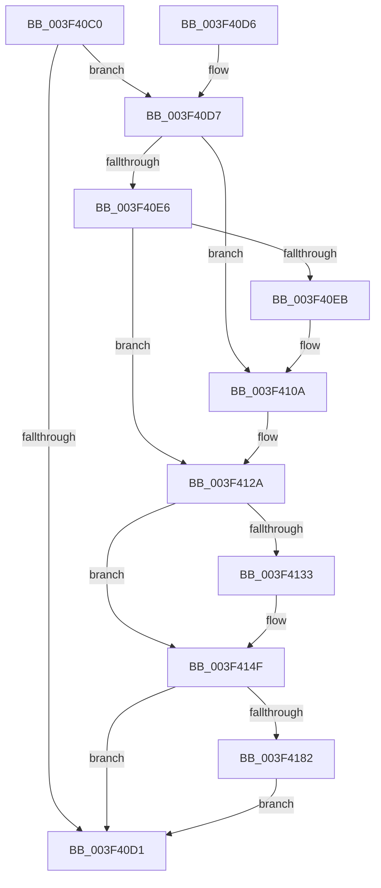

# KasanMarkAddressInvalid

- RVA: `0x003F40C0`–`0x003F4193` (길이 `211` bytes)
- VA: `0x00000001403F40C0`
- 실행 섹션: `.text`
- PDB 이름 있음: `예`; PDB Function 태그: `아니요`
- unwind 정보 RVA: `0x00097148`
- 디코드: `51`개 명령, `211/211` bytes 표시
- 미해석 바이트: `0` (있으면 어셈블리에 `.byte`로 보존)

> 이 문서는 커널 이미지의 기계어와 PDB 기호를 분석해 생성했습니다. 4번과 5번은 함수 원형과 자료형을 바이너리 사용 방식에서 추정한 C 해석이며 원본 소스 복구 결과는 아닙니다.

## 1. Dependencies

- 직접 호출 지점: **4**; 고유 호출 대상: **2**
- 직접 호출자로 확인된 함수: **0**
- RIP 상대 이미지 참조: **2**

### Outgoing calls
- `0x003F4104` → [KeBugCheckEx](../4F/KeBugCheckEx_function_004FD660.md) (function, `0x004FD660`)
- `0x003F4124` → [KeBugCheckEx](../4F/KeBugCheckEx_function_004FD660.md) (function, `0x004FD660`)
- `0x003F4149` → [KeBugCheckEx](../4F/KeBugCheckEx_function_004FD660.md) (function, `0x004FD660`)
- `0x003F4189` → [memset](../6C/memset_function_006C6C40.md) (function, `0x006C6C40`)

### Direct callers
- 이 함수 시작 RVA로 연결되는 직접 call은 확인되지 않았습니다. 간접 호출은 완전히 역산할 수 없습니다.

### Static image references
- `0x003F40C4` → RVA `0x00FCEC68` (`ALMOSTRO`; read)
- `0x003F416E` → RVA `0x00FC6ED8` (`ALMOSTRO`; read)

## 2. Other-region calls and transfers

- 다른 실행 섹션으로 향하는 call: **0**
- 별도 외부 분기/꼬리 이동을 확인하지 못했습니다.

## 3. Assembly (complete function range)

```asm
003F40C0  48 83 EC 38                     sub rsp, 0x38
003F40C4  80 3D 9D AB BD 00 00            cmp byte ptr [rip + 0xbdab9d], 0
003F40CB  45 0F B6 C8                     movzx r9d, r8b
003F40CF  75 06                           jne 0x1403f40d7
003F40D1  48 83 C4 38                     add rsp, 0x38
003F40D5  C3                              ret
003F40D6  CC                              int3
003F40D7  48 B8 00 00 00 00 00 80 FF FF   movabs rax, 0xffff800000000000
003F40E1  48 3B C8                        cmp rcx, rax
003F40E4  72 24                           jb 0x1403f410a
003F40E6  F6 C1 07                        test cl, 7
003F40E9  74 3F                           je 0x1403f412a
003F40EB  BA 02 00 00 00                  mov edx, 2
003F40F0  48 C7 44 24 20 08 00 00 00      mov qword ptr [rsp + 0x20], 8
003F40F9  4C 8B C9                        mov r9, rcx
003F40FC  44 8B C2                        mov r8d, edx
003F40FF  B9 F1 01 00 00                  mov ecx, 0x1f1
003F4104  E8 57 95 10 00                  call 0x1404fd660
003F4109  CC                              int3
003F410A  BA 02 00 00 00                  mov edx, 2
003F410F  48 C7 44 24 20 00 00 00 00      mov qword ptr [rsp + 0x20], 0
003F4118  4C 8B C9                        mov r9, rcx
003F411B  B9 F1 01 00 00                  mov ecx, 0x1f1
003F4120  44 8D 42 FF                     lea r8d, [rdx - 1]
003F4124  E8 37 95 10 00                  call 0x1404fd660
003F4129  CC                              int3
003F412A  48 8D 04 11                     lea rax, [rcx + rdx]
003F412E  48 3B C1                        cmp rax, rcx
003F4131  73 1C                           jae 0x1403f414f
003F4133  48 89 54 24 20                  mov qword ptr [rsp + 0x20], rdx
003F4138  4C 8B C9                        mov r9, rcx
003F413B  BA 02 00 00 00                  mov edx, 2
003F4140  B9 F1 01 00 00                  mov ecx, 0x1f1
003F4145  44 8D 42 01                     lea r8d, [rdx + 1]
003F4149  E8 12 95 10 00                  call 0x1404fd660
003F414E  CC                              int3
003F414F  48 8D 42 FF                     lea rax, [rdx - 1]
003F4153  83 E0 07                        and eax, 7
003F4156  48 2B D0                        sub rdx, rax
003F4159  48 B8 00 00 00 00 00 80 00 00   movabs rax, 0x800000000000
003F4163  48 03 C8                        add rcx, rax
003F4166  48 83 C2 07                     add rdx, 7
003F416A  48 C1 E9 03                     shr rcx, 3
003F416E  48 03 0D 63 2D BD 00            add rcx, qword ptr [rip + 0xbd2d63]
003F4175  48 C1 EA 03                     shr rdx, 3
003F4179  48 85 D2                        test rdx, rdx
003F417C  0F 84 4F FF FF FF               je 0x1403f40d1
003F4182  4C 8B C2                        mov r8, rdx
003F4185  41 0F B6 D1                     movzx edx, r9b
003F4189  E8 B2 2A 2D 00                  call 0x1406c6c40
003F418E  E9 3E FF FF FF                  jmp 0x1403f40d1
```

## 4. C-style interpretation (structured pseudocode)

```c
__int64 __fastcall KasanMarkAddressInvalid(__int64 a1, __int64 a2, unsigned __int8 a3)
{
    __int64 result;
    __int64 v_rsp;
    unsigned __int64 v_stack_p20;

    v_rsp = (v_rsp) - (56);
    if ((*(unsigned __int8 *)(v_rip + 12430237)) != 0) goto loc_003F40D7;
loc_003F40D1:
    v_rsp = (v_rsp) + (56);
    return result;
loc_003F40D7:
    if (a1 < result) goto loc_003F410A;
    if ((((unsigned __int8)(a1)) & (7)) == 0) goto loc_003F412A;
    v_stack_p20 = 8;
    result = KeBugCheckEx(497, 2, 2, a1);
loc_003F410A:
    v_stack_p20 = 0;
    result = KeBugCheckEx(497, 2, 2 - 1, 497);
loc_003F412A:
    result = 497 + 2 * 1;
    if ((497 + 2 * 1) < 497) {
        v_stack_p20 = 2;
        a4 = 497;
        a2 = 2;
        a1 = 497;
        a3 = a2 + 1;
        result = KeBugCheckEx(a1, a2, a3, a4);
    }
    result = (unsigned int)((a2 - 1) & (7));
    a2 = (a2) - (result);
    a1 = (a1) + (result);
    a2 = (a2) + (7);
    a1 = (a1) >> (3);
    a1 = (a1) + (*(unsigned __int64 *)(v_rip + 12397923));
    a2 = (a2) >> (3);
    if (a2 == 0) goto loc_003F40D1;
    result = memset(a1, (unsigned __int8)(a4), a2, a4);
    goto loc_003F40D1;
}
```

## 5. (Beta) C Style

```c
int64_t KasanMarkAddressInvalid(int64_t Arg1, int64_t Arg2, uint8_t Arg3)
{
    int64_t result;
    int64_t local_rsp;
    uint64_t v_stack_p20;

    local_rsp = (local_rsp) - (56);
    if ((*(uint8_t *)(v_rip + 0xBDAB9D)) != 0) goto loc_003F40D7;
loc_003F40D1:
    local_rsp = (local_rsp) + (56);
    return result;
loc_003F40D7:
    if (Arg1 < result) goto loc_003F410A;
    if ((((uint8_t)(Arg1)) & (7)) == 0) goto loc_003F412A;
    v_stack_p20 = 8;
    result = KeBugCheckEx(497, 2, 2, Arg1);
loc_003F410A:
    v_stack_p20 = 0;
    result = KeBugCheckEx(497, 2, 2 - 1, 497);
loc_003F412A:
    result = 497 + 2 * 1;
    if ((497 + 2 * 1) < 497) {
        v_stack_p20 = 2;
        a4 = 497;
        Arg2 = 2;
        Arg1 = 497;
        Arg3 = Arg2 + 1;
        result = KeBugCheckEx(Arg1, Arg2, Arg3, a4);
    }
    result = (uint32_t)((Arg2 - 1) & (7));
    Arg2 = (Arg2) - (result);
    Arg1 = (Arg1) + (result);
    Arg2 = (Arg2) + (7);
    Arg1 = (Arg1) >> (3);
    Arg1 = (Arg1) + (*(uint64_t *)(v_rip + 0xBD2D63));
    Arg2 = (Arg2) >> (3);
    if (Arg2 == 0) goto loc_003F40D1;
    result = memset(Arg1, (uint8_t)(a4), Arg2, a4);
    goto loc_003F40D1;
}
```

## 6. Execution-region graph

[열기: 2D/3D 그래프와 함수 탐색 컨트롤 패널](../../../control-panel.html?section=text&rva=0x003F40C0&view=graph)

- 2D 그래프는 위에서 아래로 흐르고, 3D 그래프는 빈 공간을 드래그해 회전합니다. Shift+드래그는 이동, 휠은 확대·축소, 함수 노드 선택은 대상 보고서 이동입니다.

### Static fallback


