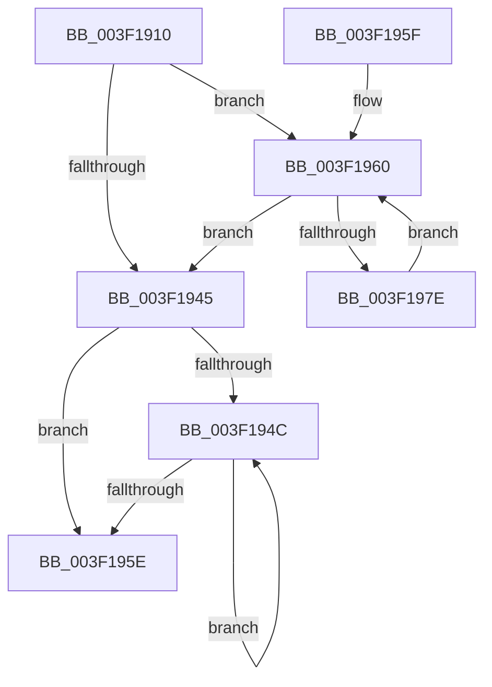

# KeCopyAffinityEx2

- RVA: `0x003F1910`–`0x003F1980` (길이 `112` bytes)
- VA: `0x00000001403F1910`
- 실행 섹션: `.text`
- PDB 이름 있음: `예`; PDB Function 태그: `아니요`
- unwind 정보 RVA: `0x000DB714`
- 디코드: `31`개 명령, `112/112` bytes 표시
- 미해석 바이트: `0` (있으면 어셈블리에 `.byte`로 보존)

> 이 문서는 커널 이미지의 기계어와 PDB 기호를 분석해 생성했습니다. 4번과 5번은 함수 원형과 자료형을 바이너리 사용 방식에서 추정한 C 해석이며 원본 소스 복구 결과는 아닙니다.

## 1. Dependencies

- 직접 호출 지점: **0**; 고유 호출 대상: **0**
- 직접 호출자로 확인된 함수: **0**
- RIP 상대 이미지 참조: **0**

### Outgoing calls
- 직접 디코드된 call 명령이 없습니다.

### Direct callers
- 이 함수 시작 RVA로 연결되는 직접 call은 확인되지 않았습니다. 간접 호출은 완전히 역산할 수 없습니다.

### Static image references
- 디코드된 RIP-relative 메모리 참조가 없습니다.

## 2. Other-region calls and transfers

- 다른 실행 섹션으로 향하는 call: **0**
- 별도 외부 분기/꼬리 이동을 확인하지 못했습니다.

## 3. Assembly (complete function range)

```asm
003F1910  0F B7 02                        movzx eax, word ptr [rdx]
003F1913  4C 8B DA                        mov r11, rdx
003F1916  44 0F B7 41 02                  movzx r8d, word ptr [rcx + 2]
003F191B  4C 8B C9                        mov r9, rcx
003F191E  66 41 3B C0                     cmp ax, r8w
003F1922  66 44 89 41 02                  mov word ptr [rcx + 2], r8w
003F1927  45 0F B7 D0                     movzx r10d, r8w
003F192B  66 44 0F 46 D0                  cmovbe r10w, ax
003F1930  45 33 C0                        xor r8d, r8d
003F1933  66 44 89 11                     mov word ptr [rcx], r10w
003F1937  41 0F B7 C0                     movzx eax, r8w
003F193B  44 89 41 04                     mov dword ptr [rcx + 4], r8d
003F193F  66 45 3B C2                     cmp r8w, r10w
003F1943  72 1B                           jb 0x1403f1960
003F1945  66 41 3B 41 02                  cmp ax, word ptr [r9 + 2]
003F194A  73 12                           jae 0x1403f195e
003F194C  0F B7 C8                        movzx ecx, ax
003F194F  66 FF C0                        inc ax
003F1952  4D 89 44 C9 08                  mov qword ptr [r9 + rcx*8 + 8], r8
003F1957  66 41 3B 41 02                  cmp ax, word ptr [r9 + 2]
003F195C  72 EE                           jb 0x1403f194c
003F195E  C3                              ret
003F195F  CC                              int3
003F1960  0F B7 C8                        movzx ecx, ax
003F1963  66 FF C0                        inc ax
003F1966  48 8D 14 CD 00 00 00 00         lea rdx, [rcx*8]
003F196E  4A 8B 4C 1A 08                  mov rcx, qword ptr [rdx + r11 + 8]
003F1973  4A 89 4C 0A 08                  mov qword ptr [rdx + r9 + 8], rcx
003F1978  66 41 3B C2                     cmp ax, r10w
003F197C  73 C7                           jae 0x1403f1945
003F197E  EB E0                           jmp 0x1403f1960
```

## 4. C-style interpretation (structured pseudocode)

```c
__int64 __fastcall KeCopyAffinityEx2(__int64 a1, __int64 a2)
{
    __int64 result;
    __int64 v_r10;

    *(unsigned __int16 *)(a1 + 2) = (unsigned __int16)(*(unsigned __int16 *)(a1 + 2));
    v_r10 = (unsigned __int16)(*(unsigned __int16 *)(a1 + 2));
    if (((unsigned __int16)(*(unsigned __int16 *)(a2))) <= ((unsigned __int16)(*(unsigned __int16 *)(a1 + 2)))) { v_r10 = (unsigned __int16)(*(unsigned __int16 *)(a2)); }
    a3 = 0;
    *(unsigned __int16 *)(a1) = (unsigned __int16)(v_r10);
    *(unsigned int *)(a1 + 4) = 0;
    if (0 < ((unsigned __int16)(v_r10))) goto loc_003F1960;
loc_003F1945:
    if (0 >= (*(unsigned __int16 *)(a1 + 2))) goto loc_003F195E;
loc_003F194C:
    result = (unsigned __int16)((0) + 1);
    *(unsigned __int64 *)(a1 + 0 * 8 + 8) = 0;
    if (((unsigned __int16)(result)) < (*(unsigned __int16 *)(a1 + 2))) goto loc_003F194C;
loc_003F195E:
    return result;
loc_003F1960:
    result = (unsigned __int16)((result) + 1);
    *(unsigned __int64 *)((unsigned __int16)(result) * 8 + a1 * 1 + 8) = *(unsigned __int64 *)((unsigned __int16)(result) * 8 + a2 * 1 + 8);
    if (((unsigned __int16)(result)) >= ((unsigned __int16)(v_r10))) goto loc_003F1945;
    goto loc_003F1960;
}
```

## 5. (Beta) C Style

```c
int64_t KeCopyAffinityEx2(void *Arg1, void *Arg2)
{
    uint8_t *arg1 = (uint8_t *)Arg1;
    uint8_t *arg2 = (uint8_t *)Arg2;

    int64_t result;
    int64_t local_r10;

    *(uint16_t *)(arg1 + 0x2) = (uint16_t)(*(uint16_t *)(arg1 + 0x2));
    local_r10 = (uint16_t)(*(uint16_t *)(arg1 + 0x2));
    if (((uint16_t)(*(uint16_t *)(arg2))) <= ((uint16_t)(*(uint16_t *)(arg1 + 0x2)))) { local_r10 = (uint16_t)(*(uint16_t *)(arg2)); }
    a3 = 0;
    *(uint16_t *)(arg1) = (uint16_t)(local_r10);
    *(uint32_t *)(arg1 + 0x4) = 0;
    if (0 < ((uint16_t)(local_r10))) goto loc_003F1960;
loc_003F1945:
    if (0 >= (*(uint16_t *)(arg1 + 0x2))) goto loc_003F195E;
loc_003F194C:
    result = (uint16_t)((0) + 1);
    *(uint64_t *)(arg1 + 0x0 * 8 + 0x8) = 0;
    if (((uint16_t)(result)) < (*(uint16_t *)(arg1 + 0x2))) goto loc_003F194C;
loc_003F195E:
    return result;
loc_003F1960:
    result = (uint16_t)((result) + 1);
    *(uint64_t *)((uint16_t)(result) * 8 + arg1 * 1 + 0x8) = *(uint64_t *)((uint16_t)(result) * 8 + arg2 * 1 + 0x8);
    if (((uint16_t)(result)) >= ((uint16_t)(local_r10))) goto loc_003F1945;
    goto loc_003F1960;
}
```

### 관측된 메모리 오프셋

구조체 형식이 확인되지 않은 접근은 인자 기준의 오프셋으로만 기록했습니다.

| 기준 인자 | 오프셋 표현 | 폭 (bit) | 접근 |
|---|---:|---:|---|
| `Arg1` | `+ 0x0` | `16` | `W` |
| `Arg1` | `+ 0x2` | `16` | `R` |
| `Arg1` | `+ 0x2` | `16` | `W` |
| `Arg1` | `+ 0x4` | `32` | `W` |
| `Arg1` | `+ 0x8 + rcx*8` | `64` | `W` |
| `Arg2` | `+ 0x0` | `16` | `R` |

## 6. Execution-region graph

[열기: 2D/3D 그래프와 함수 탐색 컨트롤 패널](../../../control-panel.html?section=text&rva=0x003F1910&view=graph)

- 2D 그래프는 위에서 아래로 흐르고, 3D 그래프는 빈 공간을 드래그해 회전합니다. Shift+드래그는 이동, 휠은 확대·축소, 함수 노드 선택은 대상 보고서 이동입니다.

### Static fallback


