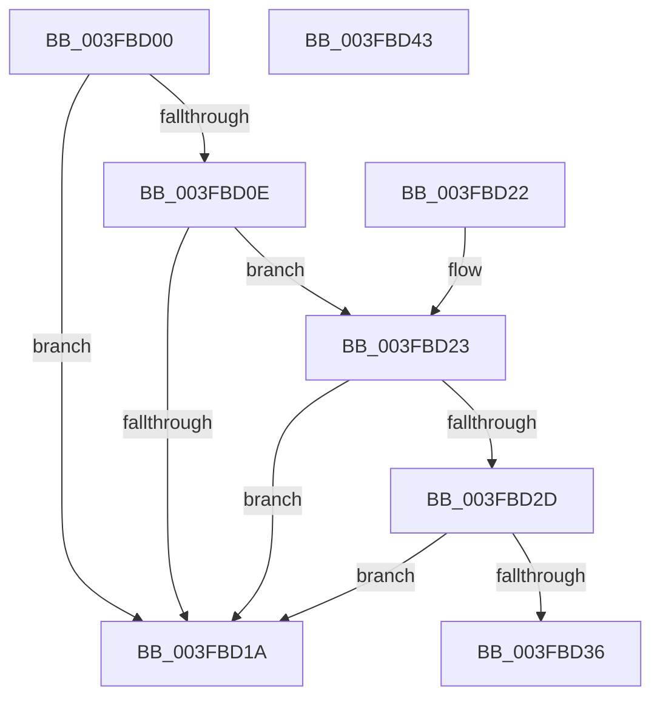

# KeYieldProcessorEx

- RVA: `0x003FBD00`–`0x003FBD44` (길이 `68` bytes)
- VA: `0x00000001403FBD00`
- 실행 섹션: `.text`
- PDB 이름 있음: `예`; PDB Function 태그: `아니요`
- unwind 정보 RVA: `0x00082068`
- 디코드: `26`개 명령, `68/68` bytes 표시
- 미해석 바이트: `0` (있으면 어셈블리에 `.byte`로 보존)

> 이 문서는 커널 이미지의 기계어와 PDB 기호를 분석해 생성했습니다. 4번과 5번은 함수 원형과 자료형을 바이너리 사용 방식에서 추정한 C 해석이며 원본 소스 복구 결과는 아닙니다.

## 1. Dependencies

- 직접 호출 지점: **2**; 고유 호출 대상: **2**
- 직접 호출자로 확인된 함수: **127**
- RIP 상대 이미지 참조: **2**

### Outgoing calls
- `0x003FBD2D` → [KiCheckVpBackingLongSpinWaitHypercall](../30/KiCheckVpBackingLongSpinWaitHypercall_function_0030F490.md) (function, `0x0030F490`)
- `0x003FBD38` → [HvlNotifyLongSpinWait](../30/HvlNotifyLongSpinWait_function_0030F460.md) (function, `0x0030F460`)

### Direct callers
- [MiReturnPagedPoolLockCharge](../24/MiReturnPagedPoolLockCharge_function_00240780.md) at `0x00240819`
- [ExfWaitForRundownProtectionRelease](../2A/ExfWaitForRundownProtectionRelease_function_002A4CDC.md) at `0x002A4E45`
- [MiFreeLargePages](../2A/MiFreeLargePages_function_002A99D0.md) at `0x002A9DA1`
- [MiFreeLargePages](../2A/MiFreeLargePages_function_002A99D0.md) at `0x002A9DE2`
- [MiTrimSharedPageFromViews](../2E/MiTrimSharedPageFromViews_function_002E16F8.md) at `0x002E1F01`
- [MiDeleteSegmentPages](../32/MiDeleteSegmentPages_function_003261D4.md) at `0x00326318`
- [KiForceIdleParkUnparkProcessor](../35/KiForceIdleParkUnparkProcessor_function_003523B8.md) at `0x00352418`
- [MiUnmapMdlCommon](../3E/MiUnmapMdlCommon_function_003E7DF0.md) at `0x003E8475`
- [MiFreePagesFromMdl](MiFreePagesFromMdl_function_003F8300.md) at `0x003F8505`
- [MiLockHugePfnInternal](MiLockHugePfnInternal_function_003FBC80.md) at `0x003FBCCC`
- [MiHandleSpecialPurposeMemoryCachedFault](../44/MiHandleSpecialPurposeMemoryCachedFault_function_0044C740.md) at `0x0044C96A`
- [MiHandleSpecialPurposeMemoryCachedFault](../44/MiHandleSpecialPurposeMemoryCachedFault_function_0044C740.md) at `0x0044C9D7`
- [KiSuspendThread](../46/KiSuspendThread_function_0046B964.md) at `0x0046B99C`
- [KiSuspendThread](../46/KiSuspendThread_function_0046B964.md) at `0x0046BBC0`
- [KiForceIdleUpdateSchedulerParkState](../48/KiForceIdleUpdateSchedulerParkState_function_0048D874.md) at `0x0048DC1A`
- [MiDeleteLargeUserPde](../4C/MiDeleteLargeUserPde_function_004C4D54.md) at `0x004C4EBD`
- [IopMcAddMdlPagesToTable](../4C/IopMcAddMdlPagesToTable_function_004C82F8.md) at `0x004C83B8`
- [MiDecommitLargePte](../4D/MiDecommitLargePte_function_004D1ED4.md) at `0x004D1FE1`
- [MiDeleteSubsectionLargePages](../4D/MiDeleteSubsectionLargePages_function_004D51E0.md) at `0x004D533A`
- [KeCheckForTimer](../4D/KeCheckForTimer_function_004D870C.md) at `0x004D87B7`
- [KeRevertToUserMultipleGroupAffinityThread](../4D/KeRevertToUserMultipleGroupAffinityThread_function_004D8A90.md) at `0x004D8AFB`
- [MiSplitDirectMapPage](../4D/MiSplitDirectMapPage_function_004DAAA0.md) at `0x004DABAB`
- [MiIdealClusterPage](../4D/MiIdealClusterPage_function_004DB964.md) at `0x004DBFDA`
- [MiIdealClusterPage](../4D/MiIdealClusterPage_function_004DB964.md) at `0x004DC034`
- [MiIdealClusterPage](../4D/MiIdealClusterPage_function_004DB964.md) at `0x004DC0A0`
- [MiMapKernelScp](../4D/MiMapKernelScp_function_004DCAD4.md) at `0x004DCCEF`
- [KiVpBackingThreadYieldExecution](../4D/KiVpBackingThreadYieldExecution_function_004DF1A4.md) at `0x004DF289`
- [KiAdjustTimerDueTimes](../4E/KiAdjustTimerDueTimes_function_004E8CD4.md) at `0x004E8D30`
- [MiFlushFileOnlyDeleteChain](../4F/MiFlushFileOnlyDeleteChain_function_004F5534.md) at `0x004F55CE`
- [MiMakeLargePageTable](../4F/MiMakeLargePageTable_function_004F9198.md) at `0x004F92DF`
- [MiMakeLargePageTable](../4F/MiMakeLargePageTable_function_004F9198.md) at `0x004F942D`
- [KiDisarmForceParkDutyCyclingIfNecessary](../4F/KiDisarmForceParkDutyCyclingIfNecessary_function_004FA9E4.md) at `0x004FAB07`
- [KiArmForceParkDutyCyclingForLocalReadyQueue](../4F/KiArmForceParkDutyCyclingForLocalReadyQueue_function_004FAB54.md) at `0x004FAC44`
- [MiLockColorHeadHugeAtDpc](../4F/MiLockColorHeadHugeAtDpc_function_004FAD3C.md) at `0x004FAD57`
- [IopLiveDumpCorralProcessors](../59/IopLiveDumpCorralProcessors_function_0059B720.md) at `0x0059B8CC`
- [IopLiveDumpInitiateCorralStateChange](../59/IopLiveDumpInitiateCorralStateChange_function_0059CA5C.md) at `0x0059CABC`
- [IopMcRemoveMdlPagesFromTable](../5A/IopMcRemoveMdlPagesFromTable_function_005A3D94.md) at `0x005A3E3C`
- [DpxAcquireSimpleRundown](../5B/DpxAcquireSimpleRundown_function_005B0470.md) at `0x005B04A2`
- [KiAcquirePrcbLocksForGroupAffinity](../5B/KiAcquirePrcbLocksForGroupAffinity_function_005B1C80.md) at `0x005B1D19`
- [KiFinalizeCoreControlBlockAssignment](../5B/KiFinalizeCoreControlBlockAssignment_function_005B7D0C.md) at `0x005B7DB7`
- [KeResumeClockTimerFromIdle](../5B/KeResumeClockTimerFromIdle_function_005BACC4.md) at `0x005BAD77`
- [KiSynchronizeIdleIsolationDomainEntry](../5C/KiSynchronizeIdleIsolationDomainEntry_function_005C04AC.md) at `0x005C04E8`
- [KiSynchronizeIdleIsolationDomainExit](../5C/KiSynchronizeIdleIsolationDomainExit_function_005C0544.md) at `0x005C0585`
- [KiCpuPartitionUpdatePrcbs](../5C/KiCpuPartitionUpdatePrcbs_function_005C15D4.md) at `0x005C161F`
- [KiAdjustCoreIsolationReasonThread](../5C/KiAdjustCoreIsolationReasonThread_function_005C3818.md) at `0x005C3857`
- [KiAdjustThreadTimer](../5C/KiAdjustThreadTimer_function_005C3A3C.md) at `0x005C3AB0`
- [KiAdjustUserIsolationDomainThread](../5C/KiAdjustUserIsolationDomainThread_function_005C3B54.md) at `0x005C3BCE`
- [KiAdjustUserIsolationDomainThread](../5C/KiAdjustUserIsolationDomainThread_function_005C3B54.md) at `0x005C3D7C`
- [KiExecuteSmtIsolationThread](../5C/KiExecuteSmtIsolationThread_function_005C4070.md) at `0x005C4115`
- [KeAbCrossThreadDelete](../5C/KeAbCrossThreadDelete_function_005C517C.md) at `0x005C5442`
- [KiFlushScbReferences](../5C/KiFlushScbReferences_function_005C89E8.md) at `0x005C8A37`
- [KeSetSchedulingGroupCycleNotification](../5C/KeSetSchedulingGroupCycleNotification_function_005C8C24.md) at `0x005C8CA6`
- [MiLockDriverPageRange](../67/MiLockDriverPageRange_function_00670160.md) at `0x006703A0`
- [MiInitializeNewPfns](../67/MiInitializeNewPfns_function_00670E94.md) at `0x00671114`
- [MiReplaceImportEntry](../67/MiReplaceImportEntry_function_00671440.md) at `0x0067167C`
- [MiInitializeDynamicPfns](../67/MiInitializeDynamicPfns_function_00672BD0.md) at `0x00672FBE`
- [MiPreparePfnDatabasePageForFree](../67/MiPreparePfnDatabasePageForFree_function_00673AA8.md) at `0x00673AF8`
- [MiSetPageProtection](../67/MiSetPageProtection_function_00674BDC.md) at `0x00674D80`
- [MiReturnBadPagesToBadList](../67/MiReturnBadPagesToBadList_function_0067A374.md) at `0x0067A3E8`
- [MiStackTheftFreezeProcessors](../67/MiStackTheftFreezeProcessors_function_0067B274.md) at `0x0067B3AF`
- [MiGetDanglingExtent](../68/MiGetDanglingExtent_function_006812C4.md) at `0x0068139F`
- [MiReapplyImportOptimizationWorker](../68/MiReapplyImportOptimizationWorker_function_00682720.md) at `0x006829F8`
- [MiClearDriverTablePtes](../68/MiClearDriverTablePtes_function_00683024.md) at `0x00683202`
- [MiClearDriverTablePtes](../68/MiClearDriverTablePtes_function_00683024.md) at `0x006832D8`
- [MiPrepareImagePagesForHotPatch](../68/MiPrepareImagePagesForHotPatch_function_00683800.md) at `0x00683C19`
- [MmMapDriverTablePage](../68/MmMapDriverTablePage_function_00683EAC.md) at `0x00683F86`
- [MmMapDriverTablePage](../68/MmMapDriverTablePage_function_00683EAC.md) at `0x00683FF6`
- [MiDbgTranslatePhysicalAddress](../68/MiDbgTranslatePhysicalAddress_function_00685760.md) at `0x006858C6`
- [MiUpdateEnclavePfnProtection](../68/MiUpdateEnclavePfnProtection_function_00687128.md) at `0x0068714A`
- [MiFillUserPhysicalMdl](../68/MiFillUserPhysicalMdl_function_006887D4.md) at `0x006888DD`
- [MiPreparePhysicalPagesMdlForFree](../68/MiPreparePhysicalPagesMdlForFree_function_006890A4.md) at `0x00689176`
- [MiInsertPossiblyBadPage](../68/MiInsertPossiblyBadPage_function_00689DF0.md) at `0x00689E5F`
- [MiDemoteValidLargePageOneLevel](../68/MiDemoteValidLargePageOneLevel_function_0068A3F4.md) at `0x0068A741`
- [MiDemoteValidLargePageOneLevel](../68/MiDemoteValidLargePageOneLevel_function_0068A3F4.md) at `0x0068A890`
- [MiTryUnlinkNodeLargePages](../68/MiTryUnlinkNodeLargePages_function_0068ADA0.md) at `0x0068AED4`
- [MiRepointPteAtExtendedStandby](../68/MiRepointPteAtExtendedStandby_function_0068B6F4.md) at `0x0068B792`
- [MmAllocateSecureKernelPages](../68/MmAllocateSecureKernelPages_function_0068F394.md) at `0x0068F595`
- [MiActOnPartitionNodePages](../68/MiActOnPartitionNodePages_function_0068F7F4.md) at `0x0068FC66`
- [MiTransferPartitionPageRun](../69/MiTransferPartitionPageRun_function_00691DCC.md) at `0x00691EB8`
- [MiTransferPartitionPageRun](../69/MiTransferPartitionPageRun_function_00691DCC.md) at `0x006920C0`
- [MiMakeVaRangePhysicallyContiguous](../69/MiMakeVaRangePhysicallyContiguous_function_006936E0.md) at `0x0069389E`
- [MiDemotePfnListChain](../69/MiDemotePfnListChain_function_00698B5C.md) at `0x00698CCD`
- [MiZeroPageCalibrateDpc](../69/MiZeroPageCalibrateDpc_function_0069AA90.md) at `0x0069AB4D`
- [sub_006D6552](../6D/Unknown_function_006D6552.md) at `0x006D655A`
- [sub_006D68B6](../6D/Unknown_function_006D68B6.md) at `0x006D68BB`
- [sub_006D6928](../6D/Unknown_function_006D6928.md) at `0x006D6941`
- [sub_006D69EA](../6D/Unknown_function_006D69EA.md) at `0x006D69EE`
- [sub_006D8256](../6D/Unknown_function_006D8256.md) at `0x006D82CC`
- [sub_006D8D62](../6D/Unknown_function_006D8D62.md) at `0x006D8D67`
- [sub_006D8D7A](../6D/Unknown_function_006D8D7A.md) at `0x006D8D7E`
- [sub_006D9212](../6D/Unknown_function_006D9212.md) at `0x006D924E`
- [sub_006D9212](../6D/Unknown_function_006D9212.md) at `0x006D961F`
- [sub_006DA208](../6D/Unknown_function_006DA208.md) at `0x006DA21A`
- [sub_006DA4DA](../6D/Unknown_function_006DA4DA.md) at `0x006DA50E`
- [sub_006DAAE6](../6D/Unknown_function_006DAAE6.md) at `0x006DABE3`
- [sub_006DB64E](../6D/Unknown_function_006DB64E.md) at `0x006DB65C`
- [sub_006DB77C](../6D/Unknown_function_006DB77C.md) at `0x006DB947`
- [sub_006DC422](../6D/Unknown_function_006DC422.md) at `0x006DC4C5`
- [sub_006DC4D4](../6D/Unknown_function_006DC4D4.md) at `0x006DC5FA`
- [sub_006E0EAA](../6E/Unknown_function_006E0EAA.md) at `0x006E0EAF`
- [sub_006E0EC2](../6E/Unknown_function_006E0EC2.md) at `0x006E0EC6`
- [sub_006E0EDA](../6E/Unknown_function_006E0EDA.md) at `0x006E0EDE`
- [sub_006E20B8](../6E/Unknown_function_006E20B8.md) at `0x006E20E8`
- [sub_006E26C2](../6E/Unknown_function_006E26C2.md) at `0x006E26C6`
- [sub_006E2730](../6E/Unknown_function_006E2730.md) at `0x006E2734`
- [sub_006E3B88](../6E/Unknown_function_006E3B88.md) at `0x006E3BAB`
- [sub_006E4548](../6E/Unknown_function_006E4548.md) at `0x006E454D`
- [sub_006E4C68](../6E/Unknown_function_006E4C68.md) at `0x006E4C98`
- [sub_006E638A](../6E/Unknown_function_006E638A.md) at `0x006E638F`
- [sub_006E650A](../6E/Unknown_function_006E650A.md) at `0x006E651F`
- [sub_006E7436](../6E/Unknown_function_006E7436.md) at `0x006E748D`
- [sub_006E7822](../6E/Unknown_function_006E7822.md) at `0x006E78B4`
- [sub_006E798E](../6E/Unknown_function_006E798E.md) at `0x006E799B`
- [sub_006E825E](../6E/Unknown_function_006E825E.md) at `0x006E8272`
- [sub_006E82CE](../6E/Unknown_function_006E82CE.md) at `0x006E838A`
- [sub_006E82CE](../6E/Unknown_function_006E82CE.md) at `0x006E8535`
- [sub_006EC6A4](../6E/Unknown_function_006EC6A4.md) at `0x006EC6CC`
- [sub_006ED6E6](../6E/Unknown_function_006ED6E6.md) at `0x006ED732`
- [sub_006ED93C](../6E/Unknown_function_006ED93C.md) at `0x006ED96F`
- [sub_006EDB06](../6E/Unknown_function_006EDB06.md) at `0x006EDB14`
- [sub_006EFE28](../6E/Unknown_function_006EFE28.md) at `0x006EFF3A`
- [sub_006F15CE](../6F/Unknown_function_006F15CE.md) at `0x006F16FD`
- [sub_006F15CE](../6F/Unknown_function_006F15CE.md) at `0x006F177D`
- [sub_006F285A](../6F/Unknown_function_006F285A.md) at `0x006F2893`
- [sub_006F28BE](../6F/Unknown_function_006F28BE.md) at `0x006F2A43`
- [sub_006F3522](../6F/Unknown_function_006F3522.md) at `0x006F3526`
- [sub_006F3522](../6F/Unknown_function_006F3522.md) at `0x006F3586`
- [sub_006F59B4](../6F/Unknown_function_006F59B4.md) at `0x006F5B04`
- [sub_006F59B4](../6F/Unknown_function_006F59B4.md) at `0x006F5B1C`
- [sub_006F60F8](../6F/Unknown_function_006F60F8.md) at `0x006F6287`
- [sub_006FA666](../6F/Unknown_function_006FA666.md) at `0x006FA6FF`
- [sub_006FBAB6](../6F/Unknown_function_006FBAB6.md) at `0x006FBACA`
- [sub_006FC98E](../6F/Unknown_function_006FC98E.md) at `0x006FC99C`
- [sub_006FC98E](../6F/Unknown_function_006FC98E.md) at `0x006FCA09`
- [KiAddCpuToSystemCpuPartition](../../pagelk/B6/KiAddCpuToSystemCpuPartition_function_00B680F0.md) at `0x00B6813A`
- [KiAddProcessorToGroupSchedulingDatabase](../../pagelk/B6/KiAddProcessorToGroupSchedulingDatabase_function_00B6B1D8.md) at `0x00B6B229`
- [ViLockContextPointer](../../pagevrfy/B9/ViLockContextPointer_function_00B94954.md) at `0x00B94985`
- [KeStartAllProcessors](../../init/C3/KeStartAllProcessors_function_00C36F78.md) at `0x00C37368`
- [MiUpdateBootHpatPagesInUse](../../init/C6/MiUpdateBootHpatPagesInUse_function_00C67548.md) at `0x00C67624`
- [MiMarkBootKernelStack](../../init/C6/MiMarkBootKernelStack_function_00C68244.md) at `0x00C68322`
- [MiCreateKernelHalSlabRange](../../init/C6/MiCreateKernelHalSlabRange_function_00C69C80.md) at `0x00C69D4E`
- [MiInitializeCacheFlushing](../../init/C6/MiInitializeCacheFlushing_function_00C6ACF8.md) at `0x00C6AE42`
- [MiInitializeCacheFlushing](../../init/C6/MiInitializeCacheFlushing_function_00C6ACF8.md) at `0x00C6AE8D`
- [MiTradeBootImagePage](../../init/C6/MiTradeBootImagePage_function_00C6C554.md) at `0x00C6C5F4`
- [MiFreeBootDriverPages](../../init/C7/MiFreeBootDriverPages_function_00C7695C.md) at `0x00C76AFE`

### Static image references
- `0x003FBD12` → RVA `0x00FC52AC` (`ALMOSTRO`; reference)
- `0x003FBD23` → RVA `0x00FC6AB8` (`ALMOSTRO`; read)

## 2. Other-region calls and transfers

- 다른 실행 섹션으로 향하는 call: **0**
- 별도 외부 분기/꼬리 이동을 확인하지 못했습니다.

## 3. Assembly (complete function range)

```asm
003FBD00  40 53                           push rbx
003FBD02  48 83 EC 20                     sub rsp, 0x20
003FBD06  48 8B D9                        mov rbx, rcx
003FBD09  48 85 C9                        test rcx, rcx
003FBD0C  74 0C                           je 0x1403fbd1a
003FBD0E  FF 01                           inc dword ptr [rcx]
003FBD10  8B 01                           mov eax, dword ptr [rcx]
003FBD12  85 05 94 95 BC 00               test dword ptr [rip + 0xbc9594], eax
003FBD18  74 09                           je 0x1403fbd23
003FBD1A  F3 90                           pause
003FBD1C  48 83 C4 20                     add rsp, 0x20
003FBD20  5B                              pop rbx
003FBD21  C3                              ret
003FBD22  CC                              int3
003FBD23  8B 05 8F AD BC 00               mov eax, dword ptr [rip + 0xbcad8f]
003FBD29  A8 40                           test al, 0x40
003FBD2B  74 ED                           je 0x1403fbd1a
003FBD2D  E8 5E 37 F1 FF                  call 0x14030f490
003FBD32  84 C0                           test al, al
003FBD34  74 E4                           je 0x1403fbd1a
003FBD36  8B 0B                           mov ecx, dword ptr [rbx]
003FBD38  E8 23 37 F1 FF                  call 0x14030f460
003FBD3D  48 83 C4 20                     add rsp, 0x20
003FBD41  5B                              pop rbx
003FBD42  C3                              ret
003FBD43  CC                              int3
```

## 4. C-style interpretation (structured pseudocode)

```c
__int64 __fastcall KeYieldProcessorEx(__int64 a1)
{
    __int64 result;
    __int64 v_rsp;

    v_rsp = (v_rsp) - (32);
    if (a1 == 0) goto loc_003FBD1A;
    if (((*(unsigned int *)(v_rip + 12359060)) & ((unsigned int)((unsigned int)(*(unsigned int *)(a1))))) == 0) goto loc_003FBD23;
loc_003FBD1A:
    v_rsp = (v_rsp) + (32);
    return (unsigned int)(*(unsigned int *)(a1));
loc_003FBD23:
    if ((((unsigned __int8)((unsigned int)(*(unsigned int *)(v_rip + 12365199)))) & (64)) == 0) goto loc_003FBD1A;
    result = KiCheckVpBackingLongSpinWaitHypercall(a1, a2, a3, a4);
    if ((unsigned __int8)(result) == 0) goto loc_003FBD1A;
    result = HvlNotifyLongSpinWait((unsigned int)(*(unsigned int *)(a1)), a2, a3, a4);
    v_rsp = (v_rsp) + (32);
    return result;
}
```

## 5. (Beta) C Style

```c
int64_t KeYieldProcessorEx(void *Arg1)
{
    uint8_t *arg1 = (uint8_t *)Arg1;

    int64_t result;
    int64_t local_rsp;

    local_rsp = (local_rsp) - (32);
    if (Arg1 == NULL) goto loc_003FBD1A;
    if (((*(uint32_t *)(v_rip + 0xBC9594)) & ((uint32_t)((uint32_t)(*(uint32_t *)(arg1))))) == 0) goto loc_003FBD23;
loc_003FBD1A:
    local_rsp = (local_rsp) + (32);
    return (uint32_t)(*(uint32_t *)(arg1));
loc_003FBD23:
    if ((((uint8_t)((uint32_t)(*(uint32_t *)(v_rip + 0xBCAD8F)))) & (64)) == 0) goto loc_003FBD1A;
    result = KiCheckVpBackingLongSpinWaitHypercall(Arg1, a2, a3, a4);
    if ((uint8_t)(result) == 0) goto loc_003FBD1A;
    result = HvlNotifyLongSpinWait((uint32_t)(*(uint32_t *)(arg1)), a2, a3, a4);
    local_rsp = (local_rsp) + (32);
    return result;
}
```

### 관측된 메모리 오프셋

구조체 형식이 확인되지 않은 접근은 인자 기준의 오프셋으로만 기록했습니다.

| 기준 인자 | 오프셋 표현 | 폭 (bit) | 접근 |
|---|---:|---:|---|
| `Arg1` | `+ 0x0` | `32` | `R` |

## 6. Execution-region graph

[열기: 2D/3D 그래프와 함수 탐색 컨트롤 패널](../../../control-panel.html?section=text&rva=0x003FBD00&view=graph)

- 2D 그래프는 위에서 아래로 흐르고, 3D 그래프는 빈 공간을 드래그해 회전합니다. Shift+드래그는 이동, 휠은 확대·축소, 함수 노드 선택은 대상 보고서 이동입니다.

### Static fallback


