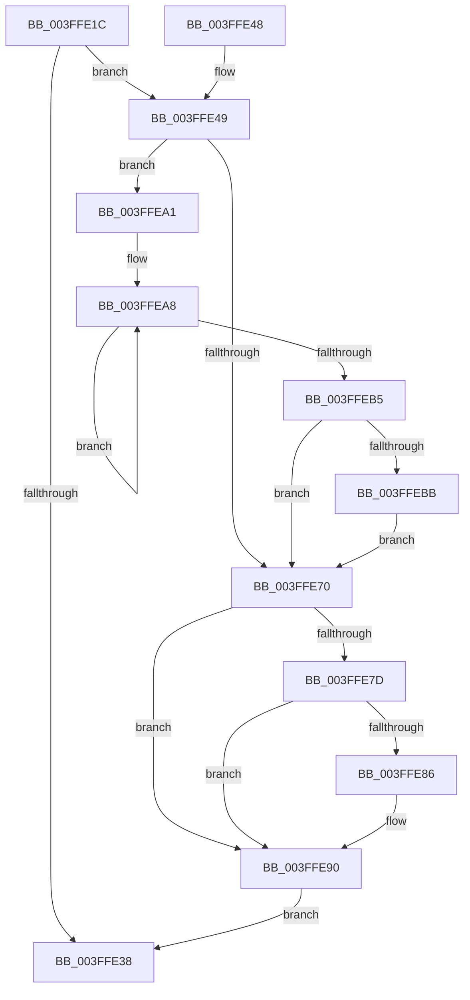

# KiCompleteDirectSwitchThread

- RVA: `0x003FFE1C`–`0x003FFEC2` (길이 `166` bytes)
- VA: `0x00000001403FFE1C`
- 실행 섹션: `.text`
- PDB 이름 있음: `예`; PDB Function 태그: `아니요`
- unwind 정보 RVA: `0x0009A108`
- 디코드: `48`개 명령, `166/166` bytes 표시
- 미해석 바이트: `0` (있으면 어셈블리에 `.byte`로 보존)

> 이 문서는 커널 이미지의 기계어와 PDB 기호를 분석해 생성했습니다. 4번과 5번은 함수 원형과 자료형을 바이너리 사용 방식에서 추정한 C 해석이며 원본 소스 복구 결과는 아닙니다.

## 1. Dependencies

- 직접 호출 지점: **3**; 고유 호출 대상: **3**
- 직접 호출자로 확인된 함수: **5**
- RIP 상대 이미지 참조: **0**

### Outgoing calls
- `0x003FFE53` → [KiUpdateTotalCyclesCurrentThread](../37/KiUpdateTotalCyclesCurrentThread_function_0037DE40.md) (function, `0x0037DE40`)
- `0x003FFE96` → [KiRemoveBoostThread](../21/KiRemoveBoostThread_function_00219128.md) (function, `0x00219128`)
- `0x003FFEBB` → [KiRemoveSystemWorkPriorityKick](../26/KiRemoveSystemWorkPriorityKick_function_002631D0.md) (function, `0x002631D0`)

### Direct callers
- [sub_002501EF](../25/Unknown_function_002501EF.md) at `0x00250231`
- [KeReleaseSemaphoreEx](../34/KeReleaseSemaphoreEx_function_003468C0.md) at `0x00346B3F`
- [AlpcpSignal](../39/AlpcpSignal_function_003955E0.md) at `0x003960B1`
- [AlpcpQueueIoCompletion](../39/AlpcpQueueIoCompletion_function_00397480.md) at `0x0039789F`
- [AlpcpQueueIoCompletionPort](AlpcpQueueIoCompletionPort_function_003FF760.md) at `0x003FFD7C`

### Static image references
- 디코드된 RIP-relative 메모리 참조가 없습니다.

## 2. Other-region calls and transfers

- 다른 실행 섹션으로 향하는 call: **0**
- 별도 외부 분기/꼬리 이동을 확인하지 못했습니다.

## 3. Assembly (complete function range)

```asm
003FFE1C  48 89 5C 24 08                  mov qword ptr [rsp + 8], rbx
003FFE21  48 89 74 24 10                  mov qword ptr [rsp + 0x10], rsi
003FFE26  57                              push rdi
003FFE27  48 83 EC 20                     sub rsp, 0x20
003FFE2B  8B 42 78                        mov eax, dword ptr [rdx + 0x78]
003FFE2E  48 8B DA                        mov rbx, rdx
003FFE31  48 8B F1                        mov rsi, rcx
003FFE34  A8 20                           test al, 0x20
003FFE36  75 11                           jne 0x1403ffe49
003FFE38  48 8B 5C 24 30                  mov rbx, qword ptr [rsp + 0x30]
003FFE3D  48 8B 74 24 38                  mov rsi, qword ptr [rsp + 0x38]
003FFE42  48 83 C4 20                     add rsp, 0x20
003FFE46  5F                              pop rdi
003FFE47  C3                              ret
003FFE48  CC                              int3
003FFE49  F0 0F BA 72 78 05               lock btr dword ptr [rdx + 0x78], 5
003FFE4F  FA                              cli
003FFE50  45 33 C0                        xor r8d, r8d
003FFE53  E8 E8 DF F7 FF                  call 0x14037de40
003FFE58  65 48 8B 0C 25 20 00 00 00      mov rcx, qword ptr gs:[0x20]
003FFE61  48 8B F8                        mov rdi, rax
003FFE64  4C 8B 81 B8 8E 00 00            mov r8, qword ptr [rcx + 0x8eb8]
003FFE6B  4D 85 C0                        test r8, r8
003FFE6E  75 31                           jne 0x1403ffea1
003FFE70  FB                              sti
003FFE71  48 8B 8E 08 2D 00 00            mov rcx, qword ptr [rsi + 0x2d08]
003FFE78  48 85 C9                        test rcx, rcx
003FFE7B  74 13                           je 0x1403ffe90
003FFE7D  48 8B 43 20                     mov rax, qword ptr [rbx + 0x20]
003FFE81  48 3B C7                        cmp rax, rdi
003FFE84  76 0A                           jbe 0x1403ffe90
003FFE86  48 2B C7                        sub rax, rdi
003FFE89  48 01 81 48 FF FF FF            add qword ptr [rcx - 0xb8], rax
003FFE90  48 8B D3                        mov rdx, rbx
003FFE93  48 8B CE                        mov rcx, rsi
003FFE96  E8 8D 92 E1 FF                  call 0x140219128
003FFE9B  48 89 7B 20                     mov qword ptr [rbx + 0x20], rdi
003FFE9F  EB 97                           jmp 0x1403ffe38
003FFEA1  41 0F 0D 08                     prefetchw byte ptr [r8]
003FFEA5  41 8B 00                        mov eax, dword ptr [r8]
003FFEA8  8B D0                           mov edx, eax
003FFEAA  0F BA F2 15                     btr edx, 0x15
003FFEAE  F0 41 0F B1 10                  lock cmpxchg dword ptr [r8], edx
003FFEB3  75 F3                           jne 0x1403ffea8
003FFEB5  0F BA E0 15                     bt eax, 0x15
003FFEB9  73 B5                           jae 0x1403ffe70
003FFEBB  E8 10 33 E6 FF                  call 0x1402631d0
003FFEC0  EB AE                           jmp 0x1403ffe70
```

## 4. C-style interpretation (structured pseudocode)

```c
__int64 __fastcall KiCompleteDirectSwitchThread(__int64 a1, __int64 a2, int a3)
{
    __int64 result;
    __int64 v_rsp;
    unsigned __int64 v_stack_p10;
    unsigned __int64 v_stack_p8;

    v_stack_p8 = v_rbx;
    v_stack_p10 = v_rsi;
    v_rsp = (v_rsp) - (32);
    if ((((unsigned __int8)((unsigned int)(*(unsigned int *)(a2 + 120)))) & (32)) != 0) goto loc_003FFE49;
loc_003FFE38:
    v_rsp = (v_rsp) + (32);
    return (unsigned int)(*(unsigned int *)(a2 + 120));
loc_003FFE49:
    a3 = 0;
    result = KiUpdateTotalCyclesCurrentThread(a1, a2, a3, a4);
    if (*(unsigned __int64 *)(*(unsigned __int64 *)(gs_base + (0 + 32)) + 36536) != 0) goto loc_003FFEA1;
loc_003FFE70:
    if (*(unsigned __int64 *)(v_stack_p10 + 11528) == 0) goto loc_003FFE90;
    result = *(unsigned __int64 *)(v_stack_p8 + 32);
    if ((*(unsigned __int64 *)(v_stack_p8 + 32)) >= = result) {
        result = (*(unsigned __int64 *)(v_stack_p8 + 32)) - (result);
    }
    result = KiRemoveBoostThread(v_stack_p10, v_stack_p8, *(unsigned __int64 *)(*(unsigned __int64 *)(gs_base + (0 + 32)) + 36536), a4);
    *(unsigned __int64 *)(v_stack_p8 + 32) = result;
    goto loc_003FFE38;
loc_003FFEA1:
loc_003FFEA8:
    if (condition_is_not_equal) goto loc_003FFEA8;
    if (condition_is_above_or_equal) goto loc_003FFE70;
    result = KiRemoveSystemWorkPriorityKick(v_stack_p10, (unsigned int)((unsigned int)((unsigned int)(*(unsigned int *)(*(unsigned __int64 *)(*(unsigned __int64 *)(gs_base + (0 + 32)) + 36536))))), *(unsigned __int64 *)(*(unsigned __int64 *)(gs_base + (0 + 32)) + 36536), a4);
    goto loc_003FFE70;
}
```

## 5. (Beta) C Style

```c
int64_t KiCompleteDirectSwitchThread(void *Arg1, void *Arg2, int32_t Arg3)
{
    uint8_t *arg1 = (uint8_t *)Arg1;
    uint8_t *arg2 = (uint8_t *)Arg2;

    int64_t result;
    int64_t local_rsp;
    uint64_t v_stack_p10;
    uint64_t v_stack_p8;

    v_stack_p8 = local_rbx;
    v_stack_p10 = local_rsi;
    local_rsp = (local_rsp) - (32);
    if ((((uint8_t)((uint32_t)(*(uint32_t *)(arg2 + 0x78)))) & (32)) != 0) goto loc_003FFE49;
loc_003FFE38:
    local_rsp = (local_rsp) + (32);
    return (uint32_t)(*(uint32_t *)(arg2 + 0x78));
loc_003FFE49:
    Arg3 = 0;
    result = KiUpdateTotalCyclesCurrentThread(Arg1, Arg2, Arg3, a4);
    if (*(uint64_t *)(*(uint64_t *)(gs_base + (0 + 0x20)) + 0x8EB8) != 0) goto loc_003FFEA1;
loc_003FFE70:
    if (*(uint64_t *)(v_stack_p10 + 0x2D08) == 0) goto loc_003FFE90;
    result = *(uint64_t *)(v_stack_p8 + 0x20);
    if ((*(uint64_t *)(v_stack_p8 + 0x20)) >= = result) {
        result = (*(uint64_t *)(v_stack_p8 + 0x20)) - (result);
    }
    result = KiRemoveBoostThread(v_stack_p10, v_stack_p8, *(uint64_t *)(*(uint64_t *)(gs_base + (0 + 0x20)) + 0x8EB8), a4);
    *(uint64_t *)(v_stack_p8 + 0x20) = result;
    goto loc_003FFE38;
loc_003FFEA1:
loc_003FFEA8:
    if (condition_is_not_equal) goto loc_003FFEA8;
    if (condition_is_above_or_equal) goto loc_003FFE70;
    result = KiRemoveSystemWorkPriorityKick(v_stack_p10, (uint32_t)((uint32_t)((uint32_t)(*(uint32_t *)(*(uint64_t *)(*(uint64_t *)(gs_base + (0 + 0x20)) + 0x8EB8))))), *(uint64_t *)(*(uint64_t *)(gs_base + (0 + 0x20)) + 0x8EB8), a4);
    goto loc_003FFE70;
}
```

### 관측된 메모리 오프셋

구조체 형식이 확인되지 않은 접근은 인자 기준의 오프셋으로만 기록했습니다.

| 기준 인자 | 오프셋 표현 | 폭 (bit) | 접근 |
|---|---:|---:|---|
| `Arg1` | `+ 0x2D08` | `64` | `R` |
| `Arg2` | `+ 0x20` | `64` | `R` |
| `Arg2` | `+ 0x20` | `64` | `W` |
| `Arg2` | `+ 0x78` | `32` | `R` |
| `Arg2` | `+ 0x78` | `32` | `R/W` |

## 6. Execution-region graph

[열기: 2D/3D 그래프와 함수 탐색 컨트롤 패널](../../../control-panel.html?section=text&rva=0x003FFE1C&view=graph)

- 2D 그래프는 위에서 아래로 흐르고, 3D 그래프는 빈 공간을 드래그해 회전합니다. Shift+드래그는 이동, 휠은 확대·축소, 함수 노드 선택은 대상 보고서 이동입니다.

### Static fallback


