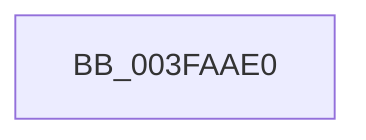

# KiEndInterruptCycleAccumulation

- RVA: `0x003FAAE0`–`0x003FAAF0` (길이 `16` bytes)
- VA: `0x00000001403FAAE0`
- 실행 섹션: `.text`
- PDB 이름 있음: `예`; PDB Function 태그: `아니요`
- unwind 정보 RVA: `0x000984A8`
- 디코드: `5`개 명령, `16/16` bytes 표시
- 미해석 바이트: `0` (있으면 어셈블리에 `.byte`로 보존)

> 이 문서는 커널 이미지의 기계어와 PDB 기호를 분석해 생성했습니다. 4번과 5번은 함수 원형과 자료형을 바이너리 사용 방식에서 추정한 C 해석이며 원본 소스 복구 결과는 아닙니다.

## 1. Dependencies

- 직접 호출 지점: **0**; 고유 호출 대상: **0**
- 직접 호출자로 확인된 함수: **11**
- RIP 상대 이미지 참조: **0**

### Outgoing calls
- 직접 디코드된 call 명령이 없습니다.

### Direct callers
- [KiChainedDispatch](../6B/KiChainedDispatch_function_006B3480.md) at `0x006B34D6`
- [KiInterruptDispatch](../6B/KiInterruptDispatch_function_006B3B30.md) at `0x006B3B86`
- [KiInterruptDispatchNoLock](../6B/KiInterruptDispatchNoLock_function_006B3F10.md) at `0x006B3F66`
- [KiInterruptDispatchNoLockNoEtw](../6B/KiInterruptDispatchNoLockNoEtw_function_006B42F0.md) at `0x006B4346`
- [KiInterruptDispatchNoEOI](../6B/KiInterruptDispatchNoEOI_function_006B46D0.md) at `0x006B471E`
- [KiSpuriousDispatchNoEOI](../6B/KiSpuriousDispatchNoEOI_function_006B4AA0.md) at `0x006B4AE2`
- [KxIsrLinkage](../6B/KxIsrLinkage_function_006B5680.md) at `0x006B5A91`
- [KiHvInterruptDispatch](../6B/KiHvInterruptDispatch_function_006B7750.md) at `0x006B77B3`
- [KiVmbusInterruptDispatch](../6B/KiVmbusInterruptDispatch_function_006B7B40.md) at `0x006B7B8F`
- [KiSwInterrupt](../6B/KiSwInterrupt_function_006B8070.md) at `0x006B842A`
- [KiIpiInterrupt](../6B/KiIpiInterrupt_function_006B8F20.md) at `0x006B92D4`

### Static image references
- 디코드된 RIP-relative 메모리 참조가 없습니다.

## 2. Other-region calls and transfers

- 다른 실행 섹션으로 향하는 call: **0**
- 별도 외부 분기/꼬리 이동을 확인하지 못했습니다.

## 3. Assembly (complete function range)

```asm
003FAAE0  40 53                           push rbx
003FAAE2  41 57                           push r15
003FAAE4  48 83 EC 38                     sub rsp, 0x38
003FAAE8  80 79 20 01                     cmp byte ptr [rcx + 0x20], 1
003FAAEC  44 0F B6 FA                     movzx r15d, dl
```

## 4. C-style interpretation (structured pseudocode)

```c
void __fastcall KiEndInterruptCycleAccumulation(__int64 a1, unsigned __int8 a2)
{
    __int64 v_rsp;

    v_rsp = (v_rsp) - (56);
    return;
}
```

## 5. (Beta) C Style

```c
void KiEndInterruptCycleAccumulation(void *Arg1, uint8_t Arg2)
{
    uint8_t *arg1 = (uint8_t *)Arg1;

    int64_t local_rsp;

    local_rsp = (local_rsp) - (56);
    return;
}
```

### 관측된 메모리 오프셋

구조체 형식이 확인되지 않은 접근은 인자 기준의 오프셋으로만 기록했습니다.

| 기준 인자 | 오프셋 표현 | 폭 (bit) | 접근 |
|---|---:|---:|---|
| `Arg1` | `+ 0x20` | `8` | `R` |

## 6. Execution-region graph

[열기: 2D/3D 그래프와 함수 탐색 컨트롤 패널](../../../control-panel.html?section=text&rva=0x003FAAE0&view=graph)

- 2D 그래프는 위에서 아래로 흐르고, 3D 그래프는 빈 공간을 드래그해 회전합니다. Shift+드래그는 이동, 휠은 확대·축소, 함수 노드 선택은 대상 보고서 이동입니다.

### Static fallback


