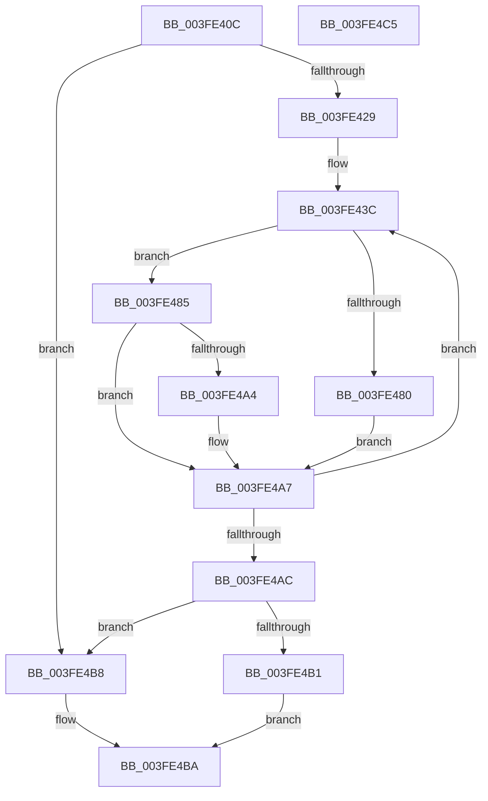

# KiFindRankBiasedIdleSmtSet

- RVA: `0x003FE40C`–`0x003FE4C6` (길이 `186` bytes)
- VA: `0x00000001403FE40C`
- 실행 섹션: `.text`
- PDB 이름 있음: `예`; PDB Function 태그: `아니요`
- unwind 정보 RVA: `0x00099E74`
- 디코드: `48`개 명령, `186/186` bytes 표시
- 미해석 바이트: `0` (있으면 어셈블리에 `.byte`로 보존)

> 이 문서는 커널 이미지의 기계어와 PDB 기호를 분석해 생성했습니다. 4번과 5번은 함수 원형과 자료형을 바이너리 사용 방식에서 추정한 C 해석이며 원본 소스 복구 결과는 아닙니다.

## 1. Dependencies

- 직접 호출 지점: **0**; 고유 호출 대상: **0**
- 직접 호출자로 확인된 함수: **5**
- RIP 상대 이미지 참조: **2**

### Outgoing calls
- 직접 디코드된 call 명령이 없습니다.

### Direct callers
- [KiChooseTargetProcessor](../25/KiChooseTargetProcessor_function_002556D8.md) at `0x00255DA9`
- [KiChooseTargetProcessor](../25/KiChooseTargetProcessor_function_002556D8.md) at `0x00255FC7`
- [KiSearchForNewThreadsOnTarget](../30/KiSearchForNewThreadsOnTarget_function_0030F500.md) at `0x0031072D`
- [KiSearchForNewThreadsOnTarget](../30/KiSearchForNewThreadsOnTarget_function_0030F500.md) at `0x00311071`
- [KiSearchForNewThreadsOnTarget](../30/KiSearchForNewThreadsOnTarget_function_0030F500.md) at `0x00311270`
- [KiTryLocalThreadSchedule](KiTryLocalThreadSchedule_function_003FDDA0.md) at `0x003FDF47`
- [KiSelectIdleProcessor](KiSelectIdleProcessor_function_003FE160.md) at `0x003FE3E0`
- [sub_006D831E](../6D/Unknown_function_006D831E.md) at `0x006D848D`
- [sub_006D831E](../6D/Unknown_function_006D831E.md) at `0x006D88A2`

### Static image references
- `0x003FE431` → RVA `0x00FC8C40` (`ALMOSTRO`; read)
- `0x003FE43C` → RVA `0x00F231B8` (`.data`; read)

## 2. Other-region calls and transfers

- 다른 실행 섹션으로 향하는 call: **0**
- 별도 외부 분기/꼬리 이동을 확인하지 못했습니다.

## 3. Assembly (complete function range)

```asm
003FE40C  48 89 5C 24 10                  mov qword ptr [rsp + 0x10], rbx
003FE411  48 89 7C 24 18                  mov qword ptr [rsp + 0x18], rdi
003FE416  4C 8B 41 10                     mov r8, qword ptr [rcx + 0x10]
003FE41A  41 B9 00 00 00 00               mov r9d, 0
003FE420  4C 23 02                        and r8, qword ptr [rdx]
003FE423  0F 84 8F 00 00 00               je 0x1403fe4b8
003FE429  44 0F B7 91 88 00 00 00         movzx r10d, word ptr [rcx + 0x88]
003FE431  48 8D 3D 08 A8 BC 00            lea rdi, [rip + 0xbca808]
003FE438  41 C1 E2 06                     shl r10d, 6
003FE43C  48 8B 1D 75 4D B2 00            mov rbx, qword ptr [rip + 0xb24d75]
003FE443  41 BB 01 00 00 00               mov r11d, 1
003FE449  83 64 24 08 00                  and dword ptr [rsp + 8], 0
003FE44E  49 0F BC C0                     bsf rax, r8
003FE452  8B C8                           mov ecx, eax
003FE454  41 03 C2                        add eax, r10d
003FE457  49 D3 E3                        shl r11, cl
003FE45A  4D 33 C3                        xor r8, r11
003FE45D  8B 04 83                        mov eax, dword ptr [rbx + rax*4]
003FE460  48 8B 04 C7                     mov rax, qword ptr [rdi + rax*8]
003FE464  48 8B 88 C8 00 00 00            mov rcx, qword ptr [rax + 0xc8]
003FE46B  48 F7 D1                        not rcx
003FE46E  48 23 88 60 8E 00 00            and rcx, qword ptr [rax + 0x8e60]
003FE475  48 8B C1                        mov rax, rcx
003FE478  49 23 C0                        and rax, r8
003FE47B  48 3B C1                        cmp rax, rcx
003FE47E  75 05                           jne 0x1403fe485
003FE480  4C 33 C1                        xor r8, rcx
003FE483  EB 22                           jmp 0x1403fe4a7
003FE485  83 64 24 08 00                  and dword ptr [rsp + 8], 0
003FE48A  48 0F BC C1                     bsf rax, rcx
003FE48E  41 03 C2                        add eax, r10d
003FE491  8B 04 83                        mov eax, dword ptr [rbx + rax*4]
003FE494  48 8B 04 C7                     mov rax, qword ptr [rdi + rax*8]
003FE498  F7 80 EC 00 00 00 00 02 00 00   test dword ptr [rax + 0xec], 0x200
003FE4A2  74 03                           je 0x1403fe4a7
003FE4A4  4D 0B CB                        or r9, r11
003FE4A7  4D 85 C0                        test r8, r8
003FE4AA  75 90                           jne 0x1403fe43c
003FE4AC  4D 85 C9                        test r9, r9
003FE4AF  74 07                           je 0x1403fe4b8
003FE4B1  4C 89 0A                        mov qword ptr [rdx], r9
003FE4B4  B0 01                           mov al, 1
003FE4B6  EB 02                           jmp 0x1403fe4ba
003FE4B8  32 C0                           xor al, al
003FE4BA  48 8B 5C 24 10                  mov rbx, qword ptr [rsp + 0x10]
003FE4BF  48 8B 7C 24 18                  mov rdi, qword ptr [rsp + 0x18]
003FE4C4  C3                              ret
003FE4C5  CC                              int3
```

## 4. C-style interpretation (structured pseudocode)

```c
__int64 __fastcall KiFindRankBiasedIdleSmtSet(__int64 a1, __int64 a2)
{
    __int64 result;
    __int64 v_r10;
    __int64 v_r11;
    unsigned __int64 v_stack_p10;
    unsigned __int64 v_stack_p18;
    unsigned int v_stack_p8;

    v_stack_p10 = v_rbx;
    v_stack_p18 = v_rdi;
    a3 = (*(unsigned __int64 *)(a1 + 16)) & (*(unsigned __int64 *)(a2));
    if (condition_is_equal) goto loc_003FE4B8;
    v_r10 = (unsigned int)((*(unsigned __int16 *)(a1 + 136)) << (6));
loc_003FE43C:
    result = (unsigned int)((result) + ((unsigned int)(v_r10)));
    v_r11 = (1) << ((unsigned __int8)((unsigned int)((unsigned int)(result))));
    a3 = (a3) ^ (v_r11);
    a1 = ~(*(unsigned __int64 *)(*(unsigned __int64 *)(v_rip + 12363784 + (unsigned int)(*(unsigned int *)(*(unsigned __int64 *)(v_rip + 11685237) + result * 4)) * 8) + 200));
    a1 = (a1) & (*(unsigned __int64 *)(*(unsigned __int64 *)(v_rip + 12363784 + (unsigned int)(*(unsigned int *)(*(unsigned __int64 *)(v_rip + 11685237) + result * 4)) * 8) + 36448));
    result = (a1) & (a3);
    if (result != a1) goto loc_003FE485;
    a3 = (a3) ^ (a1);
    goto loc_003FE4A7;
loc_003FE485:
    result = (unsigned int)((result) + ((unsigned int)(v_r10)));
    if (((*(unsigned int *)(*(unsigned __int64 *)(v_rip + 12363784 + (unsigned int)(*(unsigned int *)(*(unsigned __int64 *)(v_rip + 11685237) + result * 4)) * 8) + 236)) & (512)) != 0) {
        a4 = (0) | (v_r11);
    }
    if (a3 != 0) goto loc_003FE43C;
    if (a4 == 0) goto loc_003FE4B8;
    *(unsigned __int64 *)(a2) = a4;
    goto loc_003FE4BA;
loc_003FE4B8:
    result = 0;
loc_003FE4BA:
    return result;
}
```

## 5. (Beta) C Style

```c
int64_t KiFindRankBiasedIdleSmtSet(void *Arg1, void *Arg2)
{
    uint8_t *arg1 = (uint8_t *)Arg1;
    uint8_t *arg2 = (uint8_t *)Arg2;

    int64_t result;
    int64_t local_r10;
    int64_t local_r11;
    uint64_t v_stack_p10;
    uint64_t v_stack_p18;
    uint32_t v_stack_p8;

    v_stack_p10 = local_rbx;
    v_stack_p18 = local_rdi;
    a3 = (*(uint64_t *)(arg1 + 0x10)) & (*(uint64_t *)(arg2));
    if (condition_is_equal) goto loc_003FE4B8;
    local_r10 = (uint32_t)((*(uint16_t *)(arg1 + 0x88)) << (6));
loc_003FE43C:
    result = (uint32_t)((result) + ((uint32_t)(local_r10)));
    local_r11 = (1) << ((uint8_t)((uint32_t)((uint32_t)(result))));
    a3 = (a3) ^ (local_r11);
    Arg1 = ~(*(uint64_t *)(*(uint64_t *)(v_rip + 0xBCA808 + (uint32_t)(*(uint32_t *)(*(uint64_t *)(v_rip + 0xB24D75) + result * 4)) * 8) + 0xC8));
    Arg1 = (Arg1) & (*(uint64_t *)(*(uint64_t *)(v_rip + 0xBCA808 + (uint32_t)(*(uint32_t *)(*(uint64_t *)(v_rip + 0xB24D75) + result * 4)) * 8) + 0x8E60));
    result = (Arg1) & (a3);
    if (result != Arg1) goto loc_003FE485;
    a3 = (a3) ^ (Arg1);
    goto loc_003FE4A7;
loc_003FE485:
    result = (uint32_t)((result) + ((uint32_t)(local_r10)));
    if (((*(uint32_t *)(*(uint64_t *)(v_rip + 0xBCA808 + (uint32_t)(*(uint32_t *)(*(uint64_t *)(v_rip + 0xB24D75) + result * 4)) * 8) + 0xEC)) & (512)) != 0) {
        a4 = (0) | (local_r11);
    }
    if (a3 != 0) goto loc_003FE43C;
    if (a4 == 0) goto loc_003FE4B8;
    *(uint64_t *)(arg2) = a4;
    goto loc_003FE4BA;
loc_003FE4B8:
    result = 0;
loc_003FE4BA:
    return result;
}
```

### 관측된 메모리 오프셋

구조체 형식이 확인되지 않은 접근은 인자 기준의 오프셋으로만 기록했습니다.

| 기준 인자 | 오프셋 표현 | 폭 (bit) | 접근 |
|---|---:|---:|---|
| `Arg1` | `+ 0x10` | `64` | `R` |
| `Arg1` | `+ 0x88` | `16` | `R` |
| `Arg2` | `+ 0x0` | `64` | `R` |
| `Arg2` | `+ 0x0` | `64` | `W` |

## 6. Execution-region graph

[열기: 2D/3D 그래프와 함수 탐색 컨트롤 패널](../../../control-panel.html?section=text&rva=0x003FE40C&view=graph)

- 2D 그래프는 위에서 아래로 흐르고, 3D 그래프는 빈 공간을 드래그해 회전합니다. Shift+드래그는 이동, 휠은 확대·축소, 함수 노드 선택은 대상 보고서 이동입니다.

### Static fallback


