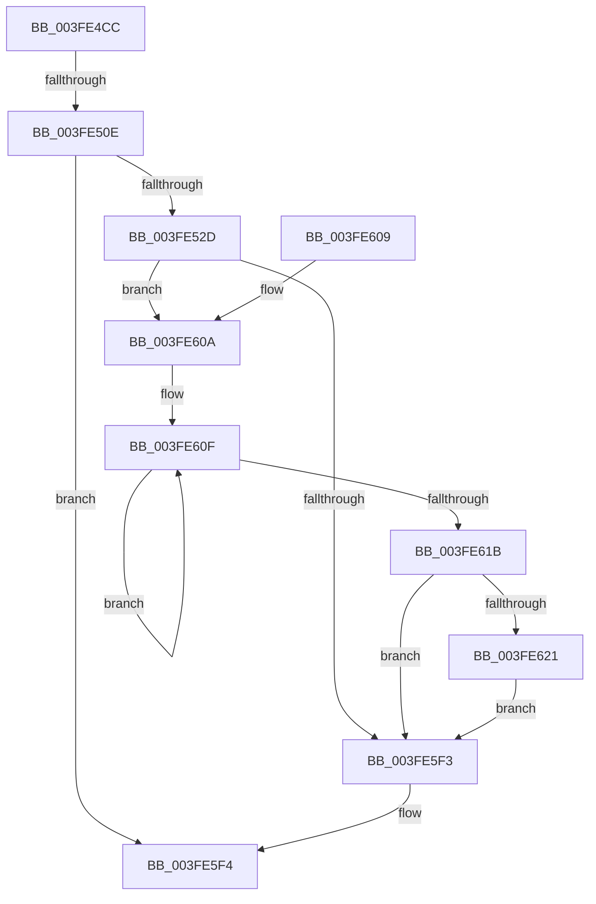

# KiInsertNewDpcRuntime

- RVA: `0x003FE4CC`–`0x003FE628` (길이 `348` bytes)
- VA: `0x00000001403FE4CC`
- 실행 섹션: `.text`
- PDB 이름 있음: `예`; PDB Function 태그: `예`
- unwind 정보 RVA: `0x00099EA0`
- 디코드: `101`개 명령, `348/348` bytes 표시
- 미해석 바이트: `0` (있으면 어셈블리에 `.byte`로 보존)

> 이 문서는 커널 이미지의 기계어와 PDB 기호를 분석해 생성했습니다. 4번과 5번은 함수 원형과 자료형을 바이너리 사용 방식에서 추정한 C 해석이며 원본 소스 복구 결과는 아닙니다.

## 1. Dependencies

- 직접 호출 지점: **4**; 고유 호출 대상: **4**
- 직접 호출자로 확인된 함수: **1**
- RIP 상대 이미지 참조: **0**

### Outgoing calls
- `0x003FE51C` → [ExAllocatePool2](../../poolcode/B8/ExAllocatePool2_function_00B820F0.md) (function, `0x00B820F0`)
- `0x003FE544` → [KeAcquireSpinLockAtDpcLevel](../20/KeAcquireSpinLockAtDpcLevel_function_00208430.md) (function, `0x00208430`)
- `0x003FE5D9` → [KxReleaseSpinLock](../20/KxReleaseSpinLock_function_00206670.md) (function, `0x00206670`)
- `0x003FE621` → [KiRemoveSystemWorkPriorityKick](../26/KiRemoveSystemWorkPriorityKick_function_002631D0.md) (function, `0x002631D0`)

### Direct callers
- [KiExecuteAllDpcs](../25/KiExecuteAllDpcs_function_0025B740.md) at `0x0025C739`

### Static image references
- 디코드된 RIP-relative 메모리 참조가 없습니다.

## 2. Other-region calls and transfers

- 다른 실행 섹션으로 향하는 call: **1**
  - `0x003FE51C` → [ExAllocatePool2](../../poolcode/B8/ExAllocatePool2_function_00B820F0.md) (`.text` → `POOLCODE`)
- call이 아닌 외부 분기/꼬리 이동: **1**
  - `0x003FE508` → [sub_006EBEFC](../6E/Unknown_function_006EBEFC.md) (`tail-transfer`)

## 3. Assembly (complete function range)

```asm
003FE4CC  48 89 5C 24 18                  mov qword ptr [rsp + 0x18], rbx
003FE4D1  48 89 54 24 10                  mov qword ptr [rsp + 0x10], rdx
003FE4D6  55                              push rbp
003FE4D7  56                              push rsi
003FE4D8  57                              push rdi
003FE4D9  41 54                           push r12
003FE4DB  41 55                           push r13
003FE4DD  41 56                           push r14
003FE4DF  41 57                           push r15
003FE4E1  48 83 EC 20                     sub rsp, 0x20
003FE4E5  65 4C 8B 3C 25 20 00 00 00      mov r15, qword ptr gs:[0x20]
003FE4EE  49 83 CC FF                     or r12, 0xffffffffffffffff
003FE4F2  8B 59 04                        mov ebx, dword ptr [rcx + 4]
003FE4F5  33 ED                           xor ebp, ebp
003FE4F7  C1 EB 05                        shr ebx, 5
003FE4FA  4D 8B E8                        mov r13, r8
003FE4FD  48 8B FA                        mov rdi, rdx
003FE500  48 8B F1                        mov rsi, rcx
003FE503  8D 04 1B                        lea eax, [rbx + rbx]
003FE506  39 01                           cmp dword ptr [rcx], eax
003FE508  0F 83 EE D9 2E 00               jae 0x1406ebefc
003FE50E  BA 20 00 00 00                  mov edx, 0x20
003FE513  41 B8 44 72 68 74               mov r8d, 0x74687244
003FE519  8D 4A 20                        lea ecx, [rdx + 0x20]
003FE51C  E8 CF 3B 78 00                  call 0x140b820f0
003FE521  4C 8B F0                        mov r14, rax
003FE524  48 85 C0                        test rax, rax
003FE527  0F 84 C7 00 00 00               je 0x1403fe5f4
003FE52D  48 89 78 08                     mov qword ptr [rax + 8], rdi
003FE531  4C 89 68 10                     mov qword ptr [rax + 0x10], r13
003FE535  C6 40 18 01                     mov byte ptr [rax + 0x18], 1
003FE539  FA                              cli
003FE53A  49 8D 9F 50 38 00 00            lea rbx, [r15 + 0x3850]
003FE541  48 8B CB                        mov rcx, rbx
003FE544  E8 E7 9E E0 FF                  call 0x140208430
003FE549  8B 7E 04                        mov edi, dword ptr [rsi + 4]
003FE54C  8B CF                           mov ecx, edi
003FE54E  83 E1 1F                        and ecx, 0x1f
003FE551  C1 EF 05                        shr edi, 5
003FE554  49 D3 E4                        shl r12, cl
003FE557  FF CF                           dec edi
003FE559  4D 23 66 08                     and r12, qword ptr [r14 + 8]
003FE55D  4C 89 64 24 78                  mov qword ptr [rsp + 0x78], r12
003FE562  41 0F B6 C4                     movzx eax, r12b
003FE566  48 05 CB 5D B1 00               add rax, 0xb15dcb
003FE56C  48 6B C8 25                     imul rcx, rax, 0x25
003FE570  0F B6 44 24 79                  movzx eax, byte ptr [rsp + 0x79]
003FE575  48 03 C8                        add rcx, rax
003FE578  0F B6 44 24 7A                  movzx eax, byte ptr [rsp + 0x7a]
003FE57D  48 6B D1 25                     imul rdx, rcx, 0x25
003FE581  48 03 D0                        add rdx, rax
003FE584  0F B6 44 24 7B                  movzx eax, byte ptr [rsp + 0x7b]
003FE589  48 6B CA 25                     imul rcx, rdx, 0x25
003FE58D  48 03 C8                        add rcx, rax
003FE590  0F B6 44 24 7C                  movzx eax, byte ptr [rsp + 0x7c]
003FE595  48 6B D1 25                     imul rdx, rcx, 0x25
003FE599  48 03 D0                        add rdx, rax
003FE59C  0F B6 44 24 7D                  movzx eax, byte ptr [rsp + 0x7d]
003FE5A1  48 6B CA 25                     imul rcx, rdx, 0x25
003FE5A5  48 03 C8                        add rcx, rax
003FE5A8  0F B6 44 24 7E                  movzx eax, byte ptr [rsp + 0x7e]
003FE5AD  48 6B D1 25                     imul rdx, rcx, 0x25
003FE5B1  48 8B CB                        mov rcx, rbx
003FE5B4  48 03 D0                        add rdx, rax
003FE5B7  0F B6 44 24 7F                  movzx eax, byte ptr [rsp + 0x7f]
003FE5BC  48 6B D2 25                     imul rdx, rdx, 0x25
003FE5C0  48 03 C2                        add rax, rdx
003FE5C3  48 8B 56 08                     mov rdx, qword ptr [rsi + 8]
003FE5C7  8B C0                           mov eax, eax
003FE5C9  48 23 F8                        and rdi, rax
003FE5CC  48 8B 04 FA                     mov rax, qword ptr [rdx + rdi*8]
003FE5D0  49 89 06                        mov qword ptr [r14], rax
003FE5D3  4C 89 34 FA                     mov qword ptr [rdx + rdi*8], r14
003FE5D7  FF 06                           inc dword ptr [rsi]
003FE5D9  E8 92 80 E0 FF                  call 0x140206670
003FE5DE  65 48 8B 0C 25 20 00 00 00      mov rcx, qword ptr gs:[0x20]
003FE5E7  48 8B B9 B8 8E 00 00            mov rdi, qword ptr [rcx + 0x8eb8]
003FE5EE  48 85 FF                        test rdi, rdi
003FE5F1  75 17                           jne 0x1403fe60a
003FE5F3  FB                              sti
003FE5F4  48 8B 5C 24 70                  mov rbx, qword ptr [rsp + 0x70]
003FE5F9  48 83 C4 20                     add rsp, 0x20
003FE5FD  41 5F                           pop r15
003FE5FF  41 5E                           pop r14
003FE601  41 5D                           pop r13
003FE603  41 5C                           pop r12
003FE605  5F                              pop rdi
003FE606  5E                              pop rsi
003FE607  5D                              pop rbp
003FE608  C3                              ret
003FE609  CC                              int3
003FE60A  0F 0D 0F                        prefetchw byte ptr [rdi]
003FE60D  8B 07                           mov eax, dword ptr [rdi]
003FE60F  8B D0                           mov edx, eax
003FE611  0F BA F2 15                     btr edx, 0x15
003FE615  F0 0F B1 17                     lock cmpxchg dword ptr [rdi], edx
003FE619  75 F4                           jne 0x1403fe60f
003FE61B  0F BA E0 15                     bt eax, 0x15
003FE61F  73 D2                           jae 0x1403fe5f3
003FE621  E8 AA 4B E6 FF                  call 0x1402631d0
003FE626  EB CB                           jmp 0x1403fe5f3
```

## 4. C-style interpretation (structured pseudocode)

```c
__int64 __fastcall KiInsertNewDpcRuntime(__int64 a1, __int64 a2, __int64 a3)
{
    __int64 result;
    __int64 v_r12;
    __int64 v_rbp;
    __int64 v_rbx;
    __int64 v_rdi;
    __int64 v_rsp;
    unsigned __int64 v_stack_p10;
    unsigned __int64 v_stack_p18;
    unsigned __int64 v_stack_p20;
    unsigned __int8 v_stack_p21;
    unsigned __int8 v_stack_p22;
    unsigned __int8 v_stack_p23;
    unsigned __int8 v_stack_p24;
    unsigned __int8 v_stack_p25;
    unsigned __int8 v_stack_p26;
    unsigned __int8 v_stack_p27;

    v_stack_p18 = v_rbx;
    v_stack_p10 = a2;
    v_rsp = (v_rsp) - (32);
    v_r12 = (v_r12) | (-1);
    v_rbp = 0;
    v_rbx = (unsigned int)(((unsigned int)(*(unsigned int *)(a1 + 4))) >> (5));
    result = ExAllocatePool2(32 + 32, 32, (unsigned int)(0x74687244ULL), a4);
    if (result == 0) goto loc_003FE5F4;
    *(unsigned __int64 *)(result + 8) = a2;
    *(unsigned __int64 *)(result + 16) = a3;
    *(unsigned __int8 *)(result + 24) = 1;
    result = KeAcquireSpinLockAtDpcLevel(*(unsigned __int64 *)(gs_base + (0 + 32)) + 14416, 32, (unsigned int)(0x74687244ULL), a4);
    a1 = (unsigned int)(((unsigned int)((unsigned int)((unsigned int)(*(unsigned int *)(a1 + 4))))) & (31));
    v_rdi = (unsigned int)(((unsigned int)(*(unsigned int *)(a1 + 4))) >> (5));
    v_r12 = (v_r12) << ((unsigned __int8)(a1));
    v_rdi = (unsigned int)((v_rdi) - 1);
    v_r12 = (v_r12) & (*(unsigned __int64 *)(result + 8));
    v_stack_p20 = v_r12;
    result = ((unsigned __int8)(v_r12)) + (0xB15DCBULL);
    a1 = (a1) * (result);
    a1 = (a1) + (v_stack_p21);
    a2 = (32) * (a1);
    a2 = (a2) + (v_stack_p22);
    a1 = (a1) * (a2);
    a1 = (a1) + (v_stack_p23);
    a2 = (a2) * (a1);
    a2 = (a2) + (v_stack_p24);
    a1 = (a1) * (a2);
    a1 = (a1) + (v_stack_p25);
    a2 = (a2) * (a1);
    a2 = (a2) + (v_stack_p26);
    a2 = (a2) * (a2);
    result = (v_stack_p27) + (a2);
    v_rdi = (v_rdi) & ((unsigned int)((unsigned int)(result)));
    *(unsigned __int64 *)(result) = *(unsigned __int64 *)(*(unsigned __int64 *)(a1 + 8) + v_rdi * 8);
    *(unsigned __int64 *)(*(unsigned __int64 *)(a1 + 8) + v_rdi * 8) = result;
    result = KxReleaseSpinLock(*(unsigned __int64 *)(gs_base + (0 + 32)) + 14416, *(unsigned __int64 *)(a1 + 8), (unsigned int)(0x74687244ULL), a4);
    if (*(unsigned __int64 *)(*(unsigned __int64 *)(gs_base + (0 + 32)) + 36536) != 0) goto loc_003FE60A;
loc_003FE5F3:
loc_003FE5F4:
    v_rsp = (v_rsp) + (32);
    return result;
loc_003FE60A:
loc_003FE60F:
    if (condition_is_not_equal) goto loc_003FE60F;
    if (condition_is_above_or_equal) goto loc_003FE5F3;
    result = KiRemoveSystemWorkPriorityKick(*(unsigned __int64 *)(gs_base + (0 + 32)), (unsigned int)((unsigned int)((unsigned int)(*(unsigned int *)(*(unsigned __int64 *)(*(unsigned __int64 *)(gs_base + (0 + 32)) + 36536))))), (unsigned int)(0x74687244ULL), a4);
    goto loc_003FE5F3;
}
```

## 5. (Beta) C Style

```c
int64_t KiInsertNewDpcRuntime(void *Arg1, int64_t Arg2, int64_t Arg3)
{
    uint8_t *arg1 = (uint8_t *)Arg1;

    int64_t result;
    int64_t local_r12;
    int64_t local_rbp;
    int64_t local_rbx;
    int64_t local_rdi;
    int64_t local_rsp;
    uint64_t v_stack_p10;
    uint64_t v_stack_p18;
    uint64_t v_stack_p20;
    uint8_t v_stack_p21;
    uint8_t v_stack_p22;
    uint8_t v_stack_p23;
    uint8_t v_stack_p24;
    uint8_t v_stack_p25;
    uint8_t v_stack_p26;
    uint8_t v_stack_p27;

    v_stack_p18 = local_rbx;
    v_stack_p10 = Arg2;
    local_rsp = (local_rsp) - (32);
    local_r12 = (local_r12) | (-1);
    local_rbp = 0;
    local_rbx = (uint32_t)(((uint32_t)(*(uint32_t *)(arg1 + 0x4))) >> (5));
    result = ExAllocatePool2(32 + 32, 32, (uint32_t)(0x74687244ULL), a4);
    if (result == 0) goto loc_003FE5F4;
    *(uint64_t *)(result + 0x8) = Arg2;
    *(uint64_t *)(result + 0x10) = Arg3;
    *(uint8_t *)(result + 0x18) = 1;
    result = KeAcquireSpinLockAtDpcLevel(*(uint64_t *)(gs_base + (0 + 0x20)) + 14416, 32, (uint32_t)(0x74687244ULL), a4);
    Arg1 = (uint32_t)(((uint32_t)((uint32_t)((uint32_t)(*(uint32_t *)(arg1 + 0x4))))) & (31));
    local_rdi = (uint32_t)(((uint32_t)(*(uint32_t *)(arg1 + 0x4))) >> (5));
    local_r12 = (local_r12) << ((uint8_t)(Arg1));
    local_rdi = (uint32_t)((local_rdi) - 1);
    local_r12 = (local_r12) & (*(uint64_t *)(result + 0x8));
    v_stack_p20 = local_r12;
    result = ((uint8_t)(local_r12)) + (0xB15DCBULL);
    Arg1 = (Arg1) * (result);
    Arg1 = (Arg1) + (v_stack_p21);
    Arg2 = (32) * (Arg1);
    Arg2 = (Arg2) + (v_stack_p22);
    Arg1 = (Arg1) * (Arg2);
    Arg1 = (Arg1) + (v_stack_p23);
    Arg2 = (Arg2) * (Arg1);
    Arg2 = (Arg2) + (v_stack_p24);
    Arg1 = (Arg1) * (Arg2);
    Arg1 = (Arg1) + (v_stack_p25);
    Arg2 = (Arg2) * (Arg1);
    Arg2 = (Arg2) + (v_stack_p26);
    Arg2 = (Arg2) * (Arg2);
    result = (v_stack_p27) + (Arg2);
    local_rdi = (local_rdi) & ((uint32_t)((uint32_t)(result)));
    *(uint64_t *)(result) = *(uint64_t *)(*(uint64_t *)(arg1 + 0x8) + local_rdi * 8);
    *(uint64_t *)(*(uint64_t *)(arg1 + 0x8) + local_rdi * 8) = result;
    result = KxReleaseSpinLock(*(uint64_t *)(gs_base + (0 + 0x20)) + 14416, *(uint64_t *)(arg1 + 0x8), (uint32_t)(0x74687244ULL), a4);
    if (*(uint64_t *)(*(uint64_t *)(gs_base + (0 + 0x20)) + 0x8EB8) != 0) goto loc_003FE60A;
loc_003FE5F3:
loc_003FE5F4:
    local_rsp = (local_rsp) + (32);
    return result;
loc_003FE60A:
loc_003FE60F:
    if (condition_is_not_equal) goto loc_003FE60F;
    if (condition_is_above_or_equal) goto loc_003FE5F3;
    result = KiRemoveSystemWorkPriorityKick(*(uint64_t *)(gs_base + (0 + 0x20)), (uint32_t)((uint32_t)((uint32_t)(*(uint32_t *)(*(uint64_t *)(*(uint64_t *)(gs_base + (0 + 0x20)) + 0x8EB8))))), (uint32_t)(0x74687244ULL), a4);
    goto loc_003FE5F3;
}
```

### 관측된 메모리 오프셋

구조체 형식이 확인되지 않은 접근은 인자 기준의 오프셋으로만 기록했습니다.

| 기준 인자 | 오프셋 표현 | 폭 (bit) | 접근 |
|---|---:|---:|---|
| `Arg1` | `+ 0x0` | `32` | `R` |
| `Arg1` | `+ 0x0` | `32` | `R/W` |
| `Arg1` | `+ 0x4` | `32` | `R` |
| `Arg1` | `+ 0x8` | `64` | `R` |

## 6. Execution-region graph

[열기: 2D/3D 그래프와 함수 탐색 컨트롤 패널](../../../control-panel.html?section=text&rva=0x003FE4CC&view=graph)

- 2D 그래프는 위에서 아래로 흐르고, 3D 그래프는 빈 공간을 드래그해 회전합니다. Shift+드래그는 이동, 휠은 확대·축소, 함수 노드 선택은 대상 보고서 이동입니다.

### Static fallback


