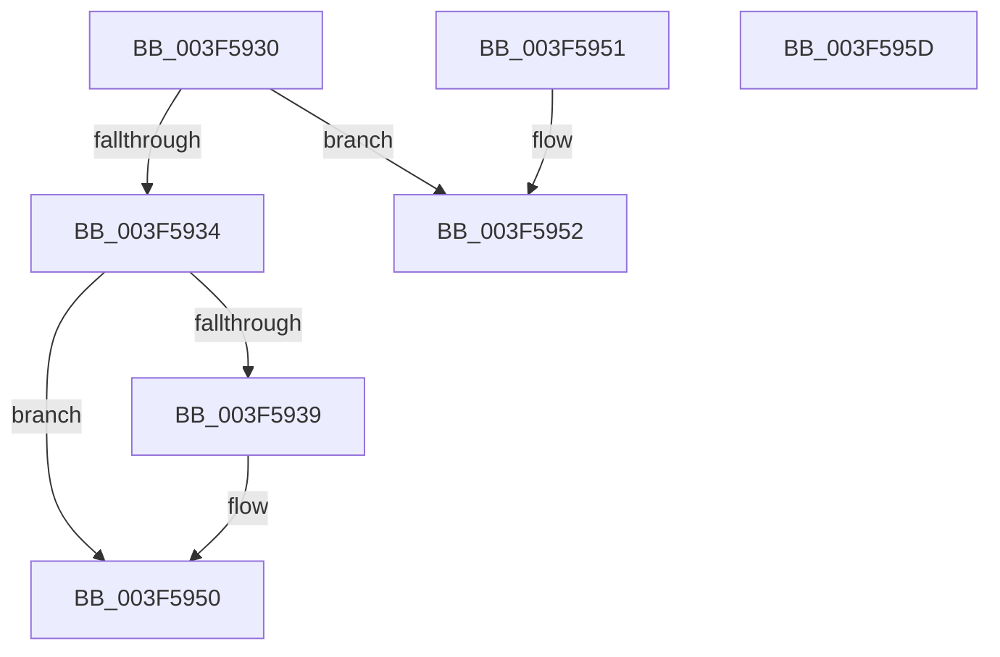

# KiPrcbArrayForIsolationWidth

- RVA: `0x003F5930`–`0x003F595E` (길이 `46` bytes)
- VA: `0x00000001403F5930`
- 실행 섹션: `.text`
- PDB 이름 있음: `예`; PDB Function 태그: `아니요`
- unwind 정보 RVA: `0x000DB714`
- 디코드: `16`개 명령, `46/46` bytes 표시
- 미해석 바이트: `0` (있으면 어셈블리에 `.byte`로 보존)

> 이 문서는 커널 이미지의 기계어와 PDB 기호를 분석해 생성했습니다. 4번과 5번은 함수 원형과 자료형을 바이너리 사용 방식에서 추정한 C 해석이며 원본 소스 복구 결과는 아닙니다.

## 1. Dependencies

- 직접 호출 지점: **0**; 고유 호출 대상: **0**
- 직접 호출자로 확인된 함수: **4**
- RIP 상대 이미지 참조: **0**

### Outgoing calls
- 직접 디코드된 call 명령이 없습니다.

### Direct callers
- [KzRefreshWorkloadProperties](../25/KzRefreshWorkloadProperties_function_002576D4.md) at `0x002577E0`
- [KiUpdateVpBackingThreadPriorityFromTopLevel](../30/KiUpdateVpBackingThreadPriorityFromTopLevel_function_00303BA0.md) at `0x00303D96`
- [KiUpdateVpBackingThreadPriorityFromTopLevel](../30/KiUpdateVpBackingThreadPriorityFromTopLevel_function_00303BA0.md) at `0x00303E00`
- [KiUpdateVPBackingThreadPriority](../30/KiUpdateVPBackingThreadPriority_function_00306040.md) at `0x0030622B`
- [KiTryUpgradeIsolationUnitLockHandle](../5B/KiTryUpgradeIsolationUnitLockHandle_function_005B23E0.md) at `0x005B2420`
- [KiTryUpgradeIsolationUnitLockHandle](../5B/KiTryUpgradeIsolationUnitLockHandle_function_005B23E0.md) at `0x005B2433`

### Static image references
- 디코드된 RIP-relative 메모리 참조가 없습니다.

## 2. Other-region calls and transfers

- 다른 실행 섹션으로 향하는 call: **0**
- 별도 외부 분기/꼬리 이동을 확인하지 못했습니다.

## 3. Assembly (complete function range)

```asm
003F5930  85 D2                           test edx, edx
003F5932  74 1E                           je 0x1403f5952
003F5934  83 FA 01                        cmp edx, 1
003F5937  75 17                           jne 0x1403f5950
003F5939  48 8B 01                        mov rax, qword ptr [rcx]
003F593C  48 8B 88 58 8E 00 00            mov rcx, qword ptr [rax + 0x8e58]
003F5943  48 8D 41 08                     lea rax, [rcx + 8]
003F5947  49 89 00                        mov qword ptr [r8], rax
003F594A  0F B6 01                        movzx eax, byte ptr [rcx]
003F594D  41 89 01                        mov dword ptr [r9], eax
003F5950  C3                              ret
003F5951  CC                              int3
003F5952  49 89 08                        mov qword ptr [r8], rcx
003F5955  41 C7 01 01 00 00 00            mov dword ptr [r9], 1
003F595C  C3                              ret
003F595D  CC                              int3
```

## 4. C-style interpretation (structured pseudocode)

```c
__int64 __fastcall KiPrcbArrayForIsolationWidth(__int64 a1, int a2, __int64 a3, __int64 a4)
{
    __int64 result;

    if (a2 == 0) goto loc_003F5952;
    if (a2 == 1) {
        result = *(unsigned __int64 *)(a1);
        a1 = *(unsigned __int64 *)(result + 36440);
        result = a1 + 8;
        *(unsigned __int64 *)(a3) = result;
        result = *(unsigned __int8 *)(a1);
        *(unsigned int *)(a4) = (unsigned int)(result);
    }
    return result;
loc_003F5952:
    *(unsigned __int64 *)(a3) = a1;
    *(unsigned int *)(a4) = 1;
    return result;
}
```

## 5. (Beta) C Style

```c
int64_t KiPrcbArrayForIsolationWidth(void *Arg1, int32_t Arg2, void *Arg3, void *Arg4)
{
    uint8_t *arg1 = (uint8_t *)Arg1;
    uint8_t *arg3 = (uint8_t *)Arg3;
    uint8_t *arg4 = (uint8_t *)Arg4;

    int64_t result;

    if (Arg2 == 0) goto loc_003F5952;
    if (Arg2 == 1) {
        result = *(uint64_t *)(arg1);
        Arg1 = *(uint64_t *)(result + 0x8E58);
        result = Arg1 + 8;
        *(uint64_t *)(arg3) = result;
        result = *(uint8_t *)(arg1);
        *(uint32_t *)(arg4) = (uint32_t)(result);
    }
    return result;
loc_003F5952:
    *(void **)(arg3) = Arg1;
    *(uint32_t *)(arg4) = 1;
    return result;
}
```

### 관측된 메모리 오프셋

구조체 형식이 확인되지 않은 접근은 인자 기준의 오프셋으로만 기록했습니다.

| 기준 인자 | 오프셋 표현 | 폭 (bit) | 접근 |
|---|---:|---:|---|
| `Arg1` | `+ 0x0` | `64` | `R` |
| `Arg3` | `+ 0x0` | `64` | `W` |
| `Arg4` | `+ 0x0` | `32` | `W` |

## 6. Execution-region graph

[열기: 2D/3D 그래프와 함수 탐색 컨트롤 패널](../../../control-panel.html?section=text&rva=0x003F5930&view=graph)

- 2D 그래프는 위에서 아래로 흐르고, 3D 그래프는 빈 공간을 드래그해 회전합니다. Shift+드래그는 이동, 휠은 확대·축소, 함수 노드 선택은 대상 보고서 이동입니다.

### Static fallback


