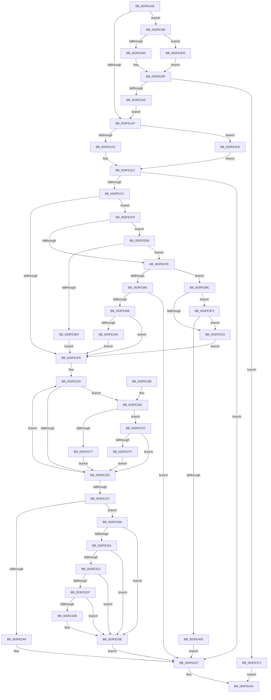

# KiSelectIdleProcessor

- RVA: `0x003FE160`–`0x003FE405` (길이 `677` bytes)
- VA: `0x00000001403FE160`
- 실행 섹션: `.text`
- PDB 이름 있음: `예`; PDB Function 태그: `아니요`
- unwind 정보 RVA: `0x00099E50`
- 디코드: `174`개 명령, `677/677` bytes 표시
- 미해석 바이트: `0` (있으면 어셈블리에 `.byte`로 보존)

> 이 문서는 커널 이미지의 기계어와 PDB 기호를 분석해 생성했습니다. 4번과 5번은 함수 원형과 자료형을 바이너리 사용 방식에서 추정한 C 해석이며 원본 소스 복구 결과는 아닙니다.

## 1. Dependencies

- 직접 호출 지점: **5**; 고유 호출 대상: **5**
- 직접 호출자로 확인된 함수: **1**
- RIP 상대 이미지 참조: **5**

### Outgoing calls
- `0x003FE1BD` → [memset](../6C/memset_function_006C6C40.md) (function, `0x006C6C40`)
- `0x003FE210` → [RtlCopyVolatileMemory](../6B/RtlCopyVolatileMemory_function_006BC9D0.md) (function, `0x006BC9D0`)
- `0x003FE252` → [_security_check_cookie](../6A/_security_check_cookie_function_006AC640.md) (function, `0x006AC640`)
- `0x003FE3AD` → [KiReduceByEffectiveIdleSmtSet](../25/KiReduceByEffectiveIdleSmtSet_function_00256E00.md) (function, `0x00256E00`)
- `0x003FE3E0` → [KiFindRankBiasedIdleSmtSet](KiFindRankBiasedIdleSmtSet_function_003FE40C.md) (function, `0x003FE40C`)

### Direct callers
- [sub_006D831E](../6D/Unknown_function_006D831E.md) at `0x006D8356`
- [sub_006D831E](../6D/Unknown_function_006D831E.md) at `0x006D83CF`
- [sub_006D831E](../6D/Unknown_function_006D831E.md) at `0x006D8636`
- [sub_006D831E](../6D/Unknown_function_006D831E.md) at `0x006D8756`
- [sub_006D831E](../6D/Unknown_function_006D831E.md) at `0x006D8A86`
- [sub_006D831E](../6D/Unknown_function_006D831E.md) at `0x006D8B0C`
- [sub_006D831E](../6D/Unknown_function_006D831E.md) at `0x006D8BBD`

### Static image references
- `0x003FE174` → RVA `0x00E0A740` (`.data`; read)
- `0x003FE18B` → RVA `0x00FC8C40` (`ALMOSTRO`; read)
- `0x003FE2F2` → RVA `0x00F231B8` (`.data`; read)
- `0x003FE322` → RVA `0x00FC5084` (`ALMOSTRO`; read)
- `0x003FE3F8` → RVA `0x00FC6D18` (`ALMOSTRO`; read)

## 2. Other-region calls and transfers

- 다른 실행 섹션으로 향하는 call: **0**
- 별도 외부 분기/꼬리 이동을 확인하지 못했습니다.

## 3. Assembly (complete function range)

```asm
003FE160  40 53                           push rbx
003FE162  55                              push rbp
003FE163  56                              push rsi
003FE164  57                              push rdi
003FE165  41 54                           push r12
003FE167  41 55                           push r13
003FE169  41 56                           push r14
003FE16B  41 57                           push r15
003FE16D  48 81 EC 88 00 00 00            sub rsp, 0x88
003FE174  48 8B 05 C5 C5 A0 00            mov rax, qword ptr [rip + 0xa0c5c5]
003FE17B  48 33 C4                        xor rax, rsp
003FE17E  48 89 44 24 70                  mov qword ptr [rsp + 0x70], rax
003FE183  4C 8B AC 24 F0 00 00 00         mov r13, qword ptr [rsp + 0xf0]
003FE18B  4C 8D 25 AE AA BC 00            lea r12, [rip + 0xbcaaae]
003FE192  4C 8B B4 24 F8 00 00 00         mov r14, qword ptr [rsp + 0xf8]
003FE19A  45 33 FF                        xor r15d, r15d
003FE19D  49 8B F9                        mov rdi, r9
003FE1A0  48 8B EA                        mov rbp, rdx
003FE1A3  48 8B D9                        mov rbx, rcx
003FE1A6  4D 85 ED                        test r13, r13
003FE1A9  0F 84 D9 00 00 00               je 0x1403fe288
003FE1AF  33 D2                           xor edx, edx
003FE1B1  48 8D 4C 24 30                  lea rcx, [rsp + 0x30]
003FE1B6  48 8B F7                        mov rsi, rdi
003FE1B9  44 8D 42 40                     lea r8d, [rdx + 0x40]
003FE1BD  E8 7E 8A 2C 00                  call 0x1406c6c40
003FE1C2  0F B7 87 88 00 00 00            movzx eax, word ptr [rdi + 0x88]
003FE1C9  66 3B 03                        cmp ax, word ptr [rbx]
003FE1CC  0F 83 F6 01 00 00               jae 0x1403fe3c8
003FE1D2  48 8B 4C C3 08                  mov rcx, qword ptr [rbx + rax*8 + 8]
003FE1D7  48 8B 77 08                     mov rsi, qword ptr [rdi + 8]
003FE1DB  49 63 46 04                     movsxd rax, dword ptr [r14 + 4]
003FE1DF  48 8B 5C C7 10                  mov rbx, qword ptr [rdi + rax*8 + 0x10]
003FE1E4  48 23 DE                        and rbx, rsi
003FE1E7  48 23 D9                        and rbx, rcx
003FE1EA  48 89 5C 24 20                  mov qword ptr [rsp + 0x20], rbx
003FE1EF  74 56                           je 0x1403fe247
003FE1F1  F6 87 B8 00 00 00 01            test byte ptr [rdi + 0xb8], 1
003FE1F8  0F 85 7B 01 00 00               jne 0x1403fe379
003FE1FE  48 8D 97 40 02 00 00            lea rdx, [rdi + 0x240]
003FE205  41 B8 40 00 00 00               mov r8d, 0x40
003FE20B  48 8D 4C 24 30                  lea rcx, [rsp + 0x30]
003FE210  E8 BB E7 2B 00                  call 0x1406bc9d0
003FE215  4D 8B C7                        mov r8, r15
003FE218  41 B2 FF                        mov r10b, 0xff
003FE21B  32 C9                           xor cl, cl
003FE21D  49 8B D7                        mov rdx, r15
003FE220  B8 01 00 00 00                  mov eax, 1
003FE225  48 D3 E0                        shl rax, cl
003FE228  48 85 C3                        test rbx, rax
003FE22B  75 3F                           jne 0x1403fe26c
003FE22D  FE C1                           inc cl
003FE22F  48 FF C2                        inc rdx
003FE232  80 F9 40                        cmp cl, 0x40
003FE235  72 E9                           jb 0x1403fe220
003FE237  4D 85 85 C8 00 00 00            test qword ptr [r13 + 0xc8], r8
003FE23E  0F 84 C6 00 00 00               je 0x1403fe30a
003FE244  4D 8B FD                        mov r15, r13
003FE247  49 8B C7                        mov rax, r15
003FE24A  48 8B 4C 24 70                  mov rcx, qword ptr [rsp + 0x70]
003FE24F  48 33 CC                        xor rcx, rsp
003FE252  E8 E9 E3 2A 00                  call 0x1406ac640
003FE257  48 81 C4 88 00 00 00            add rsp, 0x88
003FE25E  41 5F                           pop r15
003FE260  41 5E                           pop r14
003FE262  41 5D                           pop r13
003FE264  41 5C                           pop r12
003FE266  5F                              pop rdi
003FE267  5E                              pop rsi
003FE268  5D                              pop rbp
003FE269  5B                              pop rbx
003FE26A  C3                              ret
003FE26B  CC                              int3
003FE26C  44 0F B6 4C 14 30               movzx r9d, byte ptr [rsp + rdx + 0x30]
003FE272  45 3A CA                        cmp r9b, r10b
003FE275  75 06                           jne 0x1403fe27d
003FE277  49 0F AB D0                     bts r8, rdx
003FE27B  EB B0                           jmp 0x1403fe22d
003FE27D  73 AE                           jae 0x1403fe22d
003FE27F  45 0F B6 D1                     movzx r10d, r9b
003FE283  4C 8B C0                        mov r8, rax
003FE286  EB A5                           jmp 0x1403fe22d
003FE288  45 0F B7 91 88 00 00 00         movzx r10d, word ptr [r9 + 0x88]
003FE290  66 44 3B 11                     cmp r10w, word ptr [rcx]
003FE294  0F 83 36 01 00 00               jae 0x1403fe3d0
003FE29A  4E 8B 4C D1 08                  mov r9, qword ptr [rcx + r10*8 + 8]
003FE29F  4C 8B 9F 80 00 00 00            mov r11, qword ptr [rdi + 0x80]
003FE2A6  4D 23 CB                        and r9, r11
003FE2A9  0F 84 C3 00 00 00               je 0x1403fe372
003FE2AF  49 8B 80 C0 00 00 00            mov rax, qword ptr [r8 + 0xc0]
003FE2B6  44 89 7C 24 20                  mov dword ptr [rsp + 0x20], r15d
003FE2BB  44 89 7C 24 20                  mov dword ptr [rsp + 0x20], r15d
003FE2C0  44 89 7C 24 20                  mov dword ptr [rsp + 0x20], r15d
003FE2C5  48 8B 88 80 00 00 00            mov rcx, qword ptr [rax + 0x80]
003FE2CC  48 0F BC D1                     bsf rdx, rcx
003FE2D0  41 0F B6 88 D1 00 00 00         movzx ecx, byte ptr [r8 + 0xd1]
003FE2D8  2B CA                           sub ecx, edx
003FE2DA  41 8B D2                        mov edx, r10d
003FE2DD  49 0F BC C3                     bsf rax, r11
003FE2E1  C1 E2 06                        shl edx, 6
003FE2E4  03 C8                           add ecx, eax
003FE2E6  83 E1 3F                        and ecx, 0x3f
003FE2E9  49 D3 C9                        ror r9, cl
003FE2EC  49 0F BC C1                     bsf rax, r9
003FE2F0  03 C8                           add ecx, eax
003FE2F2  48 8B 05 BF 4E B2 00            mov rax, qword ptr [rip + 0xb24ebf]
003FE2F9  83 E1 3F                        and ecx, 0x3f
003FE2FC  03 D1                           add edx, ecx
003FE2FE  8B 0C 90                        mov ecx, dword ptr [rax + rdx*4]
003FE301  4D 8B 2C CC                     mov r13, qword ptr [r12 + rcx*8]
003FE305  E9 A5 FE FF FF                  jmp 0x1403fe1af
003FE30A  4D 8B C8                        mov r9, r8
003FE30D  4D 23 8D 60 8E 00 00            and r9, qword ptr [r13 + 0x8e60]
003FE314  75 28                           jne 0x1403fe33e
003FE316  4D 8B C8                        mov r9, r8
003FE319  4D 23 8D 78 8E 00 00            and r9, qword ptr [r13 + 0x8e78]
003FE320  75 1C                           jne 0x1403fe33e
003FE322  8B 05 5C 6D BC 00               mov eax, dword ptr [rip + 0xbc6d5c]
003FE328  4D 8B C8                        mov r9, r8
003FE32B  A8 01                           test al, 1
003FE32D  74 0F                           je 0x1403fe33e
003FE32F  49 8B C0                        mov rax, r8
003FE332  49 23 85 70 8E 00 00            and rax, qword ptr [r13 + 0x8e70]
003FE339  74 03                           je 0x1403fe33e
003FE33B  4C 8B C8                        mov r9, rax
003FE33E  41 0F B6 8D D1 00 00 00         movzx ecx, byte ptr [r13 + 0xd1]
003FE346  41 0F B6 95 D0 00 00 00         movzx edx, byte ptr [r13 + 0xd0]
003FE34E  49 D3 C9                        ror r9, cl
003FE351  49 0F BC C1                     bsf rax, r9
003FE355  C1 E2 06                        shl edx, 6
003FE358  03 C8                           add ecx, eax
003FE35A  48 8B 05 57 4E B2 00            mov rax, qword ptr [rip + 0xb24e57]
003FE361  83 E1 3F                        and ecx, 0x3f
003FE364  03 D1                           add edx, ecx
003FE366  8B 0C 90                        mov ecx, dword ptr [rax + rdx*4]
003FE369  4D 8B 3C CC                     mov r15, qword ptr [r12 + rcx*8]
003FE36D  E9 D5 FE FF FF                  jmp 0x1403fe247
003FE372  33 C0                           xor eax, eax
003FE374  E9 D1 FE FF FF                  jmp 0x1403fe24a
003FE379  45 38 3E                        cmp byte ptr [r14], r15b
003FE37C  75 5A                           jne 0x1403fe3d8
003FE37E  48 8B 4F 18                     mov rcx, qword ptr [rdi + 0x18]
003FE382  48 8B 5C 24 20                  mov rbx, qword ptr [rsp + 0x20]
003FE387  41 0F B6 06                     movzx eax, byte ptr [r14]
003FE38B  48 23 CB                        and rcx, rbx
003FE38E  75 2C                           jne 0x1403fe3bc
003FE390  84 C0                           test al, al
003FE392  0F 85 AF FE FF FF               jne 0x1403fe247
003FE398  48 39 BD C0 00 00 00            cmp qword ptr [rbp + 0xc0], rdi
003FE39F  0F 85 59 FE FF FF               jne 0x1403fe1fe
003FE3A5  48 8D 54 24 20                  lea rdx, [rsp + 0x20]
003FE3AA  48 8B CD                        mov rcx, rbp
003FE3AD  E8 4E 8A E5 FF                  call 0x140256e00
003FE3B2  48 8B 5C 24 20                  mov rbx, qword ptr [rsp + 0x20]
003FE3B7  E9 42 FE FF FF                  jmp 0x1403fe1fe
003FE3BC  84 C0                           test al, al
003FE3BE  75 33                           jne 0x1403fe3f3
003FE3C0  48 8B D9                        mov rbx, rcx
003FE3C3  E9 36 FE FF FF                  jmp 0x1403fe1fe
003FE3C8  49 8B CF                        mov rcx, r15
003FE3CB  E9 07 FE FF FF                  jmp 0x1403fe1d7
003FE3D0  4D 8B CF                        mov r9, r15
003FE3D3  E9 C7 FE FF FF                  jmp 0x1403fe29f
003FE3D8  48 8D 54 24 20                  lea rdx, [rsp + 0x20]
003FE3DD  48 8B CF                        mov rcx, rdi
003FE3E0  E8 27 00 00 00                  call 0x1403fe40c
003FE3E5  84 C0                           test al, al
003FE3E7  74 95                           je 0x1403fe37e
003FE3E9  48 8B 5C 24 20                  mov rbx, qword ptr [rsp + 0x20]
003FE3EE  E9 0B FE FF FF                  jmp 0x1403fe1fe
003FE3F3  F3 48 0F B8 C6                  popcnt rax, rsi
003FE3F8  3B 05 1A 89 BC 00               cmp eax, dword ptr [rip + 0xbc891a]
003FE3FE  73 C0                           jae 0x1403fe3c0
003FE400  E9 42 FE FF FF                  jmp 0x1403fe247
```

## 4. C-style interpretation (structured pseudocode)

```c
__int64 __fastcall KiSelectIdleProcessor(__int64 a1, __int64 a2, __int64 a3, __int64 a4, __int64 a5, __int64 a6)
{
    __int64 result;
    __int64 v_r15;
    __int64 v_rbx;
    __int64 v_rsp;
    unsigned __int64 v_stack_m58;
    unsigned __int64 v_stack_m98;
    unsigned __int64 v_stack_mA8;
    unsigned int v_stack_p20;

    v_rsp = (v_rsp) - (136);
    result = (*(unsigned __int64 *)(v_rip + 10536389)) ^ (v_rsp);
    v_stack_m58 = result;
    v_r15 = 0;
    if (a5 == 0) goto loc_003FE288;
loc_003FE1AF:
    a2 = 0;
    result = memset(v_stack_m98, a2, a2 + 64, a4);
    if (((unsigned __int16)(*(unsigned __int16 *)(a4 + 136))) >= (*(unsigned __int16 *)(a1))) goto loc_003FE3C8;
loc_003FE1D7:
    v_rbx = (*(unsigned __int64 *)(a4 + (int)(*(unsigned int *)(a6 + 4)) * 8 + 16)) & (*(unsigned __int64 *)(a4 + 8));
    v_rbx = (v_rbx) & (*(unsigned __int64 *)(a1 + *(unsigned __int16 *)(a4 + 136) * 8 + 8));
    v_stack_mA8 = v_rbx;
    if (condition_is_equal) goto loc_003FE247;
    if (((*(unsigned __int8 *)(a4 + 184)) & (1)) != 0) goto loc_003FE379;
loc_003FE1FE:
    result = RtlCopyVolatileMemory(v_stack_m98, a4 + 576, 64, a4);
    a1 = 0;
loc_003FE220:
    result = (1) << (0);
    if (((v_rbx) & (result)) != 0) goto loc_003FE26C;
loc_003FE22D:
    a1 = (unsigned __int8)((a1) + 1);
    a2 = (0) + 1;
    if (((unsigned __int8)(a1)) < 64) goto loc_003FE220;
    if (((*(unsigned __int64 *)(a5 + 200)) & (0)) == 0) goto loc_003FE30A;
loc_003FE247:
loc_003FE24A:
    a1 = (v_stack_m58) ^ (v_rsp);
    result = _security_check_cookie(a1, a2, 0, a4);
    v_rsp = (v_rsp) + (136);
    return result;
loc_003FE26C:
    if (((unsigned __int8)(*(unsigned __int8 *)(v_rsp + a2 * 1 + 48))) != 255) goto loc_003FE27D;
    goto loc_003FE22D;
loc_003FE27D:
    if (((unsigned __int8)(*(unsigned __int8 *)(v_rsp + a2 * 1 + 48))) >= 255) goto loc_003FE22D;
    goto loc_003FE22D;
loc_003FE288:
    if (((unsigned __int16)(*(unsigned __int16 *)(*(unsigned __int8 *)(v_rsp + a2 * 1 + 48) + 136))) >= (*(unsigned __int16 *)(a1))) goto loc_003FE3D0;
loc_003FE29F:
    a4 = (*(unsigned __int64 *)(a1 + *(unsigned __int16 *)(*(unsigned __int8 *)(v_rsp + a2 * 1 + 48) + 136) * 8 + 8)) & (*(unsigned __int64 *)(a4 + 128));
    if (condition_is_equal) goto loc_003FE372;
    v_stack_p20 = (unsigned int)(a5);
    v_stack_p20 = (unsigned int)(a5);
    v_stack_p20 = (unsigned int)(a5);
    a1 = (unsigned int)((*(unsigned __int8 *)(result + 209)) - ((unsigned int)(a2)));
    a2 = (unsigned int)(((unsigned int)((unsigned int)(*(unsigned __int16 *)(*(unsigned __int8 *)(v_rsp + a2 * 1 + 48) + 136)))) << (6));
    a1 = (unsigned int)((a1) + ((unsigned int)(*(unsigned __int64 *)(result + 192))));
    a1 = (unsigned int)((a1) & (63));
    a1 = (unsigned int)((a1) + ((unsigned int)(*(unsigned __int64 *)(result + 192))));
    a1 = (unsigned int)((a1) & (63));
    a2 = (unsigned int)((a2) + ((unsigned int)(a1)));
    goto loc_003FE1AF;
loc_003FE30A:
    a4 = (result) & (*(unsigned __int64 *)(*(unsigned __int64 *)(v_rip + 12364462 + (unsigned int)(*(unsigned int *)(*(unsigned __int64 *)(v_rip + 11685567) + a2 * 4)) * 8) + 36448));
    if (condition_is_not_equal) goto loc_003FE33E;
    a4 = (result) & (*(unsigned __int64 *)(*(unsigned __int64 *)(v_rip + 12364462 + (unsigned int)(*(unsigned int *)(*(unsigned __int64 *)(v_rip + 11685567) + a2 * 4)) * 8) + 36472));
    if (condition_is_not_equal) goto loc_003FE33E;
    if ((((unsigned __int8)((unsigned int)(*(unsigned int *)(v_rip + 12348764)))) & (1)) == 0) goto loc_003FE33E;
    result = (result) & (*(unsigned __int64 *)(*(unsigned __int64 *)(v_rip + 12364462 + (unsigned int)(*(unsigned int *)(*(unsigned __int64 *)(v_rip + 11685567) + a2 * 4)) * 8) + 36464));
    if (!(condition_is_equal)) {
        a4 = result;
    }
    a2 = (unsigned int)((*(unsigned __int8 *)(*(unsigned __int64 *)(v_rip + 12364462 + (unsigned int)(*(unsigned int *)(*(unsigned __int64 *)(v_rip + 11685567) + a2 * 4)) * 8) + 208)) << (6));
    a1 = (unsigned int)((*(unsigned __int8 *)(*(unsigned __int64 *)(v_rip + 12364462 + (unsigned int)(*(unsigned int *)(*(unsigned __int64 *)(v_rip + 11685567) + a2 * 4)) * 8) + 209)) + ((unsigned int)(result)));
    a1 = (unsigned int)((a1) & (63));
    a2 = (unsigned int)((a2) + ((unsigned int)(a1)));
    goto loc_003FE247;
loc_003FE372:
    result = 0;
    goto loc_003FE24A;
loc_003FE379:
    if ((*(unsigned __int8 *)(a6)) != ((unsigned __int8)(*(unsigned __int64 *)(v_rip + 12364462 + (unsigned int)(*(unsigned int *)(*(unsigned __int64 *)(v_rip + 11685463) + a2 * 4)) * 8)))) goto loc_003FE3D8;
loc_003FE37E:
    a1 = (*(unsigned __int64 *)(a4 + 24)) & (v_stack_p20);
    if (condition_is_not_equal) goto loc_003FE3BC;
    if ((unsigned __int8)(*(unsigned __int8 *)(a6)) != 0) goto loc_003FE247;
    if ((*(unsigned __int64 *)(a2 + 192)) != a4) goto loc_003FE1FE;
    result = KiReduceByEffectiveIdleSmtSet(a2, v_stack_p20, result, a4);
    goto loc_003FE1FE;
loc_003FE3BC:
    if ((unsigned __int8)(result) != 0) goto loc_003FE3F3;
loc_003FE3C0:
    goto loc_003FE1FE;
loc_003FE3C8:
    goto loc_003FE1D7;
loc_003FE3D0:
    goto loc_003FE29F;
loc_003FE3D8:
    result = KiFindRankBiasedIdleSmtSet(a4, v_stack_p20, result, *(unsigned __int64 *)(v_rip + 12364462 + (unsigned int)(*(unsigned int *)(*(unsigned __int64 *)(v_rip + 11685463) + a2 * 4)) * 8));
    if ((unsigned __int8)(result) == 0) goto loc_003FE37E;
    goto loc_003FE1FE;
loc_003FE3F3:
    if (((unsigned int)(result)) >= (*(unsigned int *)(v_rip + 12355866))) goto loc_003FE3C0;
    goto loc_003FE247;
}
```

## 5. (Beta) C Style

```c
int64_t KiSelectIdleProcessor(void *Arg1, void *Arg2, void *Arg3, void *Arg4, int64_t Arg5, void *Arg6)
{
    uint8_t *arg1 = (uint8_t *)Arg1;
    uint8_t *arg2 = (uint8_t *)Arg2;
    uint8_t *arg3 = (uint8_t *)Arg3;
    uint8_t *arg4 = (uint8_t *)Arg4;
    uint8_t *arg6 = (uint8_t *)Arg6;

    int64_t result;
    int64_t local_r15;
    int64_t local_rbx;
    int64_t local_rsp;
    uint64_t v_stack_m58;
    uint64_t v_stack_m98;
    uint64_t v_stack_mA8;
    uint32_t v_stack_p20;

    local_rsp = (local_rsp) - (136);
    result = (*(uint64_t *)(v_rip + 0xA0C5C5)) ^ (local_rsp);
    v_stack_m58 = result;
    local_r15 = 0;
    if (Arg5 == 0) goto loc_003FE288;
loc_003FE1AF:
    Arg2 = 0;
    result = memset(v_stack_m98, Arg2, Arg2 + 64, Arg4);
    if (((uint16_t)(*(uint16_t *)(arg4 + 0x88))) >= (*(uint16_t *)(arg1))) goto loc_003FE3C8;
loc_003FE1D7:
    local_rbx = (*(uint64_t *)(arg4 + (int32_t)(*(uint32_t *)(arg6 + 0x4)) * 8 + 0x10)) & (*(uint64_t *)(arg4 + 0x8));
    local_rbx = (local_rbx) & (*(uint64_t *)(arg1 + *(uint16_t *)(arg4 + 0x88) * 8 + 0x8));
    v_stack_mA8 = local_rbx;
    if (condition_is_equal) goto loc_003FE247;
    if (((*(uint8_t *)(arg4 + 0xB8)) & (1)) != 0) goto loc_003FE379;
loc_003FE1FE:
    result = RtlCopyVolatileMemory(v_stack_m98, Arg4 + 576, 64, Arg4);
    Arg1 = 0;
loc_003FE220:
    result = (1) << (0);
    if (((local_rbx) & (result)) != 0) goto loc_003FE26C;
loc_003FE22D:
    Arg1 = (uint8_t)((Arg1) + 1);
    Arg2 = (0) + 1;
    if (((uint8_t)(Arg1)) < 64) goto loc_003FE220;
    if (((*(uint64_t *)(Arg5 + 0xC8)) & (0)) == 0) goto loc_003FE30A;
loc_003FE247:
loc_003FE24A:
    Arg1 = (v_stack_m58) ^ (local_rsp);
    result = _security_check_cookie(Arg1, Arg2, 0, Arg4);
    local_rsp = (local_rsp) + (136);
    return result;
loc_003FE26C:
    if (((uint8_t)(*(uint8_t *)(local_rsp + arg2 * 1 + 0x30))) != 255) goto loc_003FE27D;
    goto loc_003FE22D;
loc_003FE27D:
    if (((uint8_t)(*(uint8_t *)(local_rsp + arg2 * 1 + 0x30))) >= 255) goto loc_003FE22D;
    goto loc_003FE22D;
loc_003FE288:
    if (((uint16_t)(*(uint16_t *)(*(uint8_t *)(local_rsp + arg2 * 1 + 0x30) + 0x88))) >= (*(uint16_t *)(arg1))) goto loc_003FE3D0;
loc_003FE29F:
    Arg4 = (*(uint64_t *)(arg1 + *(uint16_t *)(*(uint8_t *)(local_rsp + arg2 * 1 + 0x30) + 0x88) * 8 + 0x8)) & (*(uint64_t *)(arg4 + 0x80));
    if (condition_is_equal) goto loc_003FE372;
    v_stack_p20 = (uint32_t)(Arg5);
    v_stack_p20 = (uint32_t)(Arg5);
    v_stack_p20 = (uint32_t)(Arg5);
    Arg1 = (uint32_t)((*(uint8_t *)(result + 0xD1)) - ((uint32_t)(Arg2)));
    Arg2 = (uint32_t)(((uint32_t)((uint32_t)(*(uint16_t *)(*(uint8_t *)(local_rsp + arg2 * 1 + 0x30) + 0x88)))) << (6));
    Arg1 = (uint32_t)((Arg1) + ((uint32_t)(*(uint64_t *)(result + 0xC0))));
    Arg1 = (uint32_t)((Arg1) & (63));
    Arg1 = (uint32_t)((Arg1) + ((uint32_t)(*(uint64_t *)(result + 0xC0))));
    Arg1 = (uint32_t)((Arg1) & (63));
    Arg2 = (uint32_t)((Arg2) + ((uint32_t)(Arg1)));
    goto loc_003FE1AF;
loc_003FE30A:
    Arg4 = (result) & (*(uint64_t *)(*(uint64_t *)(v_rip + 0xBCAAAE + (uint32_t)(*(uint32_t *)(*(uint64_t *)(v_rip + 0xB24EBF) + arg2 * 4)) * 8) + 0x8E60));
    if (condition_is_not_equal) goto loc_003FE33E;
    Arg4 = (result) & (*(uint64_t *)(*(uint64_t *)(v_rip + 0xBCAAAE + (uint32_t)(*(uint32_t *)(*(uint64_t *)(v_rip + 0xB24EBF) + arg2 * 4)) * 8) + 0x8E78));
    if (condition_is_not_equal) goto loc_003FE33E;
    if ((((uint8_t)((uint32_t)(*(uint32_t *)(v_rip + 0xBC6D5C)))) & (1)) == 0) goto loc_003FE33E;
    result = (result) & (*(uint64_t *)(*(uint64_t *)(v_rip + 0xBCAAAE + (uint32_t)(*(uint32_t *)(*(uint64_t *)(v_rip + 0xB24EBF) + arg2 * 4)) * 8) + 0x8E70));
    if (!(condition_is_equal)) {
        Arg4 = result;
    }
    Arg2 = (uint32_t)((*(uint8_t *)(*(uint64_t *)(v_rip + 0xBCAAAE + (uint32_t)(*(uint32_t *)(*(uint64_t *)(v_rip + 0xB24EBF) + arg2 * 4)) * 8) + 0xD0)) << (6));
    Arg1 = (uint32_t)((*(uint8_t *)(*(uint64_t *)(v_rip + 0xBCAAAE + (uint32_t)(*(uint32_t *)(*(uint64_t *)(v_rip + 0xB24EBF) + arg2 * 4)) * 8) + 0xD1)) + ((uint32_t)(result)));
    Arg1 = (uint32_t)((Arg1) & (63));
    Arg2 = (uint32_t)((Arg2) + ((uint32_t)(Arg1)));
    goto loc_003FE247;
loc_003FE372:
    result = 0;
    goto loc_003FE24A;
loc_003FE379:
    if ((*(uint8_t *)(arg6)) != ((uint8_t)(*(uint64_t *)(v_rip + 0xBCAAAE + (uint32_t)(*(uint32_t *)(*(uint64_t *)(v_rip + 0xB24E57) + arg2 * 4)) * 8)))) goto loc_003FE3D8;
loc_003FE37E:
    Arg1 = (*(uint64_t *)(arg4 + 0x18)) & (v_stack_p20);
    if (condition_is_not_equal) goto loc_003FE3BC;
    if ((uint8_t)(*(uint8_t *)(arg6)) != 0) goto loc_003FE247;
    if ((*(uint64_t *)(arg2 + 0xC0)) != Arg4) goto loc_003FE1FE;
    result = KiReduceByEffectiveIdleSmtSet(Arg2, v_stack_p20, result, Arg4);
    goto loc_003FE1FE;
loc_003FE3BC:
    if ((uint8_t)(result) != 0) goto loc_003FE3F3;
loc_003FE3C0:
    goto loc_003FE1FE;
loc_003FE3C8:
    goto loc_003FE1D7;
loc_003FE3D0:
    goto loc_003FE29F;
loc_003FE3D8:
    result = KiFindRankBiasedIdleSmtSet(Arg4, v_stack_p20, result, *(uint64_t *)(v_rip + 0xBCAAAE + (uint32_t)(*(uint32_t *)(*(uint64_t *)(v_rip + 0xB24E57) + arg2 * 4)) * 8));
    if ((uint8_t)(result) == 0) goto loc_003FE37E;
    goto loc_003FE1FE;
loc_003FE3F3:
    if (((uint32_t)(result)) >= (*(uint32_t *)(v_rip + 0xBC891A))) goto loc_003FE3C0;
    goto loc_003FE247;
}
```

### 관측된 메모리 오프셋

구조체 형식이 확인되지 않은 접근은 인자 기준의 오프셋으로만 기록했습니다.

| 기준 인자 | 오프셋 표현 | 폭 (bit) | 접근 |
|---|---:|---:|---|
| `Arg1` | `+ 0x0` | `16` | `R` |
| `Arg1` | `+ 0x8 + r10*8` | `64` | `R` |
| `Arg1` | `+ 0x8 + rax*8` | `64` | `R` |
| `Arg2` | `+ 0xC0` | `64` | `R` |
| `Arg3` | `+ 0xC0` | `64` | `R` |
| `Arg3` | `+ 0xD1` | `8` | `R` |
| `Arg4` | `+ 0x8` | `64` | `R` |
| `Arg4` | `+ 0x10 + rax*8` | `64` | `R` |
| `Arg4` | `+ 0x18` | `64` | `R` |
| `Arg4` | `+ 0x80` | `64` | `R` |
| `Arg4` | `+ 0x88` | `16` | `R` |
| `Arg4` | `+ 0xB8` | `8` | `R` |
| `Arg4` | `+ 0x240` | `64` | `R` |
| `Arg6` | `+ 0x0` | `8` | `R` |
| `Arg6` | `+ 0x4` | `32` | `R` |

## 6. Execution-region graph

[열기: 2D/3D 그래프와 함수 탐색 컨트롤 패널](../../../control-panel.html?section=text&rva=0x003FE160&view=graph)

- 2D 그래프는 위에서 아래로 흐르고, 3D 그래프는 빈 공간을 드래그해 회전합니다. Shift+드래그는 이동, 휠은 확대·축소, 함수 노드 선택은 대상 보고서 이동입니다.

### Static fallback


