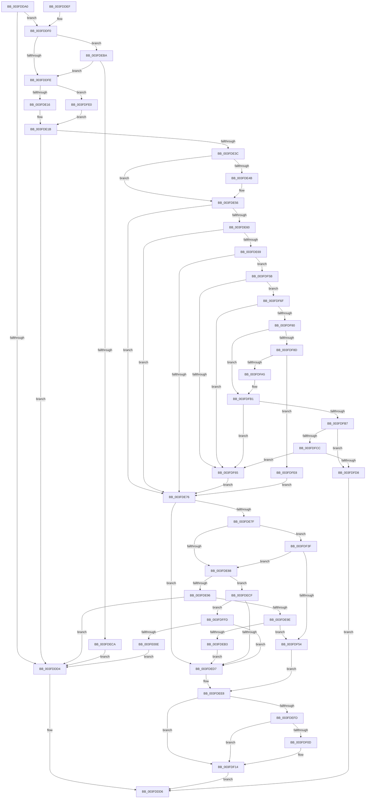

# KiTryLocalThreadSchedule

- RVA: `0x003FDDA0`–`0x003FE013` (길이 `627` bytes)
- VA: `0x00000001403FDDA0`
- 실행 섹션: `.text`
- PDB 이름 있음: `예`; PDB Function 태그: `아니요`
- unwind 정보 RVA: `0x00099DB4`
- 디코드: `147`개 명령, `627/627` bytes 표시
- 미해석 바이트: `0` (있으면 어셈블리에 `.byte`로 보존)

> 이 문서는 커널 이미지의 기계어와 PDB 기호를 분석해 생성했습니다. 4번과 5번은 함수 원형과 자료형을 바이너리 사용 방식에서 추정한 C 해석이며 원본 소스 복구 결과는 아닙니다.

## 1. Dependencies

- 직접 호출 지점: **3**; 고유 호출 대상: **3**
- 직접 호출자로 확인된 함수: **1**
- RIP 상대 이미지 참조: **5**

### Outgoing calls
- `0x003FDEA6` → [KiReduceByEffectiveIdleSmtSet](../25/KiReduceByEffectiveIdleSmtSet_function_00256E00.md) (function, `0x00256E00`)
- `0x003FDF47` → [KiFindRankBiasedIdleSmtSet](KiFindRankBiasedIdleSmtSet_function_003FE40C.md) (function, `0x003FE40C`)
- `0x003FDF9C` → [KiQueryDpcRuntimeHistory](KiQueryDpcRuntimeHistory_function_003FE020.md) (function, `0x003FE020`)

### Direct callers
- [KiChooseTargetProcessor](../25/KiChooseTargetProcessor_function_002556D8.md) at `0x00255783`

### Static image references
- `0x003FDE56` → RVA `0x00FC53C0` (`ALMOSTRO`; read)
- `0x003FDEBA` → RVA `0x00FC6DBC` (`ALMOSTRO`; read)
- `0x003FDF20` → RVA `0x00F231B8` (`.data`; read)
- `0x003FDF2C` → RVA `0x00FC8C40` (`ALMOSTRO`; read)
- `0x003FE002` → RVA `0x00FC6D18` (`ALMOSTRO`; read)

## 2. Other-region calls and transfers

- 다른 실행 섹션으로 향하는 call: **0**
- 별도 외부 분기/꼬리 이동을 확인하지 못했습니다.

## 3. Assembly (complete function range)

```asm
003FDDA0  48 89 5C 24 10                  mov qword ptr [rsp + 0x10], rbx
003FDDA5  48 89 6C 24 18                  mov qword ptr [rsp + 0x18], rbp
003FDDAA  48 89 74 24 20                  mov qword ptr [rsp + 0x20], rsi
003FDDAF  57                              push rdi
003FDDB0  41 56                           push r14
003FDDB2  41 57                           push r15
003FDDB4  48 83 EC 30                     sub rsp, 0x30
003FDDB8  48 8B 7C 24 70                  mov rdi, qword ptr [rsp + 0x70]
003FDDBD  45 33 FF                        xor r15d, r15d
003FDDC0  F6 81 BC 38 00 00 01            test byte ptr [rcx + 0x38bc], 1
003FDDC7  48 8B F2                        mov rsi, rdx
003FDDCA  48 8B D9                        mov rbx, rcx
003FDDCD  4C 89 7C 24 20                  mov qword ptr [rsp + 0x20], r15
003FDDD2  75 1C                           jne 0x1403fddf0
003FDDD4  33 C0                           xor eax, eax
003FDDD6  48 8B 5C 24 58                  mov rbx, qword ptr [rsp + 0x58]
003FDDDB  48 8B 6C 24 60                  mov rbp, qword ptr [rsp + 0x60]
003FDDE0  48 8B 74 24 68                  mov rsi, qword ptr [rsp + 0x68]
003FDDE5  48 83 C4 30                     add rsp, 0x30
003FDDE9  41 5F                           pop r15
003FDDEB  41 5E                           pop r14
003FDDED  5F                              pop rdi
003FDDEE  C3                              ret
003FDDEF  CC                              int3
003FDDF0  41 80 B8 83 02 00 00 0F         cmp byte ptr [r8 + 0x283], 0xf
003FDDF8  0F 85 BC 00 00 00               jne 0x1403fdeba
003FDDFE  48 8B A9 C0 00 00 00            mov rbp, qword ptr [rcx + 0xc0]
003FDE05  0F B7 85 88 00 00 00            movzx eax, word ptr [rbp + 0x88]
003FDE0C  66 41 3B 01                     cmp ax, word ptr [r9]
003FDE10  0F 83 CA 01 00 00               jae 0x1403fdfe0
003FDE16  49 8B 4C C1 08                  mov rcx, qword ptr [r9 + rax*8 + 8]
003FDE1B  4C 8B 75 08                     mov r14, qword ptr [rbp + 8]
003FDE1F  48 63 47 04                     movsxd rax, dword ptr [rdi + 4]
003FDE23  49 23 CE                        and rcx, r14
003FDE26  48 89 4C 24 50                  mov qword ptr [rsp + 0x50], rcx
003FDE2B  4C 8B 44 C5 10                  mov r8, qword ptr [rbp + rax*8 + 0x10]
003FDE30  4C 23 44 24 50                  and r8, qword ptr [rsp + 0x50]
003FDE35  4C 89 44 24 50                  mov qword ptr [rsp + 0x50], r8
003FDE3A  74 98                           je 0x1403fddd4
003FDE3C  49 8B C8                        mov rcx, r8
003FDE3F  49 8B D0                        mov rdx, r8
003FDE42  48 23 8B 70 8E 00 00            and rcx, qword ptr [rbx + 0x8e70]
003FDE49  74 0B                           je 0x1403fde56
003FDE4B  4C 8B C1                        mov r8, rcx
003FDE4E  48 89 4C 24 50                  mov qword ptr [rsp + 0x50], rcx
003FDE53  48 8B D1                        mov rdx, rcx
003FDE56  48 83 3D 62 75 BC 00 FF         cmp qword ptr [rip + 0xbc7562], -1
003FDE5E  74 16                           je 0x1403fde76
003FDE60  4C 39 BB 20 38 00 00            cmp qword ptr [rbx + 0x3820], r15
003FDE67  74 0D                           je 0x1403fde76
003FDE69  48 85 93 C8 00 00 00            test qword ptr [rbx + 0xc8], rdx
003FDE70  0F 85 E5 00 00 00               jne 0x1403fdf5b
003FDE76  F6 85 B8 00 00 00 01            test byte ptr [rbp + 0xb8], 1
003FDE7D  74 58                           je 0x1403fded7
003FDE7F  44 38 3F                        cmp byte ptr [rdi], r15b
003FDE82  0F 85 B7 00 00 00               jne 0x1403fdf3f
003FDE88  4C 8B 45 18                     mov r8, qword ptr [rbp + 0x18]
003FDE8C  0F B6 07                        movzx eax, byte ptr [rdi]
003FDE8F  4C 23 44 24 50                  and r8, qword ptr [rsp + 0x50]
003FDE94  75 39                           jne 0x1403fdecf
003FDE96  84 C0                           test al, al
003FDE98  0F 85 36 FF FF FF               jne 0x1403fddd4
003FDE9E  48 8D 54 24 50                  lea rdx, [rsp + 0x50]
003FDEA3  48 8B CB                        mov rcx, rbx
003FDEA6  E8 55 8F E5 FF                  call 0x140256e00
003FDEAB  84 C0                           test al, al
003FDEAD  0F 85 A1 00 00 00               jne 0x1403fdf54
003FDEB3  4C 8B 44 24 50                  mov r8, qword ptr [rsp + 0x50]
003FDEB8  EB 1D                           jmp 0x1403fded7
003FDEBA  8B 05 FC 8E BC 00               mov eax, dword ptr [rip + 0xbc8efc]
003FDEC0  41 39 40 54                     cmp dword ptr [r8 + 0x54], eax
003FDEC4  0F 82 34 FF FF FF               jb 0x1403fddfe
003FDECA  E9 05 FF FF FF                  jmp 0x1403fddd4
003FDECF  84 C0                           test al, al
003FDED1  0F 85 26 01 00 00               jne 0x1403fdffd
003FDED7  48 8B 83 60 8E 00 00            mov rax, qword ptr [rbx + 0x8e60]
003FDEDE  48 F7 D0                        not rax
003FDEE1  49 23 C0                        and rax, r8
003FDEE4  4C 0F 45 C0                     cmovne r8, rax
003FDEE8  0F B6 93 D0 00 00 00            movzx edx, byte ptr [rbx + 0xd0]
003FDEEF  8B 8B 54 8E 00 00               mov ecx, dword ptr [rbx + 0x8e54]
003FDEF5  38 96 D0 00 00 00               cmp byte ptr [rsi + 0xd0], dl
003FDEFB  75 17                           jne 0x1403fdf14
003FDEFD  48 8B 83 68 8E 00 00            mov rax, qword ptr [rbx + 0x8e68]
003FDF04  48 85 86 C8 00 00 00            test qword ptr [rsi + 0xc8], rax
003FDF0B  74 07                           je 0x1403fdf14
003FDF0D  0F B6 8E D1 00 00 00            movzx ecx, byte ptr [rsi + 0xd1]
003FDF14  49 D3 C8                        ror r8, cl
003FDF17  49 0F BC C0                     bsf rax, r8
003FDF1B  C1 E2 06                        shl edx, 6
003FDF1E  03 C8                           add ecx, eax
003FDF20  48 8B 05 91 52 B2 00            mov rax, qword ptr [rip + 0xb25291]
003FDF27  83 E1 3F                        and ecx, 0x3f
003FDF2A  03 D1                           add edx, ecx
003FDF2C  48 8D 0D 0D AD BC 00            lea rcx, [rip + 0xbcad0d]
003FDF33  8B 04 90                        mov eax, dword ptr [rax + rdx*4]
003FDF36  48 8B 04 C1                     mov rax, qword ptr [rcx + rax*8]
003FDF3A  E9 97 FE FF FF                  jmp 0x1403fddd6
003FDF3F  48 8D 54 24 50                  lea rdx, [rsp + 0x50]
003FDF44  48 8B CD                        mov rcx, rbp
003FDF47  E8 C0 04 00 00                  call 0x1403fe40c
003FDF4C  84 C0                           test al, al
003FDF4E  0F 84 34 FF FF FF               je 0x1403fde88
003FDF54  4C 8B 44 24 50                  mov r8, qword ptr [rsp + 0x50]
003FDF59  EB 8D                           jmp 0x1403fdee8
003FDF5B  8B 83 58 38 00 00               mov eax, dword ptr [rbx + 0x3858]
003FDF61  85 C0                           test eax, eax
003FDF63  74 0A                           je 0x1403fdf6f
003FDF65  4C 8B 44 24 50                  mov r8, qword ptr [rsp + 0x50]
003FDF6A  E9 07 FF FF FF                  jmp 0x1403fde76
003FDF6F  0F B7 83 BC 38 00 00            movzx eax, word ptr [rbx + 0x38bc]
003FDF76  66 83 E0 DF                     and ax, 0xffdf
003FDF7A  66 83 F8 01                     cmp ax, 1
003FDF7E  75 E5                           jne 0x1403fdf65
003FDF80  48 8B 8B 28 38 00 00            mov rcx, qword ptr [rbx + 0x3828]
003FDF87  48 83 F9 FF                     cmp rcx, -1
003FDF8B  75 24                           jne 0x1403fdfb1
003FDF8D  48 8B 93 20 38 00 00            mov rdx, qword ptr [rbx + 0x3820]
003FDF94  4C 8D 44 24 20                  lea r8, [rsp + 0x20]
003FDF99  48 8B CB                        mov rcx, rbx
003FDF9C  E8 7F 00 00 00                  call 0x1403fe020
003FDFA1  84 C0                           test al, al
003FDFA3  74 43                           je 0x1403fdfe8
003FDFA5  48 8B 4C 24 20                  mov rcx, qword ptr [rsp + 0x20]
003FDFAA  48 89 8B 28 38 00 00            mov qword ptr [rbx + 0x3828], rcx
003FDFB1  48 83 F9 FE                     cmp rcx, -2
003FDFB5  74 AE                           je 0x1403fdf65
003FDFB7  0F 31                           rdtsc
003FDFB9  48 C1 E2 20                     shl rdx, 0x20
003FDFBD  48 0B C2                        or rax, rdx
003FDFC0  48 2B 83 30 38 00 00            sub rax, qword ptr [rbx + 0x3830]
003FDFC7  48 3B C8                        cmp rcx, rax
003FDFCA  72 0C                           jb 0x1403fdfd8
003FDFCC  48 2B C8                        sub rcx, rax
003FDFCF  48 3B 0D EA 73 BC 00            cmp rcx, qword ptr [rip + 0xbc73ea]
003FDFD6  73 8D                           jae 0x1403fdf65
003FDFD8  48 8B C3                        mov rax, rbx
003FDFDB  E9 F6 FD FF FF                  jmp 0x1403fddd6
003FDFE0  49 8B CF                        mov rcx, r15
003FDFE3  E9 33 FE FF FF                  jmp 0x1403fde1b
003FDFE8  4C 8B 44 24 50                  mov r8, qword ptr [rsp + 0x50]
003FDFED  48 C7 83 28 38 00 00 FE FF FF FF  mov qword ptr [rbx + 0x3828], 0xfffffffffffffffe
003FDFF8  E9 79 FE FF FF                  jmp 0x1403fde76
003FDFFD  F3 49 0F B8 C6                  popcnt rax, r14
003FE002  3B 05 10 8D BC 00               cmp eax, dword ptr [rip + 0xbc8d10]
003FE008  0F 83 C9 FE FF FF               jae 0x1403fded7
003FE00E  E9 C1 FD FF FF                  jmp 0x1403fddd4
```

## 4. C-style interpretation (structured pseudocode)

```c
__int64 __fastcall KiTryLocalThreadSchedule(__int64 a1, __int64 a2, __int64 a3, __int64 a4, __int64 a5)
{
    __int64 result;
    __int64 v_r15;
    __int64 v_rsp;
    unsigned __int64 v_stack_m28;
    unsigned __int64 v_stack_p10;
    unsigned __int64 v_stack_p18;
    unsigned __int64 v_stack_p20;
    unsigned __int64 v_stack_p50;

    v_stack_p10 = v_rbx;
    v_stack_p18 = v_rbp;
    v_stack_p20 = v_rsi;
    v_rsp = (v_rsp) - (48);
    v_r15 = 0;
    v_stack_m28 = 0;
    if (((*(unsigned __int8 *)(a1 + 14524)) & (1)) != 0) goto loc_003FDDF0;
loc_003FDDD4:
    result = 0;
loc_003FDDD6:
    v_rsp = (v_rsp) + (48);
    return result;
loc_003FDDF0:
    if ((*(unsigned __int8 *)(a3 + 643)) != 15) goto loc_003FDEBA;
loc_003FDDFE:
    if (((unsigned __int16)(*(unsigned __int16 *)(*(unsigned __int64 *)(a1 + 192) + 136))) >= (*(unsigned __int16 *)(a4))) goto loc_003FDFE0;
loc_003FDE1B:
    a1 = (*(unsigned __int64 *)(a4 + *(unsigned __int16 *)(*(unsigned __int64 *)(a1 + 192) + 136) * 8 + 8)) & (*(unsigned __int64 *)(*(unsigned __int64 *)(a1 + 192) + 8));
    v_stack_p50 = a1;
    a3 = (*(unsigned __int64 *)(*(unsigned __int64 *)(a1 + 192) + (int)(*(unsigned int *)(a5 + 4)) * 8 + 16)) & (v_stack_p50);
    v_stack_p50 = a3;
    if (condition_is_equal) goto loc_003FDDD4;
    a1 = (a3) & (*(unsigned __int64 *)(v_stack_p10 + 36464));
    if (!(condition_is_equal)) {
        a3 = a1;
        v_stack_p50 = a1;
        a2 = a1;
    }
    if ((*(unsigned __int64 *)(v_rip + 12350818)) == -1) goto loc_003FDE76;
    if ((*(unsigned __int64 *)(v_stack_p10 + 14368)) == 0) goto loc_003FDE76;
    if (((*(unsigned __int64 *)(v_stack_p10 + 200)) & (a2)) != 0) goto loc_003FDF5B;
loc_003FDE76:
    if (((*(unsigned __int8 *)(*(unsigned __int64 *)(a1 + 192) + 184)) & (1)) == 0) goto loc_003FDED7;
    if ((*(unsigned __int8 *)(a5)) != 0) goto loc_003FDF3F;
loc_003FDE88:
    a3 = (*(unsigned __int64 *)(*(unsigned __int64 *)(a1 + 192) + 24)) & (v_stack_p50);
    if (condition_is_not_equal) goto loc_003FDECF;
    if ((unsigned __int8)(*(unsigned __int8 *)(a5)) != 0) goto loc_003FDDD4;
    result = KiReduceByEffectiveIdleSmtSet(v_stack_p10, v_stack_p50, a3, a4);
    if ((unsigned __int8)(result) != 0) goto loc_003FDF54;
    goto loc_003FDED7;
loc_003FDEBA:
    if ((*(unsigned int *)(v_stack_p50 + 84)) < ((unsigned int)((unsigned int)(*(unsigned int *)(v_rip + 12357372))))) goto loc_003FDDFE;
    goto loc_003FDDD4;
loc_003FDECF:
    if ((unsigned __int8)((unsigned int)(*(unsigned int *)(v_rip + 12357372))) != 0) goto loc_003FDFFD;
loc_003FDED7:
    result = ~(*(unsigned __int64 *)(v_stack_p10 + 36448));
    result = (result) & (v_stack_p50);
    a3 = v_stack_p50;
    if (condition_is_not_equal) { a3 = result; }
loc_003FDEE8:
    if ((*(unsigned __int8 *)(v_stack_p20 + 208)) != ((unsigned __int8)(*(unsigned __int8 *)(v_stack_p10 + 208)))) goto loc_003FDF14;
    if (((*(unsigned __int64 *)(v_stack_p20 + 200)) & (*(unsigned __int64 *)(v_stack_p10 + 36456))) != 0) {
        a1 = *(unsigned __int8 *)(v_stack_p20 + 209);
    }
    a2 = (unsigned int)((*(unsigned __int8 *)(v_stack_p10 + 208)) << (6));
    a1 = (unsigned int)((a1) + ((unsigned int)(*(unsigned __int64 *)(v_stack_p10 + 36456))));
    a1 = (unsigned int)((a1) & (63));
    a2 = (unsigned int)((a2) + ((unsigned int)(a1)));
    goto loc_003FDDD6;
loc_003FDF3F:
    result = KiFindRankBiasedIdleSmtSet(*(unsigned __int64 *)(a1 + 192), v_stack_p50, a3, a4);
    if ((unsigned __int8)(result) == 0) goto loc_003FDE88;
loc_003FDF54:
    goto loc_003FDEE8;
loc_003FDF5B:
    if ((unsigned int)((unsigned int)(*(unsigned int *)(v_stack_p10 + 14424))) == 0) goto loc_003FDF6F;
loc_003FDF65:
    goto loc_003FDE76;
loc_003FDF6F:
    result = (unsigned __int16)((*(unsigned __int16 *)(v_stack_p10 + 14524)) & (0xFFDFULL));
    if (((unsigned __int16)(result)) != 1) goto loc_003FDF65;
    if ((*(unsigned __int64 *)(v_stack_p10 + 14376)) != -1) goto loc_003FDFB1;
    result = KiQueryDpcRuntimeHistory(v_stack_p10, *(unsigned __int64 *)(v_stack_p10 + 14368), v_stack_p20, a4);
    if ((unsigned __int8)(result) == 0) goto loc_003FDFE8;
    *(unsigned __int64 *)(v_stack_p10 + 14376) = v_stack_p20;
loc_003FDFB1:
    if (v_stack_p20 == -2) goto loc_003FDF65;
    a2 = (*(unsigned __int64 *)(v_stack_p10 + 14368)) << (32);
    result = (result) | (a2);
    result = (result) - (*(unsigned __int64 *)(v_stack_p10 + 14384));
    if (v_stack_p20 < result) goto loc_003FDFD8;
    a1 = (v_stack_p20) - (result);
    if (a1 >= (*(unsigned __int64 *)(v_rip + 12350442))) goto loc_003FDF65;
loc_003FDFD8:
    goto loc_003FDDD6;
loc_003FDFE0:
    goto loc_003FDE1B;
loc_003FDFE8:
    *(unsigned __int64 *)(v_stack_p10 + 14376) = -2;
    goto loc_003FDE76;
loc_003FDFFD:
    if (((unsigned int)(v_stack_p10)) >= (*(unsigned int *)(v_rip + 12356880))) goto loc_003FDED7;
    goto loc_003FDDD4;
}
```

## 5. (Beta) C Style

```c
int64_t KiTryLocalThreadSchedule(void *Arg1, void *Arg2, void *Arg3, void *Arg4, void *Arg5)
{
    uint8_t *arg1 = (uint8_t *)Arg1;
    uint8_t *arg2 = (uint8_t *)Arg2;
    uint8_t *arg3 = (uint8_t *)Arg3;
    uint8_t *arg4 = (uint8_t *)Arg4;
    uint8_t *arg5 = (uint8_t *)Arg5;

    int64_t result;
    int64_t local_r15;
    int64_t local_rsp;
    uint64_t v_stack_m28;
    uint64_t v_stack_p10;
    uint64_t v_stack_p18;
    uint64_t v_stack_p20;
    uint64_t v_stack_p50;

    v_stack_p10 = local_rbx;
    v_stack_p18 = local_rbp;
    v_stack_p20 = local_rsi;
    local_rsp = (local_rsp) - (48);
    local_r15 = 0;
    v_stack_m28 = 0;
    if (((*(uint8_t *)(arg1 + 0x38BC)) & (1)) != 0) goto loc_003FDDF0;
loc_003FDDD4:
    result = 0;
loc_003FDDD6:
    local_rsp = (local_rsp) + (48);
    return result;
loc_003FDDF0:
    if ((*(uint8_t *)(arg3 + 0x283)) != 15) goto loc_003FDEBA;
loc_003FDDFE:
    if (((uint16_t)(*(uint16_t *)(*(uint64_t *)(arg1 + 0xC0) + 0x88))) >= (*(uint16_t *)(arg4))) goto loc_003FDFE0;
loc_003FDE1B:
    Arg1 = (*(uint64_t *)(arg4 + *(uint16_t *)(*(uint64_t *)(arg1 + 0xC0) + 0x88) * 8 + 0x8)) & (*(uint64_t *)(*(uint64_t *)(arg1 + 0xC0) + 0x8));
    v_stack_p50 = Arg1;
    Arg3 = (*(uint64_t *)(*(uint64_t *)(arg1 + 0xC0) + (int32_t)(*(uint32_t *)(arg5 + 0x4)) * 8 + 0x10)) & (v_stack_p50);
    v_stack_p50 = Arg3;
    if (condition_is_equal) goto loc_003FDDD4;
    Arg1 = (Arg3) & (*(uint64_t *)(v_stack_p10 + 0x8E70));
    if (!(condition_is_equal)) {
        Arg3 = Arg1;
        v_stack_p50 = Arg1;
        Arg2 = Arg1;
    }
    if ((*(uint64_t *)(v_rip + 0xBC7562)) == -1) goto loc_003FDE76;
    if ((*(uint64_t *)(v_stack_p10 + 0x3820)) == 0) goto loc_003FDE76;
    if (((*(uint64_t *)(v_stack_p10 + 0xC8)) & (Arg2)) != 0) goto loc_003FDF5B;
loc_003FDE76:
    if (((*(uint8_t *)(*(uint64_t *)(arg1 + 0xC0) + 0xB8)) & (1)) == 0) goto loc_003FDED7;
    if ((*(uint8_t *)(arg5)) != 0) goto loc_003FDF3F;
loc_003FDE88:
    Arg3 = (*(uint64_t *)(*(uint64_t *)(arg1 + 0xC0) + 0x18)) & (v_stack_p50);
    if (condition_is_not_equal) goto loc_003FDECF;
    if ((uint8_t)(*(uint8_t *)(arg5)) != 0) goto loc_003FDDD4;
    result = KiReduceByEffectiveIdleSmtSet(v_stack_p10, v_stack_p50, Arg3, Arg4);
    if ((uint8_t)(result) != 0) goto loc_003FDF54;
    goto loc_003FDED7;
loc_003FDEBA:
    if ((*(uint32_t *)(v_stack_p50 + 0x54)) < ((uint32_t)((uint32_t)(*(uint32_t *)(v_rip + 0xBC8EFC))))) goto loc_003FDDFE;
    goto loc_003FDDD4;
loc_003FDECF:
    if ((uint8_t)((uint32_t)(*(uint32_t *)(v_rip + 0xBC8EFC))) != 0) goto loc_003FDFFD;
loc_003FDED7:
    result = ~(*(uint64_t *)(v_stack_p10 + 0x8E60));
    result = (result) & (v_stack_p50);
    Arg3 = v_stack_p50;
    if (condition_is_not_equal) { Arg3 = result; }
loc_003FDEE8:
    if ((*(uint8_t *)(v_stack_p20 + 0xD0)) != ((uint8_t)(*(uint8_t *)(v_stack_p10 + 0xD0)))) goto loc_003FDF14;
    if (((*(uint64_t *)(v_stack_p20 + 0xC8)) & (*(uint64_t *)(v_stack_p10 + 0x8E68))) != 0) {
        Arg1 = *(uint8_t *)(v_stack_p20 + 0xD1);
    }
    Arg2 = (uint32_t)((*(uint8_t *)(v_stack_p10 + 0xD0)) << (6));
    Arg1 = (uint32_t)((Arg1) + ((uint32_t)(*(uint64_t *)(v_stack_p10 + 0x8E68))));
    Arg1 = (uint32_t)((Arg1) & (63));
    Arg2 = (uint32_t)((Arg2) + ((uint32_t)(Arg1)));
    goto loc_003FDDD6;
loc_003FDF3F:
    result = KiFindRankBiasedIdleSmtSet(*(uint64_t *)(arg1 + 0xC0), v_stack_p50, Arg3, Arg4);
    if ((uint8_t)(result) == 0) goto loc_003FDE88;
loc_003FDF54:
    goto loc_003FDEE8;
loc_003FDF5B:
    if ((uint32_t)((uint32_t)(*(uint32_t *)(v_stack_p10 + 0x3858))) == 0) goto loc_003FDF6F;
loc_003FDF65:
    goto loc_003FDE76;
loc_003FDF6F:
    result = (uint16_t)((*(uint16_t *)(v_stack_p10 + 0x38BC)) & (0xFFDFULL));
    if (((uint16_t)(result)) != 1) goto loc_003FDF65;
    if ((*(uint64_t *)(v_stack_p10 + 0x3828)) != -1) goto loc_003FDFB1;
    result = KiQueryDpcRuntimeHistory(v_stack_p10, *(uint64_t *)(v_stack_p10 + 0x3820), v_stack_p20, Arg4);
    if ((uint8_t)(result) == 0) goto loc_003FDFE8;
    *(uint64_t *)(v_stack_p10 + 0x3828) = v_stack_p20;
loc_003FDFB1:
    if (v_stack_p20 == -2) goto loc_003FDF65;
    Arg2 = (*(uint64_t *)(v_stack_p10 + 0x3820)) << (32);
    result = (result) | (Arg2);
    result = (result) - (*(uint64_t *)(v_stack_p10 + 0x3830));
    if (v_stack_p20 < result) goto loc_003FDFD8;
    Arg1 = (v_stack_p20) - (result);
    if (Arg1 >= (*(uint64_t *)(v_rip + 0xBC73EA))) goto loc_003FDF65;
loc_003FDFD8:
    goto loc_003FDDD6;
loc_003FDFE0:
    goto loc_003FDE1B;
loc_003FDFE8:
    *(uint64_t *)(v_stack_p10 + 0x3828) = -2;
    goto loc_003FDE76;
loc_003FDFFD:
    if (((uint32_t)(v_stack_p10)) >= (*(uint32_t *)(v_rip + 0xBC8D10))) goto loc_003FDED7;
    goto loc_003FDDD4;
}
```

### 관측된 메모리 오프셋

구조체 형식이 확인되지 않은 접근은 인자 기준의 오프셋으로만 기록했습니다.

| 기준 인자 | 오프셋 표현 | 폭 (bit) | 접근 |
|---|---:|---:|---|
| `Arg1` | `+ 0xC0` | `64` | `R` |
| `Arg1` | `+ 0xC8` | `64` | `R` |
| `Arg1` | `+ 0xD0` | `8` | `R` |
| `Arg1` | `+ 0x3820` | `64` | `R` |
| `Arg1` | `+ 0x3828` | `64` | `R` |
| `Arg1` | `+ 0x3828` | `64` | `W` |
| `Arg1` | `+ 0x3830` | `64` | `R` |
| `Arg1` | `+ 0x3858` | `32` | `R` |
| `Arg1` | `+ 0x38BC` | `8` | `R` |
| `Arg1` | `+ 0x38BC` | `16` | `R` |
| `Arg1` | `+ 0x8E54` | `32` | `R` |
| `Arg1` | `+ 0x8E60` | `64` | `R` |
| `Arg1` | `+ 0x8E68` | `64` | `R` |
| `Arg1` | `+ 0x8E70` | `64` | `R` |
| `Arg2` | `+ 0xC8` | `64` | `R` |
| `Arg2` | `+ 0xD0` | `8` | `R` |
| `Arg2` | `+ 0xD1` | `8` | `R` |
| `Arg3` | `+ 0x54` | `32` | `R` |
| `Arg3` | `+ 0x283` | `8` | `R` |
| `Arg4` | `+ 0x0` | `16` | `R` |
| `Arg4` | `+ 0x8 + rax*8` | `64` | `R` |
| `Arg5` | `+ 0x0` | `8` | `R` |
| `Arg5` | `+ 0x4` | `32` | `R` |

## 6. Execution-region graph

[열기: 2D/3D 그래프와 함수 탐색 컨트롤 패널](../../../control-panel.html?section=text&rva=0x003FDDA0&view=graph)

- 2D 그래프는 위에서 아래로 흐르고, 3D 그래프는 빈 공간을 드래그해 회전합니다. Shift+드래그는 이동, 휠은 확대·축소, 함수 노드 선택은 대상 보고서 이동입니다.

### Static fallback


