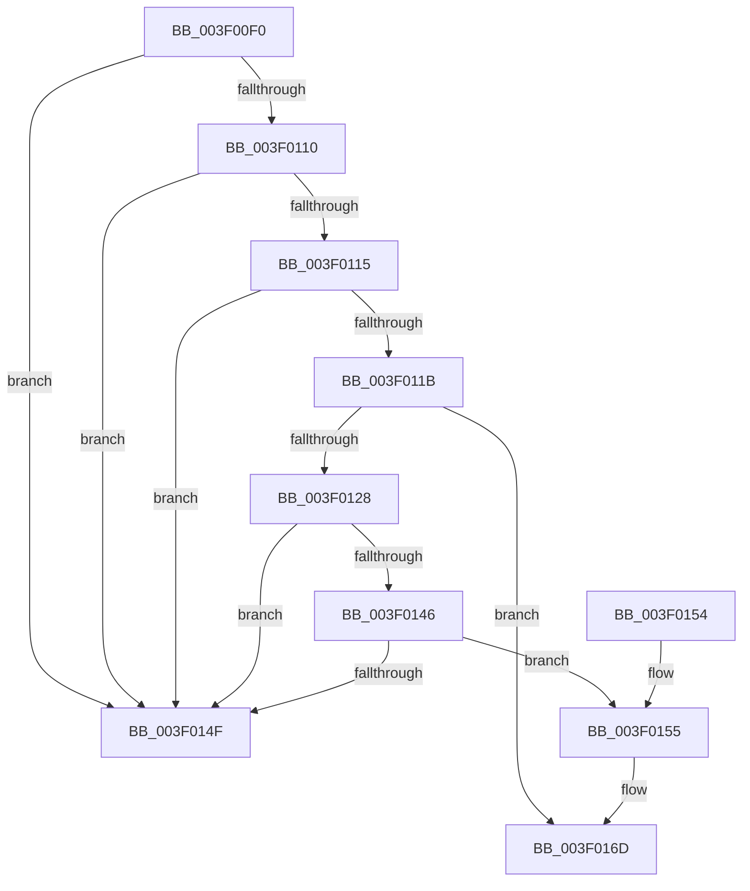

# MiCheckFatalAccessViolation

- RVA: `0x003F00F0`–`0x003F0185` (길이 `149` bytes)
- VA: `0x00000001403F00F0`
- 실행 섹션: `.text`
- PDB 이름 있음: `예`; PDB Function 태그: `아니요`
- unwind 정보 RVA: `0x00067F04`
- 디코드: `38`개 명령, `149/149` bytes 표시
- 미해석 바이트: `0` (있으면 어셈블리에 `.byte`로 보존)

> 이 문서는 커널 이미지의 기계어와 PDB 기호를 분석해 생성했습니다. 4번과 5번은 함수 원형과 자료형을 바이너리 사용 방식에서 추정한 C 해석이며 원본 소스 복구 결과는 아닙니다.

## 1. Dependencies

- 직접 호출 지점: **2**; 고유 호출 대상: **1**
- 직접 호출자로 확인된 함수: **2**
- RIP 상대 이미지 참조: **1**

### Outgoing calls
- `0x003F0167` → [KeBugCheckEx](../4F/KeBugCheckEx_function_004FD660.md) (function, `0x004FD660`)
- `0x003F017F` → [KeBugCheckEx](../4F/KeBugCheckEx_function_004FD660.md) (function, `0x004FD660`)

### Direct callers
- [MiUserFault](../32/MiUserFault_function_00329840.md) at `0x00329DE3`
- [MiInPagePageTable](../3E/MiInPagePageTable_function_003EF8DC.md) at `0x003EFC39`

### Static image references
- `0x003F0128` → RVA `0x00E30088` (`.data`; read)

## 2. Other-region calls and transfers

- 다른 실행 섹션으로 향하는 call: **0**
- 별도 외부 분기/꼬리 이동을 확인하지 못했습니다.

## 3. Assembly (complete function range)

```asm
003F00F0  48 83 EC 38                     sub rsp, 0x38
003F00F4  48 8D 81 00 00 FF FF            lea rax, [rcx - 0x10000]
003F00FB  4D 8B D0                        mov r10, r8
003F00FE  4C 8B C1                        mov r8, rcx
003F0101  48 B9 FF FF FD FF FF 7F 00 00   movabs rcx, 0x7ffffffdffff
003F010B  48 3B C1                        cmp rax, rcx
003F010E  77 3F                           ja 0x1403f014f
003F0110  48 85 D2                        test rdx, rdx
003F0113  75 3A                           jne 0x1403f014f
003F0115  41 F6 C2 02                     test r10b, 2
003F0119  74 34                           je 0x1403f014f
003F011B  41 F7 81 FC 05 00 00 00 10 00 00  test dword ptr [r9 + 0x5fc], 0x1000
003F0126  75 45                           jne 0x1403f016d
003F0128  48 8B 05 59 FF A3 00            mov rax, qword ptr [rip + 0xa3ff59]
003F012F  41 0F B7 89 AE 04 00 00         movzx ecx, word ptr [r9 + 0x4ae]
003F0137  48 8B 14 C8                     mov rdx, qword ptr [rax + rcx*8]
003F013B  8B 82 B4 04 00 00               mov eax, dword ptr [rdx + 0x4b4]
003F0141  83 F8 FF                        cmp eax, -1
003F0144  74 09                           je 0x1403f014f
003F0146  4C 39 8A A0 06 00 00            cmp qword ptr [rdx + 0x6a0], r9
003F014D  74 06                           je 0x1403f0155
003F014F  48 83 C4 38                     add rsp, 0x38
003F0153  C3                              ret
003F0154  CC                              int3
003F0155  33 C0                           xor eax, eax
003F0157  4D 8B CA                        mov r9, r10
003F015A  BA 78 44 00 00                  mov edx, 0x4478
003F015F  48 89 44 24 20                  mov qword ptr [rsp + 0x20], rax
003F0164  8D 48 1A                        lea ecx, [rax + 0x1a]
003F0167  E8 F4 D4 10 00                  call 0x1404fd660
003F016C  CC                              int3
003F016D  33 C0                           xor eax, eax
003F016F  4D 8B CA                        mov r9, r10
003F0172  BA 77 44 00 00                  mov edx, 0x4477
003F0177  48 89 44 24 20                  mov qword ptr [rsp + 0x20], rax
003F017C  8D 48 1A                        lea ecx, [rax + 0x1a]
003F017F  E8 DC D4 10 00                  call 0x1404fd660
003F0184  CC                              int3
```

## 4. C-style interpretation (structured pseudocode)

```c
__int64 __fastcall MiCheckFatalAccessViolation(__int64 a1, __int64 a2, __int64 a3, __int64 a4)
{
    __int64 result;
    __int64 v_rsp;
    unsigned __int64 v_stack_p20;

    v_rsp = (v_rsp) - (56);
    if ((a1 - 65536) > a1) goto loc_003F014F;
    if (a2 != 0) goto loc_003F014F;
    if ((((unsigned __int8)(a3)) & (2)) == 0) goto loc_003F014F;
    if (((*(unsigned int *)(a4 + 1532)) & (0x1000ULL)) != 0) goto loc_003F016D;
    if (((unsigned int)((unsigned int)(*(unsigned int *)(*(unsigned __int64 *)(*(unsigned __int64 *)(v_rip + 10747737) + *(unsigned __int16 *)(a4 + 1198) * 8) + 1204)))) == -1) goto loc_003F014F;
    if ((*(unsigned __int64 *)(*(unsigned __int64 *)(*(unsigned __int64 *)(v_rip + 10747737) + *(unsigned __int16 *)(a4 + 1198) * 8) + 1696)) == a4) goto loc_003F0155;
loc_003F014F:
    v_rsp = (v_rsp) + (56);
    return (unsigned int)(*(unsigned int *)(*(unsigned __int64 *)(*(unsigned __int64 *)(v_rip + 10747737) + *(unsigned __int16 *)(a4 + 1198) * 8) + 1204));
loc_003F0155:
    result = 0;
    v_stack_p20 = 0;
    result = KeBugCheckEx(result + 26, (unsigned int)(0x4478ULL), a1, a3);
loc_003F016D:
    result = 0;
    v_stack_p20 = 0;
    result = KeBugCheckEx(result + 26, (unsigned int)(0x4477ULL), a1, a3);
    return result;
}
```

## 5. (Beta) C Style

```c
int64_t MiCheckFatalAccessViolation(void *Arg1, int64_t Arg2, int64_t Arg3, void *Arg4)
{
    uint8_t *arg1 = (uint8_t *)Arg1;
    uint8_t *arg4 = (uint8_t *)Arg4;

    int64_t result;
    int64_t local_rsp;
    uint64_t v_stack_p20;

    local_rsp = (local_rsp) - (56);
    if ((Arg1 - 65536) > Arg1) goto loc_003F014F;
    if (Arg2 != 0) goto loc_003F014F;
    if ((((uint8_t)(Arg3)) & (2)) == 0) goto loc_003F014F;
    if (((*(uint32_t *)(arg4 + 0x5FC)) & (0x1000ULL)) != 0) goto loc_003F016D;
    if (((uint32_t)((uint32_t)(*(uint32_t *)(*(uint64_t *)(*(uint64_t *)(v_rip + 0xA3FF59) + *(uint16_t *)(arg4 + 0x4AE) * 8) + 0x4B4)))) == -1) goto loc_003F014F;
    if ((*(uint64_t *)(*(uint64_t *)(*(uint64_t *)(v_rip + 0xA3FF59) + *(uint16_t *)(arg4 + 0x4AE) * 8) + 0x6A0)) == Arg4) goto loc_003F0155;
loc_003F014F:
    local_rsp = (local_rsp) + (56);
    return (uint32_t)(*(uint32_t *)(*(uint64_t *)(*(uint64_t *)(v_rip + 0xA3FF59) + *(uint16_t *)(arg4 + 0x4AE) * 8) + 0x4B4));
loc_003F0155:
    result = 0;
    v_stack_p20 = 0;
    result = KeBugCheckEx(result + 26, (uint32_t)(0x4478ULL), Arg1, Arg3);
loc_003F016D:
    result = 0;
    v_stack_p20 = 0;
    result = KeBugCheckEx(result + 26, (uint32_t)(0x4477ULL), Arg1, Arg3);
    return result;
}
```

### 관측된 메모리 오프셋

구조체 형식이 확인되지 않은 접근은 인자 기준의 오프셋으로만 기록했습니다.

| 기준 인자 | 오프셋 표현 | 폭 (bit) | 접근 |
|---|---:|---:|---|
| `Arg1` | `- 0x10000` | `64` | `R` |
| `Arg4` | `+ 0x4AE` | `16` | `R` |
| `Arg4` | `+ 0x5FC` | `32` | `R` |

## 6. Execution-region graph

[열기: 2D/3D 그래프와 함수 탐색 컨트롤 패널](../../../control-panel.html?section=text&rva=0x003F00F0&view=graph)

- 2D 그래프는 위에서 아래로 흐르고, 3D 그래프는 빈 공간을 드래그해 회전합니다. Shift+드래그는 이동, 휠은 확대·축소, 함수 노드 선택은 대상 보고서 이동입니다.

### Static fallback


