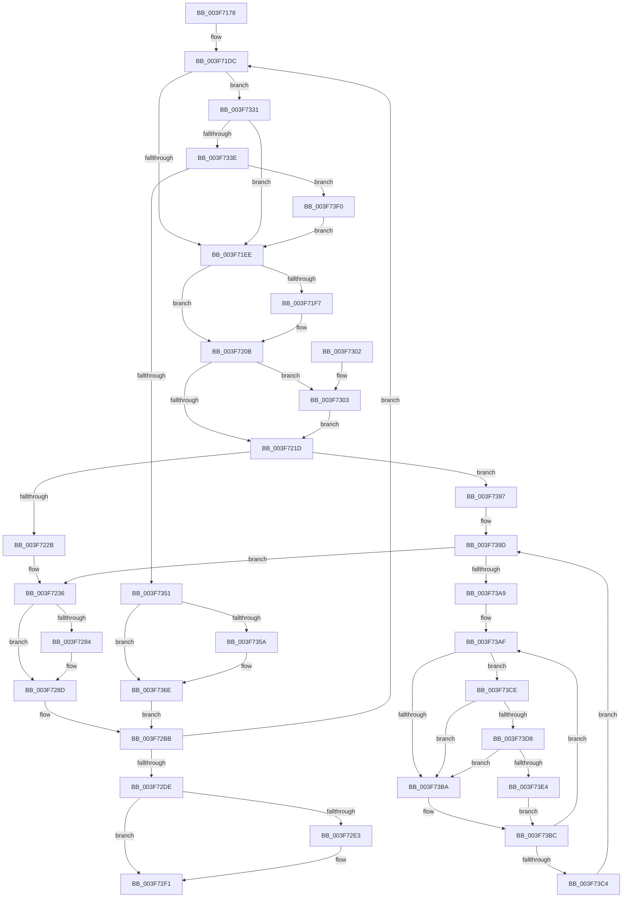

# MiFreeContiguousPages

- RVA: `0x003F7178`–`0x003F73FD` (길이 `645` bytes)
- VA: `0x00000001403F7178`
- 실행 섹션: `.text`
- PDB 이름 있음: `예`; PDB Function 태그: `아니요`
- unwind 정보 RVA: `0x000981CC`
- 디코드: `162`개 명령, `645/645` bytes 표시
- 미해석 바이트: `0` (있으면 어셈블리에 `.byte`로 보존)

> 이 문서는 커널 이미지의 기계어와 PDB 기호를 분석해 생성했습니다. 4번과 5번은 함수 원형과 자료형을 바이너리 사용 방식에서 추정한 C 해석이며 원본 소스 복구 결과는 아닙니다.

## 1. Dependencies

- 직접 호출 지점: **9**; 고유 호출 대상: **9**
- 직접 호출자로 확인된 함수: **8**
- RIP 상대 이미지 참조: **3**

### Outgoing calls
- `0x003F722E` → [MiLockPageInline](../31/MiLockPageInline_function_0031A340.md) (function, `0x0031A340`)
- `0x003F7292` → [MiDecrementShareCountEx](../33/MiDecrementShareCountEx_function_00333F70.md) (function, `0x00333F70`)
- `0x003F729D` → [MiUnlockPage](../31/MiUnlockPage_function_0031A3E0.md) (function, `0x0031A3E0`)
- `0x003F72EC` → [MiFreeLargePageCharges](MiFreeLargePageCharges_function_003F7FF0.md) (function, `0x003F7FF0`)
- `0x003F7324` → [MiUpdateLargePageBitMap](../37/MiUpdateLargePageBitMap_function_0037619C.md) (function, `0x0037619C`)
- `0x003F7344` → [MiResidentPageDangleFree](MiResidentPageDangleFree_function_003F8018.md) (function, `0x003F8018`)
- `0x003F7374` → [MiFreeLargePageMemory](../37/MiFreeLargePageMemory_function_00377938.md) (function, `0x00377938`)
- `0x003F73D8` → [KiCheckVpBackingLongSpinWaitHypercall](../30/KiCheckVpBackingLongSpinWaitHypercall_function_0030F490.md) (function, `0x0030F490`)
- `0x003F73E6` → [HvlNotifyLongSpinWait](../30/HvlNotifyLongSpinWait_function_0030F460.md) (function, `0x0030F460`)

### Direct callers
- [MiFindContiguousPagesEx](../28/MiFindContiguousPagesEx_function_0028BDE0.md) at `0x0028CAFB`
- [MiAllocateContiguousMemory](../3E/MiAllocateContiguousMemory_function_003E9FDC.md) at `0x003EA159`
- [MmFreeContiguousMemory](MmFreeContiguousMemory_function_003F6F60.md) at `0x003F70AF`
- [MmMarkPhysicalMemoryAsBad](../67/MmMarkPhysicalMemoryAsBad_function_0067AA50.md) at `0x0067AEC8`
- [MmRemovePhysicalMemory](../../page/7F/MmRemovePhysicalMemory_function_007FB560.md) at `0x007FB7C2`
- [MiRemoveMdlPages](../../page/7F/MiRemoveMdlPages_function_007FC568.md) at `0x007FC699`
- [MiCreatePagefileMemoryExtents](../../page/80/MiCreatePagefileMemoryExtents_function_0080F1BC.md) at `0x0080F374`
- [MiDeletePageFileMemoryExtents](../../page/80/MiDeletePageFileMemoryExtents_function_0080F4F8.md) at `0x0080F510`

### Static image references
- `0x003F71F7` → RVA `0x00E30088` (`.data`; read)
- `0x003F73B2` → RVA `0x00FC52AC` (`ALMOSTRO`; reference)
- `0x003F73CE` → RVA `0x00FC6AB8` (`ALMOSTRO`; read)

## 2. Other-region calls and transfers

- 다른 실행 섹션으로 향하는 call: **0**
- 별도 외부 분기/꼬리 이동을 확인하지 못했습니다.

## 3. Assembly (complete function range)

```asm
003F7178  40 53                           push rbx
003F717A  55                              push rbp
003F717B  56                              push rsi
003F717C  57                              push rdi
003F717D  41 54                           push r12
003F717F  41 55                           push r13
003F7181  41 56                           push r14
003F7183  41 57                           push r15
003F7185  48 83 EC 38                     sub rsp, 0x38
003F7189  45 33 D2                        xor r10d, r10d
003F718C  48 8D 3C 49                     lea rdi, [rcx + rcx*2]
003F7190  48 83 CD FF                     or rbp, 0xffffffffffffffff
003F7194  48 C1 E7 04                     shl rdi, 4
003F7198  41 8B DA                        mov ebx, r10d
003F719B  48 89 AC 24 98 00 00 00         mov qword ptr [rsp + 0x98], rbp
003F71A3  41 8B F2                        mov esi, r10d
003F71A6  45 8B E0                        mov r12d, r8d
003F71A9  4C 8B EA                        mov r13, rdx
003F71AC  4C 8B F9                        mov r15, rcx
003F71AF  48 B8 00 00 00 00 00 DE FF FF   movabs rax, 0xffffde0000000000
003F71B9  48 03 F8                        add rdi, rax
003F71BC  44 0F 20 C2                     mov rdx, cr8
003F71C0  41 83 CC 06                     or r12d, 6
003F71C4  48 89 94 24 88 00 00 00         mov qword ptr [rsp + 0x88], rdx
003F71CC  44 89 A4 24 90 00 00 00         mov dword ptr [rsp + 0x90], r12d
003F71D4  4C 8D 77 18                     lea r14, [rdi + 0x18]
003F71D8  45 8D 4A 01                     lea r9d, [r10 + 1]
003F71DC  48 89 5C 24 20                  mov qword ptr [rsp + 0x20], rbx
003F71E1  49 F7 C7 FF 01 00 00            test r15, 0x1ff
003F71E8  0F 84 43 01 00 00               je 0x1403f7331
003F71EE  48 8B 47 28                     mov rax, qword ptr [rdi + 0x28]
003F71F2  48 85 F6                        test rsi, rsi
003F71F5  75 14                           jne 0x1403f720b
003F71F7  48 8B 0D 8A 8E A3 00            mov rcx, qword ptr [rip + 0xa38e8a]
003F71FE  48 C1 E8 2B                     shr rax, 0x2b
003F7202  25 FF 03 00 00                  and eax, 0x3ff
003F7207  48 8B 34 C1                     mov rsi, qword ptr [rcx + rax*8]
003F720B  49 8B C7                        mov rax, r15
003F720E  48 25 00 FE FF FF               and rax, 0xfffffffffffffe00
003F7214  48 3B E8                        cmp rbp, rax
003F7217  0F 85 E6 00 00 00               jne 0x1403f7303
003F721D  80 BC 24 88 00 00 00 02         cmp byte ptr [rsp + 0x88], 2
003F7225  0F 84 6C 01 00 00               je 0x1403f7397
003F722B  48 8B CF                        mov rcx, rdi
003F722E  E8 0D 31 F2 FF                  call 0x14031a340
003F7233  40 8A E8                        mov bpl, al
003F7236  8B 4F 20                        mov ecx, dword ptr [rdi + 0x20]
003F7239  B8 FF FF 00 00                  mov eax, 0xffff
003F723E  0F B7 D1                        movzx edx, cx
003F7241  89 8C 24 80 00 00 00            mov dword ptr [rsp + 0x80], ecx
003F7248  66 03 D0                        add dx, ax
003F724B  48 8B 44 24 20                  mov rax, qword ptr [rsp + 0x20]
003F7250  66 89 94 24 80 00 00 00         mov word ptr [rsp + 0x80], dx
003F7258  8B 8C 24 80 00 00 00            mov ecx, dword ptr [rsp + 0x80]
003F725F  89 4F 20                        mov dword ptr [rdi + 0x20], ecx
003F7262  B9 01 00 00 00                  mov ecx, 1
003F7267  66 3B D1                        cmp dx, cx
003F726A  48 8D 58 01                     lea rbx, [rax + 1]
003F726E  48 B9 00 00 00 00 00 00 00 40   movabs rcx, 0x4000000000000000
003F7278  48 0F 45 D8                     cmovne rbx, rax
003F727C  49 8B 06                        mov rax, qword ptr [r14]
003F727F  48 85 C1                        test rcx, rax
003F7282  75 09                           jne 0x1403f728d
003F7284  49 8B 06                        mov rax, qword ptr [r14]
003F7287  48 0B C1                        or rax, rcx
003F728A  49 89 06                        mov qword ptr [r14], rax
003F728D  33 D2                           xor edx, edx
003F728F  48 8B CF                        mov rcx, rdi
003F7292  E8 D9 CC F3 FF                  call 0x140333f70
003F7297  40 8A D5                        mov dl, bpl
003F729A  48 8B CF                        mov rcx, rdi
003F729D  E8 3E 31 F2 FF                  call 0x14031a3e0
003F72A2  48 8B AC 24 98 00 00 00         mov rbp, qword ptr [rsp + 0x98]
003F72AA  41 BB 30 00 00 00               mov r11d, 0x30
003F72B0  48 83 CA FF                     or rdx, 0xffffffffffffffff
003F72B4  45 8D 4B D1                     lea r9d, [r11 - 0x2f]
003F72B8  45 8B C1                        mov r8d, r9d
003F72BB  49 8B CB                        mov rcx, r11
003F72BE  49 8B C3                        mov rax, r11
003F72C1  4C 03 F0                        add r14, rax
003F72C4  48 03 F9                        add rdi, rcx
003F72C7  4D 03 F8                        add r15, r8
003F72CA  45 33 D2                        xor r10d, r10d
003F72CD  4C 03 EA                        add r13, rdx
003F72D0  48 8B 94 24 88 00 00 00         mov rdx, qword ptr [rsp + 0x88]
003F72D8  0F 85 FE FE FF FF               jne 0x1403f71dc
003F72DE  48 85 DB                        test rbx, rbx
003F72E1  74 0E                           je 0x1403f72f1
003F72E3  45 8B C4                        mov r8d, r12d
003F72E6  48 8B D3                        mov rdx, rbx
003F72E9  48 8B CE                        mov rcx, rsi
003F72EC  E8 FF 0C 00 00                  call 0x1403f7ff0
003F72F1  48 83 C4 38                     add rsp, 0x38
003F72F5  41 5F                           pop r15
003F72F7  41 5E                           pop r14
003F72F9  41 5D                           pop r13
003F72FB  41 5C                           pop r12
003F72FD  5F                              pop rdi
003F72FE  5E                              pop rsi
003F72FF  5D                              pop rbp
003F7300  5B                              pop rbx
003F7301  C3                              ret
003F7302  CC                              int3
003F7303  80 FA 02                        cmp dl, 2
003F7306  48 89 84 24 98 00 00 00         mov qword ptr [rsp + 0x98], rax
003F730E  41 B9 04 00 00 00               mov r9d, 4
003F7314  41 B8 00 02 00 00               mov r8d, 0x200
003F731A  45 0F 45 CA                     cmovne r9d, r10d
003F731E  48 8B D0                        mov rdx, rax
003F7321  48 8B CE                        mov rcx, rsi
003F7324  E8 73 EE F7 FF                  call 0x14037619c
003F7329  45 33 D2                        xor r10d, r10d
003F732C  E9 EC FE FF FF                  jmp 0x1403f721d
003F7331  49 81 FD 00 02 00 00            cmp r13, 0x200
003F7338  0F 82 B0 FE FF FF               jb 0x1403f71ee
003F733E  41 8B D1                        mov edx, r9d
003F7341  49 8B CF                        mov rcx, r15
003F7344  E8 CF 0C 00 00                  call 0x1403f8018
003F7349  85 C0                           test eax, eax
003F734B  0F 84 9F 00 00 00               je 0x1403f73f0
003F7351  48 8B 47 28                     mov rax, qword ptr [rdi + 0x28]
003F7355  48 85 F6                        test rsi, rsi
003F7358  75 14                           jne 0x1403f736e
003F735A  48 8B 0D 27 8D A3 00            mov rcx, qword ptr [rip + 0xa38d27]
003F7361  48 C1 E8 2B                     shr rax, 0x2b
003F7365  25 FF 03 00 00                  and eax, 0x3ff
003F736A  48 8B 34 C1                     mov rsi, qword ptr [rcx + rax*8]
003F736E  45 8B C4                        mov r8d, r12d
003F7371  49 8B CF                        mov rcx, r15
003F7374  E8 BF 05 F8 FF                  call 0x140377938
003F7379  41 BB 00 60 00 00               mov r11d, 0x6000
003F737F  48 C7 C2 00 FE FF FF            mov rdx, 0xfffffffffffffe00
003F7386  41 B8 00 02 00 00               mov r8d, 0x200
003F738C  41 B9 01 00 00 00               mov r9d, 1
003F7392  E9 24 FF FF FF                  jmp 0x1403f72bb
003F7397  40 B5 11                        mov bpl, 0x11
003F739A  41 8B DA                        mov ebx, r10d
003F739D  F0 49 0F BA 2E 3F               lock bts qword ptr [r14], 0x3f
003F73A3  0F 83 8D FE FF FF               jae 0x1403f7236
003F73A9  41 BC 01 00 00 00               mov r12d, 1
003F73AF  41 03 DC                        add ebx, r12d
003F73B2  85 1D F4 DE BC 00               test dword ptr [rip + 0xbcdef4], ebx
003F73B8  74 14                           je 0x1403f73ce
003F73BA  F3 90                           pause
003F73BC  49 8B 06                        mov rax, qword ptr [r14]
003F73BF  48 85 C0                        test rax, rax
003F73C2  78 EB                           js 0x1403f73af
003F73C4  44 8B A4 24 90 00 00 00         mov r12d, dword ptr [rsp + 0x90]
003F73CC  EB CF                           jmp 0x1403f739d
003F73CE  8B 05 E4 F6 BC 00               mov eax, dword ptr [rip + 0xbcf6e4]
003F73D4  A8 40                           test al, 0x40
003F73D6  74 E2                           je 0x1403f73ba
003F73D8  E8 B3 80 F1 FF                  call 0x14030f490
003F73DD  45 33 D2                        xor r10d, r10d
003F73E0  84 C0                           test al, al
003F73E2  74 D6                           je 0x1403f73ba
003F73E4  8B CB                           mov ecx, ebx
003F73E6  E8 75 80 F1 FF                  call 0x14030f460
003F73EB  45 33 D2                        xor r10d, r10d
003F73EE  EB CC                           jmp 0x1403f73bc
003F73F0  48 8B 94 24 88 00 00 00         mov rdx, qword ptr [rsp + 0x88]
003F73F8  E9 F1 FD FF FF                  jmp 0x1403f71ee
```

## 4. C-style interpretation (structured pseudocode)

```c
__int64 __fastcall MiFreeContiguousPages(__int64 a1, __int64 a2, int a3)
{
    __int64 result;
    __int64 v_r10;
    __int64 v_r12;
    __int64 v_r13;
    __int64 v_r14;
    __int64 v_r15;
    __int64 v_rbp;
    __int64 v_rbx;
    __int64 v_rdi;
    __int64 v_rsi;
    __int64 v_rsp;
    unsigned __int64 v_stack_m58;
    unsigned __int64 v_stack_p10;
    unsigned int v_stack_p18;
    unsigned __int64 v_stack_p20;
    unsigned int v_stack_p8;
    unsigned __int64 v_stack_p88;
    unsigned int v_stack_p90;
    unsigned __int64 v_stack_p98;

    v_rsp = (v_rsp) - (56);
    v_r10 = 0;
    v_rbp = (v_rbp) | (-1);
    v_rdi = (a1 + a1 * 2) << (4);
    v_stack_p20 = v_rbp;
    v_rdi = (v_rdi) + (result);
    v_r12 = (unsigned int)(((unsigned int)(a3)) | (6));
    v_stack_p10 = v_cr8;
    v_stack_p18 = (unsigned int)(v_r12);
loc_003F71DC:
    v_stack_m58 = 0;
    if (((a1) & (511)) == 0) goto loc_003F7331;
loc_003F71EE:
    result = *(unsigned __int64 *)(v_rdi + 40);
    v_rsi = 0;
    if (0 == 0) {
        a1 = *(unsigned __int64 *)(v_rip + 10718858);
        result = (*(unsigned __int64 *)(v_rdi + 40)) >> (43);
        result = (unsigned int)((result) & (0x3FFULL));
        v_rsi = *(unsigned __int64 *)(a1 + result * 8);
    }
    result = (a1) & (-512);
    if (v_rbp != result) goto loc_003F7303;
loc_003F721D:
    if (v_stack_p10 == 2) goto loc_003F7397;
    result = MiLockPageInline(v_rdi, v_cr8, a3, v_r10 + 1);
loc_003F7236:
    v_stack_p8 = (unsigned int)((unsigned int)(*(unsigned int *)(v_rdi + 32)));
    a2 = (unsigned __int16)(((unsigned __int16)((unsigned int)(*(unsigned int *)(v_rdi + 32)))) + ((unsigned __int16)((unsigned int)(0xFFFFULL))));
    v_stack_p8 = (unsigned __int16)(a2);
    *(unsigned int *)(v_rdi + 32) = (unsigned int)((unsigned int)(v_stack_p8));
    v_rbx = v_stack_m58 + 1;
    if (((unsigned __int16)(a2)) != 1) { v_rbx = v_stack_m58; }
    result = *(unsigned __int64 *)(v_rdi + 24);
    if (((1) & (*(unsigned __int64 *)(v_rdi + 24))) == 0) {
        result = *(unsigned __int64 *)(v_rdi + 24);
        result = (result) | (1);
        *(unsigned __int64 *)(v_rdi + 24) = result;
    }
    a2 = 0;
    result = MiDecrementShareCountEx(v_rdi, a2, a3, v_r10 + 1);
    result = MiUnlockPage(v_rdi, (unsigned __int8)((unsigned __int8)(result)), a3, v_r10 + 1);
    a2 = ((unsigned __int8)((unsigned __int8)(result))) | (-1);
loc_003F72BB:
    v_r14 = (v_rdi + 24) + (48);
    v_rdi = (v_rdi) + (48);
    v_r15 = (a1) + ((unsigned int)((unsigned int)(48 - 47)));
    v_r10 = 0;
    v_r13 = (a2) + (a2);
    if (condition_is_not_equal) goto loc_003F71DC;
    result = 48;
    if (v_rbx != 0) {
        a3 = (unsigned int)(v_r12);
        a2 = v_rbx;
        a1 = v_rsi;
        result = MiFreeLargePageCharges(a1, a2, a3, 48 - 47);
    }
    v_rsp = (v_rsp) + (56);
    return result;
loc_003F7303:
    v_stack_p98 = result;
    a4 = 4;
    if (((unsigned __int8)(a2)) != 2) { a4 = 0; }
    result = MiUpdateLargePageBitMap(v_rsi, result, 512, a4);
    v_r10 = 0;
    goto loc_003F721D;
loc_003F7331:
    if (v_r13 < 512) goto loc_003F71EE;
    result = MiResidentPageDangleFree(v_r15, (unsigned int)((unsigned int)(a4)), 512, a4);
    if ((unsigned int)(result) == 0) goto loc_003F73F0;
    result = *(unsigned __int64 *)(v_rdi + 40);
    if (v_rsi == 0) {
        a1 = *(unsigned __int64 *)(v_rip + 10718503);
        result = (*(unsigned __int64 *)(v_rdi + 40)) >> (43);
        result = (unsigned int)((result) & (0x3FFULL));
        v_rsi = *(unsigned __int64 *)(a1 + result * 8);
    }
    result = MiFreeLargePageMemory(v_r15, (unsigned int)((unsigned int)(a4)), (unsigned int)((unsigned int)(v_r12)), a4);
    goto loc_003F72BB;
loc_003F7397:
loc_003F739D:
    if (condition_is_above_or_equal) goto loc_003F7236;
loc_003F73AF:
    v_rbx = (unsigned int)((0) + (1));
    if (((*(unsigned int *)(v_rip + 12377844)) & ((unsigned int)(v_rbx))) == 0) goto loc_003F73CE;
loc_003F73BA:
loc_003F73BC:
    if (sign_flag) goto loc_003F73AF;
    goto loc_003F739D;
loc_003F73CE:
    if ((((unsigned __int8)((unsigned int)(*(unsigned int *)(v_rip + 12383972)))) & (64)) == 0) goto loc_003F73BA;
    result = KiCheckVpBackingLongSpinWaitHypercall(v_r15, -512, 512, 1);
    v_r10 = 0;
    if ((unsigned __int8)(result) == 0) goto loc_003F73BA;
    result = HvlNotifyLongSpinWait((unsigned int)((unsigned int)(v_rbx)), -512, 512, 1);
    v_r10 = 0;
    goto loc_003F73BC;
loc_003F73F0:
    goto loc_003F71EE;
}
```

## 5. (Beta) C Style

```c
int64_t MiFreeContiguousPages(void *Arg1, int64_t Arg2, int32_t Arg3)
{
    uint8_t *arg1 = (uint8_t *)Arg1;

    int64_t result;
    int64_t local_r10;
    int64_t local_r12;
    int64_t local_r13;
    int64_t local_r14;
    int64_t local_r15;
    int64_t local_rbp;
    int64_t local_rbx;
    int64_t local_rdi;
    int64_t local_rsi;
    int64_t local_rsp;
    uint64_t v_stack_m58;
    uint64_t v_stack_p10;
    uint32_t v_stack_p18;
    uint64_t v_stack_p20;
    uint32_t v_stack_p8;
    uint64_t v_stack_p88;
    uint32_t v_stack_p90;
    uint64_t v_stack_p98;

    local_rsp = (local_rsp) - (56);
    local_r10 = 0;
    local_rbp = (local_rbp) | (-1);
    local_rdi = (Arg1 + Arg1 * 2) << (4);
    v_stack_p20 = local_rbp;
    local_rdi = (local_rdi) + (result);
    local_r12 = (uint32_t)(((uint32_t)(Arg3)) | (6));
    v_stack_p10 = v_cr8;
    v_stack_p18 = (uint32_t)(local_r12);
loc_003F71DC:
    v_stack_m58 = 0;
    if (((Arg1) & (511)) == 0) goto loc_003F7331;
loc_003F71EE:
    result = *(uint64_t *)(local_rdi + 0x28);
    local_rsi = 0;
    if (0 == 0) {
        Arg1 = *(uint64_t *)(v_rip + 0xA38E8A);
        result = (*(uint64_t *)(local_rdi + 0x28)) >> (43);
        result = (uint32_t)((result) & (0x3FFULL));
        local_rsi = *(uint64_t *)(arg1 + result * 8);
    }
    result = (Arg1) & (-512);
    if (local_rbp != result) goto loc_003F7303;
loc_003F721D:
    if (v_stack_p10 == 2) goto loc_003F7397;
    result = MiLockPageInline(local_rdi, v_cr8, Arg3, local_r10 + 1);
loc_003F7236:
    v_stack_p8 = (uint32_t)((uint32_t)(*(uint32_t *)(local_rdi + 0x20)));
    Arg2 = (uint16_t)(((uint16_t)((uint32_t)(*(uint32_t *)(local_rdi + 0x20)))) + ((uint16_t)((uint32_t)(0xFFFFULL))));
    v_stack_p8 = (uint16_t)(Arg2);
    *(uint32_t *)(local_rdi + 0x20) = (uint32_t)((uint32_t)(v_stack_p8));
    local_rbx = v_stack_m58 + 1;
    if (((uint16_t)(Arg2)) != 1) { local_rbx = v_stack_m58; }
    result = *(uint64_t *)(local_rdi + 0x18);
    if (((1) & (*(uint64_t *)(local_rdi + 0x18))) == 0) {
        result = *(uint64_t *)(local_rdi + 0x18);
        result = (result) | (1);
        *(uint64_t *)(local_rdi + 0x18) = result;
    }
    Arg2 = 0;
    result = MiDecrementShareCountEx(local_rdi, Arg2, Arg3, local_r10 + 1);
    result = MiUnlockPage(local_rdi, (uint8_t)((uint8_t)(result)), Arg3, local_r10 + 1);
    Arg2 = ((uint8_t)((uint8_t)(result))) | (-1);
loc_003F72BB:
    local_r14 = (local_rdi + 24) + (48);
    local_rdi = (local_rdi) + (48);
    local_r15 = (Arg1) + ((uint32_t)((uint32_t)(48 - 47)));
    local_r10 = 0;
    local_r13 = (Arg2) + (Arg2);
    if (condition_is_not_equal) goto loc_003F71DC;
    result = 48;
    if (local_rbx != 0) {
        Arg3 = (uint32_t)(local_r12);
        Arg2 = local_rbx;
        Arg1 = local_rsi;
        result = MiFreeLargePageCharges(Arg1, Arg2, Arg3, 48 - 47);
    }
    local_rsp = (local_rsp) + (56);
    return result;
loc_003F7303:
    v_stack_p98 = result;
    a4 = 4;
    if (((uint8_t)(Arg2)) != 2) { a4 = 0; }
    result = MiUpdateLargePageBitMap(local_rsi, result, 512, a4);
    local_r10 = 0;
    goto loc_003F721D;
loc_003F7331:
    if (local_r13 < 512) goto loc_003F71EE;
    result = MiResidentPageDangleFree(local_r15, (uint32_t)((uint32_t)(a4)), 512, a4);
    if ((uint32_t)(result) == 0) goto loc_003F73F0;
    result = *(uint64_t *)(local_rdi + 0x28);
    if (local_rsi == 0) {
        Arg1 = *(uint64_t *)(v_rip + 0xA38D27);
        result = (*(uint64_t *)(local_rdi + 0x28)) >> (43);
        result = (uint32_t)((result) & (0x3FFULL));
        local_rsi = *(uint64_t *)(arg1 + result * 8);
    }
    result = MiFreeLargePageMemory(local_r15, (uint32_t)((uint32_t)(a4)), (uint32_t)((uint32_t)(local_r12)), a4);
    goto loc_003F72BB;
loc_003F7397:
loc_003F739D:
    if (condition_is_above_or_equal) goto loc_003F7236;
loc_003F73AF:
    local_rbx = (uint32_t)((0) + (1));
    if (((*(uint32_t *)(v_rip + 0xBCDEF4)) & ((uint32_t)(local_rbx))) == 0) goto loc_003F73CE;
loc_003F73BA:
loc_003F73BC:
    if (sign_flag) goto loc_003F73AF;
    goto loc_003F739D;
loc_003F73CE:
    if ((((uint8_t)((uint32_t)(*(uint32_t *)(v_rip + 0xBCF6E4)))) & (64)) == 0) goto loc_003F73BA;
    result = KiCheckVpBackingLongSpinWaitHypercall(local_r15, -512, 512, 1);
    local_r10 = 0;
    if ((uint8_t)(result) == 0) goto loc_003F73BA;
    result = HvlNotifyLongSpinWait((uint32_t)((uint32_t)(local_rbx)), -512, 512, 1);
    local_r10 = 0;
    goto loc_003F73BC;
loc_003F73F0:
    goto loc_003F71EE;
}
```

### 관측된 메모리 오프셋

구조체 형식이 확인되지 않은 접근은 인자 기준의 오프셋으로만 기록했습니다.

| 기준 인자 | 오프셋 표현 | 폭 (bit) | 접근 |
|---|---:|---:|---|
| `Arg1` | `+ 0x0 + rcx*2` | `64` | `R` |

## 6. Execution-region graph

[열기: 2D/3D 그래프와 함수 탐색 컨트롤 패널](../../../control-panel.html?section=text&rva=0x003F7178&view=graph)

- 2D 그래프는 위에서 아래로 흐르고, 3D 그래프는 빈 공간을 드래그해 회전합니다. Shift+드래그는 이동, 휠은 확대·축소, 함수 노드 선택은 대상 보고서 이동입니다.

### Static fallback


