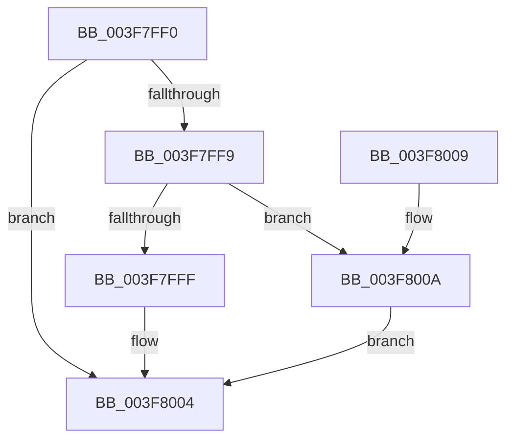

# MiFreeLargePageCharges

- RVA: `0x003F7FF0`–`0x003F8011` (길이 `33` bytes)
- VA: `0x00000001403F7FF0`
- 실행 섹션: `.text`
- PDB 이름 있음: `예`; PDB Function 태그: `아니요`
- unwind 정보 RVA: `0x0005CEE8`
- 디코드: `11`개 명령, `33/33` bytes 표시
- 미해석 바이트: `0` (있으면 어셈블리에 `.byte`로 보존)

> 이 문서는 커널 이미지의 기계어와 PDB 기호를 분석해 생성했습니다. 4번과 5번은 함수 원형과 자료형을 바이너리 사용 방식에서 추정한 C 해석이며 원본 소스 복구 결과는 아닙니다.

## 1. Dependencies

- 직접 호출 지점: **2**; 고유 호출 대상: **2**
- 직접 호출자로 확인된 함수: **4**
- RIP 상대 이미지 참조: **0**

### Outgoing calls
- `0x003F7FFF` → [MiReleaseNonPagedResources](../32/MiReleaseNonPagedResources_function_0032299C.md) (function, `0x0032299C`)
- `0x003F800A` → [MiReleaseNonPagedResourcesNotExposed](MiReleaseNonPagedResourcesNotExposed_function_003F8258.md) (function, `0x003F8258`)

### Direct callers
- [MiFinishLargePageFree](../37/MiFinishLargePageFree_function_00377B94.md) at `0x00377CE7`
- [MiFreeContiguousPages](MiFreeContiguousPages_function_003F7178.md) at `0x003F72EC`
- [MiFreeContiguousLargePageRun](../68/MiFreeContiguousLargePageRun_function_00688A34.md) at `0x00688BEA`
- [MiFreeLargeProcessPagesToCache](../69/MiFreeLargeProcessPagesToCache_function_00698F24.md) at `0x00698FE1`

### Static image references
- 디코드된 RIP-relative 메모리 참조가 없습니다.

## 2. Other-region calls and transfers

- 다른 실행 섹션으로 향하는 call: **0**
- 별도 외부 분기/꼬리 이동을 확인하지 못했습니다.

## 3. Assembly (complete function range)

```asm
003F7FF0  48 83 EC 28                     sub rsp, 0x28
003F7FF4  48 85 D2                        test rdx, rdx
003F7FF7  74 0B                           je 0x1403f8004
003F7FF9  41 F6 C0 20                     test r8b, 0x20
003F7FFD  75 0B                           jne 0x1403f800a
003F7FFF  E8 98 A9 F2 FF                  call 0x14032299c
003F8004  48 83 C4 28                     add rsp, 0x28
003F8008  C3                              ret
003F8009  CC                              int3
003F800A  E8 49 02 00 00                  call 0x1403f8258
003F800F  EB F3                           jmp 0x1403f8004
```

## 4. C-style interpretation (structured pseudocode)

```c
__int64 __fastcall MiFreeLargePageCharges(__int64 a1, __int64 a2, unsigned __int8 a3)
{
    __int64 result;
    __int64 v_rsp;

    v_rsp = (v_rsp) - (40);
    if (a2 == 0) goto loc_003F8004;
    if (((a3) & (32)) != 0) goto loc_003F800A;
    result = MiReleaseNonPagedResources(a1, a2, a3, a4);
loc_003F8004:
    v_rsp = (v_rsp) + (40);
    return result;
loc_003F800A:
    result = MiReleaseNonPagedResourcesNotExposed(a1, a2, a3, a4);
    goto loc_003F8004;
}
```

## 5. (Beta) C Style

```c
int64_t MiFreeLargePageCharges(int64_t Arg1, int64_t Arg2, uint8_t Arg3)
{
    int64_t result;
    int64_t local_rsp;

    local_rsp = (local_rsp) - (40);
    if (Arg2 == 0) goto loc_003F8004;
    if (((Arg3) & (32)) != 0) goto loc_003F800A;
    result = MiReleaseNonPagedResources(Arg1, Arg2, Arg3, a4);
loc_003F8004:
    local_rsp = (local_rsp) + (40);
    return result;
loc_003F800A:
    result = MiReleaseNonPagedResourcesNotExposed(Arg1, Arg2, Arg3, a4);
    goto loc_003F8004;
}
```

## 6. Execution-region graph

[열기: 2D/3D 그래프와 함수 탐색 컨트롤 패널](../../../control-panel.html?section=text&rva=0x003F7FF0&view=graph)

- 2D 그래프는 위에서 아래로 흐르고, 3D 그래프는 빈 공간을 드래그해 회전합니다. Shift+드래그는 이동, 휠은 확대·축소, 함수 노드 선택은 대상 보고서 이동입니다.

### Static fallback


