# MiFreePagesFromMdl

- RVA: `0x003F8300`–`0x003F87B8` (길이 `1,208` bytes)
- VA: `0x00000001403F8300`
- 실행 섹션: `.text`
- PDB 이름 있음: `예`; PDB Function 태그: `아니요`
- unwind 정보 RVA: `0x000982DC`
- 디코드: `315`개 명령, `1,208/1,208` bytes 표시
- 미해석 바이트: `0` (있으면 어셈블리에 `.byte`로 보존)

> 이 문서는 커널 이미지의 기계어와 PDB 기호를 분석해 생성했습니다. 4번과 5번은 함수 원형과 자료형을 바이너리 사용 방식에서 추정한 C 해석이며 원본 소스 복구 결과는 아닙니다.

## 1. Dependencies

- 직접 호출 지점: **20**; 고유 호출 대상: **15**
- 직접 호출자로 확인된 함수: **38**
- RIP 상대 이미지 참조: **5**

### Outgoing calls
- `0x003F8346` → [memset](../6C/memset_function_006C6C40.md) (function, `0x006C6C40`)
- `0x003F8390` → [MiRetardMdl](../40/MiRetardMdl_function_0040494C.md) (function, `0x0040494C`)
- `0x003F83A2` → [MmUnmapLockedPages](../24/MmUnmapLockedPages_function_00246E60.md) (function, `0x00246E60`)
- `0x003F8400` → [MiLogMdlRangeEvent](../67/MiLogMdlRangeEvent_function_006775E4.md) (function, `0x006775E4`)
- `0x003F841E` → [EtwTraceMdlFreeEvent](../64/EtwTraceMdlFreeEvent_function_0064FD7C.md) (function, `0x0064FD7C`)
- `0x003F84D1` → [MiPageToNode](../33/MiPageToNode_function_00338CD0.md) (function, `0x00338CD0`)
- `0x003F8505` → [KeYieldProcessorEx](KeYieldProcessorEx_function_003FBD00.md) (function, `0x003FBD00`)
- `0x003F8518` → [MiLockPageInline](../31/MiLockPageInline_function_0031A340.md) (function, `0x0031A340`)
- `0x003F8526` → [MiSetPfnIdentity](../2A/MiSetPfnIdentity_function_002A2350.md) (function, `0x002A2350`)
- `0x003F8532` → [MiUnlockPage](../31/MiUnlockPage_function_0031A3E0.md) (function, `0x0031A3E0`)
- `0x003F856B` → [MiIsPfnEnclave](../37/MiIsPfnEnclave_function_00375FF0.md) (function, `0x00375FF0`)
- `0x003F859D` → [MiIsPfnEnclave](../37/MiIsPfnEnclave_function_00375FF0.md) (function, `0x00375FF0`)
- `0x003F8634` → [MiFreeMdlPageRun](../37/MiFreeMdlPageRun_function_00375A4C.md) (function, `0x00375A4C`)
- `0x003F8655` → [MiZeroAndReleasePages](../37/MiZeroAndReleasePages_function_003748D0.md) (function, `0x003748D0`)
- `0x003F86FE` → [MiFreeMdlPageRun](../37/MiFreeMdlPageRun_function_00375A4C.md) (function, `0x00375A4C`)
- `0x003F8712` → [MiZeroAndReleasePages](../37/MiZeroAndReleasePages_function_003748D0.md) (function, `0x003748D0`)
- `0x003F8747` → [_security_check_cookie](../6A/_security_check_cookie_function_006AC640.md) (function, `0x006AC640`)
- `0x003F8776` → [KeBugCheckEx](../4F/KeBugCheckEx_function_004FD660.md) (function, `0x004FD660`)
- `0x003F8794` → [KeBugCheckEx](../4F/KeBugCheckEx_function_004FD660.md) (function, `0x004FD660`)
- `0x003F87B2` → [KeBugCheckEx](../4F/KeBugCheckEx_function_004FD660.md) (function, `0x004FD660`)

### Direct callers
- [MiFreePhysicalPageChain](../2A/MiFreePhysicalPageChain_function_002A9F1C.md) at `0x002AA1B2`
- [MiFreePhysicalPageChain](../2A/MiFreePhysicalPageChain_function_002A9F1C.md) at `0x002AA23C`
- [ST_STORE&lt;SM_TRAITS&gt;::StReleaseRegion](../3A/ST_STORE_SM_TRAITS_StReleaseRegion_function_003AF138.md) at `0x003AF254`
- [BgpFwFreeMemory](../3E/BgpFwFreeMemory_function_003E25E0.md) at `0x003E268A`
- [MmFreeSecureKernelPages](../3E/MmFreeSecureKernelPages_function_003E7A98.md) at `0x003E7BA7`
- [HalpAllocateDomainCommonBufferInternal](../3E/HalpAllocateDomainCommonBufferInternal_function_003E8B64.md) at `0x003E8FB9`
- [HalpAllocateCommonBufferDmarThin](../3E/HalpAllocateCommonBufferDmarThin_function_003E8FF0.md) at `0x003E91DF`
- [MmFreeNonChargedSecurePages](../3E/MmFreeNonChargedSecurePages_function_003E9218.md) at `0x003E9362`
- [MiFreeSecureKernelPage](../3E/MiFreeSecureKernelPage_function_003E9394.md) at `0x003E95BA`
- [EtwpAllocatePartitionMemory](../3E/EtwpAllocatePartitionMemory_function_003EB12C.md) at `0x003EB1C2`
- [EtwpFreePartitionMemory](../3E/EtwpFreePartitionMemory_function_003EBA08.md) at `0x003EBA47`
- [IopLiveDumpFreeDumpBuffers](IopLiveDumpFreeDumpBuffers_function_003F5FE8.md) at `0x003F605A`
- [HalFreeCommonBufferDmarThin](HalFreeCommonBufferDmarThin_function_003F6290.md) at `0x003F6316`
- [IopLiveDumpWriteDumpFile](IopLiveDumpWriteDumpFile_function_003F6360.md) at `0x003F64FD`
- [HalFreeCommonBufferDmaThin](HalFreeCommonBufferDmaThin_function_003F6800.md) at `0x003F6865`
- [MmFreePagesFromMdlEx](MmFreePagesFromMdlEx_function_003F8290.md) at `0x003F82AB`
- [MmFreePagesFromMdl](MmFreePagesFromMdl_function_003F82E0.md) at `0x003F82EC`
- [HalFreeCommonBufferVector](HalFreeCommonBufferVector_function_003F87C0.md) at `0x003F8881`
- [HalpDmaFreeChildAdapter](../55/HalpDmaFreeChildAdapter_function_00550E30.md) at `0x00550FB5`
- [HalpDmaFreeChildAdapter](../55/HalpDmaFreeChildAdapter_function_00550E30.md) at `0x0055108B`
- [HalFreeCommonBufferV3](../55/HalFreeCommonBufferV3_function_00551A70.md) at `0x00551B4F`
- [HvlpWithdrawPages](../58/HvlpWithdrawPages_function_00586C90.md) at `0x00586E58`
- [IopLiveDumpAllocateFromVMMemoryPartition](../59/IopLiveDumpAllocateFromVMMemoryPartition_function_0059A2D8.md) at `0x0059A4C6`
- [IopLiveDumpWriteDumpFileWithExtraPages](../59/IopLiveDumpWriteDumpFileWithExtraPages_function_0059F910.md) at `0x0059FBD6`
- [DifMmFreePagesFromMdlWrapper](../63/DifMmFreePagesFromMdlWrapper_function_00635630.md) at `0x006356FE`
- [MiReturnMdlExcess](../67/MiReturnMdlExcess_function_0067774C.md) at `0x006777F6`
- [MiFreeAwePagesFromMdl](../68/MiFreeAwePagesFromMdl_function_00688984.md) at `0x00688A0D`
- [MiFreeZeroCalibrationBuffer](../69/MiFreeZeroCalibrationBuffer_function_00699E44.md) at `0x00699EC4`
- [sub_006EA22C](../6E/Unknown_function_006EA22C.md) at `0x006EA2A0`
- [sub_006EA972](../6E/Unknown_function_006EA972.md) at `0x006EAA97`
- [sub_006EAAF4](../6E/Unknown_function_006EAAF4.md) at `0x006EAB54`
- [sub_006EABA2](../6E/Unknown_function_006EABA2.md) at `0x006EAC93`
- [sub_006EAD16](../6E/Unknown_function_006EAD16.md) at `0x006EAD99`
- [sub_006EADCA](../6E/Unknown_function_006EADCA.md) at `0x006EADF5`
- [sub_006F84D2](../6F/Unknown_function_006F84D2.md) at `0x006F8553`
- [NtFreeUserPhysicalPages](../../page/80/NtFreeUserPhysicalPages_function_0080AF30.md) at `0x0080B2C2`
- [MiAllocatePartitionPhysicalPages](../../page/80/MiAllocatePartitionPhysicalPages_function_0080C9D4.md) at `0x0080CF95`
- [KiComputeNumaCosts](../../init/C3/KiComputeNumaCosts_function_00C37AD4.md) at `0x00C37DFA`
- [PpmHeteroInitializeIntelWpsSupport](../../init/C4/PpmHeteroInitializeIntelWpsSupport_function_00C440C8.md) at `0x00C4427C`
- [MiMeasureDemandCoalesceTimeBounds](../../init/C6/MiMeasureDemandCoalesceTimeBounds_function_00C6A4FC.md) at `0x00C6A598`
- [MiMeasureDemandCoalesceTimeBounds](../../init/C6/MiMeasureDemandCoalesceTimeBounds_function_00C6A4FC.md) at `0x00C6A638`

### Static image references
- `0x003F8314` → RVA `0x00E0A740` (`.data`; read)
- `0x003F83CB` → RVA `0x00FC6B04` (`ALMOSTRO`; read)
- `0x003F8440` → RVA `0x00E2DCE0` (`.data`; read)
- `0x003F84B5` → RVA `0x00E30088` (`.data`; read)
- `0x003F8537` → RVA `0x00E2DCE8` (`.data`; read/write)

## 2. Other-region calls and transfers

- 다른 실행 섹션으로 향하는 call: **0**
- 별도 외부 분기/꼬리 이동을 확인하지 못했습니다.

## 3. Assembly (complete function range)

```asm
003F8300  40 53                           push rbx
003F8302  55                              push rbp
003F8303  56                              push rsi
003F8304  57                              push rdi
003F8305  41 54                           push r12
003F8307  41 55                           push r13
003F8309  41 56                           push r14
003F830B  41 57                           push r15
003F830D  48 81 EC F8 00 00 00            sub rsp, 0xf8
003F8314  48 8B 05 25 24 A1 00            mov rax, qword ptr [rip + 0xa12425]
003F831B  48 33 C4                        xor rax, rsp
003F831E  48 89 84 24 E0 00 00 00         mov qword ptr [rsp + 0xe0], rax
003F8326  44 8B FA                        mov r15d, edx
003F8329  89 54 24 3C                     mov dword ptr [rsp + 0x3c], edx
003F832D  33 D2                           xor edx, edx
003F832F  44 89 44 24 34                  mov dword ptr [rsp + 0x34], r8d
003F8334  48 8B E9                        mov rbp, rcx
003F8337  49 8B D9                        mov rbx, r9
003F833A  48 8D 8C 24 80 00 00 00         lea rcx, [rsp + 0x80]
003F8342  44 8D 42 60                     lea r8d, [rdx + 0x60]
003F8346  E8 F5 E8 2C 00                  call 0x1406c6c40
003F834B  33 FF                           xor edi, edi
003F834D  48 8D 84 24 80 00 00 00         lea rax, [rsp + 0x80]
003F8355  48 89 7C 24 48                  mov qword ptr [rsp + 0x48], rdi
003F835A  8D 4F 04                        lea ecx, [rdi + 4]
003F835D  48 21 78 10                     and qword ptr [rax + 0x10], rdi
003F8361  48 89 40 08                     mov qword ptr [rax + 8], rax
003F8365  48 89 00                        mov qword ptr [rax], rax
003F8368  48 83 C0 18                     add rax, 0x18
003F836C  48 83 E9 01                     sub rcx, 1
003F8370  75 EB                           jne 0x1403f835d
003F8372  33 F6                           xor esi, esi
003F8374  C7 44 24 38 01 00 00 00         mov dword ptr [rsp + 0x38], 1
003F837C  66 0F BA 65 0A 09               bt word ptr [rbp + 0xa], 9
003F8382  73 11                           jae 0x1403f8395
003F8384  41 83 E7 FE                     and r15d, 0xfffffffe
003F8388  48 8B CD                        mov rcx, rbp
003F838B  44 89 7C 24 3C                  mov dword ptr [rsp + 0x3c], r15d
003F8390  E8 B7 C5 00 00                  call 0x14040494c
003F8395  F6 45 0A 01                     test byte ptr [rbp + 0xa], 1
003F8399  74 0C                           je 0x1403f83a7
003F839B  48 8B 4D 18                     mov rcx, qword ptr [rbp + 0x18]
003F839F  48 8B D5                        mov rdx, rbp
003F83A2  E8 B9 EA E4 FF                  call 0x140246e60
003F83A7  48 0F BF 45 0A                  movsx rax, word ptr [rbp + 0xa]
003F83AC  A8 01                           test al, 1
003F83AE  0F 85 AD 03 00 00               jne 0x1403f8761
003F83B4  8B 4D 2C                        mov ecx, dword ptr [rbp + 0x2c]
003F83B7  4C 8D 75 30                     lea r14, [rbp + 0x30]
003F83BB  03 4D 20                        add ecx, dword ptr [rbp + 0x20]
003F83BE  45 33 E4                        xor r12d, r12d
003F83C1  44 8B 6D 28                     mov r13d, dword ptr [rbp + 0x28]
003F83C5  81 E1 FF 0F 00 00               and ecx, 0xfff
003F83CB  8B 05 33 E7 BC 00               mov eax, dword ptr [rip + 0xbce733]
003F83D1  49 81 C5 FF 0F 00 00            add r13, 0xfff
003F83D8  4C 03 E9                        add r13, rcx
003F83DB  49 C1 ED 0C                     shr r13, 0xc
003F83DF  4C 89 6C 24 60                  mov qword ptr [rsp + 0x60], r13
003F83E4  A8 01                           test al, 1
003F83E6  74 1D                           je 0x1403f8405
003F83E8  41 B8 79 02 00 00               mov r8d, 0x279
003F83EE  48 C7 44 24 20 01 00 00 00      mov qword ptr [rsp + 0x20], 1
003F83F7  4D 8B CD                        mov r9, r13
003F83FA  49 8B D6                        mov rdx, r14
003F83FD  48 8B CB                        mov rcx, rbx
003F8400  E8 DF F1 27 00                  call 0x1406775e4
003F8405  48 85 DB                        test rbx, rbx
003F8408  75 19                           jne 0x1403f8423
003F840A  F6 44 24 34 08                  test byte ptr [rsp + 0x34], 8
003F840F  75 12                           jne 0x1403f8423
003F8411  49 8B D5                        mov rdx, r13
003F8414  45 8B C7                        mov r8d, r15d
003F8417  48 C1 E2 0C                     shl rdx, 0xc
003F841B  48 8B CD                        mov rcx, rbp
003F841E  E8 59 79 25 00                  call 0x14064fd7c
003F8423  BB 01 00 00 00                  mov ebx, 1
003F8428  44 0F 20 C0                     mov rax, cr8
003F842C  45 33 FF                        xor r15d, r15d
003F842F  48 89 44 24 68                  mov qword ptr [rsp + 0x68], rax
003F8434  4D 85 ED                        test r13, r13
003F8437  0F 84 93 02 00 00               je 0x1403f86d0
003F843D  49 8B 06                        mov rax, qword ptr [r14]
003F8440  48 3B 05 99 58 A3 00            cmp rax, qword ptr [rip + 0xa35899]
003F8447  4C 89 74 24 70                  mov qword ptr [rsp + 0x70], r14
003F844C  0F 87 48 03 00 00               ja 0x1403f879a
003F8452  48 8D 04 40                     lea rax, [rax + rax*2]
003F8456  48 03 C0                        add rax, rax
003F8459  48 B9 28 00 00 00 00 DE FF FF   movabs rcx, 0xffffde0000000028
003F8463  48 8B 04 C1                     mov rax, qword ptr [rcx + rax*8]
003F8467  48 C1 E8 36                     shr rax, 0x36
003F846B  0F BA E0 00                     bt eax, 0
003F846F  0F 83 25 03 00 00               jae 0x1403f879a
003F8475  49 8B 06                        mov rax, qword ptr [r14]
003F8478  4C 8D 2C 40                     lea r13, [rax + rax*2]
003F847C  49 C1 E5 04                     shl r13, 4
003F8480  48 B8 00 00 00 00 00 DE FF FF   movabs rax, 0xffffde0000000000
003F848A  4C 03 E8                        add r13, rax
003F848D  48 B9 FF FF FF FF FF 00 00 00   movabs rcx, 0xffffffffff
003F8497  49 8B 45 28                     mov rax, qword ptr [r13 + 0x28]
003F849B  48 23 C1                        and rax, rcx
003F849E  48 B9 FE FF FF FF 3F 00 00 00   movabs rcx, 0x3ffffffffe
003F84A8  48 3B C1                        cmp rax, rcx
003F84AB  0F 85 CB 02 00 00               jne 0x1403f877c
003F84B1  49 8B 45 28                     mov rax, qword ptr [r13 + 0x28]
003F84B5  48 8B 0D CC 7B A3 00            mov rcx, qword ptr [rip + 0xa37bcc]
003F84BC  48 C1 E8 2B                     shr rax, 0x2b
003F84C0  25 FF 03 00 00                  and eax, 0x3ff
003F84C5  48 8B 04 C1                     mov rax, qword ptr [rcx + rax*8]
003F84C9  49 8B 0E                        mov rcx, qword ptr [r14]
003F84CC  48 89 44 24 58                  mov qword ptr [rsp + 0x58], rax
003F84D1  E8 FA 07 F4 FF                  call 0x140338cd0
003F84D6  8B F8                           mov edi, eax
003F84D8  49 8B 45 28                     mov rax, qword ptr [r13 + 0x28]
003F84DC  48 C1 E8 3C                     shr rax, 0x3c
003F84E0  24 07                           and al, 7
003F84E2  3C 03                           cmp al, 3
003F84E4  75 59                           jne 0x1403f853f
003F84E6  80 7C 24 68 02                  cmp byte ptr [rsp + 0x68], 2
003F84EB  75 28                           jne 0x1403f8515
003F84ED  83 64 24 50 00                  and dword ptr [rsp + 0x50], 0
003F84F2  C6 44 24 30 11                  mov byte ptr [rsp + 0x30], 0x11
003F84F7  F0 49 0F BA 6D 18 3F            lock bts qword ptr [r13 + 0x18], 0x3f
003F84FE  73 21                           jae 0x1403f8521
003F8500  48 8D 4C 24 50                  lea rcx, [rsp + 0x50]
003F8505  E8 F6 37 00 00                  call 0x1403fbd00
003F850A  49 8B 45 18                     mov rax, qword ptr [r13 + 0x18]
003F850E  48 85 C0                        test rax, rax
003F8511  78 ED                           js 0x1403f8500
003F8513  EB E2                           jmp 0x1403f84f7
003F8515  49 8B CD                        mov rcx, r13
003F8518  E8 23 1E F2 FF                  call 0x14031a340
003F851D  88 44 24 30                     mov byte ptr [rsp + 0x30], al
003F8521  33 D2                           xor edx, edx
003F8523  49 8B CD                        mov rcx, r13
003F8526  E8 25 9E EA FF                  call 0x1402a2350
003F852B  8A 54 24 30                     mov dl, byte ptr [rsp + 0x30]
003F852F  49 8B CD                        mov rcx, r13
003F8532  E8 A9 1E F2 FF                  call 0x14031a3e0
003F8537  F0 48 FF 0D A9 57 A3 00         lock dec qword ptr [rip + 0xa357a9]
003F853F  48 8B 4C 24 58                  mov rcx, qword ptr [rsp + 0x58]
003F8544  4D 85 FF                        test r15, r15
003F8547  75 36                           jne 0x1403f857f
003F8549  41 8B 45 20                     mov eax, dword ptr [r13 + 0x20]
003F854D  41 BF 01 00 00 00               mov r15d, 1
003F8553  C1 E8 10                        shr eax, 0x10
003F8556  44 0F B6 D0                     movzx r10d, al
003F855A  48 89 4C 24 48                  mov qword ptr [rsp + 0x48], rcx
003F855F  49 8B CD                        mov rcx, r13
003F8562  41 C1 EA 06                     shr r10d, 6
003F8566  44 89 54 24 38                  mov dword ptr [rsp + 0x38], r10d
003F856B  E8 80 DA F7 FF                  call 0x140375ff0
003F8570  C1 E0 02                        shl eax, 2
003F8573  33 C3                           xor eax, ebx
003F8575  83 E0 04                        and eax, 4
003F8578  33 D8                           xor ebx, eax
003F857A  E9 20 01 00 00                  jmp 0x1403f869f
003F857F  83 E3 FD                        and ebx, 0xfffffffd
003F8582  8B C3                           mov eax, ebx
003F8584  83 CB 02                        or ebx, 2
003F8587  48 39 4C 24 48                  cmp qword ptr [rsp + 0x48], rcx
003F858C  0F 44 D8                        cmove ebx, eax
003F858F  8B C3                           mov eax, ebx
003F8591  83 E0 02                        and eax, 2
003F8594  89 44 24 40                     mov dword ptr [rsp + 0x40], eax
003F8598  75 62                           jne 0x1403f85fc
003F859A  49 8B CD                        mov rcx, r13
003F859D  E8 4E DA F7 FF                  call 0x140375ff0
003F85A2  85 C0                           test eax, eax
003F85A4  75 56                           jne 0x1403f85fc
003F85A6  41 8B 45 20                     mov eax, dword ptr [r13 + 0x20]
003F85AA  C1 E8 10                        shr eax, 0x10
003F85AD  0F B6 C8                        movzx ecx, al
003F85B0  C1 E9 06                        shr ecx, 6
003F85B3  3B 4C 24 38                     cmp ecx, dword ptr [rsp + 0x38]
003F85B7  75 43                           jne 0x1403f85fc
003F85B9  3B FE                           cmp edi, esi
003F85BB  75 3F                           jne 0x1403f85fc
003F85BD  49 8B 4E F8                     mov rcx, qword ptr [r14 - 8]
003F85C1  49 8B 16                        mov rdx, qword ptr [r14]
003F85C4  48 8D 41 01                     lea rax, [rcx + 1]
003F85C8  48 3B D0                        cmp rdx, rax
003F85CB  75 16                           jne 0x1403f85e3
003F85CD  49 83 FF 01                     cmp r15, 1
003F85D1  74 05                           je 0x1403f85d8
003F85D3  F6 C3 01                        test bl, 1
003F85D6  74 3C                           je 0x1403f8614
003F85D8  83 CB 01                        or ebx, 1
003F85DB  49 FF C7                        inc r15
003F85DE  E9 BE 00 00 00                  jmp 0x1403f86a1
003F85E3  48 8D 41 FF                     lea rax, [rcx - 1]
003F85E7  48 3B D0                        cmp rdx, rax
003F85EA  75 10                           jne 0x1403f85fc
003F85EC  49 83 FF 01                     cmp r15, 1
003F85F0  74 05                           je 0x1403f85f7
003F85F2  F6 C3 01                        test bl, 1
003F85F5  75 0A                           jne 0x1403f8601
003F85F7  83 E3 FE                        and ebx, 0xfffffffe
003F85FA  EB DF                           jmp 0x1403f85db
003F85FC  F6 C3 01                        test bl, 1
003F85FF  74 13                           je 0x1403f8614
003F8601  4A 8D 04 FD 00 00 00 00         lea rax, [r15*8]
003F8609  49 8B CE                        mov rcx, r14
003F860C  48 2B C8                        sub rcx, rax
003F860F  48 8B 09                        mov rcx, qword ptr [rcx]
003F8612  EB 04                           jmp 0x1403f8618
003F8614  49 8B 4E F8                     mov rcx, qword ptr [r14 - 8]
003F8618  8B 74 24 3C                     mov esi, dword ptr [rsp + 0x3c]
003F861C  48 8D 84 24 80 00 00 00         lea rax, [rsp + 0x80]
003F8624  44 8B 4C 24 34                  mov r9d, dword ptr [rsp + 0x34]
003F8629  44 8B C6                        mov r8d, esi
003F862C  49 8B D7                        mov rdx, r15
003F862F  48 89 44 24 20                  mov qword ptr [rsp + 0x20], rax
003F8634  E8 13 D4 F7 FF                  call 0x140375a4c
003F8639  4D 03 E7                        add r12, r15
003F863C  83 7C 24 40 00                  cmp dword ptr [rsp + 0x40], 0
003F8641  74 45                           je 0x1403f8688
003F8643  44 8B 7C 24 34                  mov r15d, dword ptr [rsp + 0x34]
003F8648  48 8D 8C 24 80 00 00 00         lea rcx, [rsp + 0x80]
003F8650  45 8B C7                        mov r8d, r15d
003F8653  8B D6                           mov edx, esi
003F8655  E8 76 C2 F7 FF                  call 0x1403748d0
003F865A  41 F6 C7 02                     test r15b, 2
003F865E  0F 94 C1                        sete cl
003F8661  F6 C3 04                        test bl, 4
003F8664  0F 94 C0                        sete al
003F8667  84 C8                           test al, cl
003F8669  74 10                           je 0x1403f867b
003F866B  48 8B 44 24 48                  mov rax, qword ptr [rsp + 0x48]
003F8670  49 F7 DC                        neg r12
003F8673  F0 4C 01 A0 C0 4C 00 00         lock add qword ptr [rax + 0x4cc0], r12
003F867B  48 8B 44 24 58                  mov rax, qword ptr [rsp + 0x58]
003F8680  45 33 E4                        xor r12d, r12d
003F8683  48 89 44 24 48                  mov qword ptr [rsp + 0x48], rax
003F8688  41 8B 45 20                     mov eax, dword ptr [r13 + 0x20]
003F868C  41 BF 01 00 00 00               mov r15d, 1
003F8692  C1 E8 10                        shr eax, 0x10
003F8695  0F B6 C0                        movzx eax, al
003F8698  C1 E8 06                        shr eax, 6
003F869B  89 44 24 38                     mov dword ptr [rsp + 0x38], eax
003F869F  8B F7                           mov esi, edi
003F86A1  4C 8B 4C 24 60                  mov r9, qword ptr [rsp + 0x60]
003F86A6  49 83 C6 08                     add r14, 8
003F86AA  48 8B 4C 24 48                  mov rcx, qword ptr [rsp + 0x48]
003F86AF  49 FF C9                        dec r9
003F86B2  4C 89 4C 24 60                  mov qword ptr [rsp + 0x60], r9
003F86B7  8B C3                           mov eax, ebx
003F86B9  4D 85 C9                        test r9, r9
003F86BC  0F 85 7B FD FF FF               jne 0x1403f843d
003F86C2  48 8B F9                        mov rdi, rcx
003F86C5  A8 01                           test al, 1
003F86C7  75 07                           jne 0x1403f86d0
003F86C9  48 8B 4C 24 70                  mov rcx, qword ptr [rsp + 0x70]
003F86CE  EB 0E                           jmp 0x1403f86de
003F86D0  4A 8D 04 FD 00 00 00 00         lea rax, [r15*8]
003F86D8  49 8B CE                        mov rcx, r14
003F86DB  48 2B C8                        sub rcx, rax
003F86DE  44 8B 74 24 34                  mov r14d, dword ptr [rsp + 0x34]
003F86E3  48 8D 84 24 80 00 00 00         lea rax, [rsp + 0x80]
003F86EB  44 8B 44 24 3C                  mov r8d, dword ptr [rsp + 0x3c]
003F86F0  45 8B CE                        mov r9d, r14d
003F86F3  48 8B 09                        mov rcx, qword ptr [rcx]
003F86F6  49 8B D7                        mov rdx, r15
003F86F9  48 89 44 24 20                  mov qword ptr [rsp + 0x20], rax
003F86FE  E8 49 D3 F7 FF                  call 0x140375a4c
003F8703  8B 54 24 3C                     mov edx, dword ptr [rsp + 0x3c]
003F8707  48 8D 8C 24 80 00 00 00         lea rcx, [rsp + 0x80]
003F870F  45 8B C6                        mov r8d, r14d
003F8712  E8 B9 C1 F7 FF                  call 0x1403748d0
003F8717  41 F6 C6 02                     test r14b, 2
003F871B  0F 94 C1                        sete cl
003F871E  F6 C3 04                        test bl, 4
003F8721  0F 94 C0                        sete al
003F8724  84 C8                           test al, cl
003F8726  74 0F                           je 0x1403f8737
003F8728  4B 8D 04 3C                     lea rax, [r12 + r15]
003F872C  48 F7 D8                        neg rax
003F872F  F0 48 01 87 C0 4C 00 00         lock add qword ptr [rdi + 0x4cc0], rax
003F8737  66 83 65 0A FD                  and word ptr [rbp + 0xa], 0xfffd
003F873C  48 8B 8C 24 E0 00 00 00         mov rcx, qword ptr [rsp + 0xe0]
003F8744  48 33 CC                        xor rcx, rsp
003F8747  E8 F4 3E 2B 00                  call 0x1406ac640
003F874C  48 81 C4 F8 00 00 00            add rsp, 0xf8
003F8753  41 5F                           pop r15
003F8755  41 5E                           pop r14
003F8757  41 5D                           pop r13
003F8759  41 5C                           pop r12
003F875B  5F                              pop rdi
003F875C  5E                              pop rsi
003F875D  5D                              pop rbp
003F875E  5B                              pop rbx
003F875F  C3                              ret
003F8760  CC                              int3
003F8761  48 21 74 24 20                  and qword ptr [rsp + 0x20], rsi
003F8766  4C 8B C8                        mov r9, rax
003F8769  4C 8B C5                        mov r8, rbp
003F876C  BA 38 12 00 00                  mov edx, 0x1238
003F8771  B9 1A 00 00 00                  mov ecx, 0x1a
003F8776  E8 E5 4E 10 00                  call 0x1404fd660
003F877B  CC                              int3
003F877C  49 8B 06                        mov rax, qword ptr [r14]
003F877F  4D 8B CE                        mov r9, r14
003F8782  4C 8B C5                        mov r8, rbp
003F8785  48 89 44 24 20                  mov qword ptr [rsp + 0x20], rax
003F878A  BA 36 12 00 00                  mov edx, 0x1236
003F878F  B9 1A 00 00 00                  mov ecx, 0x1a
003F8794  E8 C7 4E 10 00                  call 0x1404fd660
003F8799  CC                              int3
003F879A  49 8B 06                        mov rax, qword ptr [r14]
003F879D  4D 8B CE                        mov r9, r14
003F87A0  4C 8B C5                        mov r8, rbp
003F87A3  48 89 44 24 20                  mov qword ptr [rsp + 0x20], rax
003F87A8  BA 37 12 00 00                  mov edx, 0x1237
003F87AD  B9 1A 00 00 00                  mov ecx, 0x1a
003F87B2  E8 A9 4E 10 00                  call 0x1404fd660
003F87B7  CC                              int3
```

## 4. C-style interpretation (structured pseudocode)

```c
__int64 __fastcall MiFreePagesFromMdl(__int64 a1, int a2, int a3, __int64 a4)
{
    __int64 result;
    __int64 v_r10;
    __int64 v_r12;
    __int64 v_r13;
    __int64 v_r14;
    __int64 v_r15;
    __int64 v_rbx;
    __int64 v_rdi;
    __int64 v_rsi;
    __int64 v_rsp;
    unsigned int v_stack_m100;
    unsigned int v_stack_m104;
    unsigned __int8 v_stack_m108;
    unsigned __int64 v_stack_m118;
    unsigned __int64 v_stack_m58;
    unsigned __int64 v_stack_mB8;
    unsigned __int64 v_stack_mC8;
    unsigned __int64 v_stack_mD0;
    unsigned __int64 v_stack_mD8;
    unsigned __int64 v_stack_mE0;
    unsigned int v_stack_mE8;
    unsigned __int64 v_stack_mF0;
    unsigned int v_stack_mF8;
    unsigned int v_stack_mFC;
    unsigned __int64 v_stack_p20;

    v_rsp = (v_rsp) - (248);
    result = (*(unsigned __int64 *)(v_rip + 10560549)) ^ (v_rsp);
    v_stack_m58 = result;
    v_stack_mFC = a2;
    a2 = 0;
    v_stack_m104 = a3;
    result = memset(v_stack_mB8, a2, a2 + 96, a4);
    v_rdi = 0;
    v_stack_mF0 = 0;
loc_003F835D:
    *(unsigned __int64 *)(v_stack_mB8 + 8) = v_stack_mB8;
    *(unsigned __int64 *)(v_stack_mB8) = v_stack_mB8;
    result = (v_stack_mB8) + (24);
    a1 = (v_rdi + 4) - (1);
    if (condition_is_not_equal) goto loc_003F835D;
    v_rsi = 0;
    v_stack_m100 = 1;
    v_r15 = (unsigned int)(a2);
    if (!(condition_is_above_or_equal)) {
        v_r15 = (unsigned int)(((unsigned int)(a2)) & (0xFFFFFFFEULL));
        a1 = a1;
        v_stack_mFC = (unsigned int)(v_r15);
        result = MiRetardMdl(a1, a2, a2 + 96, a4);
    }
    if (((*(unsigned __int8 *)(a1 + 10)) & (1)) != 0) {
        a1 = *(unsigned __int64 *)(a1 + 24);
        a2 = a1;
        result = MmUnmapLockedPages(a1, a2, a2 + 96, a4);
    }
    if ((((unsigned __int8)((__int16)(*(unsigned __int16 *)(a1 + 10)))) & (1)) != 0) goto loc_003F8761;
    a1 = (unsigned int)(((unsigned int)(*(unsigned int *)(a1 + 44))) + (*(unsigned int *)(a1 + 32)));
    v_r12 = 0;
    a1 = (unsigned int)((a1) & (0xFFFULL));
    v_r13 = ((unsigned int)(*(unsigned int *)(a1 + 40))) + (0xFFFULL);
    v_r13 = (v_r13) + (a1);
    v_r13 = (v_r13) >> (12);
    v_stack_mD8 = v_r13;
    result = (unsigned int)(*(unsigned int *)(v_rip + 12379955));
    if ((((unsigned __int8)((unsigned int)(*(unsigned int *)(v_rip + 12379955)))) & (1)) != 0) {
        a3 = 633;
        v_stack_m118 = 1;
        a4 = v_r13;
        a2 = a1 + 48;
        a1 = a4;
        result = MiLogMdlRangeEvent(a1, a2, a3, a4);
    }
    if (a4 != 0) goto loc_003F8423;
    if (((v_stack_m104) & (8)) == 0) {
        a2 = v_r13;
        a3 = (unsigned int)(v_r15);
        a2 = (a2) << (12);
        a1 = a1;
        result = EtwTraceMdlFreeEvent(a1, a2, a3, a4);
    }
    v_r15 = 0;
    v_stack_mD0 = v_cr8;
    if (v_r13 == 0) goto loc_003F86D0;
loc_003F843D:
    v_stack_mC8 = a1 + 48;
    if ((*(unsigned __int64 *)(a1 + 48)) > (*(unsigned __int64 *)(v_rip + 10705049))) goto loc_003F879A;
    result = (*(unsigned __int64 *)(a1 + 48) + *(unsigned __int64 *)(a1 + 48) * 2) + (*(unsigned __int64 *)(a1 + 48) + *(unsigned __int64 *)(a1 + 48) * 2);
    result = (*(unsigned __int64 *)(a1 + result * 8)) >> (54);
    if (condition_is_above_or_equal) goto loc_003F879A;
    v_r13 = (*(unsigned __int64 *)(a1 + 48) + *(unsigned __int64 *)(a1 + 48) * 2) << (4);
    v_r13 = (v_r13) + (*(unsigned __int64 *)(a1 + 48));
    result = (*(unsigned __int64 *)(v_r13 + 40)) & (a1);
    if (result != a1) goto loc_003F877C;
    result = (*(unsigned __int64 *)(v_r13 + 40)) >> (43);
    result = (unsigned int)((result) & (0x3FFULL));
    v_stack_mE0 = *(unsigned __int64 *)(*(unsigned __int64 *)(v_rip + 10714060) + result * 8);
    result = MiPageToNode(*(unsigned __int64 *)(a1 + 48), a2, a3, a4);
    result = (*(unsigned __int64 *)(v_r13 + 40)) >> (60);
    result = (unsigned __int8)((result) & (7));
    if (((unsigned __int8)(result)) != 3) goto loc_003F853F;
    if (v_stack_mD0 != 2) goto loc_003F8515;
    v_stack_m108 = 17;
loc_003F84F7:
    if (v_stack_mD0 >= 2) goto loc_003F8521;
loc_003F8500:
    result = KeYieldProcessorEx(v_stack_mE8, a2, a3, a4);
    if (sign_flag) goto loc_003F8500;
    goto loc_003F84F7;
loc_003F8515:
    result = MiLockPageInline(v_r13, a2, a3, a4);
    v_stack_m108 = (unsigned __int8)(result);
loc_003F8521:
    a2 = 0;
    result = MiSetPfnIdentity(v_r13, a2, a3, a4);
    result = MiUnlockPage(v_r13, v_stack_m108, a3, a4);
loc_003F853F:
    if (0 != 0) goto loc_003F857F;
    result = (unsigned int)(((unsigned int)(*(unsigned int *)(v_r13 + 32))) >> (16));
    v_stack_mF0 = v_stack_mE0;
    v_r10 = (unsigned int)(((unsigned __int8)(result)) >> (6));
    v_stack_m100 = (unsigned int)(v_r10);
    result = MiIsPfnEnclave(v_r13, v_stack_m108, a3, a4);
    result = (unsigned int)((result) << (2));
    result = (unsigned int)((result) ^ (1));
    result = (unsigned int)((result) & (4));
    v_rbx = (unsigned int)((1) ^ ((unsigned int)(result)));
    goto loc_003F869F;
loc_003F857F:
    v_rbx = (unsigned int)((v_rbx) & (0xFFFFFFFDULL));
    v_rbx = (unsigned int)((v_rbx) | (2));
    if (v_stack_mF0 == v_r13) { v_rbx = (unsigned int)((unsigned int)((unsigned int)(v_rbx))); }
    result = (unsigned int)(((unsigned int)((unsigned int)(v_rbx))) & (2));
    v_stack_mF8 = (unsigned int)(result);
    if (condition_is_not_equal) goto loc_003F85FC;
    result = MiIsPfnEnclave(v_r13, v_stack_m108, a3, a4);
    if ((unsigned int)(result) != 0) goto loc_003F85FC;
    result = (unsigned int)(((unsigned int)(*(unsigned int *)(v_r13 + 32))) >> (16));
    a1 = (unsigned int)(((unsigned __int8)(result)) >> (6));
    if (((unsigned int)(a1)) != v_stack_m100) goto loc_003F85FC;
    if (((unsigned int)((unsigned int)((unsigned int)(result)))) != 0) goto loc_003F85FC;
    if ((*(unsigned __int64 *)(a1 + 48)) != (*(unsigned __int64 *)(a1 + 48 - 8) + 1)) goto loc_003F85E3;
    if (1 == 1) goto loc_003F85D8;
    if ((((unsigned __int8)(v_rbx)) & (1)) == 0) goto loc_003F8614;
loc_003F85D8:
    v_rbx = (unsigned int)((v_rbx) | (1));
loc_003F85DB:
    v_r15 = (1) + 1;
    goto loc_003F86A1;
loc_003F85E3:
    if ((*(unsigned __int64 *)(a1 + 48)) != (*(unsigned __int64 *)(a1 + 48 - 8) - 1)) goto loc_003F85FC;
    if (v_r15 == 1) goto loc_003F85F7;
    if ((((unsigned __int8)(v_rbx)) & (1)) != 0) goto loc_003F8601;
loc_003F85F7:
    v_rbx = (unsigned int)((v_rbx) & (0xFFFFFFFEULL));
    goto loc_003F85DB;
loc_003F85FC:
    if ((((unsigned __int8)(v_rbx)) & (1)) == 0) goto loc_003F8614;
loc_003F8601:
    a1 = (a1 + 48) - (v_r15 * 8);
    goto loc_003F8618;
loc_003F8614:
loc_003F8618:
    v_stack_m118 = v_stack_mB8;
    result = MiFreeMdlPageRun(*(unsigned __int64 *)(a1 + 48 - 8), v_r15, (unsigned int)((unsigned int)((unsigned int)(v_stack_mFC))), (unsigned int)(v_stack_m104));
    v_r12 = (v_r12) + (v_r15);
    if (v_stack_mF8 == 0) goto loc_003F8688;
    result = MiZeroAndReleasePages(v_stack_mB8, (unsigned int)((unsigned int)((unsigned int)(v_stack_mFC))), (unsigned int)((unsigned int)((unsigned int)(v_stack_m104))), (unsigned int)(v_stack_m104));
    a1 = ((((unsigned __int8)((unsigned int)(v_stack_m104))) & (2)) == 0) ? 1 : 0;
    result = ((((unsigned __int8)(v_rbx)) & (4)) == 0) ? 1 : 0;
    if ((((unsigned __int8)(result)) & ((unsigned __int8)(a1))) != 0) {
        result = v_stack_mF0;
        v_r12 = -(v_r12);
    }
    v_r12 = 0;
    v_stack_mF0 = v_stack_mE0;
loc_003F8688:
    result = (unsigned int)(((unsigned int)(*(unsigned int *)(v_r13 + 32))) >> (16));
    result = (unsigned int)(((unsigned __int8)(result)) >> (6));
    v_stack_m100 = (unsigned int)(result);
loc_003F869F:
loc_003F86A1:
    v_r14 = (a1 + 48) + (8);
    a4 = (v_stack_mD8) - 1;
    v_stack_mD8 = a4;
    if (a4 != 0) goto loc_003F843D;
    if ((((unsigned __int8)((unsigned int)((unsigned int)(v_rbx)))) & (1)) != 0) goto loc_003F86D0;
    goto loc_003F86DE;
loc_003F86D0:
    a1 = (v_r14) - (1 * 8);
loc_003F86DE:
    v_stack_m118 = v_stack_mB8;
    result = MiFreeMdlPageRun(*(unsigned __int64 *)(a1), 1, (unsigned int)(v_stack_mFC), (unsigned int)((unsigned int)((unsigned int)(v_stack_m104))));
    result = MiZeroAndReleasePages(v_stack_mB8, (unsigned int)(v_stack_mFC), (unsigned int)((unsigned int)((unsigned int)(v_stack_m104))), (unsigned int)((unsigned int)((unsigned int)(v_stack_m104))));
    a1 = ((((unsigned __int8)((unsigned int)(v_stack_m104))) & (2)) == 0) ? 1 : 0;
    result = ((((unsigned __int8)(v_rbx)) & (4)) == 0) ? 1 : 0;
    if ((((unsigned __int8)(result)) & ((unsigned __int8)(a1))) != 0) {
        result = v_r12 + 1 * 1;
        result = -(result);
    }
    a1 = (v_stack_m58) ^ (v_rsp);
    result = _security_check_cookie(a1, (unsigned int)(v_stack_mFC), (unsigned int)((unsigned int)((unsigned int)(v_stack_m104))), (unsigned int)((unsigned int)((unsigned int)(v_stack_m104))));
    v_rsp = (v_rsp) + (248);
    return result;
loc_003F8761:
    result = KeBugCheckEx(26, (unsigned int)(0x1238ULL), a1, result);
loc_003F877C:
    v_stack_p20 = *(unsigned __int64 *)((unsigned int)(v_stack_m104));
    result = KeBugCheckEx(26, (unsigned int)(0x1236ULL), a1, (unsigned int)(v_stack_m104));
loc_003F879A:
    v_stack_p20 = *(unsigned __int64 *)((unsigned int)(v_stack_m104));
    result = KeBugCheckEx(26, (unsigned int)(0x1237ULL), a1, (unsigned int)(v_stack_m104));
    return result;
}
```

## 5. (Beta) C Style

```c
int64_t MiFreePagesFromMdl(void *Arg1, int32_t Arg2, int32_t Arg3, int64_t Arg4)
{
    uint8_t *arg1 = (uint8_t *)Arg1;

    int64_t result;
    int64_t local_r10;
    int64_t local_r12;
    int64_t local_r13;
    int64_t local_r14;
    int64_t local_r15;
    int64_t local_rbx;
    int64_t local_rdi;
    int64_t local_rsi;
    int64_t local_rsp;
    uint32_t v_stack_m100;
    uint32_t v_stack_m104;
    uint8_t v_stack_m108;
    uint64_t v_stack_m118;
    uint64_t v_stack_m58;
    uint64_t v_stack_mB8;
    uint64_t v_stack_mC8;
    uint64_t v_stack_mD0;
    uint64_t v_stack_mD8;
    uint64_t v_stack_mE0;
    uint32_t v_stack_mE8;
    uint64_t v_stack_mF0;
    uint32_t v_stack_mF8;
    uint32_t v_stack_mFC;
    uint64_t v_stack_p20;

    local_rsp = (local_rsp) - (248);
    result = (*(uint64_t *)(v_rip + 0xA12425)) ^ (local_rsp);
    v_stack_m58 = result;
    v_stack_mFC = Arg2;
    Arg2 = 0;
    v_stack_m104 = Arg3;
    result = memset(v_stack_mB8, Arg2, Arg2 + 96, Arg4);
    local_rdi = 0;
    v_stack_mF0 = 0;
loc_003F835D:
    *(uint64_t *)(v_stack_mB8 + 0x8) = v_stack_mB8;
    *(uint64_t *)(v_stack_mB8) = v_stack_mB8;
    result = (v_stack_mB8) + (24);
    Arg1 = (local_rdi + 4) - (1);
    if (condition_is_not_equal) goto loc_003F835D;
    local_rsi = 0;
    v_stack_m100 = 1;
    local_r15 = (uint32_t)(Arg2);
    if (!(condition_is_above_or_equal)) {
        local_r15 = (uint32_t)(((uint32_t)(Arg2)) & (0xFFFFFFFEULL));
        Arg1 = Arg1;
        v_stack_mFC = (uint32_t)(local_r15);
        result = MiRetardMdl(Arg1, Arg2, Arg2 + 96, Arg4);
    }
    if (((*(uint8_t *)(arg1 + 0xA)) & (1)) != 0) {
        Arg1 = *(uint64_t *)(arg1 + 0x18);
        Arg2 = Arg1;
        result = MmUnmapLockedPages(Arg1, Arg2, Arg2 + 96, Arg4);
    }
    if ((((uint8_t)((int16_t)(*(uint16_t *)(arg1 + 0xA)))) & (1)) != 0) goto loc_003F8761;
    Arg1 = (uint32_t)(((uint32_t)(*(uint32_t *)(arg1 + 0x2C))) + (*(uint32_t *)(arg1 + 0x20)));
    local_r12 = 0;
    Arg1 = (uint32_t)((Arg1) & (0xFFFULL));
    local_r13 = ((uint32_t)(*(uint32_t *)(arg1 + 0x28))) + (0xFFFULL);
    local_r13 = (local_r13) + (Arg1);
    local_r13 = (local_r13) >> (12);
    v_stack_mD8 = local_r13;
    result = (uint32_t)(*(uint32_t *)(v_rip + 0xBCE733));
    if ((((uint8_t)((uint32_t)(*(uint32_t *)(v_rip + 0xBCE733)))) & (1)) != 0) {
        Arg3 = 633;
        v_stack_m118 = 1;
        Arg4 = local_r13;
        Arg2 = Arg1 + 48;
        Arg1 = Arg4;
        result = MiLogMdlRangeEvent(Arg1, Arg2, Arg3, Arg4);
    }
    if (Arg4 != 0) goto loc_003F8423;
    if (((v_stack_m104) & (8)) == 0) {
        Arg2 = local_r13;
        Arg3 = (uint32_t)(local_r15);
        Arg2 = (Arg2) << (12);
        Arg1 = Arg1;
        result = EtwTraceMdlFreeEvent(Arg1, Arg2, Arg3, Arg4);
    }
    local_r15 = 0;
    v_stack_mD0 = v_cr8;
    if (local_r13 == 0) goto loc_003F86D0;
loc_003F843D:
    v_stack_mC8 = Arg1 + 48;
    if ((*(uint64_t *)(arg1 + 0x30)) > (*(uint64_t *)(v_rip + 0xA35899))) goto loc_003F879A;
    result = (*(uint64_t *)(arg1 + 0x30) + *(uint64_t *)(arg1 + 0x30) * 2) + (*(uint64_t *)(arg1 + 0x30) + *(uint64_t *)(arg1 + 0x30) * 2);
    result = (*(uint64_t *)(arg1 + result * 8)) >> (54);
    if (condition_is_above_or_equal) goto loc_003F879A;
    local_r13 = (*(uint64_t *)(arg1 + 0x30) + *(uint64_t *)(arg1 + 0x30) * 2) << (4);
    local_r13 = (local_r13) + (*(uint64_t *)(arg1 + 0x30));
    result = (*(uint64_t *)(local_r13 + 0x28)) & (Arg1);
    if (result != Arg1) goto loc_003F877C;
    result = (*(uint64_t *)(local_r13 + 0x28)) >> (43);
    result = (uint32_t)((result) & (0x3FFULL));
    v_stack_mE0 = *(uint64_t *)(*(uint64_t *)(v_rip + 0xA37BCC) + result * 8);
    result = MiPageToNode(*(uint64_t *)(arg1 + 0x30), Arg2, Arg3, Arg4);
    result = (*(uint64_t *)(local_r13 + 0x28)) >> (60);
    result = (uint8_t)((result) & (7));
    if (((uint8_t)(result)) != 3) goto loc_003F853F;
    if (v_stack_mD0 != 2) goto loc_003F8515;
    v_stack_m108 = 17;
loc_003F84F7:
    if (v_stack_mD0 >= 2) goto loc_003F8521;
loc_003F8500:
    result = KeYieldProcessorEx(v_stack_mE8, Arg2, Arg3, Arg4);
    if (sign_flag) goto loc_003F8500;
    goto loc_003F84F7;
loc_003F8515:
    result = MiLockPageInline(local_r13, Arg2, Arg3, Arg4);
    v_stack_m108 = (uint8_t)(result);
loc_003F8521:
    Arg2 = 0;
    result = MiSetPfnIdentity(local_r13, Arg2, Arg3, Arg4);
    result = MiUnlockPage(local_r13, v_stack_m108, Arg3, Arg4);
loc_003F853F:
    if (0 != 0) goto loc_003F857F;
    result = (uint32_t)(((uint32_t)(*(uint32_t *)(local_r13 + 0x20))) >> (16));
    v_stack_mF0 = v_stack_mE0;
    local_r10 = (uint32_t)(((uint8_t)(result)) >> (6));
    v_stack_m100 = (uint32_t)(local_r10);
    result = MiIsPfnEnclave(local_r13, v_stack_m108, Arg3, Arg4);
    result = (uint32_t)((result) << (2));
    result = (uint32_t)((result) ^ (1));
    result = (uint32_t)((result) & (4));
    local_rbx = (uint32_t)((1) ^ ((uint32_t)(result)));
    goto loc_003F869F;
loc_003F857F:
    local_rbx = (uint32_t)((local_rbx) & (0xFFFFFFFDULL));
    local_rbx = (uint32_t)((local_rbx) | (2));
    if (v_stack_mF0 == local_r13) { local_rbx = (uint32_t)((uint32_t)((uint32_t)(local_rbx))); }
    result = (uint32_t)(((uint32_t)((uint32_t)(local_rbx))) & (2));
    v_stack_mF8 = (uint32_t)(result);
    if (condition_is_not_equal) goto loc_003F85FC;
    result = MiIsPfnEnclave(local_r13, v_stack_m108, Arg3, Arg4);
    if ((uint32_t)(result) != 0) goto loc_003F85FC;
    result = (uint32_t)(((uint32_t)(*(uint32_t *)(local_r13 + 0x20))) >> (16));
    Arg1 = (uint32_t)(((uint8_t)(result)) >> (6));
    if (((uint32_t)(Arg1)) != v_stack_m100) goto loc_003F85FC;
    if (((uint32_t)((uint32_t)((uint32_t)(result)))) != 0) goto loc_003F85FC;
    if ((*(uint64_t *)(arg1 + 0x30)) != (*(uint64_t *)(arg1 + 0x30 - 0x8) + 1)) goto loc_003F85E3;
    if (1 == 1) goto loc_003F85D8;
    if ((((uint8_t)(local_rbx)) & (1)) == 0) goto loc_003F8614;
loc_003F85D8:
    local_rbx = (uint32_t)((local_rbx) | (1));
loc_003F85DB:
    local_r15 = (1) + 1;
    goto loc_003F86A1;
loc_003F85E3:
    if ((*(uint64_t *)(arg1 + 0x30)) != (*(uint64_t *)(arg1 + 0x30 - 0x8) - 1)) goto loc_003F85FC;
    if (local_r15 == 1) goto loc_003F85F7;
    if ((((uint8_t)(local_rbx)) & (1)) != 0) goto loc_003F8601;
loc_003F85F7:
    local_rbx = (uint32_t)((local_rbx) & (0xFFFFFFFEULL));
    goto loc_003F85DB;
loc_003F85FC:
    if ((((uint8_t)(local_rbx)) & (1)) == 0) goto loc_003F8614;
loc_003F8601:
    Arg1 = (Arg1 + 48) - (local_r15 * 8);
    goto loc_003F8618;
loc_003F8614:
loc_003F8618:
    v_stack_m118 = v_stack_mB8;
    result = MiFreeMdlPageRun(*(uint64_t *)(arg1 + 0x30 - 0x8), local_r15, (uint32_t)((uint32_t)((uint32_t)(v_stack_mFC))), (uint32_t)(v_stack_m104));
    local_r12 = (local_r12) + (local_r15);
    if (v_stack_mF8 == 0) goto loc_003F8688;
    result = MiZeroAndReleasePages(v_stack_mB8, (uint32_t)((uint32_t)((uint32_t)(v_stack_mFC))), (uint32_t)((uint32_t)((uint32_t)(v_stack_m104))), (uint32_t)(v_stack_m104));
    Arg1 = ((((uint8_t)((uint32_t)(v_stack_m104))) & (2)) == 0) ? 1 : 0;
    result = ((((uint8_t)(local_rbx)) & (4)) == 0) ? 1 : 0;
    if ((((uint8_t)(result)) & ((uint8_t)(Arg1))) != 0) {
        result = v_stack_mF0;
        local_r12 = -(local_r12);
    }
    local_r12 = 0;
    v_stack_mF0 = v_stack_mE0;
loc_003F8688:
    result = (uint32_t)(((uint32_t)(*(uint32_t *)(local_r13 + 0x20))) >> (16));
    result = (uint32_t)(((uint8_t)(result)) >> (6));
    v_stack_m100 = (uint32_t)(result);
loc_003F869F:
loc_003F86A1:
    local_r14 = (Arg1 + 48) + (8);
    Arg4 = (v_stack_mD8) - 1;
    v_stack_mD8 = Arg4;
    if (Arg4 != 0) goto loc_003F843D;
    if ((((uint8_t)((uint32_t)((uint32_t)(local_rbx)))) & (1)) != 0) goto loc_003F86D0;
    goto loc_003F86DE;
loc_003F86D0:
    Arg1 = (local_r14) - (1 * 8);
loc_003F86DE:
    v_stack_m118 = v_stack_mB8;
    result = MiFreeMdlPageRun(*(uint64_t *)(arg1), 1, (uint32_t)(v_stack_mFC), (uint32_t)((uint32_t)((uint32_t)(v_stack_m104))));
    result = MiZeroAndReleasePages(v_stack_mB8, (uint32_t)(v_stack_mFC), (uint32_t)((uint32_t)((uint32_t)(v_stack_m104))), (uint32_t)((uint32_t)((uint32_t)(v_stack_m104))));
    Arg1 = ((((uint8_t)((uint32_t)(v_stack_m104))) & (2)) == 0) ? 1 : 0;
    result = ((((uint8_t)(local_rbx)) & (4)) == 0) ? 1 : 0;
    if ((((uint8_t)(result)) & ((uint8_t)(Arg1))) != 0) {
        result = local_r12 + 1 * 1;
        result = -(result);
    }
    Arg1 = (v_stack_m58) ^ (local_rsp);
    result = _security_check_cookie(Arg1, (uint32_t)(v_stack_mFC), (uint32_t)((uint32_t)((uint32_t)(v_stack_m104))), (uint32_t)((uint32_t)((uint32_t)(v_stack_m104))));
    local_rsp = (local_rsp) + (248);
    return result;
loc_003F8761:
    result = KeBugCheckEx(26, (uint32_t)(0x1238ULL), Arg1, result);
loc_003F877C:
    v_stack_p20 = *(uint64_t *)((uint32_t)(v_stack_m104));
    result = KeBugCheckEx(26, (uint32_t)(0x1236ULL), Arg1, (uint32_t)(v_stack_m104));
loc_003F879A:
    v_stack_p20 = *(uint64_t *)((uint32_t)(v_stack_m104));
    result = KeBugCheckEx(26, (uint32_t)(0x1237ULL), Arg1, (uint32_t)(v_stack_m104));
    return result;
}
```

### 관측된 메모리 오프셋

구조체 형식이 확인되지 않은 접근은 인자 기준의 오프셋으로만 기록했습니다.

| 기준 인자 | 오프셋 표현 | 폭 (bit) | 접근 |
|---|---:|---:|---|
| `Arg1` | `- 0x8` | `64` | `R` |
| `Arg1` | `+ 0x0` | `64` | `R` |
| `Arg1` | `+ 0xA` | `8` | `R` |
| `Arg1` | `+ 0xA` | `16` | `R` |
| `Arg1` | `+ 0xA` | `16` | `R/W` |
| `Arg1` | `+ 0x18` | `64` | `R` |
| `Arg1` | `+ 0x20` | `32` | `R` |
| `Arg1` | `+ 0x28` | `32` | `R` |
| `Arg1` | `+ 0x2C` | `32` | `R` |
| `Arg1` | `+ 0x30` | `64` | `R` |

## 6. Execution-region graph

[열기: 2D/3D 그래프와 함수 탐색 컨트롤 패널](../../../control-panel.html?section=text&rva=0x003F8300&view=graph)

- 2D 그래프는 위에서 아래로 흐르고, 3D 그래프는 빈 공간을 드래그해 회전합니다. Shift+드래그는 이동, 휠은 확대·축소, 함수 노드 선택은 대상 보고서 이동입니다.

### Static fallback

```mermaid
flowchart TD
  bb_003F8300[BB_003F8300]
  bb_003F835D[BB_003F835D]
  bb_003F8372[BB_003F8372]
  bb_003F8384[BB_003F8384]
  bb_003F8395[BB_003F8395]
  bb_003F839B[BB_003F839B]
  bb_003F83A7[BB_003F83A7]
  bb_003F83B4[BB_003F83B4]
  bb_003F83E8[BB_003F83E8]
  bb_003F8405[BB_003F8405]
  bb_003F840A[BB_003F840A]
  bb_003F8411[BB_003F8411]
  bb_003F8423[BB_003F8423]
  bb_003F843D[BB_003F843D]
  bb_003F8452[BB_003F8452]
  bb_003F8475[BB_003F8475]
  bb_003F84B1[BB_003F84B1]
  bb_003F84E6[BB_003F84E6]
  bb_003F84ED[BB_003F84ED]
  bb_003F84F7[BB_003F84F7]
  bb_003F8500[BB_003F8500]
  bb_003F8513[BB_003F8513]
  bb_003F8515[BB_003F8515]
  bb_003F8521[BB_003F8521]
  bb_003F853F[BB_003F853F]
  bb_003F8549[BB_003F8549]
  bb_003F857F[BB_003F857F]
  bb_003F859A[BB_003F859A]
  bb_003F85A6[BB_003F85A6]
  bb_003F85B9[BB_003F85B9]
  bb_003F85BD[BB_003F85BD]
  bb_003F85CD[BB_003F85CD]
  bb_003F85D3[BB_003F85D3]
  bb_003F85D8[BB_003F85D8]
  bb_003F85DB[BB_003F85DB]
  bb_003F85E3[BB_003F85E3]
  bb_003F85EC[BB_003F85EC]
  bb_003F85F2[BB_003F85F2]
  bb_003F85F7[BB_003F85F7]
  bb_003F85FC[BB_003F85FC]
  bb_003F8601[BB_003F8601]
  bb_003F8614[BB_003F8614]
  bb_003F8618[BB_003F8618]
  bb_003F8643[BB_003F8643]
  bb_003F866B[BB_003F866B]
  bb_003F867B[BB_003F867B]
  bb_003F8688[BB_003F8688]
  bb_003F869F[BB_003F869F]
  bb_003F86A1[BB_003F86A1]
  bb_003F86C2[BB_003F86C2]
  bb_003F86C9[BB_003F86C9]
  bb_003F86D0[BB_003F86D0]
  bb_003F86DE[BB_003F86DE]
  bb_003F8728[BB_003F8728]
  bb_003F8737[BB_003F8737]
  bb_003F8760[BB_003F8760]
  bb_003F8761[BB_003F8761]
  bb_003F877C[BB_003F877C]
  bb_003F879A[BB_003F879A]
  bb_003F8300 -->|flow| bb_003F835D
  bb_003F835D -->|branch| bb_003F835D
  bb_003F835D -->|fallthrough| bb_003F8372
  bb_003F8372 -->|branch| bb_003F8395
  bb_003F8372 -->|fallthrough| bb_003F8384
  bb_003F8384 -->|flow| bb_003F8395
  bb_003F8395 -->|branch| bb_003F83A7
  bb_003F8395 -->|fallthrough| bb_003F839B
  bb_003F839B -->|flow| bb_003F83A7
  bb_003F83A7 -->|branch| bb_003F8761
  bb_003F83A7 -->|fallthrough| bb_003F83B4
  bb_003F83B4 -->|branch| bb_003F8405
  bb_003F83B4 -->|fallthrough| bb_003F83E8
  bb_003F83E8 -->|flow| bb_003F8405
  bb_003F8405 -->|branch| bb_003F8423
  bb_003F8405 -->|fallthrough| bb_003F840A
  bb_003F840A -->|branch| bb_003F8423
  bb_003F840A -->|fallthrough| bb_003F8411
  bb_003F8411 -->|flow| bb_003F8423
  bb_003F8423 -->|branch| bb_003F86D0
  bb_003F8423 -->|fallthrough| bb_003F843D
  bb_003F843D -->|branch| bb_003F879A
  bb_003F843D -->|fallthrough| bb_003F8452
  bb_003F8452 -->|branch| bb_003F879A
  bb_003F8452 -->|fallthrough| bb_003F8475
  bb_003F8475 -->|branch| bb_003F877C
  bb_003F8475 -->|fallthrough| bb_003F84B1
  bb_003F84B1 -->|branch| bb_003F853F
  bb_003F84B1 -->|fallthrough| bb_003F84E6
  bb_003F84E6 -->|branch| bb_003F8515
  bb_003F84E6 -->|fallthrough| bb_003F84ED
  bb_003F84ED -->|flow| bb_003F84F7
  bb_003F84F7 -->|branch| bb_003F8521
  bb_003F84F7 -->|fallthrough| bb_003F8500
  bb_003F8500 -->|branch| bb_003F8500
  bb_003F8500 -->|fallthrough| bb_003F8513
  bb_003F8513 -->|branch| bb_003F84F7
  bb_003F8515 -->|flow| bb_003F8521
  bb_003F8521 -->|flow| bb_003F853F
  bb_003F853F -->|branch| bb_003F857F
  bb_003F853F -->|fallthrough| bb_003F8549
  bb_003F8549 -->|branch| bb_003F869F
  bb_003F857F -->|branch| bb_003F85FC
  bb_003F857F -->|fallthrough| bb_003F859A
  bb_003F859A -->|branch| bb_003F85FC
  bb_003F859A -->|fallthrough| bb_003F85A6
  bb_003F85A6 -->|branch| bb_003F85FC
  bb_003F85A6 -->|fallthrough| bb_003F85B9
  bb_003F85B9 -->|branch| bb_003F85FC
  bb_003F85B9 -->|fallthrough| bb_003F85BD
  bb_003F85BD -->|branch| bb_003F85E3
  bb_003F85BD -->|fallthrough| bb_003F85CD
  bb_003F85CD -->|branch| bb_003F85D8
  bb_003F85CD -->|fallthrough| bb_003F85D3
  bb_003F85D3 -->|branch| bb_003F8614
  bb_003F85D3 -->|fallthrough| bb_003F85D8
  bb_003F85D8 -->|flow| bb_003F85DB
  bb_003F85DB -->|branch| bb_003F86A1
  bb_003F85E3 -->|branch| bb_003F85FC
  bb_003F85E3 -->|fallthrough| bb_003F85EC
  bb_003F85EC -->|branch| bb_003F85F7
  bb_003F85EC -->|fallthrough| bb_003F85F2
  bb_003F85F2 -->|branch| bb_003F8601
  bb_003F85F2 -->|fallthrough| bb_003F85F7
  bb_003F85F7 -->|branch| bb_003F85DB
  bb_003F85FC -->|branch| bb_003F8614
  bb_003F85FC -->|fallthrough| bb_003F8601
  bb_003F8601 -->|branch| bb_003F8618
  bb_003F8614 -->|flow| bb_003F8618
  bb_003F8618 -->|branch| bb_003F8688
  bb_003F8618 -->|fallthrough| bb_003F8643
  bb_003F8643 -->|branch| bb_003F867B
  bb_003F8643 -->|fallthrough| bb_003F866B
  bb_003F866B -->|flow| bb_003F867B
  bb_003F867B -->|flow| bb_003F8688
  bb_003F8688 -->|flow| bb_003F869F
  bb_003F869F -->|flow| bb_003F86A1
  bb_003F86A1 -->|branch| bb_003F843D
  bb_003F86A1 -->|fallthrough| bb_003F86C2
  bb_003F86C2 -->|branch| bb_003F86D0
  bb_003F86C2 -->|fallthrough| bb_003F86C9
  bb_003F86C9 -->|branch| bb_003F86DE
  bb_003F86D0 -->|flow| bb_003F86DE
  bb_003F86DE -->|branch| bb_003F8737
  bb_003F86DE -->|fallthrough| bb_003F8728
  bb_003F8728 -->|flow| bb_003F8737
  bb_003F8760 -->|flow| bb_003F8761
  bb_003F8761 -->|flow| bb_003F877C
  bb_003F877C -->|flow| bb_003F879A
```


