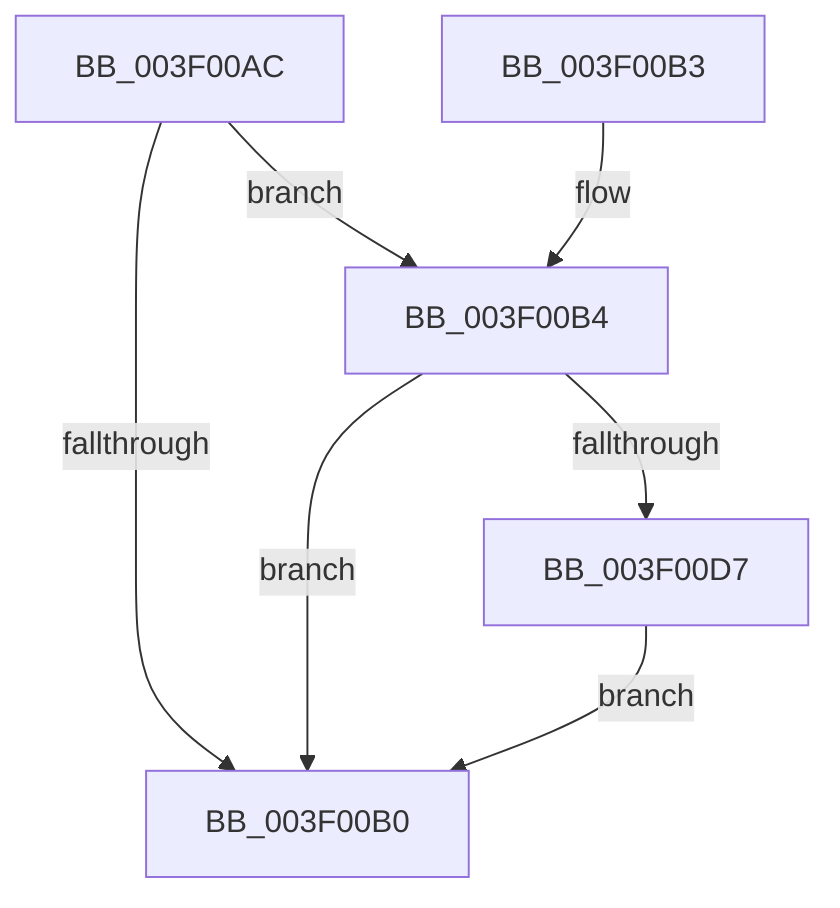

# MiGetClosestImplicitNode

- RVA: `0x003F00AC`–`0x003F00DE` (길이 `50` bytes)
- VA: `0x00000001403F00AC`
- 실행 섹션: `.text`
- PDB 이름 있음: `예`; PDB Function 태그: `아니요`
- unwind 정보 RVA: `0x000DB714`
- 디코드: `16`개 명령, `50/50` bytes 표시
- 미해석 바이트: `0` (있으면 어셈블리에 `.byte`로 보존)

> 이 문서는 커널 이미지의 기계어와 PDB 기호를 분석해 생성했습니다. 4번과 5번은 함수 원형과 자료형을 바이너리 사용 방식에서 추정한 C 해석이며 원본 소스 복구 결과는 아닙니다.

## 1. Dependencies

- 직접 호출 지점: **0**; 고유 호출 대상: **0**
- 직접 호출자로 확인된 함수: **3**
- RIP 상대 이미지 참조: **2**

### Outgoing calls
- 직접 디코드된 call 명령이 없습니다.

### Direct callers
- [MiInPagePageTable](../3E/MiInPagePageTable_function_003EF8DC.md) at `0x003EFB89`
- [MiAddPhysicalMemoryChunks](../../page/7F/MiAddPhysicalMemoryChunks_function_007F98D4.md) at `0x007F9A26`
- [MiMapNewPfns](../../page/7F/MiMapNewPfns_function_007FA63C.md) at `0x007FA74B`

### Static image references
- `0x003F00B4` → RVA `0x00FC5000` (`ALMOSTRO`; read)
- `0x003F00BF` → RVA `0x00E2DBD0` (`.data`; read)

## 2. Other-region calls and transfers

- 다른 실행 섹션으로 향하는 call: **0**
- 별도 외부 분기/꼬리 이동을 확인하지 못했습니다.

## 3. Assembly (complete function range)

```asm
003F00AC  85 C9                           test ecx, ecx
003F00AE  75 04                           jne 0x1403f00b4
003F00B0  8B C1                           mov eax, ecx
003F00B2  C3                              ret
003F00B3  CC                              int3
003F00B4  44 0F B7 05 44 4F BD 00         movzx r8d, word ptr [rip + 0xbd4f44]
003F00BC  8D 51 FF                        lea edx, [rcx - 1]
003F00BF  48 8B 05 0A DB A3 00            mov rax, qword ptr [rip + 0xa3db0a]
003F00C6  41 0F AF D0                     imul edx, r8d
003F00CA  4C 8D 0C 90                     lea r9, [rax + rdx*4]
003F00CE  4B 8D 14 81                     lea rdx, [r9 + r8*4]
003F00D2  4C 3B CA                        cmp r9, rdx
003F00D5  73 D9                           jae 0x1403f00b0
003F00D7  41 8B 09                        mov ecx, dword ptr [r9]
003F00DA  FF C1                           inc ecx
003F00DC  EB D2                           jmp 0x1403f00b0
```

## 4. C-style interpretation (structured pseudocode)

```c
__int64 __fastcall MiGetClosestImplicitNode(__int64 a1)
{
    if ((unsigned int)(a1) != 0) goto loc_003F00B4;
loc_003F00B0:
    return (unsigned int)((unsigned int)(a1));
loc_003F00B4:
    a2 = (unsigned int)((a1 - 1) * ((unsigned int)(*(unsigned __int16 *)(v_rip + 12406596))));
    if ((*(unsigned __int64 *)(v_rip + 10738442) + a2 * 4) >= (*(unsigned __int64 *)(v_rip + 10738442) + a2 * 4 + *(unsigned __int16 *)(v_rip + 12406596) * 4)) goto loc_003F00B0;
    a1 = (unsigned int)(((unsigned int)(*(unsigned int *)(*(unsigned __int64 *)(v_rip + 10738442) + a2 * 4))) + 1);
    goto loc_003F00B0;
}
```

## 5. (Beta) C Style

```c
int64_t MiGetClosestImplicitNode(int64_t Arg1)
{
    if ((uint32_t)(Arg1) != 0) goto loc_003F00B4;
loc_003F00B0:
    return (uint32_t)((uint32_t)(Arg1));
loc_003F00B4:
    a2 = (uint32_t)((Arg1 - 1) * ((uint32_t)(*(uint16_t *)(v_rip + 0xBD4F44))));
    if ((*(uint64_t *)(v_rip + 0xA3DB0A) + a2 * 4) >= (*(uint64_t *)(v_rip + 0xA3DB0A) + a2 * 4 + *(uint16_t *)(v_rip + 0xBD4F44) * 4)) goto loc_003F00B0;
    Arg1 = (uint32_t)(((uint32_t)(*(uint32_t *)(*(uint64_t *)(v_rip + 0xA3DB0A) + a2 * 4))) + 1);
    goto loc_003F00B0;
}
```

## 6. Execution-region graph

[열기: 2D/3D 그래프와 함수 탐색 컨트롤 패널](../../../control-panel.html?section=text&rva=0x003F00AC&view=graph)

- 2D 그래프는 위에서 아래로 흐르고, 3D 그래프는 빈 공간을 드래그해 회전합니다. Shift+드래그는 이동, 휠은 확대·축소, 함수 노드 선택은 대상 보고서 이동입니다.

### Static fallback


