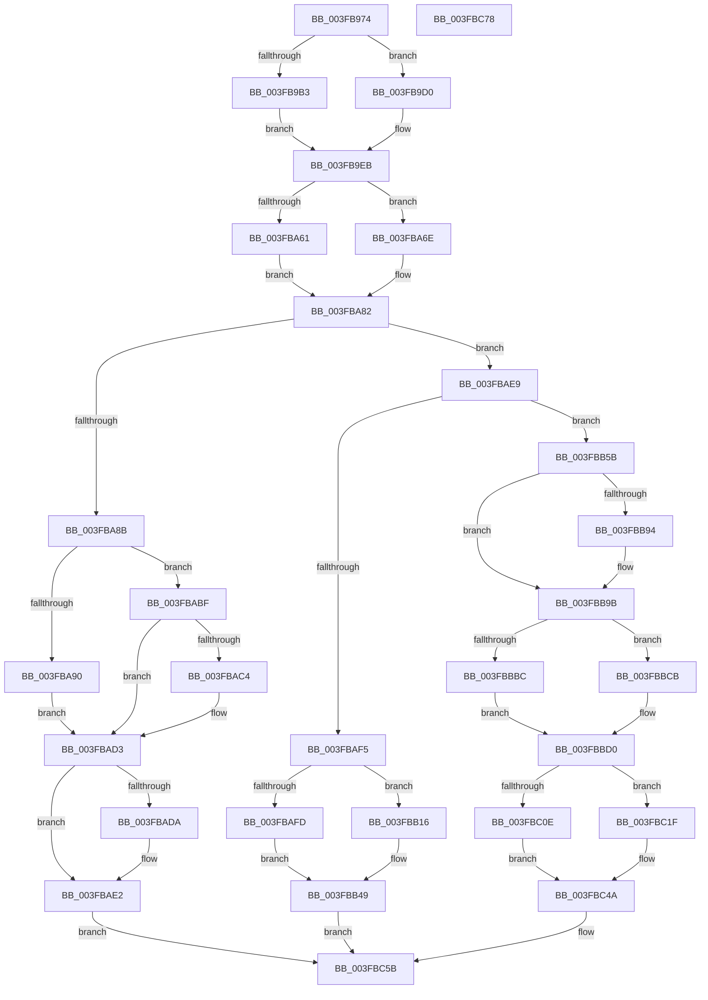

# MiInitializeNewUltraHugeContext

- RVA: `0x003FB974`–`0x003FBC79` (길이 `773` bytes)
- VA: `0x00000001403FB974`
- 실행 섹션: `.text`
- PDB 이름 있음: `예`; PDB Function 태그: `아니요`
- unwind 정보 RVA: `0x0008C2BC`
- 디코드: `190`개 명령, `773/773` bytes 표시
- 미해석 바이트: `0` (있으면 어셈블리에 `.byte`로 보존)

> 이 문서는 커널 이미지의 기계어와 PDB 기호를 분석해 생성했습니다. 4번과 5번은 함수 원형과 자료형을 바이너리 사용 방식에서 추정한 C 해석이며 원본 소스 복구 결과는 아닙니다.

## 1. Dependencies

- 직접 호출 지점: **11**; 고유 호출 대상: **9**
- 직접 호출자로 확인된 함수: **1**
- RIP 상대 이미지 참조: **2**

### Outgoing calls
- `0x003FBA36` → [MiInitializePageColorBase](../32/MiInitializePageColorBase_function_00320410.md) (function, `0x00320410`)
- `0x003FBA53` → [MiCreateUltraThreadContext](../28/MiCreateUltraThreadContext_function_00288200.md) (function, `0x00288200`)
- `0x003FBA64` → [MiLockHugePfnInternal](MiLockHugePfnInternal_function_003FBC80.md) (function, `0x003FBC80`)
- `0x003FBA71` → [MiSafeLockPageAtDpc](../31/MiSafeLockPageAtDpc_function_0031C67C.md) (function, `0x0031C67C`)
- `0x003FBADD` → [MiDeleteUltraThreadContext](../32/MiDeleteUltraThreadContext_function_00322C90.md) (function, `0x00322C90`)
- `0x003FBB00` → [MiStopPageAccessor](../43/MiStopPageAccessor_function_00436BB8.md) (function, `0x00436BB8`)
- `0x003FBB19` → [MiStopPageAccessor](../43/MiStopPageAccessor_function_00436BB8.md) (function, `0x00436BB8`)
- `0x003FBB4C` → [MiDeleteUltraThreadContext](../32/MiDeleteUltraThreadContext_function_00322C90.md) (function, `0x00322C90`)
- `0x003FBB6A` → [MiGetUltraMapping](../32/MiGetUltraMapping_function_00323270.md) (function, `0x00323270`)
- `0x003FBBC4` → [MiMakeProtectionPfnCompatible](../22/MiMakeProtectionPfnCompatible_function_00229CD0.md) (function, `0x00229CD0`)
- `0x003FBBE1` → [MiWriteLargePte](../2C/MiWriteLargePte_function_002C6DE0.md) (function, `0x002C6DE0`)

### Direct callers
- [MiGetBackgroundHugePageToZero](../31/MiGetBackgroundHugePageToZero_function_0031DD8C.md) at `0x0031DF12`

### Static image references
- `0x003FB9B3` → RVA `0x00E300C0` (`.data`; read)
- `0x003FBA99` → RVA `0x00E300C8` (`.data`; read)

## 2. Other-region calls and transfers

- 다른 실행 섹션으로 향하는 call: **0**
- 별도 외부 분기/꼬리 이동을 확인하지 못했습니다.

## 3. Assembly (complete function range)

```asm
003FB974  48 8B C4                        mov rax, rsp
003FB977  48 89 58 10                     mov qword ptr [rax + 0x10], rbx
003FB97B  48 89 68 18                     mov qword ptr [rax + 0x18], rbp
003FB97F  48 89 70 20                     mov qword ptr [rax + 0x20], rsi
003FB983  57                              push rdi
003FB984  41 54                           push r12
003FB986  41 55                           push r13
003FB988  41 56                           push r14
003FB98A  41 57                           push r15
003FB98C  48 83 EC 30                     sub rsp, 0x30
003FB990  4C 8B B2 A8 01 00 00            mov r14, qword ptr [rdx + 0x1a8]
003FB997  4C 8B F9                        mov r15, rcx
003FB99A  33 C9                           xor ecx, ecx
003FB99C  0F 57 C0                        xorps xmm0, xmm0
003FB99F  48 8B EA                        mov rbp, rdx
003FB9A2  BE 01 00 00 00                  mov esi, 1
003FB9A7  0F 11 40 C8                     movups xmmword ptr [rax - 0x38], xmm0
003FB9AB  38 8A 44 01 00 00               cmp byte ptr [rdx + 0x144], cl
003FB9B1  74 1D                           je 0x1403fb9d0
003FB9B3  48 8B 05 06 47 A3 00            mov rax, qword ptr [rip + 0xa34706]
003FB9BA  41 81 E6 FF FF 3F 00            and r14d, 0x3fffff
003FB9C1  8B D9                           mov ebx, ecx
003FB9C3  44 8B EE                        mov r13d, esi
003FB9C6  4A 8D 3C F0                     lea rdi, [rax + r14*8]
003FB9CA  49 C1 E6 12                     shl r14, 0x12
003FB9CE  EB 1B                           jmp 0x1403fb9eb
003FB9D0  4B 8D 1C 76                     lea rbx, [r14 + r14*2]
003FB9D4  48 C1 E3 04                     shl rbx, 4
003FB9D8  48 B8 00 00 00 00 00 DE FF FF   movabs rax, 0xffffde0000000000
003FB9E2  48 03 D8                        add rbx, rax
003FB9E5  44 8B E9                        mov r13d, ecx
003FB9E8  48 8B F9                        mov rdi, rcx
003FB9EB  C7 82 58 01 00 00 00 02 00 00   mov dword ptr [rdx + 0x158], 0x200
003FB9F5  48 8D 82 68 01 00 00            lea rax, [rdx + 0x168]
003FB9FC  48 89 82 60 01 00 00            mov qword ptr [rdx + 0x160], rax
003FBA03  4C 8D 4C 24 20                  lea r9, [rsp + 0x20]
003FBA08  01 B2 3C 02 00 00               add dword ptr [rdx + 0x23c], esi
003FBA0E  49 89 AF 48 02 00 00            mov qword ptr [r15 + 0x248], rbp
003FBA15  48 8B 8A 60 01 00 00            mov rcx, qword ptr [rdx + 0x160]
003FBA1C  0F BE 01                        movsx eax, byte ptr [rcx]
003FBA1F  0F BA E8 00                     bts eax, 0
003FBA23  88 01                           mov byte ptr [rcx], al
003FBA25  33 C9                           xor ecx, ecx
003FBA27  44 8B 82 38 02 00 00            mov r8d, dword ptr [rdx + 0x238]
003FBA2E  BA 03 00 00 00                  mov edx, 3
003FBA33  44 03 C6                        add r8d, esi
003FBA36  E8 D5 49 F2 FF                  call 0x140320410
003FBA3B  4C 8D A5 B0 01 00 00            lea r12, [rbp + 0x1b0]
003FBA42  41 B9 0C 00 00 00               mov r9d, 0xc
003FBA48  49 8B CC                        mov rcx, r12
003FBA4B  48 8D 54 24 20                  lea rdx, [rsp + 0x20]
003FBA50  44 8B C6                        mov r8d, esi
003FBA53  E8 A8 C7 E8 FF                  call 0x140288200
003FBA58  89 44 24 60                     mov dword ptr [rsp + 0x60], eax
003FBA5C  45 85 ED                        test r13d, r13d
003FBA5F  74 0D                           je 0x1403fba6e
003FBA61  48 8B CF                        mov rcx, rdi
003FBA64  E8 17 02 00 00                  call 0x1403fbc80
003FBA69  45 33 C0                        xor r8d, r8d
003FBA6C  EB 14                           jmp 0x1403fba82
003FBA6E  49 8B CE                        mov rcx, r14
003FBA71  E8 06 0C F2 FF                  call 0x14031c67c
003FBA76  3C 11                           cmp al, 0x11
003FBA78  41 B8 00 00 00 00               mov r8d, 0
003FBA7E  49 0F 44 D8                     cmove rbx, r8
003FBA82  48 8B 45 18                     mov rax, qword ptr [rbp + 0x18]
003FBA86  40 84 C6                        test sil, al
003FBA89  74 5E                           je 0x1403fbae9
003FBA8B  45 85 ED                        test r13d, r13d
003FBA8E  74 2F                           je 0x1403fbabf
003FBA90  48 2B 3D 29 46 A3 00            sub rdi, qword ptr [rip + 0xa34629]
003FBA97  8B D6                           mov edx, esi
003FBA99  48 8B 05 28 46 A3 00            mov rax, qword ptr [rip + 0xa34628]
003FBAA0  48 C1 FF 03                     sar rdi, 3
003FBAA4  81 E7 FF FF 3F 00               and edi, 0x3fffff
003FBAAA  8B CF                           mov ecx, edi
003FBAAC  83 E1 1F                        and ecx, 0x1f
003FBAAF  D3 E2                           shl edx, cl
003FBAB1  8B CF                           mov ecx, edi
003FBAB3  F7 D2                           not edx
003FBAB5  48 C1 E9 05                     shr rcx, 5
003FBAB9  F0 21 14 88                     lock and dword ptr [rax + rcx*4], edx
003FBABD  EB 14                           jmp 0x1403fbad3
003FBABF  48 85 DB                        test rbx, rbx
003FBAC2  74 0F                           je 0x1403fbad3
003FBAC4  48 B8 FF FF FF FF FF FF FF 7F   movabs rax, 0x7fffffffffffffff
003FBACE  F0 48 21 43 18                  lock and qword ptr [rbx + 0x18], rax
003FBAD3  44 39 44 24 60                  cmp dword ptr [rsp + 0x60], r8d
003FBAD8  74 08                           je 0x1403fbae2
003FBADA  49 8B CC                        mov rcx, r12
003FBADD  E8 AE 71 F2 FF                  call 0x140322c90
003FBAE2  8B C6                           mov eax, esi
003FBAE4  E9 72 01 00 00                  jmp 0x1403fbc5b
003FBAE9  45 33 ED                        xor r13d, r13d
003FBAEC  33 D2                           xor edx, edx
003FBAEE  44 39 6C 24 60                  cmp dword ptr [rsp + 0x60], r13d
003FBAF3  75 66                           jne 0x1403fbb5b
003FBAF5  45 33 C0                        xor r8d, r8d
003FBAF8  48 85 DB                        test rbx, rbx
003FBAFB  74 19                           je 0x1403fbb16
003FBAFD  48 8B CB                        mov rcx, rbx
003FBB00  E8 B3 B0 03 00                  call 0x140436bb8
003FBB05  48 B8 FF FF FF FF FF FF FF 7F   movabs rax, 0x7fffffffffffffff
003FBB0F  F0 48 21 43 18                  lock and qword ptr [rbx + 0x18], rax
003FBB14  EB 33                           jmp 0x1403fbb49
003FBB16  48 8B CF                        mov rcx, rdi
003FBB19  E8 9A B0 03 00                  call 0x140436bb8
003FBB1E  48 2B 3D 9B 45 A3 00            sub rdi, qword ptr [rip + 0xa3459b]
003FBB25  48 8B 05 9C 45 A3 00            mov rax, qword ptr [rip + 0xa3459c]
003FBB2C  48 C1 FF 03                     sar rdi, 3
003FBB30  81 E7 FF FF 3F 00               and edi, 0x3fffff
003FBB36  8B CF                           mov ecx, edi
003FBB38  83 E1 1F                        and ecx, 0x1f
003FBB3B  D3 E6                           shl esi, cl
003FBB3D  8B CF                           mov ecx, edi
003FBB3F  F7 D6                           not esi
003FBB41  48 C1 E9 05                     shr rcx, 5
003FBB45  F0 21 34 88                     lock and dword ptr [rax + rcx*4], esi
003FBB49  49 8B CC                        mov rcx, r12
003FBB4C  E8 3F 71 F2 FF                  call 0x140322c90
003FBB51  B8 02 00 00 00                  mov eax, 2
003FBB56  E9 00 01 00 00                  jmp 0x1403fbc5b
003FBB5B  41 B9 05 00 00 00               mov r9d, 5
003FBB61  41 B8 00 00 04 00               mov r8d, 0x40000
003FBB67  49 8B CC                        mov rcx, r12
003FBB6A  E8 01 77 F2 FF                  call 0x140323270
003FBB6F  49 8B 97 50 01 00 00            mov rdx, qword ptr [r15 + 0x150]
003FBB76  4C 8D 8D 48 01 00 00            lea r9, [rbp + 0x148]
003FBB7D  4C 8B D0                        mov r10, rax
003FBB80  4C 8B 82 B0 00 00 00            mov r8, qword ptr [rdx + 0xb0]
003FBB87  49 83 C0 20                     add r8, 0x20
003FBB8B  49 8B 40 08                     mov rax, qword ptr [r8 + 8]
003FBB8F  4C 39 00                        cmp qword ptr [rax], r8
003FBB92  74 07                           je 0x1403fbb9b
003FBB94  B9 03 00 00 00                  mov ecx, 3
003FBB99  CD 29                           int 0x29
003FBB9B  4D 89 01                        mov qword ptr [r9], r8
003FBB9E  49 89 41 08                     mov qword ptr [r9 + 8], rax
003FBBA2  4C 89 08                        mov qword ptr [rax], r9
003FBBA5  4D 89 48 08                     mov qword ptr [r8 + 8], r9
003FBBA9  4C 89 95 30 02 00 00            mov qword ptr [rbp + 0x230], r10
003FBBB0  4C 89 95 28 01 00 00            mov qword ptr [rbp + 0x128], r10
003FBBB7  48 85 DB                        test rbx, rbx
003FBBBA  74 0F                           je 0x1403fbbcb
003FBBBC  48 8B D3                        mov rdx, rbx
003FBBBF  B9 04 00 00 00                  mov ecx, 4
003FBBC4  E8 07 E1 E2 FF                  call 0x140229cd0
003FBBC9  EB 05                           jmp 0x1403fbbd0
003FBBCB  B8 04 00 00 00                  mov eax, 4
003FBBD0  0D 00 00 00 A4                  or eax, 0xa4000000
003FBBD5  45 33 C0                        xor r8d, r8d
003FBBD8  44 8B C8                        mov r9d, eax
003FBBDB  49 8B D6                        mov rdx, r14
003FBBDE  49 8B CA                        mov rcx, r10
003FBBE1  E8 FA B1 EC FF                  call 0x1402c6de0
003FBBE6  48 8B 8D 28 01 00 00            mov rcx, qword ptr [rbp + 0x128]
003FBBED  48 81 C1 FF FF FF 3F            add rcx, 0x3fffffff
003FBBF4  44 89 AD 40 01 00 00            mov dword ptr [rbp + 0x140], r13d
003FBBFB  48 89 8D 30 01 00 00            mov qword ptr [rbp + 0x130], rcx
003FBC02  48 89 85 20 01 00 00            mov qword ptr [rbp + 0x120], rax
003FBC09  48 85 DB                        test rbx, rbx
003FBC0C  74 11                           je 0x1403fbc1f
003FBC0E  48 B8 FF FF FF FF FF FF FF 7F   movabs rax, 0x7fffffffffffffff
003FBC18  F0 48 21 43 18                  lock and qword ptr [rbx + 0x18], rax
003FBC1D  EB 2B                           jmp 0x1403fbc4a
003FBC1F  48 2B 3D 9A 44 A3 00            sub rdi, qword ptr [rip + 0xa3449a]
003FBC26  48 8B 05 9B 44 A3 00            mov rax, qword ptr [rip + 0xa3449b]
003FBC2D  48 C1 FF 03                     sar rdi, 3
003FBC31  81 E7 FF FF 3F 00               and edi, 0x3fffff
003FBC37  8B CF                           mov ecx, edi
003FBC39  83 E1 1F                        and ecx, 0x1f
003FBC3C  D3 E6                           shl esi, cl
003FBC3E  8B CF                           mov ecx, edi
003FBC40  F7 D6                           not esi
003FBC42  48 C1 E9 05                     shr rcx, 5
003FBC46  F0 21 34 88                     lock and dword ptr [rax + rcx*4], esi
003FBC4A  45 89 AF 40 01 00 00            mov dword ptr [r15 + 0x140], r13d
003FBC51  33 C0                           xor eax, eax
003FBC53  66 45 89 AF 40 02 00 00         mov word ptr [r15 + 0x240], r13w
003FBC5B  48 8B 5C 24 68                  mov rbx, qword ptr [rsp + 0x68]
003FBC60  48 8B 6C 24 70                  mov rbp, qword ptr [rsp + 0x70]
003FBC65  48 8B 74 24 78                  mov rsi, qword ptr [rsp + 0x78]
003FBC6A  48 83 C4 30                     add rsp, 0x30
003FBC6E  41 5F                           pop r15
003FBC70  41 5E                           pop r14
003FBC72  41 5D                           pop r13
003FBC74  41 5C                           pop r12
003FBC76  5F                              pop rdi
003FBC77  C3                              ret
003FBC78  CC                              int3
```

## 4. C-style interpretation (structured pseudocode)

```c
__int64 __fastcall MiInitializeNewUltraHugeContext(__int64 a1, __int64 a2)
{
    __int64 result;
    __int64 v_r13;
    __int64 v_r14;
    __int64 v_rbx;
    __int64 v_rdi;
    __int64 v_rsi;
    __int64 v_rsp;
    unsigned __int64 v_stack_m38;
    unsigned __int64 v_stack_p10;
    unsigned __int64 v_stack_p18;
    unsigned __int64 v_stack_p20;
    unsigned int v_stack_p8;

    *(unsigned __int64 *)(v_rsp + 16) = v_rbx;
    *(unsigned __int64 *)(v_rsp + 24) = v_rbp;
    *(unsigned __int64 *)(v_rsp + 32) = v_rsi;
    v_rsp = (v_rsp) - (48);
    a1 = 0;
    *(unsigned __int64 *)(v_rsp - 56) = v_xmm0;
    if ((*(unsigned __int8 *)(a2 + 324)) == 0) goto loc_003FB9D0;
    v_r14 = (unsigned int)((*(unsigned __int64 *)(a2 + 424)) & (0x3FFFFFULL));
    v_r14 = (v_r14) << (18);
    goto loc_003FB9EB;
loc_003FB9D0:
    v_rbx = (v_r14 + v_r14 * 2) << (4);
    v_rbx = (v_rbx) + (*(unsigned __int64 *)(v_rip + 10700550));
loc_003FB9EB:
    *(unsigned int *)(a2 + 344) = 512;
    *(unsigned __int64 *)(a2 + 352) = a2 + 360;
    *(unsigned __int64 *)(a1 + 584) = a2;
    *(unsigned __int8 *)(*(unsigned __int64 *)(a2 + 352)) = (unsigned __int8)((__int8)(*(unsigned __int8 *)(*(unsigned __int64 *)(a2 + 352))));
    a1 = 0;
    a3 = (unsigned int)(((unsigned int)(*(unsigned int *)(a2 + 568))) + (1));
    result = MiInitializePageColorBase(a1, 3, a3, v_stack_m38);
    result = MiCreateUltraThreadContext(a2 + 432, v_stack_m38, 1, 12);
    v_stack_p8 = (unsigned int)(result);
    if (0 == 0) goto loc_003FBA6E;
    result = MiLockHugePfnInternal(0, v_stack_m38, 1, 12);
    a3 = 0;
    goto loc_003FBA82;
loc_003FBA6E:
    result = MiSafeLockPageAtDpc(v_r14, v_stack_m38, a3, 12);
    if (((unsigned __int8)(result)) == 17) { v_rbx = 0; }
loc_003FBA82:
    if (((1) & ((unsigned __int8)(*(unsigned __int64 *)(a2 + 24)))) == 0) goto loc_003FBAE9;
    if (0 == 0) goto loc_003FBABF;
    v_rdi = (0) - (*(unsigned __int64 *)(v_rip + 10700329));
    v_rdi = (v_rdi) >> (3);
    v_rdi = (unsigned int)((v_rdi) & (0x3FFFFFULL));
    a1 = (unsigned int)(((unsigned int)((unsigned int)(v_rdi))) & (31));
    a2 = (unsigned int)((1) << ((unsigned __int8)(a1)));
    a2 = (unsigned int)(~(a2));
    a1 = ((unsigned int)((unsigned int)(v_rdi))) >> (5);
    goto loc_003FBAD3;
loc_003FBABF:
    if (v_rbx != 0) {
    }
    result = *(unsigned __int64 *)(v_rip + 10700328);
    if (v_stack_p8 != 0) {
        a1 = a2 + 432;
        result = MiDeleteUltraThreadContext(a1, a2, 0, 12);
    }
    goto loc_003FBC5B;
loc_003FBAE9:
    v_r13 = 0;
    a2 = 0;
    if (v_stack_p8 != 0) goto loc_003FBB5B;
    a3 = 0;
    if (v_rbx == 0) goto loc_003FBB16;
    result = MiStopPageAccessor(v_rbx, a2, a3, 12);
    goto loc_003FBB49;
loc_003FBB16:
    result = MiStopPageAccessor(v_rdi, a2, a3, 12);
    v_rdi = (v_rdi) - (*(unsigned __int64 *)(v_rip + 10700187));
    v_rdi = (v_rdi) >> (3);
    v_rdi = (unsigned int)((v_rdi) & (0x3FFFFFULL));
    a1 = (unsigned int)(((unsigned int)((unsigned int)(v_rdi))) & (31));
    v_rsi = (unsigned int)((1) << ((unsigned __int8)(a1)));
    v_rsi = (unsigned int)(~(v_rsi));
    a1 = ((unsigned int)((unsigned int)(v_rdi))) >> (5);
loc_003FBB49:
    result = MiDeleteUltraThreadContext(a2 + 432, a2, a3, 12);
    goto loc_003FBC5B;
loc_003FBB5B:
    result = MiGetUltraMapping(a2 + 432, a2, (unsigned int)(0x40000ULL), 5);
    a3 = (*(unsigned __int64 *)(*(unsigned __int64 *)(a1 + 336) + 176)) + (32);
    if ((*(unsigned __int64 *)(*(unsigned __int64 *)(a3 + 8))) != a3) {
        a1 = 3;
    }
    *(unsigned __int64 *)(a2 + 328) = a3;
    *(unsigned __int64 *)(a2 + 328 + 8) = *(unsigned __int64 *)(a3 + 8);
    *(unsigned __int64 *)(*(unsigned __int64 *)(a3 + 8)) = a2 + 328;
    *(unsigned __int64 *)(a3 + 8) = a2 + 328;
    *(unsigned __int64 *)(a2 + 560) = result;
    *(unsigned __int64 *)(a2 + 296) = result;
    if (v_rbx == 0) goto loc_003FBBCB;
    result = MiMakeProtectionPfnCompatible(4, v_rbx, a3, a2 + 328);
    goto loc_003FBBD0;
loc_003FBBCB:
loc_003FBBD0:
    result = (unsigned int)((4) | (0xA4000000ULL));
    a3 = 0;
    result = MiWriteLargePte(result, v_r14, a3, (unsigned int)((unsigned int)(result)));
    a1 = (*(unsigned __int64 *)(a2 + 296)) + (0x3FFFFFFFULL);
    *(unsigned int *)(a2 + 320) = 0;
    *(unsigned __int64 *)(a2 + 304) = a1;
    *(unsigned __int64 *)(a2 + 288) = result;
    if (v_rbx == 0) goto loc_003FBC1F;
    goto loc_003FBC4A;
loc_003FBC1F:
    v_rdi = (v_rdi) - (*(unsigned __int64 *)(v_rip + 10699930));
    v_rdi = (v_rdi) >> (3);
    v_rdi = (unsigned int)((v_rdi) & (0x3FFFFFULL));
    a1 = (unsigned int)(((unsigned int)((unsigned int)(v_rdi))) & (31));
    v_rsi = (unsigned int)((v_rsi) << ((unsigned __int8)(a1)));
    v_rsi = (unsigned int)(~(v_rsi));
    a1 = ((unsigned int)((unsigned int)(v_rdi))) >> (5);
loc_003FBC4A:
    *(unsigned int *)(a1 + 320) = 0;
    result = 0;
    *(unsigned __int16 *)(a1 + 576) = 0;
loc_003FBC5B:
    v_rsp = (v_rsp) + (48);
    return result;
}
```

## 5. (Beta) C Style

```c
int64_t MiInitializeNewUltraHugeContext(void *Arg1, void *Arg2)
{
    uint8_t *arg1 = (uint8_t *)Arg1;
    uint8_t *arg2 = (uint8_t *)Arg2;

    int64_t result;
    int64_t local_r13;
    int64_t local_r14;
    int64_t local_rbx;
    int64_t local_rdi;
    int64_t local_rsi;
    int64_t local_rsp;
    uint64_t v_stack_m38;
    uint64_t v_stack_p10;
    uint64_t v_stack_p18;
    uint64_t v_stack_p20;
    uint32_t v_stack_p8;

    *(uint64_t *)(local_rsp + 0x10) = local_rbx;
    *(uint64_t *)(local_rsp + 0x18) = local_rbp;
    *(uint64_t *)(local_rsp + 0x20) = local_rsi;
    local_rsp = (local_rsp) - (48);
    Arg1 = 0;
    *(uint64_t *)(local_rsp - 0x38) = v_xmm0;
    if ((*(uint8_t *)(arg2 + 0x144)) == 0) goto loc_003FB9D0;
    local_r14 = (uint32_t)((*(uint64_t *)(arg2 + 0x1A8)) & (0x3FFFFFULL));
    local_r14 = (local_r14) << (18);
    goto loc_003FB9EB;
loc_003FB9D0:
    local_rbx = (local_r14 + local_r14 * 2) << (4);
    local_rbx = (local_rbx) + (*(uint64_t *)(v_rip + 0xA34706));
loc_003FB9EB:
    *(uint32_t *)(arg2 + 0x158) = 512;
    *(void **)(arg2 + 0x160) = Arg2 + 360;
    *(void **)(arg1 + 0x248) = Arg2;
    *(uint8_t *)(*(uint64_t *)(arg2 + 0x160)) = (uint8_t)((int8_t)(*(uint8_t *)(*(uint64_t *)(arg2 + 0x160))));
    Arg1 = 0;
    a3 = (uint32_t)(((uint32_t)(*(uint32_t *)(arg2 + 0x238))) + (1));
    result = MiInitializePageColorBase(Arg1, 3, a3, v_stack_m38);
    result = MiCreateUltraThreadContext(Arg2 + 432, v_stack_m38, 1, 12);
    v_stack_p8 = (uint32_t)(result);
    if (0 == 0) goto loc_003FBA6E;
    result = MiLockHugePfnInternal(0, v_stack_m38, 1, 12);
    a3 = 0;
    goto loc_003FBA82;
loc_003FBA6E:
    result = MiSafeLockPageAtDpc(local_r14, v_stack_m38, a3, 12);
    if (((uint8_t)(result)) == 17) { local_rbx = 0; }
loc_003FBA82:
    if (((1) & ((uint8_t)(*(uint64_t *)(arg2 + 0x18)))) == 0) goto loc_003FBAE9;
    if (0 == 0) goto loc_003FBABF;
    local_rdi = (0) - (*(uint64_t *)(v_rip + 0xA34629));
    local_rdi = (local_rdi) >> (3);
    local_rdi = (uint32_t)((local_rdi) & (0x3FFFFFULL));
    Arg1 = (uint32_t)(((uint32_t)((uint32_t)(local_rdi))) & (31));
    Arg2 = (uint32_t)((1) << ((uint8_t)(Arg1)));
    Arg2 = (uint32_t)(~(Arg2));
    Arg1 = ((uint32_t)((uint32_t)(local_rdi))) >> (5);
    goto loc_003FBAD3;
loc_003FBABF:
    if (local_rbx != 0) {
    }
    result = *(uint64_t *)(v_rip + 0xA34628);
    if (v_stack_p8 != 0) {
        Arg1 = Arg2 + 432;
        result = MiDeleteUltraThreadContext(Arg1, Arg2, 0, 12);
    }
    goto loc_003FBC5B;
loc_003FBAE9:
    local_r13 = 0;
    Arg2 = 0;
    if (v_stack_p8 != 0) goto loc_003FBB5B;
    a3 = 0;
    if (local_rbx == 0) goto loc_003FBB16;
    result = MiStopPageAccessor(local_rbx, Arg2, a3, 12);
    goto loc_003FBB49;
loc_003FBB16:
    result = MiStopPageAccessor(local_rdi, Arg2, a3, 12);
    local_rdi = (local_rdi) - (*(uint64_t *)(v_rip + 0xA3459B));
    local_rdi = (local_rdi) >> (3);
    local_rdi = (uint32_t)((local_rdi) & (0x3FFFFFULL));
    Arg1 = (uint32_t)(((uint32_t)((uint32_t)(local_rdi))) & (31));
    local_rsi = (uint32_t)((1) << ((uint8_t)(Arg1)));
    local_rsi = (uint32_t)(~(local_rsi));
    Arg1 = ((uint32_t)((uint32_t)(local_rdi))) >> (5);
loc_003FBB49:
    result = MiDeleteUltraThreadContext(Arg2 + 432, Arg2, a3, 12);
    goto loc_003FBC5B;
loc_003FBB5B:
    result = MiGetUltraMapping(Arg2 + 432, Arg2, (uint32_t)(0x40000ULL), 5);
    a3 = (*(uint64_t *)(*(uint64_t *)(arg1 + 0x150) + 0xB0)) + (32);
    if ((*(uint64_t *)(*(uint64_t *)(a3 + 0x8))) != a3) {
        Arg1 = 3;
    }
    *(uint64_t *)(arg2 + 0x148) = a3;
    *(uint64_t *)(arg2 + 0x148 + 0x8) = *(uint64_t *)(a3 + 0x8);
    *(void **)(*(uint64_t *)(a3 + 0x8)) = Arg2 + 328;
    *(void **)(a3 + 0x8) = Arg2 + 328;
    *(uint64_t *)(arg2 + 0x230) = result;
    *(uint64_t *)(arg2 + 0x128) = result;
    if (local_rbx == 0) goto loc_003FBBCB;
    result = MiMakeProtectionPfnCompatible(4, local_rbx, a3, Arg2 + 328);
    goto loc_003FBBD0;
loc_003FBBCB:
loc_003FBBD0:
    result = (uint32_t)((4) | (0xA4000000ULL));
    a3 = 0;
    result = MiWriteLargePte(result, local_r14, a3, (uint32_t)((uint32_t)(result)));
    Arg1 = (*(uint64_t *)(arg2 + 0x128)) + (0x3FFFFFFFULL);
    *(uint32_t *)(arg2 + 0x140) = 0;
    *(void **)(arg2 + 0x130) = Arg1;
    *(uint64_t *)(arg2 + 0x120) = result;
    if (local_rbx == 0) goto loc_003FBC1F;
    goto loc_003FBC4A;
loc_003FBC1F:
    local_rdi = (local_rdi) - (*(uint64_t *)(v_rip + 0xA3449A));
    local_rdi = (local_rdi) >> (3);
    local_rdi = (uint32_t)((local_rdi) & (0x3FFFFFULL));
    Arg1 = (uint32_t)(((uint32_t)((uint32_t)(local_rdi))) & (31));
    local_rsi = (uint32_t)((local_rsi) << ((uint8_t)(Arg1)));
    local_rsi = (uint32_t)(~(local_rsi));
    Arg1 = ((uint32_t)((uint32_t)(local_rdi))) >> (5);
loc_003FBC4A:
    *(uint32_t *)(arg1 + 0x140) = 0;
    result = 0;
    *(uint16_t *)(arg1 + 0x240) = 0;
loc_003FBC5B:
    local_rsp = (local_rsp) + (48);
    return result;
}
```

### 관측된 메모리 오프셋

구조체 형식이 확인되지 않은 접근은 인자 기준의 오프셋으로만 기록했습니다.

| 기준 인자 | 오프셋 표현 | 폭 (bit) | 접근 |
|---|---:|---:|---|
| `Arg1` | `+ 0x140` | `32` | `W` |
| `Arg1` | `+ 0x150` | `64` | `R` |
| `Arg1` | `+ 0x240` | `16` | `W` |
| `Arg1` | `+ 0x248` | `64` | `W` |
| `Arg2` | `+ 0x0` | `64` | `W` |
| `Arg2` | `+ 0x8` | `64` | `W` |
| `Arg2` | `+ 0x18` | `64` | `R` |
| `Arg2` | `+ 0x120` | `64` | `W` |
| `Arg2` | `+ 0x128` | `64` | `R` |
| `Arg2` | `+ 0x128` | `64` | `W` |
| `Arg2` | `+ 0x130` | `64` | `W` |
| `Arg2` | `+ 0x140` | `32` | `W` |
| `Arg2` | `+ 0x144` | `8` | `R` |
| `Arg2` | `+ 0x148` | `64` | `R` |
| `Arg2` | `+ 0x158` | `32` | `W` |
| `Arg2` | `+ 0x160` | `64` | `R` |
| `Arg2` | `+ 0x160` | `64` | `W` |
| `Arg2` | `+ 0x168` | `64` | `R` |
| `Arg2` | `+ 0x1A8` | `64` | `R` |
| `Arg2` | `+ 0x1B0` | `64` | `R` |
| `Arg2` | `+ 0x230` | `64` | `W` |
| `Arg2` | `+ 0x238` | `32` | `R` |
| `Arg2` | `+ 0x23C` | `32` | `R/W` |

## 6. Execution-region graph

[열기: 2D/3D 그래프와 함수 탐색 컨트롤 패널](../../../control-panel.html?section=text&rva=0x003FB974&view=graph)

- 2D 그래프는 위에서 아래로 흐르고, 3D 그래프는 빈 공간을 드래그해 회전합니다. Shift+드래그는 이동, 휠은 확대·축소, 함수 노드 선택은 대상 보고서 이동입니다.

### Static fallback


