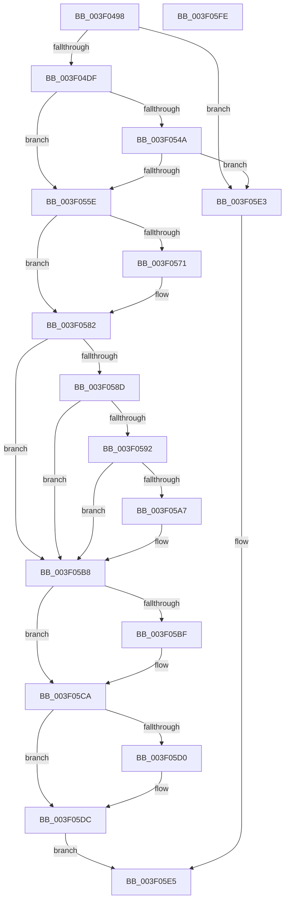

# MiInsertLargeVadMapping

- RVA: `0x003F0498`–`0x003F05FF` (길이 `359` bytes)
- VA: `0x00000001403F0498`
- 실행 섹션: `.text`
- PDB 이름 있음: `예`; PDB Function 태그: `아니요`
- unwind 정보 RVA: `0x00084C9C`
- 디코드: `89`개 명령, `359/359` bytes 표시
- 미해석 바이트: `0` (있으면 어셈블리에 `.byte`로 보존)

> 이 문서는 커널 이미지의 기계어와 PDB 기호를 분석해 생성했습니다. 4번과 5번은 함수 원형과 자료형을 바이너리 사용 방식에서 추정한 C 해석이며 원본 소스 복구 결과는 아닙니다.

## 1. Dependencies

- 직접 호출 지점: **9**; 고유 호출 대상: **9**
- 직접 호출자로 확인된 함수: **1**
- RIP 상대 이미지 참조: **1**

### Outgoing calls
- `0x003F04D1` → [MiLockProtoPoolPage](../2B/MiLockProtoPoolPage_function_002B8B80.md) (function, `0x002B8B80`)
- `0x003F04E7` → [MiUnlockProtoPoolPage](../24/MiUnlockProtoPoolPage_function_00246090.md) (function, `0x00246090`)
- `0x003F053C` → [MiMakeValidPte](../2C/MiMakeValidPte_function_002C5590.md) (function, `0x002C5590`)
- `0x003F0551` → [MiConvertWorkingSetLockSharedToExclusive](../68/MiConvertWorkingSetLockSharedToExclusive_function_0068B104.md) (function, `0x0068B104`)
- `0x003F0568` → [MiPteInShadowRange](../23/MiPteInShadowRange_function_0023FB00.md) (function, `0x0023FB00`)
- `0x003F0576` → [MiSanitizeShadowPxe](../29/MiSanitizeShadowPxe_function_00294B68.md) (function, `0x00294B68`)
- `0x003F05B3` → [MiCheckLinearProtectedPteAccessedBit](../29/MiCheckLinearProtectedPteAccessedBit_function_00292D80.md) (function, `0x00292D80`)
- `0x003F05C5` → [MiWritePteShadow](../29/MiWritePteShadow_function_00294EAC.md) (function, `0x00294EAC`)
- `0x003F05D7` → [MiConvertWorkingSetLockExclusiveToShared](../68/MiConvertWorkingSetLockExclusiveToShared_function_0068B040.md) (function, `0x0068B040`)

### Direct callers
- [MiInPagePageTable](../3E/MiInPagePageTable_function_003EF8DC.md) at `0x003EFEAD`

### Static image references
- `0x003F0582` → RVA `0x00FC6A88` (`ALMOSTRO`; read)

## 2. Other-region calls and transfers

- 다른 실행 섹션으로 향하는 call: **0**
- 별도 외부 분기/꼬리 이동을 확인하지 못했습니다.

## 3. Assembly (complete function range)

```asm
003F0498  48 89 5C 24 08                  mov qword ptr [rsp + 8], rbx
003F049D  48 89 6C 24 10                  mov qword ptr [rsp + 0x10], rbp
003F04A2  48 89 74 24 18                  mov qword ptr [rsp + 0x18], rsi
003F04A7  57                              push rdi
003F04A8  41 56                           push r14
003F04AA  41 57                           push r15
003F04AC  48 83 EC 30                     sub rsp, 0x30
003F04B0  65 48 8B 04 25 88 01 00 00      mov rax, qword ptr gs:[0x188]
003F04B9  48 8B DA                        mov rbx, rdx
003F04BC  48 8B E9                        mov rbp, rcx
003F04BF  33 D2                           xor edx, edx
003F04C1  48 8B CB                        mov rcx, rbx
003F04C4  49 8B F9                        mov rdi, r9
003F04C7  45 8B F0                        mov r14d, r8d
003F04CA  48 8B B0 B8 00 00 00            mov rsi, qword ptr [rax + 0xb8]
003F04D1  E8 AA 86 EC FF                  call 0x1402b8b80
003F04D6  48 85 C0                        test rax, rax
003F04D9  0F 84 04 01 00 00               je 0x1403f05e3
003F04DF  48 8B 1B                        mov rbx, qword ptr [rbx]
003F04E2  B2 11                           mov dl, 0x11
003F04E4  48 8B C8                        mov rcx, rax
003F04E7  E8 A4 5B E5 FF                  call 0x140246090
003F04EC  44 8B 44 24 70                  mov r8d, dword ptr [rsp + 0x70]
003F04F1  48 BA 00 00 FC FF FF 00 00 00   movabs rdx, 0xfffffc0000
003F04FB  41 81 C8 00 00 00 84            or r8d, 0x84000000
003F0502  49 BF 00 00 00 00 80 F6 FF FF   movabs r15, 0xfffff68000000000
003F050C  41 83 FE 02                     cmp r14d, 2
003F0510  48 B8 00 FE FF FF FF 00 00 00   movabs rax, 0xfffffffe00
003F051A  48 B9 F8 FF FF FF 7F 00 00 00   movabs rcx, 0x7ffffffff8
003F0524  48 0F 45 D0                     cmovne rdx, rax
003F0528  48 C1 EB 0C                     shr rbx, 0xc
003F052C  48 C1 ED 09                     shr rbp, 9
003F0530  48 23 D3                        and rdx, rbx
003F0533  48 23 CD                        and rcx, rbp
003F0536  49 8B C7                        mov rax, r15
003F0539  48 03 C8                        add rcx, rax
003F053C  E8 4F 50 ED FF                  call 0x1402c5590
003F0541  48 8B D8                        mov rbx, rax
003F0544  41 83 FE 01                     cmp r14d, 1
003F0548  74 14                           je 0x1403f055e
003F054A  48 8D 8E 00 04 00 00            lea rcx, [rsi + 0x400]
003F0551  E8 AE AB 29 00                  call 0x14068b104
003F0556  85 C0                           test eax, eax
003F0558  0F 84 85 00 00 00               je 0x1403f05e3
003F055E  48 8B CF                        mov rcx, rdi
003F0561  48 89 5C 24 20                  mov qword ptr [rsp + 0x20], rbx
003F0566  33 ED                           xor ebp, ebp
003F0568  E8 93 F5 E4 FF                  call 0x14023fb00
003F056D  85 C0                           test eax, eax
003F056F  74 11                           je 0x1403f0582
003F0571  48 8D 54 24 20                  lea rdx, [rsp + 0x20]
003F0576  E8 ED 45 EA FF                  call 0x140294b68
003F057B  48 8B 5C 24 20                  mov rbx, qword ptr [rsp + 0x20]
003F0580  8B E8                           mov ebp, eax
003F0582  48 0F BA 25 FD 64 BD 00 24      bt qword ptr [rip + 0xbd64fd], 0x24
003F058B  73 2B                           jae 0x1403f05b8
003F058D  F6 C3 20                        test bl, 0x20
003F0590  75 26                           jne 0x1403f05b8
003F0592  49 8B CF                        mov rcx, r15
003F0595  48 B8 00 00 00 00 40 00 00 00   movabs rax, 0x4000000000
003F059F  48 03 C8                        add rcx, rax
003F05A2  48 3B F9                        cmp rdi, rcx
003F05A5  72 11                           jb 0x1403f05b8
003F05A7  41 B8 80 00 00 00               mov r8d, 0x80
003F05AD  48 8B D3                        mov rdx, rbx
003F05B0  48 8B CF                        mov rcx, rdi
003F05B3  E8 C8 27 EA FF                  call 0x140292d80
003F05B8  48 89 1F                        mov qword ptr [rdi], rbx
003F05BB  85 ED                           test ebp, ebp
003F05BD  74 0B                           je 0x1403f05ca
003F05BF  48 8B D3                        mov rdx, rbx
003F05C2  48 8B CF                        mov rcx, rdi
003F05C5  E8 E2 48 EA FF                  call 0x140294eac
003F05CA  41 83 FE 01                     cmp r14d, 1
003F05CE  74 0C                           je 0x1403f05dc
003F05D0  48 8D 8E 00 04 00 00            lea rcx, [rsi + 0x400]
003F05D7  E8 64 AA 29 00                  call 0x14068b040
003F05DC  B8 01 00 00 00                  mov eax, 1
003F05E1  EB 02                           jmp 0x1403f05e5
003F05E3  33 C0                           xor eax, eax
003F05E5  48 8B 5C 24 50                  mov rbx, qword ptr [rsp + 0x50]
003F05EA  48 8B 6C 24 58                  mov rbp, qword ptr [rsp + 0x58]
003F05EF  48 8B 74 24 60                  mov rsi, qword ptr [rsp + 0x60]
003F05F4  48 83 C4 30                     add rsp, 0x30
003F05F8  41 5F                           pop r15
003F05FA  41 5E                           pop r14
003F05FC  5F                              pop rdi
003F05FD  C3                              ret
003F05FE  CC                              int3
```

## 4. C-style interpretation (structured pseudocode)

```c
__int64 __fastcall MiInsertLargeVadMapping(__int64 a1, __int64 a2, int a3, __int64 a4, unsigned int a5)
{
    __int64 result;
    __int64 v_rbp;
    __int64 v_rbx;
    __int64 v_rsp;
    unsigned __int64 v_stack_m28;
    unsigned __int64 v_stack_p10;
    unsigned __int64 v_stack_p18;
    unsigned __int64 v_stack_p8;

    v_stack_p8 = v_rbx;
    v_stack_p10 = v_rbp;
    v_stack_p18 = v_rsi;
    v_rsp = (v_rsp) - (48);
    a2 = 0;
    result = MiLockProtoPoolPage(0, a2, a3, a4);
    if (result == 0) goto loc_003F05E3;
    result = MiUnlockProtoPoolPage(result, 17, a3, a4);
    a3 = (unsigned int)(((unsigned int)(a5)) | (0x84000000ULL));
    a2 = 17;
    if (((unsigned int)((unsigned int)(a3))) != 2) { a2 = result; }
    v_rbx = (*(unsigned __int64 *)(a2)) >> (12);
    v_rbp = (a1) >> (9);
    a2 = (a2) & (v_rbx);
    a1 = (result) & (v_rbp);
    a1 = (a1) + (v_r15);
    result = MiMakeValidPte(a1, a2, a3, a4);
    if (((unsigned int)((unsigned int)(a3))) == 1) goto loc_003F055E;
    result = MiConvertWorkingSetLockSharedToExclusive(*(unsigned __int64 *)(*(unsigned __int64 *)(gs_base + (0 + 392)) + 184) + 1024, a2, a3, a4);
    if ((unsigned int)(result) == 0) goto loc_003F05E3;
loc_003F055E:
    v_stack_m28 = result;
    v_rbp = 0;
    result = MiPteInShadowRange(a4, a2, a3, a4);
    v_rbx = result;
    if ((unsigned int)(result) != 0) {
        a2 = v_stack_m28;
        result = MiSanitizeShadowPxe(a4, a2, a3, a4);
        v_rbx = v_stack_m28;
        v_rbp = (unsigned int)(result);
    }
    if (condition_is_above_or_equal) goto loc_003F05B8;
    if ((((unsigned __int8)(v_rbx)) & (32)) != 0) goto loc_003F05B8;
    a1 = (v_r15) + (result);
    if (a4 >= a1) {
        a3 = 128;
        a2 = v_rbx;
        a1 = a4;
        result = MiCheckLinearProtectedPteAccessedBit(a1, a2, a3, a4);
    }
    *(unsigned __int64 *)(a4) = v_rbx;
    if ((unsigned int)(v_rbp) != 0) {
        a2 = v_rbx;
        a1 = a4;
        result = MiWritePteShadow(a1, a2, a3, a4);
    }
    if (((unsigned int)((unsigned int)(a3))) != 1) {
        a1 = *(unsigned __int64 *)(*(unsigned __int64 *)(gs_base + (0 + 392)) + 184) + 1024;
        result = MiConvertWorkingSetLockExclusiveToShared(a1, a2, a3, a4);
    }
    goto loc_003F05E5;
loc_003F05E3:
    result = 0;
loc_003F05E5:
    v_rsp = (v_rsp) + (48);
    return result;
}
```

## 5. (Beta) C Style

```c
int64_t MiInsertLargeVadMapping(int64_t Arg1, void *Arg2, int32_t Arg3, int64_t Arg4, uint32_t Arg5)
{
    uint8_t *arg2 = (uint8_t *)Arg2;

    int64_t result;
    int64_t local_rbp;
    int64_t local_rbx;
    int64_t local_rsp;
    uint64_t v_stack_m28;
    uint64_t v_stack_p10;
    uint64_t v_stack_p18;
    uint64_t v_stack_p8;

    v_stack_p8 = local_rbx;
    v_stack_p10 = local_rbp;
    v_stack_p18 = local_rsi;
    local_rsp = (local_rsp) - (48);
    Arg2 = 0;
    result = MiLockProtoPoolPage(0, Arg2, Arg3, Arg4);
    if (result == 0) goto loc_003F05E3;
    result = MiUnlockProtoPoolPage(result, 17, Arg3, Arg4);
    Arg3 = (uint32_t)(((uint32_t)(Arg5)) | (0x84000000ULL));
    Arg2 = 17;
    if (((uint32_t)((uint32_t)(Arg3))) != 2) { Arg2 = result; }
    local_rbx = (*(uint64_t *)(arg2)) >> (12);
    local_rbp = (Arg1) >> (9);
    Arg2 = (Arg2) & (local_rbx);
    Arg1 = (result) & (local_rbp);
    Arg1 = (Arg1) + (local_r15);
    result = MiMakeValidPte(Arg1, Arg2, Arg3, Arg4);
    if (((uint32_t)((uint32_t)(Arg3))) == 1) goto loc_003F055E;
    result = MiConvertWorkingSetLockSharedToExclusive(*(uint64_t *)(*(uint64_t *)(gs_base + (0 + 0x188)) + 0xB8) + 1024, Arg2, Arg3, Arg4);
    if ((uint32_t)(result) == 0) goto loc_003F05E3;
loc_003F055E:
    v_stack_m28 = result;
    local_rbp = 0;
    result = MiPteInShadowRange(Arg4, Arg2, Arg3, Arg4);
    local_rbx = result;
    if ((uint32_t)(result) != 0) {
        Arg2 = v_stack_m28;
        result = MiSanitizeShadowPxe(Arg4, Arg2, Arg3, Arg4);
        local_rbx = v_stack_m28;
        local_rbp = (uint32_t)(result);
    }
    if (condition_is_above_or_equal) goto loc_003F05B8;
    if ((((uint8_t)(local_rbx)) & (32)) != 0) goto loc_003F05B8;
    Arg1 = (local_r15) + (result);
    if (Arg4 >= Arg1) {
        Arg3 = 128;
        Arg2 = local_rbx;
        Arg1 = Arg4;
        result = MiCheckLinearProtectedPteAccessedBit(Arg1, Arg2, Arg3, Arg4);
    }
    *(uint64_t *)(Arg4) = local_rbx;
    if ((uint32_t)(local_rbp) != 0) {
        Arg2 = local_rbx;
        Arg1 = Arg4;
        result = MiWritePteShadow(Arg1, Arg2, Arg3, Arg4);
    }
    if (((uint32_t)((uint32_t)(Arg3))) != 1) {
        Arg1 = *(uint64_t *)(*(uint64_t *)(gs_base + (0 + 0x188)) + 0xB8) + 1024;
        result = MiConvertWorkingSetLockExclusiveToShared(Arg1, Arg2, Arg3, Arg4);
    }
    goto loc_003F05E5;
loc_003F05E3:
    result = 0;
loc_003F05E5:
    local_rsp = (local_rsp) + (48);
    return result;
}
```

### 관측된 메모리 오프셋

구조체 형식이 확인되지 않은 접근은 인자 기준의 오프셋으로만 기록했습니다.

| 기준 인자 | 오프셋 표현 | 폭 (bit) | 접근 |
|---|---:|---:|---|
| `Arg2` | `+ 0x0` | `64` | `R` |

## 6. Execution-region graph

[열기: 2D/3D 그래프와 함수 탐색 컨트롤 패널](../../../control-panel.html?section=text&rva=0x003F0498&view=graph)

- 2D 그래프는 위에서 아래로 흐르고, 3D 그래프는 빈 공간을 드래그해 회전합니다. Shift+드래그는 이동, 휠은 확대·축소, 함수 노드 선택은 대상 보고서 이동입니다.

### Static fallback


