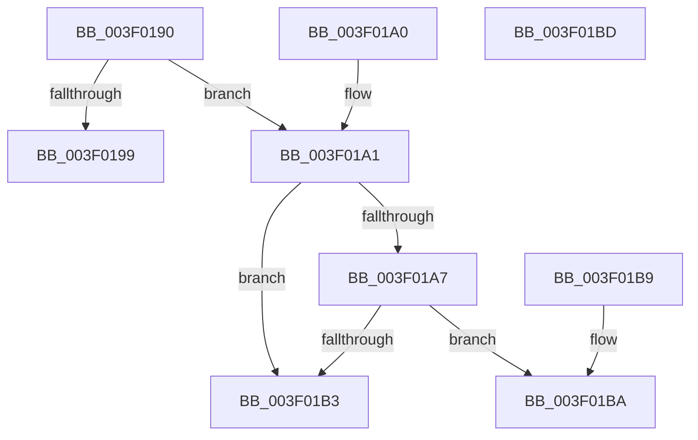

# MiIsVadLarge

- RVA: `0x003F0190`–`0x003F01BE` (길이 `46` bytes)
- VA: `0x00000001403F0190`
- 실행 섹션: `.text`
- PDB 이름 있음: `예`; PDB Function 태그: `아니요`
- unwind 정보 RVA: `0x000DB714`
- 디코드: `18`개 명령, `46/46` bytes 표시
- 미해석 바이트: `0` (있으면 어셈블리에 `.byte`로 보존)

> 이 문서는 커널 이미지의 기계어와 PDB 기호를 분석해 생성했습니다. 4번과 5번은 함수 원형과 자료형을 바이너리 사용 방식에서 추정한 C 해석이며 원본 소스 복구 결과는 아닙니다.

## 1. Dependencies

- 직접 호출 지점: **0**; 고유 호출 대상: **0**
- 직접 호출자로 확인된 함수: **3**
- RIP 상대 이미지 참조: **0**

### Outgoing calls
- 직접 디코드된 call 명령이 없습니다.

### Direct callers
- [MiInPagePageTable](../3E/MiInPagePageTable_function_003EF8DC.md) at `0x003EFD92`
- [MiRemoveVadCharges](../../page/9B/MiRemoveVadCharges_function_009BAEC4.md) at `0x009BAF12`
- [MiProcessVaRangesInfoClass](../../page/9F/MiProcessVaRangesInfoClass_function_009F4E50.md) at `0x009F4EFE`

### Static image references
- 디코드된 RIP-relative 메모리 참조가 없습니다.

## 2. Other-region calls and transfers

- 다른 실행 섹션으로 향하는 call: **0**
- 별도 외부 분기/꼬리 이동을 확인하지 못했습니다.

## 3. Assembly (complete function range)

```asm
003F0190  8B 41 30                        mov eax, dword ptr [rcx + 0x30]
003F0193  0F BA E0 15                     bt eax, 0x15
003F0197  72 08                           jb 0x1403f01a1
003F0199  8B 41 40                        mov eax, dword ptr [rcx + 0x40]
003F019C  83 E0 01                        and eax, 1
003F019F  C3                              ret
003F01A0  CC                              int3
003F01A1  0F BA E0 17                     bt eax, 0x17
003F01A5  72 0C                           jb 0x1403f01b3
003F01A7  25 00 00 18 00                  and eax, 0x180000
003F01AC  3D 00 00 10 00                  cmp eax, 0x100000
003F01B1  72 07                           jb 0x1403f01ba
003F01B3  B8 01 00 00 00                  mov eax, 1
003F01B8  C3                              ret
003F01B9  CC                              int3
003F01BA  33 C0                           xor eax, eax
003F01BC  C3                              ret
003F01BD  CC                              int3
```

## 4. C-style interpretation (structured pseudocode)

```c
__int64 __fastcall MiIsVadLarge(__int64 a1)
{
    __int64 result;

    if (condition_is_below) goto loc_003F01A1;
    result = (unsigned int)(((unsigned int)(*(unsigned int *)(a1 + 64))) & (1));
    return result;
loc_003F01A1:
    if (condition_is_below) goto loc_003F01B3;
    result = (unsigned int)((result) & (0x180000ULL));
    if (((unsigned int)(result)) < 0x100000ULL) goto loc_003F01BA;
loc_003F01B3:
    return 1;
loc_003F01BA:
    result = 0;
    return result;
}
```

## 5. (Beta) C Style

```c
int64_t MiIsVadLarge(void *Arg1)
{
    uint8_t *arg1 = (uint8_t *)Arg1;

    int64_t result;

    if (condition_is_below) goto loc_003F01A1;
    result = (uint32_t)(((uint32_t)(*(uint32_t *)(arg1 + 0x40))) & (1));
    return result;
loc_003F01A1:
    if (condition_is_below) goto loc_003F01B3;
    result = (uint32_t)((result) & (0x180000ULL));
    if (((uint32_t)(result)) < 0x100000ULL) goto loc_003F01BA;
loc_003F01B3:
    return 1;
loc_003F01BA:
    result = 0;
    return result;
}
```

### 관측된 메모리 오프셋

구조체 형식이 확인되지 않은 접근은 인자 기준의 오프셋으로만 기록했습니다.

| 기준 인자 | 오프셋 표현 | 폭 (bit) | 접근 |
|---|---:|---:|---|
| `Arg1` | `+ 0x30` | `32` | `R` |
| `Arg1` | `+ 0x40` | `32` | `R` |

## 6. Execution-region graph

[열기: 2D/3D 그래프와 함수 탐색 컨트롤 패널](../../../control-panel.html?section=text&rva=0x003F0190&view=graph)

- 2D 그래프는 위에서 아래로 흐르고, 3D 그래프는 빈 공간을 드래그해 회전합니다. Shift+드래그는 이동, 휠은 확대·축소, 함수 노드 선택은 대상 보고서 이동입니다.

### Static fallback


