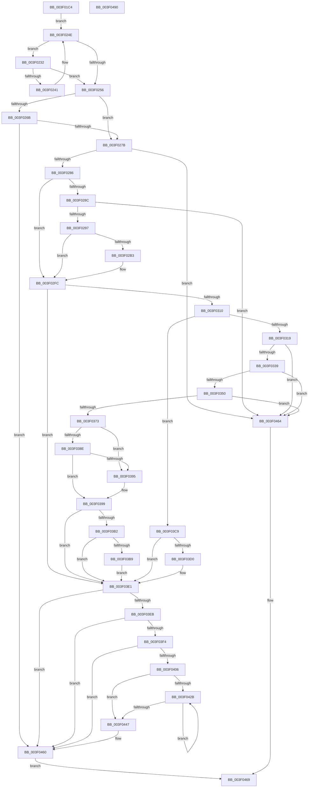

# MiLargePageFault

- RVA: `0x003F01C4`–`0x003F0491` (길이 `717` bytes)
- VA: `0x00000001403F01C4`
- 실행 섹션: `.text`
- PDB 이름 있음: `예`; PDB Function 태그: `아니요`
- unwind 정보 RVA: `0x00096BBC`
- 디코드: `179`개 명령, `717/717` bytes 표시
- 미해석 바이트: `0` (있으면 어셈블리에 `.byte`로 보존)

> 이 문서는 커널 이미지의 기계어와 PDB 기호를 분석해 생성했습니다. 4번과 5번은 함수 원형과 자료형을 바이너리 사용 방식에서 추정한 C 해석이며 원본 소스 복구 결과는 아닙니다.

## 1. Dependencies

- 직접 호출 지점: **13**; 고유 호출 대상: **13**
- 직접 호출자로 확인된 함수: **2**
- RIP 상대 이미지 참조: **3**

### Outgoing calls
- `0x003F01FC` → [memset](../6C/memset_function_006C6C40.md) (function, `0x006C6C40`)
- `0x003F0259` → [MI_READ_PTE_LOCK_FREE](../28/MI_READ_PTE_LOCK_FREE_function_002828A0.md) (function, `0x002828A0`)
- `0x003F02AA` → [MiNoFaultFound](../41/MiNoFaultFound_function_0041BB20.md) (function, `0x0041BB20`)
- `0x003F02DE` → [MiInitializeTbFlushList](../29/MiInitializeTbFlushList_function_00294F00.md) (function, `0x00294F00`)
- `0x003F02ED` → [MiInsertLargeTbFlushEntry](../37/MiInsertLargeTbFlushEntry_function_0037827C.md) (function, `0x0037827C`)
- `0x003F02F7` → [MiFlushTbList](../31/MiFlushTbList_function_00311FC0.md) (function, `0x00311FC0`)
- `0x003F032C` → [MiCanGrantExecute](../4A/MiCanGrantExecute_function_004AD788.md) (function, `0x004AD788`)
- `0x003F039F` → [MiWriteValidPteNewProtection](../28/MiWriteValidPteNewProtection_function_00281810.md) (function, `0x00281810`)
- `0x003F03C2` → [MiFlushSingleTbEntry](../28/MiFlushSingleTbEntry_function_0028E730.md) (function, `0x0028E730`)
- `0x003F03DC` → [MiCheckSystemNxFault](../4A/MiCheckSystemNxFault_function_004A44C0.md) (function, `0x004A44C0`)
- `0x003F03FD` → [MiValidVirtualizationFault](../46/MiValidVirtualizationFault_function_00466EC0.md) (function, `0x00466EC0`)
- `0x003F040F` → [MiGetVirtualFaultPageInfo](../46/MiGetVirtualFaultPageInfo_function_0046705C.md) (function, `0x0046705C`)
- `0x003F0474` → [_security_check_cookie](../6A/_security_check_cookie_function_006AC640.md) (function, `0x006AC640`)

### Direct callers
- [sub_002762D6](../27/Unknown_function_002762D6.md) at `0x002762E8`
- [MiInPagePageTable](../3E/MiInPagePageTable_function_003EF8DC.md) at `0x003EFF09`

### Static image references
- `0x003F01D7` → RVA `0x00E0A740` (`.data`; read)
- `0x003F0343` → RVA `0x00E2DCE0` (`.data`; read)
- `0x003F0380` → RVA `0x00FC6A88` (`ALMOSTRO`; read)

## 2. Other-region calls and transfers

- 다른 실행 섹션으로 향하는 call: **0**
- 별도 외부 분기/꼬리 이동을 확인하지 못했습니다.

## 3. Assembly (complete function range)

```asm
003F01C4  48 89 5C 24 18                  mov qword ptr [rsp + 0x18], rbx
003F01C9  55                              push rbp
003F01CA  56                              push rsi
003F01CB  57                              push rdi
003F01CC  41 55                           push r13
003F01CE  41 56                           push r14
003F01D0  48 81 EC 20 01 00 00            sub rsp, 0x120
003F01D7  48 8B 05 62 A5 A1 00            mov rax, qword ptr [rip + 0xa1a562]
003F01DE  48 33 C4                        xor rax, rsp
003F01E1  48 89 84 24 10 01 00 00         mov qword ptr [rsp + 0x110], rax
003F01E9  4C 8B F2                        mov r14, rdx
003F01EC  48 8B F9                        mov rdi, rcx
003F01EF  33 D2                           xor edx, edx
003F01F1  48 8D 4C 24 40                  lea rcx, [rsp + 0x40]
003F01F6  41 B8 C8 00 00 00               mov r8d, 0xc8
003F01FC  E8 3F 6A 2D 00                  call 0x1406c6c40
003F0201  49 B8 00 00 00 00 80 F6 FF FF   movabs r8, 0xfffff68000000000
003F020B  BD 01 00 00 00                  mov ebp, 1
003F0210  49 8B D0                        mov rdx, r8
003F0213  48 C1 E2 19                     shl rdx, 0x19
003F0217  49 8B CE                        mov rcx, r14
003F021A  48 C1 E1 19                     shl rcx, 0x19
003F021E  48 2B CA                        sub rcx, rdx
003F0221  48 C1 F9 10                     sar rcx, 0x10
003F0225  48 C1 E1 19                     shl rcx, 0x19
003F0229  48 2B CA                        sub rcx, rdx
003F022C  48 C1 F9 10                     sar rcx, 0x10
003F0230  EB 1C                           jmp 0x1403f024e
003F0232  48 B8 FF FF FF FF FF F6 FF FF   movabs rax, 0xfffff6ffffffffff
003F023C  48 3B C8                        cmp rcx, rax
003F023F  77 15                           ja 0x1403f0256
003F0241  48 C1 E1 19                     shl rcx, 0x19
003F0245  48 2B CA                        sub rcx, rdx
003F0248  48 C1 F9 10                     sar rcx, 0x10
003F024C  FF C5                           inc ebp
003F024E  49 8B C0                        mov rax, r8
003F0251  48 3B C8                        cmp rcx, rax
003F0254  73 DC                           jae 0x1403f0232
003F0256  49 8B CE                        mov rcx, r14
003F0259  E8 42 26 E9 FF                  call 0x1402828a0
003F025E  4C 8B 4F 10                     mov r9, qword ptr [rdi + 0x10]
003F0262  48 8B D8                        mov rbx, rax
003F0265  41 F6 C1 01                     test r9b, 1
003F0269  74 10                           je 0x1403f027b
003F026B  49 8B C1                        mov rax, r9
003F026E  48 83 E0 FE                     and rax, 0xfffffffffffffffe
003F0272  80 38 01                        cmp byte ptr [rax], 1
003F0275  0F 84 E5 01 00 00               je 0x1403f0460
003F027B  8B 47 50                        mov eax, dword ptr [rdi + 0x50]
003F027E  84 C0                           test al, al
003F0280  0F 88 DE 01 00 00               js 0x1403f0464
003F0286  F6 47 08 02                     test byte ptr [rdi + 8], 2
003F028A  74 70                           je 0x1403f02fc
003F028C  48 0F BA E3 0B                  bt rbx, 0xb
003F0291  0F 83 CD 01 00 00               jae 0x1403f0464
003F0297  4C 8B 07                        mov r8, qword ptr [rdi]
003F029A  49 8B D6                        mov rdx, r14
003F029D  48 89 5C 24 28                  mov qword ptr [rsp + 0x28], rbx
003F02A2  48 8B CF                        mov rcx, rdi
003F02A5  83 64 24 20 00                  and dword ptr [rsp + 0x20], 0
003F02AA  E8 71 B8 02 00                  call 0x14041bb20
003F02AF  85 C0                           test eax, eax
003F02B1  74 49                           je 0x1403f02fc
003F02B3  65 48 8B 04 25 88 01 00 00      mov rax, qword ptr gs:[0x188]
003F02BC  48 8D 4C 24 40                  lea rcx, [rsp + 0x40]
003F02C1  45 33 C9                        xor r9d, r9d
003F02C4  C7 44 24 20 80 00 00 00         mov dword ptr [rsp + 0x20], 0x80
003F02CC  48 8B 90 B8 00 00 00            mov rdx, qword ptr [rax + 0xb8]
003F02D3  48 81 C2 00 04 00 00            add rdx, 0x400
003F02DA  45 8D 41 14                     lea r8d, [r9 + 0x14]
003F02DE  E8 1D 4C EA FF                  call 0x140294f00
003F02E3  4D 8B C6                        mov r8, r14
003F02E6  48 8D 4C 24 40                  lea rcx, [rsp + 0x40]
003F02EB  8B D5                           mov edx, ebp
003F02ED  E8 8A 7F F8 FF                  call 0x14037827c
003F02F2  48 8D 4C 24 40                  lea rcx, [rsp + 0x40]
003F02F7  E8 C4 1C F2 FF                  call 0x140311fc0
003F02FC  F6 47 08 10                     test byte ptr [rdi + 8], 0x10
003F0300  49 BD FF FF FF FF FF 00 00 00   movabs r13, 0xffffffffff
003F030A  0F 84 D1 00 00 00               je 0x1403f03e1
003F0310  48 85 DB                        test rbx, rbx
003F0313  0F 89 B0 00 00 00               jns 0x1403f03c9
003F0319  65 48 8B 04 25 88 01 00 00      mov rax, qword ptr gs:[0x188]
003F0322  48 8B 17                        mov rdx, qword ptr [rdi]
003F0325  48 8B 88 B8 00 00 00            mov rcx, qword ptr [rax + 0xb8]
003F032C  E8 57 D4 0B 00                  call 0x1404ad788
003F0331  85 C0                           test eax, eax
003F0333  0F 84 2B 01 00 00               je 0x1403f0464
003F0339  48 8B C3                        mov rax, rbx
003F033C  48 C1 E8 0C                     shr rax, 0xc
003F0340  49 23 C5                        and rax, r13
003F0343  48 3B 05 96 D9 A3 00            cmp rax, qword ptr [rip + 0xa3d996]
003F034A  0F 87 14 01 00 00               ja 0x1403f0464
003F0350  48 8D 04 40                     lea rax, [rax + rax*2]
003F0354  48 03 C0                        add rax, rax
003F0357  48 B9 28 00 00 00 00 DE FF FF   movabs rcx, 0xffffde0000000028
003F0361  48 8B 04 C1                     mov rax, qword ptr [rcx + rax*8]
003F0365  48 C1 E8 36                     shr rax, 0x36
003F0369  0F BA E0 00                     bt eax, 0
003F036D  0F 83 F1 00 00 00               jae 0x1403f0464
003F0373  48 B8 FF FF FF FF FF FF FF 7F   movabs rax, 0x7fffffffffffffff
003F037D  48 23 D8                        and rbx, rax
003F0380  48 8B 05 01 67 BD 00            mov rax, qword ptr [rip + 0xbd6701]
003F0387  48 0F BA E0 08                  bt rax, 8
003F038C  72 07                           jb 0x1403f0395
003F038E  48 0F BA E0 09                  bt rax, 9
003F0393  73 04                           jae 0x1403f0399
003F0395  48 83 CB 20                     or rbx, 0x20
003F0399  48 8B D3                        mov rdx, rbx
003F039C  49 8B CE                        mov rcx, r14
003F039F  E8 6C 14 E9 FF                  call 0x140281810
003F03A4  48 8B 05 DD 66 BD 00            mov rax, qword ptr [rip + 0xbd66dd]
003F03AB  48 0F BA E0 08                  bt rax, 8
003F03B0  72 2F                           jb 0x1403f03e1
003F03B2  48 0F BA E0 09                  bt rax, 9
003F03B7  72 28                           jb 0x1403f03e1
003F03B9  48 8B 0F                        mov rcx, qword ptr [rdi]
003F03BC  33 D2                           xor edx, edx
003F03BE  44 8D 42 20                     lea r8d, [rdx + 0x20]
003F03C2  E8 69 E3 E9 FF                  call 0x14028e730
003F03C7  EB 18                           jmp 0x1403f03e1
003F03C9  0F BA 67 50 08                  bt dword ptr [rdi + 0x50], 8
003F03CE  72 11                           jb 0x1403f03e1
003F03D0  41 B8 07 00 00 00               mov r8d, 7
003F03D6  48 8B D3                        mov rdx, rbx
003F03D9  48 8B CF                        mov rcx, rdi
003F03DC  E8 DF 40 0B 00                  call 0x1404a44c0
003F03E1  48 8B 77 10                     mov rsi, qword ptr [rdi + 0x10]
003F03E5  40 F6 C6 01                     test sil, 1
003F03E9  74 75                           je 0x1403f0460
003F03EB  48 83 E6 FE                     and rsi, 0xfffffffffffffffe
003F03EF  80 3E 05                        cmp byte ptr [rsi], 5
003F03F2  75 6C                           jne 0x1403f0460
003F03F4  4D 8B C6                        mov r8, r14
003F03F7  48 8B D6                        mov rdx, rsi
003F03FA  48 8B CF                        mov rcx, rdi
003F03FD  E8 BE 6A 07 00                  call 0x140466ec0
003F0402  85 C0                           test eax, eax
003F0404  74 5A                           je 0x1403f0460
003F0406  4C 8B 17                        mov r10, qword ptr [rdi]
003F0409  48 8B CE                        mov rcx, rsi
003F040C  49 8B D2                        mov rdx, r10
003F040F  E8 48 6C 07 00                  call 0x14046705c
003F0414  48 C1 EB 0C                     shr rbx, 0xc
003F0418  4C 8B D8                        mov r11, rax
003F041B  49 23 DD                        and rbx, r13
003F041E  49 C1 EA 0C                     shr r10, 0xc
003F0422  B9 01 00 00 00                  mov ecx, 1
003F0427  85 ED                           test ebp, ebp
003F0429  74 1C                           je 0x1403f0447
003F042B  49 8B C2                        mov rax, r10
003F042E  49 C1 EA 09                     shr r10, 9
003F0432  25 FF 01 00 00                  and eax, 0x1ff
003F0437  48 0F AF C1                     imul rax, rcx
003F043B  48 C1 E1 09                     shl rcx, 9
003F043F  48 03 D8                        add rbx, rax
003F0442  83 ED 01                        sub ebp, 1
003F0445  75 E4                           jne 0x1403f042b
003F0447  48 8B C3                        mov rax, rbx
003F044A  48 B9 00 00 00 00 00 00 F0 FF   movabs rcx, 0xfff0000000000000
003F0454  49 33 03                        xor rax, qword ptr [r11]
003F0457  48 23 C1                        and rax, rcx
003F045A  48 33 C3                        xor rax, rbx
003F045D  49 89 03                        mov qword ptr [r11], rax
003F0460  33 C0                           xor eax, eax
003F0462  EB 05                           jmp 0x1403f0469
003F0464  B8 05 00 00 C0                  mov eax, 0xc0000005
003F0469  48 8B 8C 24 10 01 00 00         mov rcx, qword ptr [rsp + 0x110]
003F0471  48 33 CC                        xor rcx, rsp
003F0474  E8 C7 C1 2B 00                  call 0x1406ac640
003F0479  48 8B 9C 24 60 01 00 00         mov rbx, qword ptr [rsp + 0x160]
003F0481  48 81 C4 20 01 00 00            add rsp, 0x120
003F0488  41 5E                           pop r14
003F048A  41 5D                           pop r13
003F048C  5F                              pop rdi
003F048D  5E                              pop rsi
003F048E  5D                              pop rbp
003F048F  C3                              ret
003F0490  CC                              int3
```

## 4. C-style interpretation (structured pseudocode)

```c
__int64 __fastcall MiLargePageFault(__int64 a1, __int64 a2)
{
    __int64 result;
    __int64 v_r10;
    __int64 v_rbp;
    __int64 v_rbx;
    __int64 v_rsi;
    __int64 v_rsp;
    unsigned __int64 v_stack_m108;
    unsigned __int64 v_stack_m120;
    unsigned int v_stack_m128;
    unsigned __int64 v_stack_m38;
    unsigned __int64 v_stack_p18;

    v_stack_p18 = v_rbx;
    v_rsp = (v_rsp) - (288);
    result = (*(unsigned __int64 *)(v_rip + 10593634)) ^ (v_rsp);
    v_stack_m38 = result;
    a2 = 0;
    result = memset(v_stack_m108, a2, 200, a4);
    a2 = (200) << (25);
    a1 = (a2) << (25);
    a1 = (a1) - (a2);
    a1 = (a1) >> (16);
    a1 = (a1) << (25);
    a1 = (a1) - (a2);
    a1 = (a1) >> (16);
    goto loc_003F024E;
loc_003F0232:
    if (a1 > result) goto loc_003F0256;
    a1 = (a1) << (25);
    a1 = (a1) - (a2);
    a1 = (a1) >> (16);
    v_rbp = (unsigned int)((1) + 1);
loc_003F024E:
    if (a1 >= 200) goto loc_003F0232;
loc_003F0256:
    result = MI_READ_PTE_LOCK_FREE(a2, a2, 200, a4);
    if ((((unsigned __int8)(*(unsigned __int64 *)(a1 + 16))) & (1)) == 0) goto loc_003F027B;
    result = (*(unsigned __int64 *)(a1 + 16)) & (-2);
    if ((*(unsigned __int8 *)(result)) == 1) goto loc_003F0460;
loc_003F027B:
    if (sign_flag) goto loc_003F0464;
    if (((*(unsigned __int8 *)(a1 + 8)) & (2)) == 0) goto loc_003F02FC;
    if (condition_is_above_or_equal) goto loc_003F0464;
    v_stack_m120 = result;
    result = MiNoFaultFound(a1, a2, *(unsigned __int64 *)(a1), *(unsigned __int64 *)(a1 + 16));
    if ((unsigned int)(result) != 0) {
        result = *(unsigned __int64 *)(gs_base + (0 + 392));
        a1 = v_stack_m108;
        a4 = 0;
        v_stack_m128 = 128;
        a2 = *(unsigned __int64 *)(result + 184);
        a2 = (a2) + (0x400ULL);
        a3 = a4 + 20;
        result = MiInitializeTbFlushList(a1, a2, a3, a4);
        a3 = a2;
        a1 = v_stack_m108;
        a2 = (unsigned int)(v_rbp);
        result = MiInsertLargeTbFlushEntry(a1, a2, a3, a4);
        a1 = v_stack_m108;
        result = MiFlushTbList(a1, a2, a3, a4);
    }
    if (((*(unsigned __int8 *)(a1 + 8)) & (16)) == 0) goto loc_003F03E1;
    if (!sign_flag) goto loc_003F03C9;
    result = MiCanGrantExecute(*(unsigned __int64 *)(*(unsigned __int64 *)(gs_base + (0 + 392)) + 184), *(unsigned __int64 *)(a1), a3, a4);
    if ((unsigned int)(result) == 0) goto loc_003F0464;
    result = (result) >> (12);
    result = (result) & (v_r13);
    if (result > (*(unsigned __int64 *)(v_rip + 10738070))) goto loc_003F0464;
    result = (result + result * 2) + (result + result * 2);
    result = (*(unsigned __int64 *)(*(unsigned __int64 *)(*(unsigned __int64 *)(gs_base + (0 + 392)) + 184) + result * 8)) >> (54);
    if (condition_is_above_or_equal) goto loc_003F0464;
    v_rbx = (result) & (result);
    if (condition_is_below) goto loc_003F0395;
    if (!(condition_is_above_or_equal)) {
        v_rbx = (v_rbx) | (32);
    }
    result = MiWriteValidPteNewProtection(a2, v_rbx, a3, a4);
    if (condition_is_below) goto loc_003F03E1;
    if (condition_is_below) goto loc_003F03E1;
    a2 = 0;
    result = MiFlushSingleTbEntry(*(unsigned __int64 *)(a1), a2, a2 + 32, a4);
    goto loc_003F03E1;
loc_003F03C9:
    if (!(condition_is_below)) {
        a3 = 7;
        a2 = v_rbx;
        a1 = a1;
        result = MiCheckSystemNxFault(a1, a2, a3, a4);
    }
    if ((((unsigned __int8)(*(unsigned __int64 *)(a1 + 16))) & (1)) == 0) goto loc_003F0460;
    v_rsi = (*(unsigned __int64 *)(a1 + 16)) & (-2);
    if ((*(unsigned __int8 *)(v_rsi)) != 5) goto loc_003F0460;
    result = MiValidVirtualizationFault(a1, v_rsi, a2, a4);
    if ((unsigned int)(result) == 0) goto loc_003F0460;
    result = MiGetVirtualFaultPageInfo(v_rsi, *(unsigned __int64 *)(a1), a2, a4);
    v_rbx = (v_rbx) >> (12);
    v_rbx = (v_rbx) & (v_r13);
    v_r10 = (*(unsigned __int64 *)(a1)) >> (12);
    if ((unsigned int)(v_rbp) == 0) goto loc_003F0447;
loc_003F042B:
    v_r10 = (v_r10) >> (9);
    result = (unsigned int)((v_r10) & (511));
    result = (result) * (1);
    a1 = (1) << (9);
    v_rbx = (v_rbx) + (result);
    v_rbp = (unsigned int)((v_rbp) - (1));
    if (condition_is_not_equal) goto loc_003F042B;
loc_003F0447:
    result = (v_rbx) ^ (*(unsigned __int64 *)(result));
    result = (result) & (a1);
    result = (result) ^ (v_rbx);
    *(unsigned __int64 *)(result) = result;
loc_003F0460:
    result = 0;
    goto loc_003F0469;
loc_003F0464:
loc_003F0469:
    a1 = (v_stack_m38) ^ (v_rsp);
    result = _security_check_cookie(a1, *(unsigned __int64 *)(a1), a2, a4);
    v_rsp = (v_rsp) + (288);
    return result;
}
```

## 5. (Beta) C Style

```c
int64_t MiLargePageFault(void *Arg1, int64_t Arg2)
{
    uint8_t *arg1 = (uint8_t *)Arg1;

    int64_t result;
    int64_t local_r10;
    int64_t local_rbp;
    int64_t local_rbx;
    int64_t local_rsi;
    int64_t local_rsp;
    uint64_t v_stack_m108;
    uint64_t v_stack_m120;
    uint32_t v_stack_m128;
    uint64_t v_stack_m38;
    uint64_t v_stack_p18;

    v_stack_p18 = local_rbx;
    local_rsp = (local_rsp) - (288);
    result = (*(uint64_t *)(v_rip + 0xA1A562)) ^ (local_rsp);
    v_stack_m38 = result;
    Arg2 = 0;
    result = memset(v_stack_m108, Arg2, 200, a4);
    Arg2 = (200) << (25);
    Arg1 = (Arg2) << (25);
    Arg1 = (Arg1) - (Arg2);
    Arg1 = (Arg1) >> (16);
    Arg1 = (Arg1) << (25);
    Arg1 = (Arg1) - (Arg2);
    Arg1 = (Arg1) >> (16);
    goto loc_003F024E;
loc_003F0232:
    if (Arg1 > result) goto loc_003F0256;
    Arg1 = (Arg1) << (25);
    Arg1 = (Arg1) - (Arg2);
    Arg1 = (Arg1) >> (16);
    local_rbp = (uint32_t)((1) + 1);
loc_003F024E:
    if (Arg1 >= 200) goto loc_003F0232;
loc_003F0256:
    result = MI_READ_PTE_LOCK_FREE(Arg2, Arg2, 200, a4);
    if ((((uint8_t)(*(uint64_t *)(arg1 + 0x10))) & (1)) == 0) goto loc_003F027B;
    result = (*(uint64_t *)(arg1 + 0x10)) & (-2);
    if ((*(uint8_t *)(result)) == 1) goto loc_003F0460;
loc_003F027B:
    if (sign_flag) goto loc_003F0464;
    if (((*(uint8_t *)(arg1 + 0x8)) & (2)) == 0) goto loc_003F02FC;
    if (condition_is_above_or_equal) goto loc_003F0464;
    v_stack_m120 = result;
    result = MiNoFaultFound(Arg1, Arg2, *(uint64_t *)(arg1), *(uint64_t *)(arg1 + 0x10));
    if ((uint32_t)(result) != 0) {
        result = *(uint64_t *)(gs_base + (0 + 0x188));
        Arg1 = v_stack_m108;
        a4 = 0;
        v_stack_m128 = 128;
        Arg2 = *(uint64_t *)(result + 0xB8);
        Arg2 = (Arg2) + (0x400ULL);
        a3 = a4 + 20;
        result = MiInitializeTbFlushList(Arg1, Arg2, a3, a4);
        a3 = Arg2;
        Arg1 = v_stack_m108;
        Arg2 = (uint32_t)(local_rbp);
        result = MiInsertLargeTbFlushEntry(Arg1, Arg2, a3, a4);
        Arg1 = v_stack_m108;
        result = MiFlushTbList(Arg1, Arg2, a3, a4);
    }
    if (((*(uint8_t *)(arg1 + 0x8)) & (16)) == 0) goto loc_003F03E1;
    if (!sign_flag) goto loc_003F03C9;
    result = MiCanGrantExecute(*(uint64_t *)(*(uint64_t *)(gs_base + (0 + 0x188)) + 0xB8), *(uint64_t *)(arg1), a3, a4);
    if ((uint32_t)(result) == 0) goto loc_003F0464;
    result = (result) >> (12);
    result = (result) & (local_r13);
    if (result > (*(uint64_t *)(v_rip + 0xA3D996))) goto loc_003F0464;
    result = (result + result * 2) + (result + result * 2);
    result = (*(uint64_t *)(*(uint64_t *)(*(uint64_t *)(gs_base + (0 + 0x188)) + 0xB8) + result * 8)) >> (54);
    if (condition_is_above_or_equal) goto loc_003F0464;
    local_rbx = (result) & (result);
    if (condition_is_below) goto loc_003F0395;
    if (!(condition_is_above_or_equal)) {
        local_rbx = (local_rbx) | (32);
    }
    result = MiWriteValidPteNewProtection(Arg2, local_rbx, a3, a4);
    if (condition_is_below) goto loc_003F03E1;
    if (condition_is_below) goto loc_003F03E1;
    Arg2 = 0;
    result = MiFlushSingleTbEntry(*(uint64_t *)(arg1), Arg2, Arg2 + 32, a4);
    goto loc_003F03E1;
loc_003F03C9:
    if (!(condition_is_below)) {
        a3 = 7;
        Arg2 = local_rbx;
        Arg1 = Arg1;
        result = MiCheckSystemNxFault(Arg1, Arg2, a3, a4);
    }
    if ((((uint8_t)(*(uint64_t *)(arg1 + 0x10))) & (1)) == 0) goto loc_003F0460;
    local_rsi = (*(uint64_t *)(arg1 + 0x10)) & (-2);
    if ((*(uint8_t *)(local_rsi)) != 5) goto loc_003F0460;
    result = MiValidVirtualizationFault(Arg1, local_rsi, Arg2, a4);
    if ((uint32_t)(result) == 0) goto loc_003F0460;
    result = MiGetVirtualFaultPageInfo(local_rsi, *(uint64_t *)(arg1), Arg2, a4);
    local_rbx = (local_rbx) >> (12);
    local_rbx = (local_rbx) & (local_r13);
    local_r10 = (*(uint64_t *)(arg1)) >> (12);
    if ((uint32_t)(local_rbp) == 0) goto loc_003F0447;
loc_003F042B:
    local_r10 = (local_r10) >> (9);
    result = (uint32_t)((local_r10) & (511));
    result = (result) * (1);
    Arg1 = (1) << (9);
    local_rbx = (local_rbx) + (result);
    local_rbp = (uint32_t)((local_rbp) - (1));
    if (condition_is_not_equal) goto loc_003F042B;
loc_003F0447:
    result = (local_rbx) ^ (*(uint64_t *)(result));
    result = (result) & (Arg1);
    result = (result) ^ (local_rbx);
    *(uint64_t *)(result) = result;
loc_003F0460:
    result = 0;
    goto loc_003F0469;
loc_003F0464:
loc_003F0469:
    Arg1 = (v_stack_m38) ^ (local_rsp);
    result = _security_check_cookie(Arg1, *(uint64_t *)(arg1), Arg2, a4);
    local_rsp = (local_rsp) + (288);
    return result;
}
```

### 관측된 메모리 오프셋

구조체 형식이 확인되지 않은 접근은 인자 기준의 오프셋으로만 기록했습니다.

| 기준 인자 | 오프셋 표현 | 폭 (bit) | 접근 |
|---|---:|---:|---|
| `Arg1` | `+ 0x0` | `64` | `R` |
| `Arg1` | `+ 0x8` | `8` | `R` |
| `Arg1` | `+ 0x10` | `64` | `R` |
| `Arg1` | `+ 0x50` | `32` | `R` |

## 6. Execution-region graph

[열기: 2D/3D 그래프와 함수 탐색 컨트롤 패널](../../../control-panel.html?section=text&rva=0x003F01C4&view=graph)

- 2D 그래프는 위에서 아래로 흐르고, 3D 그래프는 빈 공간을 드래그해 회전합니다. Shift+드래그는 이동, 휠은 확대·축소, 함수 노드 선택은 대상 보고서 이동입니다.

### Static fallback


