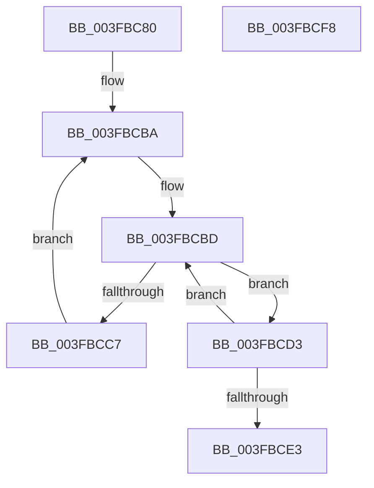

# MiLockHugePfnInternal

- RVA: `0x003FBC80`–`0x003FBCF9` (길이 `121` bytes)
- VA: `0x00000001403FBC80`
- 실행 섹션: `.text`
- PDB 이름 있음: `예`; PDB Function 태그: `아니요`
- unwind 정보 RVA: `0x00099778`
- 디코드: `37`개 명령, `121/121` bytes 표시
- 미해석 바이트: `0` (있으면 어셈블리에 `.byte`로 보존)

> 이 문서는 커널 이미지의 기계어와 PDB 기호를 분석해 생성했습니다. 4번과 5번은 함수 원형과 자료형을 바이너리 사용 방식에서 추정한 C 해석이며 원본 소스 복구 결과는 아닙니다.

## 1. Dependencies

- 직접 호출 지점: **1**; 고유 호출 대상: **1**
- 직접 호출자로 확인된 함수: **17**
- RIP 상대 이미지 참조: **2**

### Outgoing calls
- `0x003FBCCC` → [KeYieldProcessorEx](KeYieldProcessorEx_function_003FBD00.md) (function, `0x003FBD00`)

### Direct callers
- [sub_0031F9CC](../31/Unknown_function_0031F9CC.md) at `0x0031F9EE`
- [MiInitializeNewUltraHugeContext](MiInitializeNewUltraHugeContext_function_003FB974.md) at `0x003FBA64`
- [MiValidateAndLockAweMapCountPage](../4B/MiValidateAndLockAweMapCountPage_function_004BD8F4.md) at `0x004BDA15`
- [MiDeleteVadAwePtes](../4C/MiDeleteVadAwePtes_function_004C4F3C.md) at `0x004C50C0`
- [MiDereferenceHugeContext](../4D/MiDereferenceHugeContext_function_004D9664.md) at `0x004D96FE`
- [MiGetSingleHugeRangeToZero](../4D/MiGetSingleHugeRangeToZero_function_004DD034.md) at `0x004DD1E1`
- [MiAddPartitionHugeRange](../67/MiAddPartitionHugeRange_function_006750D8.md) at `0x006752A1`
- [MiDereferenceIoHugeRange](../67/MiDereferenceIoHugeRange_function_006753F8.md) at `0x00675449`
- [MiGetHugeBadRangeFromNode](../67/MiGetHugeBadRangeFromNode_function_00675818.md) at `0x006758CA`
- [MiGetHugeRange](../67/MiGetHugeRange_function_00675954.md) at `0x00675A89`
- [MiGetPerfectColorHeadHugeRange](../67/MiGetPerfectColorHeadHugeRange_function_00675C08.md) at `0x00675CD7`
- [MiHotRemoveHugeRange](../67/MiHotRemoveHugeRange_function_00675DD0.md) at `0x00675F8A`
- [MiHugePurgeZeroList](../67/MiHugePurgeZeroList_function_00676124.md) at `0x00676224`
- [MiLockHugePfn](../67/MiLockHugePfn_function_006765FC.md) at `0x00676629`
- [MiSetHugeRangePartitionId](../67/MiSetHugeRangePartitionId_function_006773E4.md) at `0x0067745F`
- [sub_006EA7BC](../6E/Unknown_function_006EA7BC.md) at `0x006EA7D8`
- [sub_006FC98E](../6F/Unknown_function_006FC98E.md) at `0x006FCA24`

### Static image references
- `0x003FBC93` → RVA `0x00E300C0` (`.data`; read)
- `0x003FBC9E` → RVA `0x00E300C8` (`.data`; read)

## 2. Other-region calls and transfers

- 다른 실행 섹션으로 향하는 call: **0**
- 별도 외부 분기/꼬리 이동을 확인하지 못했습니다.

## 3. Assembly (complete function range)

```asm
003FBC80  48 8B C4                        mov rax, rsp
003FBC83  48 89 58 08                     mov qword ptr [rax + 8], rbx
003FBC87  48 89 70 18                     mov qword ptr [rax + 0x18], rsi
003FBC8B  89 50 10                        mov dword ptr [rax + 0x10], edx
003FBC8E  57                              push rdi
003FBC8F  48 83 EC 20                     sub rsp, 0x20
003FBC93  48 2B 0D 26 44 A3 00            sub rcx, qword ptr [rip + 0xa34426]
003FBC9A  83 60 10 00                     and dword ptr [rax + 0x10], 0
003FBC9E  48 8B 3D 23 44 A3 00            mov rdi, qword ptr [rip + 0xa34423]
003FBCA5  48 C1 F9 03                     sar rcx, 3
003FBCA9  81 E1 FF FF 3F 00               and ecx, 0x3fffff
003FBCAF  8B F1                           mov esi, ecx
003FBCB1  8B D9                           mov ebx, ecx
003FBCB3  83 E6 1F                        and esi, 0x1f
003FBCB6  48 C1 EB 05                     shr rbx, 5
003FBCBA  8B 14 9F                        mov edx, dword ptr [rdi + rbx*4]
003FBCBD  8B C2                           mov eax, edx
003FBCBF  8B CE                           mov ecx, esi
003FBCC1  D3 F8                           sar eax, cl
003FBCC3  A8 01                           test al, 1
003FBCC5  74 0C                           je 0x1403fbcd3
003FBCC7  48 8D 4C 24 38                  lea rcx, [rsp + 0x38]
003FBCCC  E8 2F 00 00 00                  call 0x1403fbd00
003FBCD1  EB E7                           jmp 0x1403fbcba
003FBCD3  8B CA                           mov ecx, edx
003FBCD5  8B C2                           mov eax, edx
003FBCD7  0F AB F1                        bts ecx, esi
003FBCDA  F0 0F B1 0C 9F                  lock cmpxchg dword ptr [rdi + rbx*4], ecx
003FBCDF  8B D0                           mov edx, eax
003FBCE1  75 DA                           jne 0x1403fbcbd
003FBCE3  48 8B 5C 24 30                  mov rbx, qword ptr [rsp + 0x30]
003FBCE8  B8 01 00 00 00                  mov eax, 1
003FBCED  48 8B 74 24 40                  mov rsi, qword ptr [rsp + 0x40]
003FBCF2  48 83 C4 20                     add rsp, 0x20
003FBCF6  5F                              pop rdi
003FBCF7  C3                              ret
003FBCF8  CC                              int3
```

## 4. C-style interpretation (structured pseudocode)

```c
__int64 __fastcall MiLockHugePfnInternal(__int64 a1, int a2)
{
    __int64 result;
    __int64 v_rbx;
    __int64 v_rsi;
    __int64 v_rsp;
    unsigned __int64 v_stack_p10;
    unsigned __int64 v_stack_p18;
    unsigned __int64 v_stack_p8;

    *(unsigned __int64 *)(v_rsp + 8) = v_rbx;
    *(unsigned __int64 *)(v_rsp + 24) = v_rsi;
    *(unsigned int *)(v_rsp + 16) = a2;
    v_rsp = (v_rsp) - (32);
    a1 = (a1) - (*(unsigned __int64 *)(v_rip + 10699814));
    a1 = (a1) >> (3);
    a1 = (unsigned int)((a1) & (0x3FFFFFULL));
    v_rsi = (unsigned int)(((unsigned int)((unsigned int)(a1))) & (31));
    v_rbx = ((unsigned int)((unsigned int)(a1))) >> (5);
loc_003FBCBA:
loc_003FBCBD:
    result = (unsigned int)(((unsigned int)((unsigned int)((unsigned int)(*(unsigned int *)(*(unsigned __int64 *)(v_rip + 10699811) + v_rbx * 4))))) >> ((unsigned __int8)((unsigned int)((unsigned int)(v_rsi)))));
    if ((((unsigned __int8)(result)) & (1)) == 0) goto loc_003FBCD3;
    result = KeYieldProcessorEx(v_stack_p10, (unsigned int)(*(unsigned int *)(*(unsigned __int64 *)(v_rip + 10699811) + v_rbx * 4)), a3, a4);
    goto loc_003FBCBA;
loc_003FBCD3:
    if ((((unsigned __int8)(result)) & (1)) != 0) goto loc_003FBCBD;
    v_rsp = (v_rsp) + (32);
    return 1;
}
```

## 5. (Beta) C Style

```c
int64_t MiLockHugePfnInternal(int64_t Arg1, int32_t Arg2)
{
    int64_t result;
    int64_t local_rbx;
    int64_t local_rsi;
    int64_t local_rsp;
    uint64_t v_stack_p10;
    uint64_t v_stack_p18;
    uint64_t v_stack_p8;

    *(uint64_t *)(local_rsp + 0x8) = local_rbx;
    *(uint64_t *)(local_rsp + 0x18) = local_rsi;
    *(uint32_t *)(local_rsp + 0x10) = Arg2;
    local_rsp = (local_rsp) - (32);
    Arg1 = (Arg1) - (*(uint64_t *)(v_rip + 0xA34426));
    Arg1 = (Arg1) >> (3);
    Arg1 = (uint32_t)((Arg1) & (0x3FFFFFULL));
    local_rsi = (uint32_t)(((uint32_t)((uint32_t)(Arg1))) & (31));
    local_rbx = ((uint32_t)((uint32_t)(Arg1))) >> (5);
loc_003FBCBA:
loc_003FBCBD:
    result = (uint32_t)(((uint32_t)((uint32_t)((uint32_t)(*(uint32_t *)(*(uint64_t *)(v_rip + 0xA34423) + local_rbx * 4))))) >> ((uint8_t)((uint32_t)((uint32_t)(local_rsi)))));
    if ((((uint8_t)(result)) & (1)) == 0) goto loc_003FBCD3;
    result = KeYieldProcessorEx(v_stack_p10, (uint32_t)(*(uint32_t *)(*(uint64_t *)(v_rip + 0xA34423) + local_rbx * 4)), a3, a4);
    goto loc_003FBCBA;
loc_003FBCD3:
    if ((((uint8_t)(result)) & (1)) != 0) goto loc_003FBCBD;
    local_rsp = (local_rsp) + (32);
    return 1;
}
```

## 6. Execution-region graph

[열기: 2D/3D 그래프와 함수 탐색 컨트롤 패널](../../../control-panel.html?section=text&rva=0x003FBC80&view=graph)

- 2D 그래프는 위에서 아래로 흐르고, 3D 그래프는 빈 공간을 드래그해 회전합니다. Shift+드래그는 이동, 휠은 확대·축소, 함수 노드 선택은 대상 보고서 이동입니다.

### Static fallback


