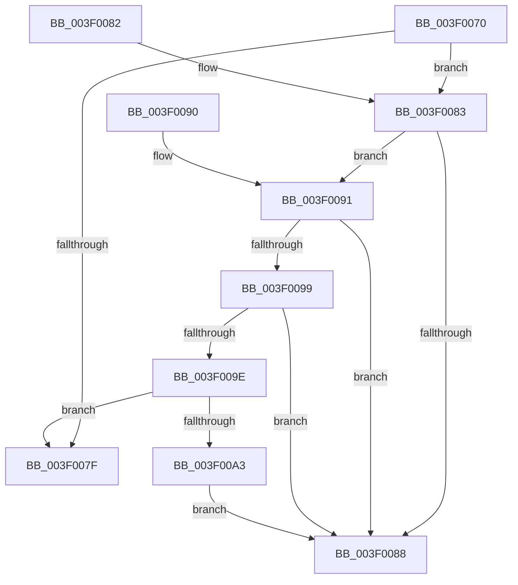

# MiNodeFromFaultPacket

- RVA: `0x003F0070`–`0x003F00A5` (길이 `53` bytes)
- VA: `0x00000001403F0070`
- 실행 섹션: `.text`
- PDB 이름 있음: `예`; PDB Function 태그: `아니요`
- unwind 정보 RVA: `0x000DB714`
- 디코드: `22`개 명령, `53/53` bytes 표시
- 미해석 바이트: `0` (있으면 어셈블리에 `.byte`로 보존)

> 이 문서는 커널 이미지의 기계어와 PDB 기호를 분석해 생성했습니다. 4번과 5번은 함수 원형과 자료형을 바이너리 사용 방식에서 추정한 C 해석이며 원본 소스 복구 결과는 아닙니다.

## 1. Dependencies

- 직접 호출 지점: **0**; 고유 호출 대상: **0**
- 직접 호출자로 확인된 함수: **1**
- RIP 상대 이미지 참조: **0**

### Outgoing calls
- 직접 디코드된 call 명령이 없습니다.

### Direct callers
- [MiInPagePageTable](../3E/MiInPagePageTable_function_003EF8DC.md) at `0x003EFB82`

### Static image references
- 디코드된 RIP-relative 메모리 참조가 없습니다.

## 2. Other-region calls and transfers

- 다른 실행 섹션으로 향하는 call: **0**
- 별도 외부 분기/꼬리 이동을 확인하지 못했습니다.

## 3. Assembly (complete function range)

```asm
003F0070  48 8B 41 10                     mov rax, qword ptr [rcx + 0x10]
003F0074  48 8B C8                        mov rcx, rax
003F0077  48 83 E1 FE                     and rcx, 0xfffffffffffffffe
003F007B  A8 01                           test al, 1
003F007D  75 04                           jne 0x1403f0083
003F007F  33 C0                           xor eax, eax
003F0081  C3                              ret
003F0082  CC                              int3
003F0083  80 39 02                        cmp byte ptr [rcx], 2
003F0086  75 09                           jne 0x1403f0091
003F0088  48 83 E0 FE                     and rax, 0xfffffffffffffffe
003F008C  8B 40 28                        mov eax, dword ptr [rax + 0x28]
003F008F  C3                              ret
003F0090  CC                              int3
003F0091  0F B6 11                        movzx edx, byte ptr [rcx]
003F0094  80 FA 08                        cmp dl, 8
003F0097  74 EF                           je 0x1403f0088
003F0099  80 FA 07                        cmp dl, 7
003F009C  74 EA                           je 0x1403f0088
003F009E  80 FA 04                        cmp dl, 4
003F00A1  75 DC                           jne 0x1403f007f
003F00A3  EB E3                           jmp 0x1403f0088
```

## 4. C-style interpretation (structured pseudocode)

```c
__int64 __fastcall MiNodeFromFaultPacket(__int64 a1)
{
    __int64 result;

    a1 = (*(unsigned __int64 *)(a1 + 16)) & (-2);
    if ((((unsigned __int8)(*(unsigned __int64 *)(a1 + 16))) & (1)) != 0) goto loc_003F0083;
loc_003F007F:
    result = 0;
    return result;
loc_003F0083:
    if ((*(unsigned __int8 *)(a1)) != 2) goto loc_003F0091;
loc_003F0088:
    result = (result) & (-2);
    return (unsigned int)(*(unsigned int *)(result + 40));
loc_003F0091:
    if (((unsigned __int8)(*(unsigned __int8 *)(a1))) == 8) goto loc_003F0088;
    if (((unsigned __int8)(*(unsigned __int8 *)(a1))) == 7) goto loc_003F0088;
    if (((unsigned __int8)(*(unsigned __int8 *)(a1))) != 4) goto loc_003F007F;
    goto loc_003F0088;
}
```

## 5. (Beta) C Style

```c
int64_t MiNodeFromFaultPacket(void *Arg1)
{
    uint8_t *arg1 = (uint8_t *)Arg1;

    int64_t result;

    Arg1 = (*(uint64_t *)(arg1 + 0x10)) & (-2);
    if ((((uint8_t)(*(uint64_t *)(arg1 + 0x10))) & (1)) != 0) goto loc_003F0083;
loc_003F007F:
    result = 0;
    return result;
loc_003F0083:
    if ((*(uint8_t *)(arg1)) != 2) goto loc_003F0091;
loc_003F0088:
    result = (result) & (-2);
    return (uint32_t)(*(uint32_t *)(result + 0x28));
loc_003F0091:
    if (((uint8_t)(*(uint8_t *)(arg1))) == 8) goto loc_003F0088;
    if (((uint8_t)(*(uint8_t *)(arg1))) == 7) goto loc_003F0088;
    if (((uint8_t)(*(uint8_t *)(arg1))) != 4) goto loc_003F007F;
    goto loc_003F0088;
}
```

### 관측된 메모리 오프셋

구조체 형식이 확인되지 않은 접근은 인자 기준의 오프셋으로만 기록했습니다.

| 기준 인자 | 오프셋 표현 | 폭 (bit) | 접근 |
|---|---:|---:|---|
| `Arg1` | `+ 0x10` | `64` | `R` |

## 6. Execution-region graph

[열기: 2D/3D 그래프와 함수 탐색 컨트롤 패널](../../../control-panel.html?section=text&rva=0x003F0070&view=graph)

- 2D 그래프는 위에서 아래로 흐르고, 3D 그래프는 빈 공간을 드래그해 회전합니다. Shift+드래그는 이동, 휠은 확대·축소, 함수 노드 선택은 대상 보고서 이동입니다.

### Static fallback


