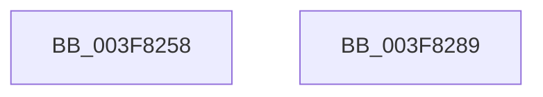

# MiReleaseNonPagedResourcesNotExposed

- RVA: `0x003F8258`–`0x003F828A` (길이 `50` bytes)
- VA: `0x00000001403F8258`
- 실행 섹션: `.text`
- PDB 이름 있음: `예`; PDB Function 태그: `아니요`
- unwind 정보 RVA: `0x0005CAAC`
- 디코드: `15`개 명령, `50/50` bytes 표시
- 미해석 바이트: `0` (있으면 어셈블리에 `.byte`로 보존)

> 이 문서는 커널 이미지의 기계어와 PDB 기호를 분석해 생성했습니다. 4번과 5번은 함수 원형과 자료형을 바이너리 사용 방식에서 추정한 C 해석이며 원본 소스 복구 결과는 아닙니다.

## 1. Dependencies

- 직접 호출 지점: **2**; 고유 호출 대상: **2**
- 직접 호출자로 확인된 함수: **6**
- RIP 상대 이미지 참조: **0**

### Outgoing calls
- `0x003F826E` → [MiReturnCommit](../24/MiReturnCommit_function_00248410.md) (function, `0x00248410`)
- `0x003F8279` → [MiReturnResident](../28/MiReturnResident_function_00286890.md) (function, `0x00286890`)

### Direct callers
- [MiFreeSmallPageFromMdl](../37/MiFreeSmallPageFromMdl_function_00375D58.md) at `0x00375FAB`
- [MiReturnMdlCharges](MiReturnMdlCharges_function_003F6238.md) at `0x003F6256`
- [MiFreeLargePageCharges](MiFreeLargePageCharges_function_003F7FF0.md) at `0x003F800A`
- [MiObtainMdlCharges](../47/MiObtainMdlCharges_function_0047E014.md) at `0x0047E18D`
- [MmRemovePhysicalMemory](../../page/7F/MmRemovePhysicalMemory_function_007FB560.md) at `0x007FB70F`
- [MiAllocatePartitionPhysicalPages](../../page/80/MiAllocatePartitionPhysicalPages_function_0080C9D4.md) at `0x0080CE38`

### Static image references
- 디코드된 RIP-relative 메모리 참조가 없습니다.

## 2. Other-region calls and transfers

- 다른 실행 섹션으로 향하는 call: **0**
- 별도 외부 분기/꼬리 이동을 확인하지 못했습니다.

## 3. Assembly (complete function range)

```asm
003F8258  48 89 5C 24 08                  mov qword ptr [rsp + 8], rbx
003F825D  57                              push rdi
003F825E  48 83 EC 20                     sub rsp, 0x20
003F8262  41 B8 10 00 00 00               mov r8d, 0x10
003F8268  48 8B DA                        mov rbx, rdx
003F826B  48 8B F9                        mov rdi, rcx
003F826E  E8 9D 01 E5 FF                  call 0x140248410
003F8273  48 8B D3                        mov rdx, rbx
003F8276  48 8B CF                        mov rcx, rdi
003F8279  E8 12 E6 E8 FF                  call 0x140286890
003F827E  48 8B 5C 24 30                  mov rbx, qword ptr [rsp + 0x30]
003F8283  48 83 C4 20                     add rsp, 0x20
003F8287  5F                              pop rdi
003F8288  C3                              ret
003F8289  CC                              int3
```

## 4. C-style interpretation (structured pseudocode)

```c
__int64 __fastcall MiReleaseNonPagedResourcesNotExposed(__int64 a1, __int64 a2)
{
    __int64 result;
    __int64 v_rsp;
    unsigned __int64 v_stack_p8;

    v_stack_p8 = v_rbx;
    v_rsp = (v_rsp) - (32);
    result = MiReturnCommit(a1, a2, 16, a4);
    result = MiReturnResident(a1, a2, 16, a4);
    v_rsp = (v_rsp) + (32);
    return result;
}
```

## 5. (Beta) C Style

```c
int64_t MiReleaseNonPagedResourcesNotExposed(int64_t Arg1, int64_t Arg2)
{
    int64_t result;
    int64_t local_rsp;
    uint64_t v_stack_p8;

    v_stack_p8 = local_rbx;
    local_rsp = (local_rsp) - (32);
    result = MiReturnCommit(Arg1, Arg2, 16, a4);
    result = MiReturnResident(Arg1, Arg2, 16, a4);
    local_rsp = (local_rsp) + (32);
    return result;
}
```

## 6. Execution-region graph

[열기: 2D/3D 그래프와 함수 탐색 컨트롤 패널](../../../control-panel.html?section=text&rva=0x003F8258&view=graph)

- 2D 그래프는 위에서 아래로 흐르고, 3D 그래프는 빈 공간을 드래그해 회전합니다. Shift+드래그는 이동, 휠은 확대·축소, 함수 노드 선택은 대상 보고서 이동입니다.

### Static fallback


