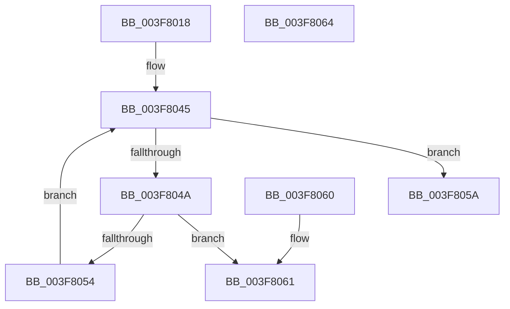

# MiResidentPageDangleFree

- RVA: `0x003F8018`–`0x003F8065` (길이 `77` bytes)
- VA: `0x00000001403F8018`
- 실행 섹션: `.text`
- PDB 이름 있음: `예`; PDB Function 태그: `아니요`
- unwind 정보 RVA: `0x000DB714`
- 디코드: `23`개 명령, `77/77` bytes 표시
- 미해석 바이트: `0` (있으면 어셈블리에 `.byte`로 보존)

> 이 문서는 커널 이미지의 기계어와 PDB 기호를 분석해 생성했습니다. 4번과 5번은 함수 원형과 자료형을 바이너리 사용 방식에서 추정한 C 해석이며 원본 소스 복구 결과는 아닙니다.

## 1. Dependencies

- 직접 호출 지점: **0**; 고유 호출 대상: **0**
- 직접 호출자로 확인된 함수: **2**
- RIP 상대 이미지 참조: **1**

### Outgoing calls
- 직접 디코드된 call 명령이 없습니다.

### Direct callers
- [MiFreeMdlPageRun](../37/MiFreeMdlPageRun_function_00375A4C.md) at `0x00375C18`
- [MiFreeContiguousPages](MiFreeContiguousPages_function_003F7178.md) at `0x003F7344`

### Static image references
- `0x003F802D` → RVA `0x00011C60` (`.rdata`; read)

## 2. Other-region calls and transfers

- 다른 실행 섹션으로 향하는 call: **0**
- 별도 외부 분기/꼬리 이동을 확인하지 못했습니다.

## 3. Assembly (complete function range)

```asm
003F8018  4C 8D 04 49                     lea r8, [rcx + rcx*2]
003F801C  49 C1 E0 04                     shl r8, 4
003F8020  48 B8 00 00 00 00 00 DE FF FF   movabs rax, 0xffffde0000000000
003F802A  4C 03 C0                        add r8, rax
003F802D  48 8D 0D 2C 9C C1 FF            lea rcx, [rip - 0x3e63d4]
003F8034  8B C2                           mov eax, edx
003F8036  48 8B 04 C1                     mov rax, qword ptr [rcx + rax*8]
003F803A  48 8D 0C 40                     lea rcx, [rax + rax*2]
003F803E  48 C1 E1 04                     shl rcx, 4
003F8042  49 03 C8                        add rcx, r8
003F8045  4C 3B C1                        cmp r8, rcx
003F8048  73 10                           jae 0x1403f805a
003F804A  41 8B 40 20                     mov eax, dword ptr [r8 + 0x20]
003F804E  66 83 F8 02                     cmp ax, 2
003F8052  75 0D                           jne 0x1403f8061
003F8054  49 83 C0 30                     add r8, 0x30
003F8058  EB EB                           jmp 0x1403f8045
003F805A  B8 01 00 00 00                  mov eax, 1
003F805F  C3                              ret
003F8060  CC                              int3
003F8061  33 C0                           xor eax, eax
003F8063  C3                              ret
003F8064  CC                              int3
```

## 4. C-style interpretation (structured pseudocode)

```c
__int64 __fastcall MiResidentPageDangleFree(__int64 a1, int a2)
{
    __int64 result;

    a3 = (a1 + a1 * 2) << (4);
    a3 = (a3) + (result);
    a1 = (*(unsigned __int64 *)(v_rip - 4088788 + (unsigned int)(a2) * 8) + *(unsigned __int64 *)(v_rip - 4088788 + (unsigned int)(a2) * 8) * 2) << (4);
    a1 = (a1) + (a3);
loc_003F8045:
    if (a3 >= a1) goto loc_003F805A;
    if (((unsigned __int16)((unsigned int)(*(unsigned int *)(a3 + 32)))) != 2) goto loc_003F8061;
    a3 = (a3) + (48);
    goto loc_003F8045;
loc_003F805A:
    return 1;
loc_003F8061:
    result = 0;
    return result;
}
```

## 5. (Beta) C Style

```c
int64_t MiResidentPageDangleFree(void *Arg1, int32_t Arg2)
{
    uint8_t *arg1 = (uint8_t *)Arg1;

    int64_t result;

    a3 = (Arg1 + Arg1 * 2) << (4);
    a3 = (a3) + (result);
    Arg1 = (*(uint64_t *)(v_rip - 0x3E63D4 + (uint32_t)(Arg2) * 8) + *(uint64_t *)(v_rip - 0x3E63D4 + (uint32_t)(Arg2) * 8) * 2) << (4);
    Arg1 = (Arg1) + (a3);
loc_003F8045:
    if (a3 >= Arg1) goto loc_003F805A;
    if (((uint16_t)((uint32_t)(*(uint32_t *)(a3 + 0x20)))) != 2) goto loc_003F8061;
    a3 = (a3) + (48);
    goto loc_003F8045;
loc_003F805A:
    return 1;
loc_003F8061:
    result = 0;
    return result;
}
```

### 관측된 메모리 오프셋

구조체 형식이 확인되지 않은 접근은 인자 기준의 오프셋으로만 기록했습니다.

| 기준 인자 | 오프셋 표현 | 폭 (bit) | 접근 |
|---|---:|---:|---|
| `Arg1` | `+ 0x0 + rcx*2` | `64` | `R` |

## 6. Execution-region graph

[열기: 2D/3D 그래프와 함수 탐색 컨트롤 패널](../../../control-panel.html?section=text&rva=0x003F8018&view=graph)

- 2D 그래프는 위에서 아래로 흐르고, 3D 그래프는 빈 공간을 드래그해 회전합니다. Shift+드래그는 이동, 휠은 확대·축소, 함수 노드 선택은 대상 보고서 이동입니다.

### Static fallback


