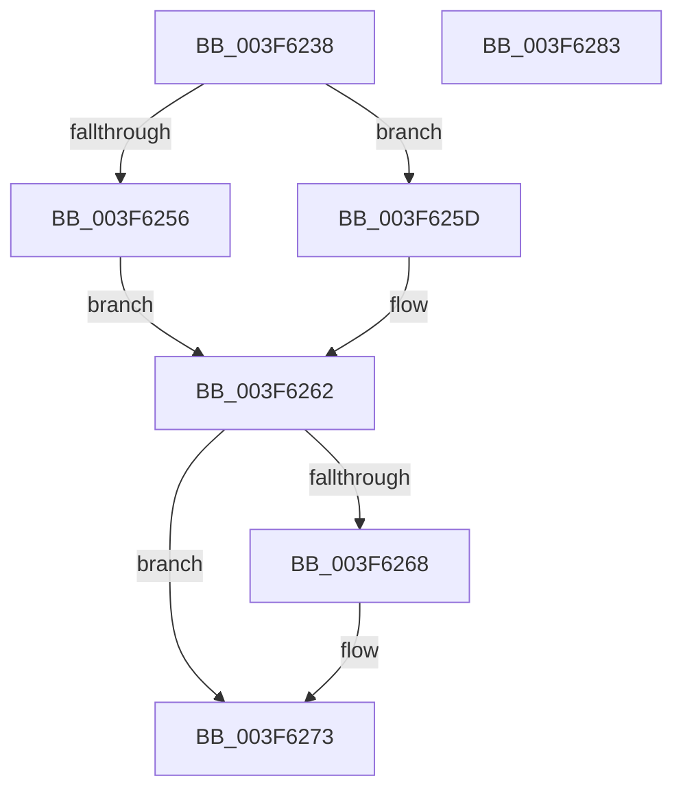

# MiReturnMdlCharges

- RVA: `0x003F6238`–`0x003F6284` (길이 `76` bytes)
- VA: `0x00000001403F6238`
- 실행 섹션: `.text`
- PDB 이름 있음: `예`; PDB Function 태그: `아니요`
- unwind 정보 RVA: `0x00060BC4`
- 디코드: `22`개 명령, `76/76` bytes 표시
- 미해석 바이트: `0` (있으면 어셈블리에 `.byte`로 보존)

> 이 문서는 커널 이미지의 기계어와 PDB 기호를 분석해 생성했습니다. 4번과 5번은 함수 원형과 자료형을 바이너리 사용 방식에서 추정한 C 해석이며 원본 소스 복구 결과는 아닙니다.

## 1. Dependencies

- 직접 호출 지점: **2**; 고유 호출 대상: **2**
- 직접 호출자로 확인된 함수: **2**
- RIP 상대 이미지 참조: **0**

### Outgoing calls
- `0x003F6256` → [MiReleaseNonPagedResourcesNotExposed](MiReleaseNonPagedResourcesNotExposed_function_003F8258.md) (function, `0x003F8258`)
- `0x003F625D` → [MiReleaseNonPagedResources](../32/MiReleaseNonPagedResources_function_0032299C.md) (function, `0x0032299C`)

### Direct callers
- [MiReturnMdlExcess](../67/MiReturnMdlExcess_function_0067774C.md) at `0x006777B1`
- [MiFreeBootPageTable](../../init/C5/MiFreeBootPageTable_function_00C5FC10.md) at `0x00C5FCE1`

### Static image references
- 디코드된 RIP-relative 메모리 참조가 없습니다.

## 2. Other-region calls and transfers

- 다른 실행 섹션으로 향하는 call: **0**
- 별도 외부 분기/꼬리 이동을 확인하지 못했습니다.

## 3. Assembly (complete function range)

```asm
003F6238  48 89 5C 24 08                  mov qword ptr [rsp + 8], rbx
003F623D  48 89 74 24 10                  mov qword ptr [rsp + 0x10], rsi
003F6242  57                              push rdi
003F6243  48 83 EC 20                     sub rsp, 0x20
003F6247  41 8B F0                        mov esi, r8d
003F624A  48 8B DA                        mov rbx, rdx
003F624D  48 8B F9                        mov rdi, rcx
003F6250  41 F6 C0 01                     test r8b, 1
003F6254  74 07                           je 0x1403f625d
003F6256  E8 FD 1F 00 00                  call 0x1403f8258
003F625B  EB 05                           jmp 0x1403f6262
003F625D  E8 3A C7 F2 FF                  call 0x14032299c
003F6262  40 F6 C6 02                     test sil, 2
003F6266  75 0B                           jne 0x1403f6273
003F6268  48 F7 DB                        neg rbx
003F626B  F0 48 01 9F C0 4C 00 00         lock add qword ptr [rdi + 0x4cc0], rbx
003F6273  48 8B 5C 24 30                  mov rbx, qword ptr [rsp + 0x30]
003F6278  48 8B 74 24 38                  mov rsi, qword ptr [rsp + 0x38]
003F627D  48 83 C4 20                     add rsp, 0x20
003F6281  5F                              pop rdi
003F6282  C3                              ret
003F6283  CC                              int3
```

## 4. C-style interpretation (structured pseudocode)

```c
__int64 __fastcall MiReturnMdlCharges(__int64 a1, __int64 a2, int a3)
{
    __int64 result;
    __int64 v_rbx;
    __int64 v_rsp;
    unsigned __int64 v_stack_p10;
    unsigned __int64 v_stack_p8;

    v_stack_p8 = v_rbx;
    v_stack_p10 = v_rsi;
    v_rsp = (v_rsp) - (32);
    if ((((unsigned __int8)(a3)) & (1)) == 0) goto loc_003F625D;
    result = MiReleaseNonPagedResourcesNotExposed(a1, a2, a3, a4);
    goto loc_003F6262;
loc_003F625D:
    result = MiReleaseNonPagedResources(a1, a2, a3, a4);
loc_003F6262:
    v_rbx = a2;
    if ((((unsigned __int8)((unsigned int)(a3))) & (2)) == 0) {
        v_rbx = -(a2);
    }
    v_rsp = (v_rsp) + (32);
    return result;
}
```

## 5. (Beta) C Style

```c
int64_t MiReturnMdlCharges(void *Arg1, int64_t Arg2, int32_t Arg3)
{
    uint8_t *arg1 = (uint8_t *)Arg1;

    int64_t result;
    int64_t local_rbx;
    int64_t local_rsp;
    uint64_t v_stack_p10;
    uint64_t v_stack_p8;

    v_stack_p8 = local_rbx;
    v_stack_p10 = local_rsi;
    local_rsp = (local_rsp) - (32);
    if ((((uint8_t)(Arg3)) & (1)) == 0) goto loc_003F625D;
    result = MiReleaseNonPagedResourcesNotExposed(Arg1, Arg2, Arg3, a4);
    goto loc_003F6262;
loc_003F625D:
    result = MiReleaseNonPagedResources(Arg1, Arg2, Arg3, a4);
loc_003F6262:
    local_rbx = Arg2;
    if ((((uint8_t)((uint32_t)(Arg3))) & (2)) == 0) {
        local_rbx = -(Arg2);
    }
    local_rsp = (local_rsp) + (32);
    return result;
}
```

### 관측된 메모리 오프셋

구조체 형식이 확인되지 않은 접근은 인자 기준의 오프셋으로만 기록했습니다.

| 기준 인자 | 오프셋 표현 | 폭 (bit) | 접근 |
|---|---:|---:|---|
| `Arg1` | `+ 0x4CC0` | `64` | `R/W` |

## 6. Execution-region graph

[열기: 2D/3D 그래프와 함수 탐색 컨트롤 패널](../../../control-panel.html?section=text&rva=0x003F6238&view=graph)

- 2D 그래프는 위에서 아래로 흐르고, 3D 그래프는 빈 공간을 드래그해 회전합니다. Shift+드래그는 이동, 휠은 확대·축소, 함수 노드 선택은 대상 보고서 이동입니다.

### Static fallback


