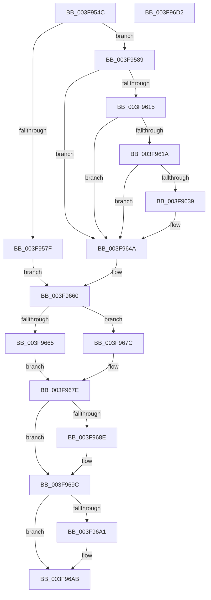

# MiScrubPage

- RVA: `0x003F954C`–`0x003F96D3` (길이 `391` bytes)
- VA: `0x00000001403F954C`
- 실행 섹션: `.text`
- PDB 이름 있음: `예`; PDB Function 태그: `아니요`
- unwind 정보 RVA: `0x0005D79C`
- 디코드: `103`개 명령, `391/391` bytes 표시
- 미해석 바이트: `0` (있으면 어셈블리에 `.byte`로 보존)

> 이 문서는 커널 이미지의 기계어와 PDB 기호를 분석해 생성했습니다. 4번과 5번은 함수 원형과 자료형을 바이너리 사용 방식에서 추정한 C 해석이며 원본 소스 복구 결과는 아닙니다.

## 1. Dependencies

- 직접 호출 지점: **7**; 고유 호출 대상: **6**
- 직접 호출자로 확인된 함수: **3**
- RIP 상대 이미지 참조: **2**

### Outgoing calls
- `0x003F959F` → [MiGetUltraMapping](../32/MiGetUltraMapping_function_00323270.md) (function, `0x00323270`)
- `0x003F95D3` → [MiMakeProtectionPfnCompatible](../22/MiMakeProtectionPfnCompatible_function_00229CD0.md) (function, `0x00229CD0`)
- `0x003F9602` → [MiMakeValidPte](../2C/MiMakeValidPte_function_002C5590.md) (function, `0x002C5590`)
- `0x003F9645` → [MiCheckLinearProtectedPteAccessedBit](../29/MiCheckLinearProtectedPteAccessedBit_function_00292D80.md) (function, `0x00292D80`)
- `0x003F9675` → [KeCopyPage](../6B/KeCopyPage_function_006BA0F0.md) (function, `0x006BA0F0`)
- `0x003F9681` → [RtlScrubMemory](RtlScrubMemory_function_003F96DC.md) (function, `0x003F96DC`)
- `0x003F9697` → [KeCopyPage](../6B/KeCopyPage_function_006BA0F0.md) (function, `0x006BA0F0`)

### Direct callers
- [MiScrubLargeMappedPage](../69/MiScrubLargeMappedPage_function_00693E2C.md) at `0x0069415E`
- [MiScrubLargePage](../69/MiScrubLargePage_function_006942E8.md) at `0x006946C7`
- [MiScrubNode](../../page/A4/MiScrubNode_function_00A46098.md) at `0x00A46249`

### Static image references
- `0x003F9607` → RVA `0x00FC6A88` (`ALMOSTRO`; read)
- `0x003F96A1` → RVA `0x00010880` (`.rdata`; read)

## 2. Other-region calls and transfers

- 다른 실행 섹션으로 향하는 call: **0**
- 별도 외부 분기/꼬리 이동을 확인하지 못했습니다.

## 3. Assembly (complete function range)

```asm
003F954C  48 89 5C 24 10                  mov qword ptr [rsp + 0x10], rbx
003F9551  48 89 6C 24 18                  mov qword ptr [rsp + 0x18], rbp
003F9556  48 89 74 24 20                  mov qword ptr [rsp + 0x20], rsi
003F955B  57                              push rdi
003F955C  41 54                           push r12
003F955E  41 55                           push r13
003F9560  41 56                           push r14
003F9562  41 57                           push r15
003F9564  48 83 EC 20                     sub rsp, 0x20
003F9568  83 CF FF                        or edi, 0xffffffff
003F956B  45 8B E1                        mov r12d, r9d
003F956E  4D 8B F8                        mov r15, r8
003F9571  4C 8B EA                        mov r13, rdx
003F9574  48 8B E9                        mov rbp, rcx
003F9577  8D 47 02                        lea eax, [rdi + 2]
003F957A  4D 85 C0                        test r8, r8
003F957D  74 0A                           je 0x1403f9589
003F957F  4D 8B F0                        mov r14, r8
003F9582  33 F6                           xor esi, esi
003F9584  E9 D7 00 00 00                  jmp 0x1403f9660
003F9589  41 83 E1 02                     and r9d, 2
003F958D  48 81 C1 90 00 00 00            add rcx, 0x90
003F9594  45 03 C9                        add r9d, r9d
003F9597  4C 8B C0                        mov r8, rax
003F959A  BA 03 00 00 00                  mov edx, 3
003F959F  E8 CC 9C F2 FF                  call 0x140323270
003F95A4  48 8B F0                        mov rsi, rax
003F95A7  4C 8B F0                        mov r14, rax
003F95AA  48 B8 F8 FF FF FF 7F 00 00 00   movabs rax, 0x7ffffffff8
003F95B4  48 C1 EE 09                     shr rsi, 9
003F95B8  48 23 F0                        and rsi, rax
003F95BB  48 B8 00 00 00 00 80 F6 FF FF   movabs rax, 0xfffff68000000000
003F95C5  48 8B C8                        mov rcx, rax
003F95C8  48 03 F1                        add rsi, rcx
003F95CB  49 8B D5                        mov rdx, r13
003F95CE  B9 04 00 00 00                  mov ecx, 4
003F95D3  E8 F8 06 E3 FF                  call 0x140229cd0
003F95D8  0D 00 00 00 A0                  or eax, 0xa0000000
003F95DD  48 B9 00 00 00 00 00 DE FF FF   movabs rcx, 0xffffde0000000000
003F95E7  48 2B D1                        sub rdx, rcx
003F95EA  44 8B C0                        mov r8d, eax
003F95ED  48 C1 FA 04                     sar rdx, 4
003F95F1  48 B9 AB AA AA AA AA AA AA AA   movabs rcx, 0xaaaaaaaaaaaaaaab
003F95FB  48 0F AF D1                     imul rdx, rcx
003F95FF  48 8B CE                        mov rcx, rsi
003F9602  E8 89 BF EC FF                  call 0x1402c5590
003F9607  48 0F BA 25 78 D4 BC 00 24      bt qword ptr [rip + 0xbcd478], 0x24
003F9610  48 8B D8                        mov rbx, rax
003F9613  73 35                           jae 0x1403f964a
003F9615  F6 C3 20                        test bl, 0x20
003F9618  75 30                           jne 0x1403f964a
003F961A  48 B8 00 00 00 00 80 F6 FF FF   movabs rax, 0xfffff68000000000
003F9624  48 8B C0                        mov rax, rax
003F9627  48 B9 00 00 00 00 40 00 00 00   movabs rcx, 0x4000000000
003F9631  48 03 C1                        add rax, rcx
003F9634  48 3B F0                        cmp rsi, rax
003F9637  72 11                           jb 0x1403f964a
003F9639  41 B8 80 00 00 00               mov r8d, 0x80
003F963F  48 8B D3                        mov rdx, rbx
003F9642  48 8B CE                        mov rcx, rsi
003F9645  E8 36 97 E9 FF                  call 0x140292d80
003F964A  48 89 1E                        mov qword ptr [rsi], rbx
003F964D  41 8B 45 20                     mov eax, dword ptr [r13 + 0x20]
003F9651  C1 E8 10                        shr eax, 0x10
003F9654  24 C0                           and al, 0xc0
003F9656  3C 40                           cmp al, 0x40
003F9658  B8 01 00 00 00                  mov eax, 1
003F965D  0F 44 F8                        cmove edi, eax
003F9660  44 84 E0                        test al, r12b
003F9663  74 17                           je 0x1403f967c
003F9665  48 8B 9D B0 00 00 00            mov rbx, qword ptr [rbp + 0xb0]
003F966C  44 8B C7                        mov r8d, edi
003F966F  48 8B CB                        mov rcx, rbx
003F9672  49 8B D6                        mov rdx, r14
003F9675  E8 76 0A 2C 00                  call 0x1406ba0f0
003F967A  EB 02                           jmp 0x1403f967e
003F967C  33 DB                           xor ebx, ebx
003F967E  49 8B CE                        mov rcx, r14
003F9681  E8 56 00 00 00                  call 0x1403f96dc
003F9686  44 8B E0                        mov r12d, eax
003F9689  48 85 DB                        test rbx, rbx
003F968C  74 0E                           je 0x1403f969c
003F968E  44 8B C7                        mov r8d, edi
003F9691  48 8B D3                        mov rdx, rbx
003F9694  49 8B CE                        mov rcx, r14
003F9697  E8 54 0A 2C 00                  call 0x1406ba0f0
003F969C  4D 85 FF                        test r15, r15
003F969F  75 0A                           jne 0x1403f96ab
003F96A1  48 8B 0D D8 71 C1 FF            mov rcx, qword ptr [rip - 0x3e8e28]
003F96A8  48 89 0E                        mov qword ptr [rsi], rcx
003F96AB  48 FF 85 B8 00 00 00            inc qword ptr [rbp + 0xb8]
003F96B2  41 8B C4                        mov eax, r12d
003F96B5  48 8B 6C 24 60                  mov rbp, qword ptr [rsp + 0x60]
003F96BA  48 8B 5C 24 58                  mov rbx, qword ptr [rsp + 0x58]
003F96BF  48 8B 74 24 68                  mov rsi, qword ptr [rsp + 0x68]
003F96C4  48 83 C4 20                     add rsp, 0x20
003F96C8  41 5F                           pop r15
003F96CA  41 5E                           pop r14
003F96CC  41 5D                           pop r13
003F96CE  41 5C                           pop r12
003F96D0  5F                              pop rdi
003F96D1  C3                              ret
003F96D2  CC                              int3
```

## 4. C-style interpretation (structured pseudocode)

```c
__int64 __fastcall MiScrubPage(__int64 a1, __int64 a2, __int64 a3, int a4)
{
    __int64 result;
    __int64 v_rbx;
    __int64 v_rdi;
    __int64 v_rsi;
    __int64 v_rsp;
    unsigned __int64 v_stack_p10;
    unsigned __int64 v_stack_p18;
    unsigned __int64 v_stack_p20;

    v_stack_p10 = v_rbx;
    v_stack_p18 = v_rbp;
    v_stack_p20 = v_rsi;
    v_rsp = (v_rsp) - (32);
    v_rdi = (unsigned int)((v_rdi) | (0xFFFFFFFFULL));
    if (a3 == 0) goto loc_003F9589;
    v_rsi = 0;
    goto loc_003F9660;
loc_003F9589:
    a4 = (unsigned int)((a4) & (2));
    a1 = (a1) + (144);
    a4 = (unsigned int)((a4) + (a4));
    result = MiGetUltraMapping(a1, 3, v_rdi + 2, a4);
    v_rsi = (result) >> (9);
    v_rsi = (v_rsi) & (result);
    v_rsi = (v_rsi) + (result);
    result = MiMakeProtectionPfnCompatible(4, a2, v_rdi + 2, a4);
    result = (unsigned int)((result) | (0xA0000000ULL));
    a2 = (a2) - (4);
    a2 = (a2) >> (4);
    a2 = (a2) * (4);
    result = MiMakeValidPte(v_rsi, a2, (unsigned int)((unsigned int)(result)), a4);
    if (condition_is_above_or_equal) goto loc_003F964A;
    if ((((unsigned __int8)(result)) & (32)) != 0) goto loc_003F964A;
    result = (result) + (v_rsi);
    if (v_rsi >= result) {
        a3 = 128;
        a2 = result;
        a1 = v_rsi;
        result = MiCheckLinearProtectedPteAccessedBit(a1, a2, a3, a4);
    }
    *(unsigned __int64 *)(v_rsi) = result;
    result = (unsigned int)(((unsigned int)(*(unsigned int *)(a2 + 32))) >> (16));
    result = (unsigned __int8)((result) & (192));
    if (((unsigned __int8)(result)) == 64) { v_rdi = 1; }
loc_003F9660:
    if (((1) & ((unsigned __int8)((unsigned int)(a4)))) == 0) goto loc_003F967C;
    result = KeCopyPage(*(unsigned __int64 *)(a1 + 176), result, (unsigned int)((unsigned int)(v_rdi)), a4);
    goto loc_003F967E;
loc_003F967C:
    v_rbx = 0;
loc_003F967E:
    result = RtlScrubMemory(result, result, (unsigned int)((unsigned int)(v_rdi)), a4);
    if (0 != 0) {
        a3 = (unsigned int)(v_rdi);
        a2 = 0;
        a1 = result;
        result = KeCopyPage(a1, a2, a3, a4);
    }
    if (a3 == 0) {
        a1 = *(unsigned __int64 *)(v_rip - 4099624);
        *(unsigned __int64 *)(v_rsi) = a1;
    }
    v_rsp = (v_rsp) + (32);
    return (unsigned int)((unsigned int)((unsigned int)((unsigned int)(result))));
}
```

## 5. (Beta) C Style

```c
int64_t MiScrubPage(void *Arg1, void *Arg2, int64_t Arg3, int32_t Arg4)
{
    uint8_t *arg1 = (uint8_t *)Arg1;
    uint8_t *arg2 = (uint8_t *)Arg2;

    int64_t result;
    int64_t local_rbx;
    int64_t local_rdi;
    int64_t local_rsi;
    int64_t local_rsp;
    uint64_t v_stack_p10;
    uint64_t v_stack_p18;
    uint64_t v_stack_p20;

    v_stack_p10 = local_rbx;
    v_stack_p18 = local_rbp;
    v_stack_p20 = local_rsi;
    local_rsp = (local_rsp) - (32);
    local_rdi = (uint32_t)((local_rdi) | (0xFFFFFFFFULL));
    if (Arg3 == 0) goto loc_003F9589;
    local_rsi = 0;
    goto loc_003F9660;
loc_003F9589:
    Arg4 = (uint32_t)((Arg4) & (2));
    Arg1 = (Arg1) + (144);
    Arg4 = (uint32_t)((Arg4) + (Arg4));
    result = MiGetUltraMapping(Arg1, 3, local_rdi + 2, Arg4);
    local_rsi = (result) >> (9);
    local_rsi = (local_rsi) & (result);
    local_rsi = (local_rsi) + (result);
    result = MiMakeProtectionPfnCompatible(4, Arg2, local_rdi + 2, Arg4);
    result = (uint32_t)((result) | (0xA0000000ULL));
    Arg2 = (Arg2) - (4);
    Arg2 = (Arg2) >> (4);
    Arg2 = (Arg2) * (4);
    result = MiMakeValidPte(local_rsi, Arg2, (uint32_t)((uint32_t)(result)), Arg4);
    if (condition_is_above_or_equal) goto loc_003F964A;
    if ((((uint8_t)(result)) & (32)) != 0) goto loc_003F964A;
    result = (result) + (local_rsi);
    if (local_rsi >= result) {
        Arg3 = 128;
        Arg2 = result;
        Arg1 = local_rsi;
        result = MiCheckLinearProtectedPteAccessedBit(Arg1, Arg2, Arg3, Arg4);
    }
    *(uint64_t *)(local_rsi) = result;
    result = (uint32_t)(((uint32_t)(*(uint32_t *)(arg2 + 0x20))) >> (16));
    result = (uint8_t)((result) & (192));
    if (((uint8_t)(result)) == 64) { local_rdi = 1; }
loc_003F9660:
    if (((1) & ((uint8_t)((uint32_t)(Arg4)))) == 0) goto loc_003F967C;
    result = KeCopyPage(*(uint64_t *)(arg1 + 0xB0), result, (uint32_t)((uint32_t)(local_rdi)), Arg4);
    goto loc_003F967E;
loc_003F967C:
    local_rbx = 0;
loc_003F967E:
    result = RtlScrubMemory(result, result, (uint32_t)((uint32_t)(local_rdi)), Arg4);
    if (0 != 0) {
        Arg3 = (uint32_t)(local_rdi);
        Arg2 = 0;
        Arg1 = result;
        result = KeCopyPage(Arg1, Arg2, Arg3, Arg4);
    }
    if (Arg3 == 0) {
        Arg1 = *(uint64_t *)(v_rip - 0x3E8E28);
        *(void **)(local_rsi) = Arg1;
    }
    local_rsp = (local_rsp) + (32);
    return (uint32_t)((uint32_t)((uint32_t)((uint32_t)(result))));
}
```

### 관측된 메모리 오프셋

구조체 형식이 확인되지 않은 접근은 인자 기준의 오프셋으로만 기록했습니다.

| 기준 인자 | 오프셋 표현 | 폭 (bit) | 접근 |
|---|---:|---:|---|
| `Arg1` | `+ 0xB0` | `64` | `R` |
| `Arg1` | `+ 0xB8` | `64` | `R/W` |
| `Arg2` | `+ 0x20` | `32` | `R` |

## 6. Execution-region graph

[열기: 2D/3D 그래프와 함수 탐색 컨트롤 패널](../../../control-panel.html?section=text&rva=0x003F954C&view=graph)

- 2D 그래프는 위에서 아래로 흐르고, 3D 그래프는 빈 공간을 드래그해 회전합니다. Shift+드래그는 이동, 휠은 확대·축소, 함수 노드 선택은 대상 보고서 이동입니다.

### Static fallback


