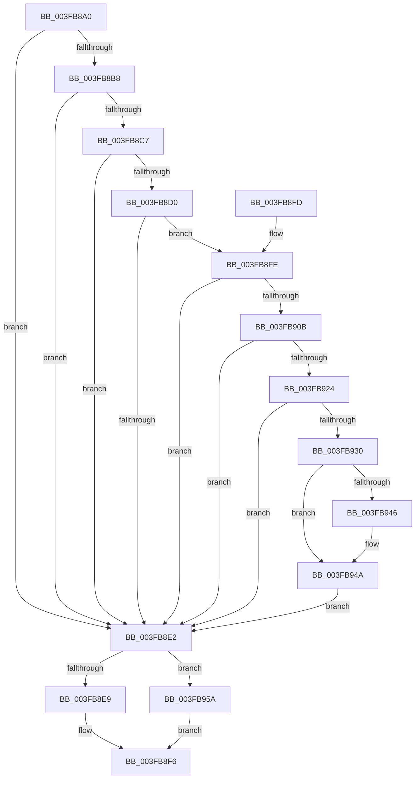

# MiSetNonResidentPteHeat

- RVA: `0x003FB8A0`–`0x003FB96C` (길이 `204` bytes)
- VA: `0x00000001403FB8A0`
- 실행 섹션: `.text`
- PDB 이름 있음: `예`; PDB Function 태그: `아니요`
- unwind 정보 RVA: `0x000DB714`
- 디코드: `54`개 명령, `204/204` bytes 표시
- 미해석 바이트: `0` (있으면 어셈블리에 `.byte`로 보존)

> 이 문서는 커널 이미지의 기계어와 PDB 기호를 분석해 생성했습니다. 4번과 5번은 함수 원형과 자료형을 바이너리 사용 방식에서 추정한 C 해석이며 원본 소스 복구 결과는 아닙니다.

## 1. Dependencies

- 직접 호출 지점: **0**; 고유 호출 대상: **0**
- 직접 호출자로 확인된 함수: **1**
- RIP 상대 이미지 참조: **1**

### Outgoing calls
- 직접 디코드된 call 명령이 없습니다.

### Direct callers
- [MiInitializeNewPfns](../67/MiInitializeNewPfns_function_00670E94.md) at `0x00670FAE`

### Static image references
- `0x003FB8FE` → RVA `0x00FC6A88` (`ALMOSTRO`; read)

## 2. Other-region calls and transfers

- 다른 실행 섹션으로 향하는 call: **0**
- 별도 외부 분기/꼬리 이동을 확인하지 못했습니다.

## 3. Assembly (complete function range)

```asm
003FB8A0  4C 8B 01                        mov r8, qword ptr [rcx]
003FB8A3  44 8B D2                        mov r10d, edx
003FB8A6  4C 8B C9                        mov r9, rcx
003FB8A9  48 B8 00 D0 BE 7D FB F6 FF FF   movabs rax, 0xfffff6fb7dbed000
003FB8B3  48 3B C8                        cmp rcx, rax
003FB8B6  72 2A                           jb 0x1403fb8e2
003FB8B8  48 B8 F8 D7 BE 7D FB F6 FF FF   movabs rax, 0xfffff6fb7dbed7f8
003FB8C2  48 3B C8                        cmp rcx, rax
003FB8C5  77 1B                           ja 0x1403fb8e2
003FB8C7  49 8B C0                        mov rax, r8
003FB8CA  41 F6 C0 01                     test r8b, 1
003FB8CE  74 12                           je 0x1403fb8e2
003FB8D0  41 F6 C0 42                     test r8b, 0x42
003FB8D4  0F 95 C2                        setne dl
003FB8D7  41 F6 C0 20                     test r8b, 0x20
003FB8DB  0F 95 C1                        setne cl
003FB8DE  84 D1                           test cl, dl
003FB8E0  74 1C                           je 0x1403fb8fe
003FB8E2  49 0F BA E0 0A                  bt r8, 0xa
003FB8E7  72 71                           jb 0x1403fb95a
003FB8E9  41 F7 DA                        neg r10d
003FB8EC  48 1B C0                        sbb rax, rax
003FB8EF  83 E0 08                        and eax, 8
003FB8F2  49 83 E0 F7                     and r8, 0xfffffffffffffff7
003FB8F6  49 0B C0                        or rax, r8
003FB8F9  49 89 01                        mov qword ptr [r9], rax
003FB8FC  C3                              ret
003FB8FD  CC                              int3
003FB8FE  48 F7 05 7F B1 BC 00 00 00 60 00  test qword ptr [rip + 0xbcb17f], 0x600000
003FB909  74 D7                           je 0x1403fb8e2
003FB90B  65 48 8B 0C 25 88 01 00 00      mov rcx, qword ptr gs:[0x188]
003FB914  48 8B 91 B8 00 00 00            mov rdx, qword ptr [rcx + 0xb8]
003FB91B  80 BA 60 01 00 00 01            cmp byte ptr [rdx + 0x160], 1
003FB922  74 BE                           je 0x1403fb8e2
003FB924  4C 8B 9A 08 05 00 00            mov r11, qword ptr [rdx + 0x508]
003FB92B  4D 85 DB                        test r11, r11
003FB92E  74 B2                           je 0x1403fb8e2
003FB930  49 8B C9                        mov rcx, r9
003FB933  48 C1 E9 03                     shr rcx, 3
003FB937  81 E1 FF 01 00 00               and ecx, 0x1ff
003FB93D  49 8B 0C CB                     mov rcx, qword ptr [r11 + rcx*8]
003FB941  F6 C1 20                        test cl, 0x20
003FB944  74 04                           je 0x1403fb94a
003FB946  48 83 C8 20                     or rax, 0x20
003FB94A  4C 8B C0                        mov r8, rax
003FB94D  49 83 C8 42                     or r8, 0x42
003FB951  F6 C1 42                        test cl, 0x42
003FB954  4C 0F 44 C0                     cmove r8, rax
003FB958  EB 88                           jmp 0x1403fb8e2
003FB95A  41 F7 DA                        neg r10d
003FB95D  48 1B C0                        sbb rax, rax
003FB960  25 00 08 00 00                  and eax, 0x800
003FB965  49 0F BA F0 0B                  btr r8, 0xb
003FB96A  EB 8A                           jmp 0x1403fb8f6
```

## 4. C-style interpretation (structured pseudocode)

```c
__int64 __fastcall MiSetNonResidentPteHeat(__int64 a1, int a2)
{
    __int64 result;
    __int64 v_r10;

    if (a1 < result) goto loc_003FB8E2;
    if (a1 > result) goto loc_003FB8E2;
    if ((((unsigned __int8)(*(unsigned __int64 *)(a1))) & (1)) == 0) goto loc_003FB8E2;
    a2 = ((((unsigned __int8)(*(unsigned __int64 *)(a1))) & (66)) != 0) ? 1 : 0;
    a1 = ((((unsigned __int8)(*(unsigned __int64 *)(a1))) & (32)) != 0) ? 1 : 0;
    if ((((unsigned __int8)(a1)) & ((unsigned __int8)(a2))) == 0) goto loc_003FB8FE;
loc_003FB8E2:
    if (condition_is_below) goto loc_003FB95A;
    v_r10 = (unsigned int)(-((unsigned int)(a2)));
    result = (unsigned int)((*(unsigned __int64 *)(a1)) & (8));
    a3 = (*(unsigned __int64 *)(a1)) & (-9);
loc_003FB8F6:
    result = (result) | (a3);
    *(unsigned __int64 *)(a1) = result;
    return result;
loc_003FB8FE:
    if (((*(unsigned __int64 *)(v_rip + 12366207)) & (0x600000ULL)) == 0) goto loc_003FB8E2;
    if ((*(unsigned __int8 *)(*(unsigned __int64 *)(*(unsigned __int64 *)(gs_base + (0 + 392)) + 184) + 352)) == 1) goto loc_003FB8E2;
    if (*(unsigned __int64 *)(*(unsigned __int64 *)(*(unsigned __int64 *)(gs_base + (0 + 392)) + 184) + 1288) == 0) goto loc_003FB8E2;
    a1 = (a1) >> (3);
    a1 = (unsigned int)((a1) & (511));
    if ((((unsigned __int8)(*(unsigned __int64 *)(*(unsigned __int64 *)(*(unsigned __int64 *)(*(unsigned __int64 *)(gs_base + (0 + 392)) + 184) + 1288) + a1 * 8))) & (32)) != 0) {
        result = (result) | (32);
    }
    a3 = (result) | (66);
    if ((((unsigned __int8)(*(unsigned __int64 *)(*(unsigned __int64 *)(*(unsigned __int64 *)(*(unsigned __int64 *)(gs_base + (0 + 392)) + 184) + 1288) + a1 * 8))) & (66)) == 0) { a3 = result; }
    goto loc_003FB8E2;
loc_003FB95A:
    v_r10 = (unsigned int)(-(v_r10));
    result = (unsigned int)((result) & (0x800ULL));
    goto loc_003FB8F6;
}
```

## 5. (Beta) C Style

```c
int64_t MiSetNonResidentPteHeat(void *Arg1, int32_t Arg2)
{
    uint8_t *arg1 = (uint8_t *)Arg1;

    int64_t result;
    int64_t local_r10;

    if (Arg1 < result) goto loc_003FB8E2;
    if (Arg1 > result) goto loc_003FB8E2;
    if ((((uint8_t)(*(uint64_t *)(arg1))) & (1)) == 0) goto loc_003FB8E2;
    Arg2 = ((((uint8_t)(*(uint64_t *)(arg1))) & (66)) != 0) ? 1 : 0;
    Arg1 = ((((uint8_t)(*(uint64_t *)(arg1))) & (32)) != 0) ? 1 : 0;
    if ((((uint8_t)(Arg1)) & ((uint8_t)(Arg2))) == 0) goto loc_003FB8FE;
loc_003FB8E2:
    if (condition_is_below) goto loc_003FB95A;
    local_r10 = (uint32_t)(-((uint32_t)(Arg2)));
    result = (uint32_t)((*(uint64_t *)(arg1)) & (8));
    a3 = (*(uint64_t *)(arg1)) & (-9);
loc_003FB8F6:
    result = (result) | (a3);
    *(uint64_t *)(arg1) = result;
    return result;
loc_003FB8FE:
    if (((*(uint64_t *)(v_rip + 0xBCB17F)) & (0x600000ULL)) == 0) goto loc_003FB8E2;
    if ((*(uint8_t *)(*(uint64_t *)(*(uint64_t *)(gs_base + (0 + 0x188)) + 0xB8) + 0x160)) == 1) goto loc_003FB8E2;
    if (*(uint64_t *)(*(uint64_t *)(*(uint64_t *)(gs_base + (0 + 0x188)) + 0xB8) + 0x508) == 0) goto loc_003FB8E2;
    Arg1 = (Arg1) >> (3);
    Arg1 = (uint32_t)((Arg1) & (511));
    if ((((uint8_t)(*(uint64_t *)(*(uint64_t *)(*(uint64_t *)(*(uint64_t *)(gs_base + (0 + 0x188)) + 0xB8) + 0x508) + arg1 * 8))) & (32)) != 0) {
        result = (result) | (32);
    }
    a3 = (result) | (66);
    if ((((uint8_t)(*(uint64_t *)(*(uint64_t *)(*(uint64_t *)(*(uint64_t *)(gs_base + (0 + 0x188)) + 0xB8) + 0x508) + arg1 * 8))) & (66)) == 0) { a3 = result; }
    goto loc_003FB8E2;
loc_003FB95A:
    local_r10 = (uint32_t)(-(local_r10));
    result = (uint32_t)((result) & (0x800ULL));
    goto loc_003FB8F6;
}
```

### 관측된 메모리 오프셋

구조체 형식이 확인되지 않은 접근은 인자 기준의 오프셋으로만 기록했습니다.

| 기준 인자 | 오프셋 표현 | 폭 (bit) | 접근 |
|---|---:|---:|---|
| `Arg1` | `+ 0x0` | `64` | `R` |
| `Arg1` | `+ 0x0` | `64` | `W` |

## 6. Execution-region graph

[열기: 2D/3D 그래프와 함수 탐색 컨트롤 패널](../../../control-panel.html?section=text&rva=0x003FB8A0&view=graph)

- 2D 그래프는 위에서 아래로 흐르고, 3D 그래프는 빈 공간을 드래그해 회전합니다. Shift+드래그는 이동, 휠은 확대·축소, 함수 노드 선택은 대상 보고서 이동입니다.

### Static fallback


